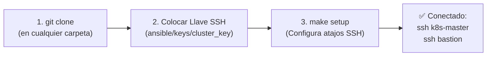

# 🔌 Guía Rápida: Clonar y Conectarse al Servidor en 3 Minutos

Esta guía está diseñada para que **cualquier usuario o laptop nueva** clone el proyecto y se conecte inmediatamente a los servidores físicos, a Kubernetes y a los dashboards de monitoreo sin configuraciones complejas.

---

## ⚡ En 3 Pasos Rápidos



---

## Paso 1: Clonar el Repositorio

Abre una terminal en tu laptop (Linux, macOS o WSL2 en Windows) y clona el proyecto en la carpeta que prefieras:

```bash
git clone <URL_DEL_REPOSITORIO>
cd infra-scripts
```

> [!NOTE]
> No importa cómo se llame tu carpeta o en qué ruta esté (`~/Documents/...`, `~/k8s/k8s/`, etc.), los scripts detectan automáticamente la ubicación raíz.

---

## Paso 2: La Llave de Acceso al Clúster

Para entrar a los servidores necesitas la llave privada del clúster (`cluster_key`).

### Opción A (Recomendada): Copiar la llave del clúster
Copia el archivo `cluster_key` que te entregó el administrador en la carpeta de llaves del proyecto y dale permisos seguros:

```bash
# Copia la llave en ansible/keys/
cp /ruta/donde/tengas/cluster_key ansible/keys/cluster_key

# ⚠️ Obligatorio en Linux/Mac: Permisos estrictos de lectura
chmod 600 ansible/keys/cluster_key
```

### Opción B: Si quieres usar tu propia llave SSH personal (`~/.ssh/id_ed25519.pub`)
Pídele al administrador o a alguien ya conectado que autorice tu llave ejecutando desde su máquina:
```bash
ssh n306@192.168.29.25 "echo 'TU_LLAVE_PUBLICA_AQUI' | sudo tee -a /home/n306/.ssh/authorized_keys"
```

---

## Paso 3: Configurar tus Atajos SSH (1 Solo Comando)

Ejecuta el configurador automático desde la raíz del repositorio:

```bash
make setup
```
*(O si no tienes `make` instalado: `./scripts/client/setup-client-workstation.sh`)*

Este comando configura automáticamente tu archivo `~/.ssh/config` para que puedas conectarte a cualquier servidor por su nombre directo, manejando el salto de red (`ProxyJump`) de forma invisible.

---

## 🚀 ¡Listo! Cómo Conectarte a Cada Servidor

### 1. Conectarte al Nodo Controlador / Kubernetes Master (Nodo 306)
Es el servidor principal donde corre el API Server de Kubernetes, OpenStack Kolla, Prometheus y Grafana:

```bash
# Con el atajo configurado:
ssh k8s-master

# O con el comando directo tradicional:
ssh -i ansible/keys/cluster_key n306@192.168.29.25
```

---

### 2. Conectarte al Bastión Perimetral (Nodo 314)
El servidor de seguridad perimetral, firewall nftables y proxy Squid:

```bash
# Con el atajo configurado:
ssh bastion

# O directo:
ssh -i ansible/keys/cluster_key -o ProxyJump=n306@192.168.29.25 aget-ic@10.100.29.10
```

---

### 3. Conectarte al Servidor de Repositorios Nexus 3 (Nodo 315)
El servidor donde corren PostgreSQL 16 y el registro de imágenes Docker:

```bash
# Con el atajo configurado:
ssh nexus

# O directo:
ssh -i ansible/keys/cluster_key -o ProxyJump=n306@192.168.29.25 io@10.100.29.20
```

---

### 4. Conectarte a Cualquier Nodo Trabajador de Kubernetes

| Servidor Físico | Atajo Rápido | Comando SSH Directo |
| :--- | :--- | :--- |
| **Worker 01** (`10.100.29.102`) | `ssh worker-01` | `ssh -i ansible/keys/cluster_key -o ProxyJump=n306@192.168.29.25 debian@10.100.29.102` |
| **Worker 02** (`10.100.29.103`) | `ssh worker-02` | `ssh -i ansible/keys/cluster_key -o ProxyJump=n306@192.168.29.25 debian@10.100.29.103` |
| **Worker 03** (`10.100.29.111`) | `ssh worker-03` | `ssh -i ansible/keys/cluster_key -o ProxyJump=n306@192.168.29.25 debian@10.100.29.111` |
| **Worker 04** (`10.100.29.112`) | `ssh worker-04` | `ssh -i ansible/keys/cluster_key -o ProxyJump=n306@192.168.29.25 debian@10.100.29.112` |
| **Worker 05** (`10.100.29.101`) | `ssh worker-05` | `ssh -i ansible/keys/cluster_key -o ProxyJump=n306@192.168.29.25 debian@10.100.29.101` |

---

## ☸️ Cómo Ver y Usar Kubernetes Inmediatamente

Para ver el estado del clúster y los contenedores directamente:

```bash
# 1. Entrar al nodo maestro:
ssh k8s-master

# 2. Ver todos los nodos físicos (7 nodos en Ready):
sudo /var/lib/rancher/rke2/bin/kubectl --kubeconfig /etc/rancher/rke2/rke2.yaml get nodes -o wide

# 3. Ver todos los contenedores y pods en ejecución:
sudo /var/lib/rancher/rke2/bin/kubectl --kubeconfig /etc/rancher/rke2/rke2.yaml get pods -A -o wide
```

> [!TIP]
> **Crear un alias para no escribir todo el comando:**
> Dentro del nodo maestro ejecuta:
> ```bash
> echo "alias k='sudo /var/lib/rancher/rke2/bin/kubectl --kubeconfig /etc/rancher/rke2/rke2.yaml'" >> ~/.bashrc
> source ~/.bashrc
> ```
> ¡A partir de ahí solo escribes `k get nodes` o `k get pods -A`!

---

## 📊 Cómo Abrir Grafana y los Dashboards Web desde tu Laptop

Para ver los paneles de monitoreo en el navegador de tu laptop (Chrome, Firefox, etc.):

```bash
# Ejecutar en tu laptop:
make tunnels
# O: ./scripts/client/tunnels.sh
```

Abre en tu navegador:
* **Grafana (Monitoreo de Nodos y Contenedores):** [http://localhost:3000](http://localhost:3000) *(Usuario: `admin`, Contraseña: `admin`)*
* **Prometheus (Métricas en vivo):** [http://localhost:9090](http://localhost:9090)
* **OpenStack Horizon (Panel Bare-Metal):** [http://localhost:8080](http://localhost:8080) *(Usuario: `admin`, Contraseña: `Admin2025!`)*
* **Sonatype Nexus (Repositorios):** [http://localhost:8081](http://localhost:8081)

---

## ❓ Preguntas Frecuentes y Problemas de Conexión

### 1. `Permission denied (publickey)`
* **Causa:** No le diste permisos `600` a la llave o el archivo `cluster_key` está en otra ruta.
* **Solución:**
  ```bash
  chmod 600 ansible/keys/cluster_key
  ls -la ansible/keys/cluster_key
  ```

### 2. `Could not resolve hostname`
* **Causa:** No ejecutaste `make setup` en tu máquina.
* **Solución:** Ejecuta `./scripts/client/setup-client-workstation.sh` o usa la IP directa: `ssh -i ansible/keys/cluster_key n306@192.168.29.25`.

### 3. `No route to host` o ping no responde
* **Causa:** Tu laptop no está conectada a la red WiFi del laboratorio (`192.168.29.x` o red del switch).
* **Solución:** Conéctate a la red WiFi o por cable Ethernet al switch de los OptiPlex.
