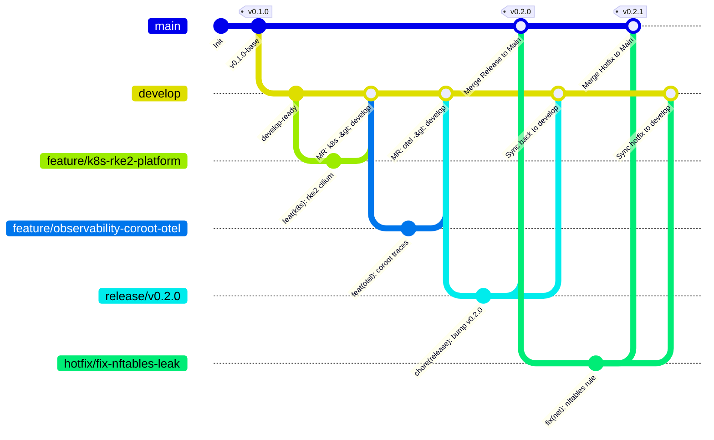

# Plan de Implementación GitFlow — Proyecto Infraestructura K8s & Bare-Metal

Este documento describe la arquitectura de ramas bajo el modelo **GitFlow**, las políticas de fusión en GitLab, las convenciones de trabajo y la guía rápida de comandos para el equipo de DevOps y SRE.

---

## 1. Diagrama de Ramas (GitFlow)



---

## 2. Mapa y Matriz de Ramas

| Rama | Propósito | Rama Origen | Destino de Fusión | Política de Protección |
| :--- | :--- | :--- | :--- | :--- |
| **`main`** | Código estable en **producción**. Cada commit representa una versión funcional desplegada en los servidores bare-metal. | Inicial / Historial base | Ninguna (es la cúspide) | **Protegida:** Nadie empuja directo. Solo Merge Requests aprobados. |
| **`develop`** | Rama de **integración continua**. Reúne las funcionalidades terminadas antes de pasar a un release. | `main` | `release/*` o `main` (vía release) | **Protegida:** Rama por defecto para desarrollo. Requiere MR. |
| **`feature/*`** | Desarrollo de nuevas capacidades, playbooks o módulos aislados. | `develop` | `develop` | Ramas temporales de trabajo (se eliminan tras el merge). |
| **`release/*`** | Congelamiento de código, auditoría final, pruebas de integración y versionado (`v0.1.0`, `v0.2.0`). | `develop` | `main` y retorno a `develop` | Se crean al cerrar un ciclo de sprint o versión. |
| **`hotfix/*`** | Corrección crítica urgente que afecta directamente a los servidores en producción (`main`). | `main` | `main` y retorno a `develop` | Temporales y prioritarias ante incidentes P1/P0. |
| **`backup/main-pre-gitflow`** | Respaldo inmutable del historial original de `main` previo a la reorganización. | `main` | Ninguna (archivo histórico) | Solo lectura. |

---

## 3. Ramas Creadas en el Repositorio

Actualmente se encuentran sincronizadas y rastreadas en GitLab (`origin`):

* `main` (Producción)
* `develop` (Integración)
* `backup/main-pre-gitflow` (Respaldo)
* `release/v0.1.0` (Versión inicial base etiquetada con tag `v0.1.0`)
* **Ramas Feature por Módulo:**
  1. `feature/core-network-bastion`: Red bare-metal VLAN 29, DNSmasq, Squid proxy y firewall nftables.
  2. `feature/services-nexus-postgres`: Repositorio Nexus 3 OSS, PostgreSQL 16 y servidor PXE/TFTP.
  3. `feature/openstack-ironic-packer`: Kolla-Ansible, OpenStack Ironic Standalone y templates Packer Debian 13.
  4. `feature/k8s-rke2-platform`: Clúster RKE2 en HA, Cilium CNI (eBPF), Ingress-NGINX y Traefik.
  5. `feature/observability-coroot-otel`: Prometheus, VictoriaMetrics, Grafana, Loki, Tempo, Coroot y OTel Operator.
  6. `feature/operations-automation`: Makefile (`make setup`, `make tunnels`), scripts de DR y Cloudflare Tunnels.

---

## 4. Convención de Nombres y Commits (Conventional Commits)

### Formato de Ramas:
* `feature/<modulo>-<descripcion-corta>` (ejemplo: `feature/k8s-cilium-ebpf`)
* `bugfix/<modulo>-<descripcion-corta>` (ejemplo: `bugfix/ansible-port-conflict`)
* `release/v<MAJOR>.<MINOR>.<PATCH>` (ejemplo: `release/v0.2.0`)
* `hotfix/<incidente>-<descripcion>` (ejemplo: `hotfix/down-nexus-database`)

### Formato de Mensajes de Commit:
```text
<tipo>(<alcance>): <descripcion concisa en imperativo>

[cuerpo opcional explicando el porqué del cambio]

[pie opcional: referencias a tickets o issues (#12)]
```

* **`feat`**: Nueva funcionalidad (ej: `feat(observability): agregar dashboard grafana para cilium`).
* **`fix`**: Corrección de un fallo operativo o bug (ej: `fix(bastion): corregir regla nftables para squid`).
* **`docs`**: Modificaciones solo de documentación (ej: `docs: actualizar guia rapida de conexion ssh`).
* **`refactor`**: Refactorización de código o playbooks que no alteran la funcionalidad.
* **`chore`**: Tareas rutinarias, linters o dependencias del Makefile.

---

## 5. Guía Rápida de Comandos para el Día a Día

### A. Crear una nueva funcionalidad (Feature)
```bash
# 1. Asegurar tener develop al día
git checkout develop
git pull origin develop

# 2. Crear rama feature
git checkout -b feature/mi-nueva-tarea develop

# 3. Trabajar y commitear
git add .
git commit -m "feat(modulo): descripcion del cambio"

# 4. Subir a GitLab y abrir Merge Request hacia develop
git push -u origin feature/mi-nueva-tarea
```

### B. Preparar y Cerrar un Release (`release/*`)
```bash
# 1. Crear rama release desde develop
git checkout develop
git pull origin develop
git checkout -b release/v0.2.0 develop

# 2. Hacer ajustes finales (versión en docs, changelog, tests)
git commit -m "chore(release): bump version v0.2.0"
git push -u origin release/v0.2.0

# 3. Fusionar en main (en GitLab vía MR o por terminal):
git checkout main
git pull origin main
git merge --no-ff release/v0.2.0 -m "Merge branch 'release/v0.2.0' into main"
git tag -a v0.2.0 -m "release: version v0.2.0 en produccion"
git push origin main --tags

# 4. Traer los cambios de vuelta a develop:
git checkout develop
git merge --no-ff release/v0.2.0 -m "Merge branch 'release/v0.2.0' into develop"
git push origin develop

# 5. Eliminar la rama release ya fusionada
git branch -d release/v0.2.0
git push origin --delete release/v0.2.0
```

### C. Resolver una urgencia en Producción (`hotfix/*`)
```bash
# 1. Nace directamente de main
git checkout main
git pull origin main
git checkout -b hotfix/reparar-dns-urgente main

# 2. Aplicar el fix
git commit -m "fix(network): corregir forwarding dnsmasq en nodo-306"

# 3. Fusionar a main y etiquetar
git checkout main
git merge --no-ff hotfix/reparar-dns-urgente -m "Merge hotfix into main"
git tag -a v0.1.1 -m "hotfix: resolucion de caida de dns"
git push origin main --tags

# 4. Sincronizar hacia develop inmediatamente
git checkout develop
git merge --no-ff hotfix/reparar-dns-urgente -m "Merge hotfix into develop"
git push origin develop

# 5. Limpiar rama hotfix
git branch -d hotfix/reparar-dns-urgente
git push origin --delete hotfix/reparar-dns-urgente
```

---

## 6. Configuración Recomendada en la Interfaz de GitLab

Ingresa al repositorio en GitLab (`https://gitlab.agetic.gob.bo/.../k8s`):

1. **Establecer `develop` como Rama por Defecto (Default branch):**
   * Ve a **Settings** $\rightarrow$ **Repository** $\rightarrow$ **Default branch**.
   * Cambia `main` por `develop` y haz clic en **Save changes**.  
     *(Así cualquier clonado nuevo o MR se dirigirá a `develop` por defecto).*

2. **Proteger Ramas Críticas (`main` y `develop`):**
   * Ve a **Settings** $\rightarrow$ **Repository** $\rightarrow$ **Protected branches**.
   * Para **`main`**:
     * *Allowed to merge:* Maintainers / Admins.
     * *Allowed to push and merge:* **No one** (fuerza a usar Merge Requests).
   * Para **`develop`**:
     * *Allowed to merge:* Developers + Maintainers.
     * *Allowed to push and merge:* **No one**.

3. **Reglas de Merge Request:**
   * Ve a **Settings** $\rightarrow$ **Merge requests**:
     * Marcar: **"Pipelines must succeed"** (el pipeline de `.gitlab-ci.yml` debe pasar en verde).
     * Marcar: **"All threads must be resolved"** (resolver todos los comentarios de code review).
     * Activar: **"Delete source branch"** por defecto tras aprobar el MR.

---

## 7. Checklist de Cumplimiento

- [x] **Paso 1: Diagnóstico:** `git status`, auditoría de secretos y `.gitignore` comprobados.
- [x] **Paso 2: Respaldo:** Rama `backup/main-pre-gitflow` creada y subida a GitLab.
- [x] **Paso 2: Estructura GitFlow:** Ramas `develop`, 6 `feature/*` y `release/v0.1.0` creadas.
- [x] **Paso 3: Tag Semántico:** Tag `v0.1.0` creado en `main` y subido a GitLab.
- [x] **Paso 4: CI/CD:** Pipeline existente en `.gitlab-ci.yml` con linting (YAML, Shell, Ansible) y validaciones sintácticas.
- [x] **Paso 5: Subida al Remoto:** Todas las ramas sincronizadas y validadas con `git branch -r`.
- [x] **Paso 6: Entregable:** Guía operativa [GITFLOW_PLAN.md](file:///home/rodrigo/Documents/gitlabinf/GuiaImplementacion/infra-scripts/GITFLOW_PLAN.md) creada en la raíz.
