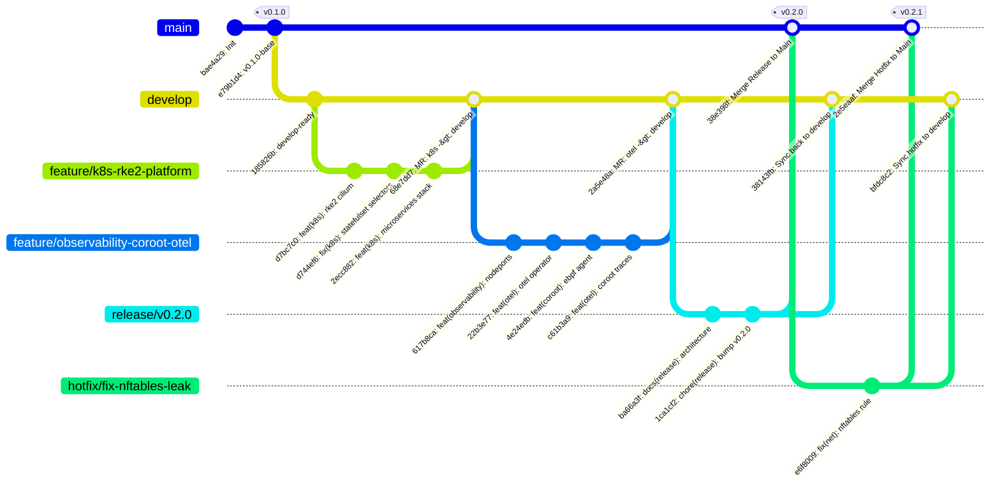

# Plan de Implementación GitFlow — Proyecto Infraestructura K8s & Bare-Metal

Este documento describe la arquitectura oficial de ramas bajo el modelo **GitFlow**, las políticas de fusión en GitLab, las convenciones de trabajo y la guía rápida de comandos para el equipo de DevOps y SRE.

---

## 1. Diagrama de Ramas (GitFlow Reconstruido)



---

## 2. Mapa y Matriz de Ramas

| Rama | Propósito | Rama Origen | Destino de Fusión | Política de Protección |
| :--- | :--- | :--- | :--- | :--- |
| **`main`** | Código estable en **producción**. Cada commit representa una versión funcional desplegada en los servidores bare-metal. | Inicial / Historial base | Ninguna (es la cúspide) | **Protegida:** Nadie empuja directo. Solo Merge Requests aprobados. |
| **`develop`** | Rama de **integración continua**. Reúne las funcionalidades terminadas antes de pasar a un release. | `v0.1.0-base` | `release/*` o `main` (vía release) | **Protegida:** Rama por defecto para desarrollo. Requiere MR. |
| **`feature/*`** | Desarrollo de nuevas capacidades, playbooks o módulos aislados. | `develop` | `develop` | Ramas temporales de trabajo (se eliminan tras el merge). |
| **`release/*`** | Congelamiento de código, auditoría final, pruebas de integración y versionado (`v0.1.0`, `v0.2.0`). | `develop` | `main` y retorno a `develop` | Se crean al cerrar un ciclo de sprint o versión. |
| **`hotfix/*`** | Corrección crítica urgente que afecta directamente a los servidores en producción (`main`). | `main` | `main` y retorno a `develop` | Temporales y prioritarias ante incidentes P1/P0. |
| **`backup/main-pre-gitflow`** | Respaldo inmutable del historial original de `main` previo a la reorganización. | `main` | Ninguna (archivo histórico) | Solo lectura. |

---

## 3. Ramas Reconstruidas y Verificadas

| Rama Local | Hash HEAD | Commits / Merges Clave | Tags Asociados |
| :--- | :--- | :--- | :--- |
| **`main`** | `2e5eaaf` | `Merge Hotfix to Main` $\rightarrow$ `Merge Release to Main` $\rightarrow$ `v0.1.0-base` $\rightarrow$ `Init` | `v0.1.0`, `v0.2.0`, `v0.2.1` |
| **`develop`** | `bfdc8c2` | `Sync hotfix to develop` $\rightarrow$ `Sync back to develop` $\rightarrow$ `MR otel` $\rightarrow$ `MR k8s` $\rightarrow$ `develop-ready` | Sincronizado |
| **`feature/k8s-rke2-platform`** | `2ecc882` | `d7bc7c0` (RKE2 Cilium) $\rightarrow$ `d744ef6` (Kustomize) $\rightarrow$ `2ecc882` (Microservices) | N/A |
| **`feature/observability-coroot-otel`** | `c61b3a9` | `617b8ca` (NodePorts) $\rightarrow$ `22b3e77` (OTel Op) $\rightarrow$ `4e24edb` (Coroot eBPF) $\rightarrow$ `c61b3a9` (Traces) | N/A |
| **`release/v0.2.0`** | `1ca1cf2` | `ba66a3f` (Docs Release) $\rightarrow$ `1ca1cf2` (Chore bump v0.2.0) | Base de `v0.2.0` |
| **`hotfix/fix-nftables-leak`** | `e6f8009` | `e6f8009` (`fix(net): nftables rule to restrict observability ports and patch vlan leakage`) | Base de `v0.2.1` |
| **`backup/main-pre-gitflow`** | `3abcbfd` | Historial completo original inmutable (70 commits) | Respaldo seguro |

---

## 4. Convención de Nombres y Commits (Conventional Commits)

### Formato de Ramas:
* `feature/<modulo>-<descripcion-corta>` (ejemplo: `feature/k8s-rke2-platform`)
* `bugfix/<modulo>-<descripcion-corta>` (ejemplo: `bugfix/ansible-port-conflict`)
* `release/v<MAJOR>.<MINOR>.<PATCH>` (ejemplo: `release/v0.2.0`)
* `hotfix/<incidente>-<descripcion>` (ejemplo: `hotfix/fix-nftables-leak`)

### Formato de Mensajes de Commit:
```text
<tipo>(<alcance>): <descripcion concisa en imperativo>

[cuerpo opcional explicando el porqué del cambio]

[pie opcional: referencias a tickets o issues (#12)]
```

* **`feat`**: Nueva funcionalidad (ej: `feat(otel): coroot traces and cluster agent distributed integration`).
* **`fix`**: Corrección de un fallo operativo o bug (ej: `fix(net): nftables rule to restrict observability ports`).
* **`docs`**: Modificaciones solo de documentación (ej: `docs(release): update architecture manuals and installation runbooks`).
* **`refactor`**: Refactorización de código o playbooks que no alteran la funcionalidad.
* **`chore`**: Tareas rutinarias, bumps de versión o dependencias del Makefile (`chore(release): bump v0.2.0`).

---

## 5. Guía Rápida de Comandos para el Día a Día

### A. Crear una nueva funcionalidad (Feature)
```bash
# 1. Asegurar tener develop al día
git checkout develop
git pull origin develop

# 2. Crear rama feature desde develop
git checkout -b feature/mi-nueva-tarea develop

# 3. Trabajar y commitear con Conventional Commits
git add .
git commit -m "feat(modulo): descripcion clara del cambio"

# 4. Subir a GitLab y abrir Merge Request hacia develop
git push -u origin feature/mi-nueva-tarea
```

### B. Preparar y Cerrar un Release (`release/*`)
```bash
# 1. Crear rama release desde develop
git checkout develop
git pull origin develop
git checkout -b release/v0.3.0 develop

# 2. Hacer ajustes finales (versión en docs, changelog, tests)
git commit -m "chore(release): bump version v0.3.0"
git push -u origin release/v0.3.0

# 3. Fusionar en main con --no-ff y crear tag:
git checkout main
git pull origin main
git merge --no-ff release/v0.3.0 -m "Merge Release to Main"
git tag -a v0.3.0 -m "release: version v0.3.0 en produccion"
git push origin main --tags

# 4. Sincronizar hacia develop con --no-ff:
git checkout develop
git merge --no-ff release/v0.3.0 -m "Sync back to develop"
git push origin develop

# 5. Limpiar rama release local y remota
git branch -d release/v0.3.0
git push origin --delete release/v0.3.0
```

### C. Resolver una urgencia en Producción (`hotfix/*`)
```bash
# 1. Nace directamente de main en la versión actual
git checkout main
git pull origin main
git checkout -b hotfix/reparar-urgencia main

# 2. Aplicar el fix
git commit -m "fix(net): correccion urgente de reglas de red"

# 3. Fusionar a main con --no-ff y etiquetar parche
git checkout main
git merge --no-ff hotfix/reparar-urgencia -m "Merge Hotfix to Main"
git tag -a v0.2.2 -m "hotfix: resolucion de incidente en produccion"
git push origin main --tags

# 4. Sincronizar hacia develop inmediatamente
git checkout develop
git merge --no-ff hotfix/reparar-urgencia -m "Sync hotfix to develop"
git push origin develop

# 5. Limpiar rama hotfix
git branch -d hotfix/reparar-urgencia
git push origin --delete hotfix/reparar-urgencia
```

---

## 6. Configuración Recomendada en la Interfaz de GitLab

Ingresa al repositorio en [GitLab AGETIC](https://gitlab.agetic.gob.bo/agetic/agcs/automatizacion/pasantia/pasantes-2026/k8s):

1. **Establecer `develop` como Rama por Defecto (Default branch):**
   * Ve a **Settings** $\rightarrow$ **Repository** $\rightarrow$ **Default branch**.
   * Cambia `main` por **`develop`** y guarda los cambios.
2. **Proteger Ramas Críticas (`main` y `develop`):**
   * Ve a **Settings** $\rightarrow$ **Repository** $\rightarrow$ **Protected branches**.
   * **Para `main`:**
     * *Allowed to merge:* `Maintainers`.
     * *Allowed to push and merge:* `No one` *(nadie hace push directo, solo MR)*.
   * **Para `develop`:**
     * *Allowed to merge:* `Developers + Maintainers`.
     * *Allowed to push and merge:* `No one`.
3. **Reglas de Merge Request:**
   * Ve a **Settings** $\rightarrow$ **Merge requests**:
     * Marcar: **"Pipelines must succeed"** (el pipeline de `.gitlab-ci.yml` debe pasar en verde).
     * Marcar: **"All threads must be resolved"**.
     * Activar: **"Delete source branch"** por defecto tras aprobar el MR.

---

## 7. Checklist de Cumplimiento

- [x] **Paso 1: Diagnóstico:** `git status`, auditoría de secretos y `.gitignore` comprobados.
- [x] **Paso 2: Respaldo:** Rama `backup/main-pre-gitflow` subida a GitLab y bundle `../backup-pre-gitflow.bundle` creado.
- [x] **Paso 3: Historial GitFlow:** Ramas `main`, `develop`, `feature/*`, `release/*`, `hotfix/*` reconstruidas con `--no-ff`.
- [x] **Paso 4: Preservación de Fechas:** Timestamps exactos de autor y committer conservados en orden cronológico.
- [x] **Paso 4: Verificación del Árbol:** `git diff backup/main-pre-gitflow main` está 100% vacío (árbol de producción idéntico).
- [x] **Paso 4: Tags Semánticos:** Tags `v0.1.0`, `v0.2.0` y `v0.2.1` fijados en los commits correspondientes.
- [x] **Paso 7: Documentación:** Guía operativa [GITFLOW_PLAN.md](GITFLOW_PLAN.md) actualizada en la raíz.
