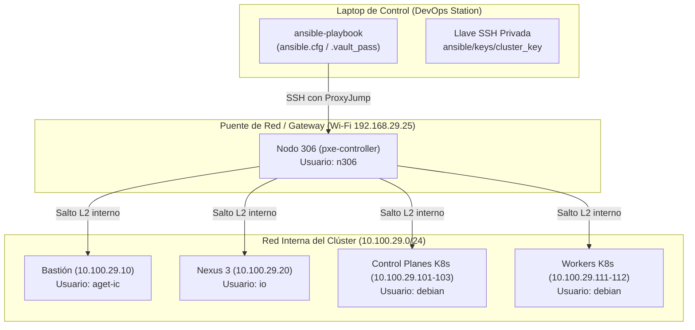

# 📘 Guía Oficial de Ansible en el Proyecto: Arquitectura, Roles y Automatización Bare-Metal

Esta guía explica de forma sencilla, directa y sin rodeos cómo está diseñado, organizado y ejecutado **Ansible** para automatizar los 8 servidores físicos del clúster.

---

## 1. ¿Qué es Ansible?

### ¿Para qué sirve?
Imagina que necesitas cambiar la configuración de red, instalar paquetes y crear usuarios en 8 servidores físicos distintos. Hacerlo a mano por SSH en cada uno tomaría horas y provocaría errores. 

**Ansible** es una herramienta de automatización que te permite escribir lo que quieres que tenga cada máquina en archivos de texto sencillos (**YAML**) y se encarga de aplicar esos cambios en todos los servidores a la vez. No necesita instalar programas pesados en los servidores administrados; se comunica usando únicamente **SSH** y el intérprete estándar de **Python**.

### Conceptos clave explicados fácil
* **Nodo de control:** La computadora desde donde lanzas los comandos (en este proyecto, **tu Laptop**).
* **Nodos administrados:** Los servidores físicos que reciben las órdenes (los **8 miniPCs Dell OptiPlex 3020M**).
* **Inventario:** La lista de direcciones IP, nombres y puertos de las máquinas que vas a controlar.
* **Playbook:** El libro de recetas. Un archivo `.yml` que describe paso a paso qué debe instalarse y configurarse.
* **Tarea (Task):** Una orden individual dentro del playbook (ejemplo: "copiar este archivo" o "iniciar este servicio").
* **Rol (Role):** Una carpeta que agrupa tareas, plantillas y configuraciones de un solo servicio para que el código sea limpio y reutilizable (ejemplo: rol `nexus`, rol `bastion`).

### ¿Qué hace Ansible dentro de este proyecto?
Ansible es el **motor principal de automatización** del proyecto (reemplazó antiguos scripts de bash monolíticos). Se encarga de:
1. Auditar conectividad y hardware en la flota física.
2. Configurar el sistema operativo base Debian 13 en los 8 nodos.
3. Endurecer el Bastión perimetral con firewall nftables, proxy Squid y servidor Chrony NTP.
4. Desplegar PostgreSQL 16 y el gestor de paquetes Sonatype Nexus 3 OSS.
5. Configurar el servidor PXE con dnsmasq y arranque iPXE.
6. Instalar y unir los 5 nodos del clúster Kubernetes HA con **RKE2 y Cilium eBPF**.
7. Desplegar los agentes de observabilidad (**Node Exporter** y **Coroot eBPF**).
8. Ejecutar pruebas de salud (*healthchecks*) y copias de seguridad de contingencia.

---

## 2. Arquitectura de Ansible en el Proyecto

### Desde qué equipo se ejecuta
Ansible se ejecuta **únicamente desde tu Laptop de control (DevOps Workstation)** conectada a la red Wi-Fi del laboratorio (`192.168.29.x`).

### Qué servidores y grupos administra
Controla **8 computadoras físicas Dell OptiPlex 3020M** agrupadas de la siguiente manera:
* `bastion` (`nodo-314` | `10.100.29.10`): Proxy perimetral y firewall.
* `nexus` (`nodo-315` | `10.100.29.20`): Repositorio local de paquetes y registro Docker.
* `pxe_controller` (`nodo-306` | `10.100.29.30` / Wi-Fi `192.168.29.25`): Servidor PXE, OpenStack y monitoreo.
* `k8s_control_plane` (`nodo-269`, `nodo-280`, `nodo-320`): 3 servidores maestros de Kubernetes con etcd.
* `k8s_workers` (`nodo-321`, `nodo-279`): 2 servidores trabajadores de Kubernetes.

### Cómo se conecta (El Salto por Bastión / ProxyJump)
La red de los servidores (`10.100.29.0/24`) es una red interna privada que no tiene conexión directa con la Wi-Fi de tu laptop. 

Para resolver esto sin complicaciones, Ansible utiliza **ProxyJump**:
1. La laptop se conecta por SSH al **Nodo 306** a través de su IP Wi-Fi (`192.168.29.25`).
2. Desde allí, el túnel SSH salta internamente a la dirección `10.100.29.x` de cualquier nodo.
3. Esta regla está automatizada en [ansible.cfg:21]`(file:///home/rodrigo/Documents/gitlabinf/GuiaImplementacion/infra-scripts/ansible.cfg#L21)` e [inventory/lab/group_vars/all/vars.yml:14-18](file:///home/rodrigo/Documents/gitlabinf/GuiaImplementacion/infra-scripts/inventory/lab/group_vars/all/vars.yml#L14-L18):
   ```text
   -o ProxyJump=n306@192.168.29.25 -o StrictHostKeyChecking=no
   ```
4. Cada nodo se accede con su usuario administrativo correspondiente (`aget-ic` en bastión, `io` en nexus, `n306` en controlador y `debian` en los nodos de Kubernetes) y todos tienen privilegios `sudo NOPASSWD` habilitados.

### Relación con OpenStack y otras herramientas
* **Kolla-Ansible:** OpenStack se despliega con su propia instancia contenerizada de Ansible dentro del Nodo 306.
* **Ansible de este repositorio:** Es el orquestador "paraguas". No compite con Kolla; lo verifica, levanta sus contenedores y orquesta todo lo demás (redes, Kubernetes, Nexus y respaldos).

### Diagrama de Conectividad de Ansible



---

## 3. Estructura de Archivos de Ansible en el Repositorio

| Archivo o Carpeta | Para qué sirve | Información importante respaldada en el código |
| :--- | :--- | :--- |
| **`ansible.cfg`** | Configuración maestra del motor de Ansible | Define inventario por defecto, 8 forks paralelos, SSH pipelining y ruta de la clave de vault ([ansible.cfg:1-21](file:///home/rodrigo/Documents/gitlabinf/GuiaImplementacion/infra-scripts/ansible.cfg#L1-L21)). |
| **`inventario.ini`** | Inventario plano en formato INI | Ideal para comandos rápidos ad-hoc (`ansible -i inventario.ini baremetal -m ping`) ([inventario.ini:1-42](file:///home/rodrigo/Documents/gitlabinf/GuiaImplementacion/infra-scripts/inventario.ini#L1-L42)). |
| **`inventory/lab/hosts.yml`** | Inventario oficial estructurado en YAML | Define variables por nodo (MAC, RAM, disco, IP, rol y líder de K8s) ([inventory/lab/hosts.yml:1-107](file:///home/rodrigo/Documents/gitlabinf/GuiaImplementacion/infra-scripts/inventory/lab/hosts.yml#L1-L107)). |
| **`inventory/prod/hosts.yml`** | Plantilla de inventario para Producción | **Documentado:** Contiene esquema para IPs `10.200.29.x` con valores de ejemplo ([inventory/prod/hosts.yml:1-75](file:///home/rodrigo/Documents/gitlabinf/GuiaImplementacion/infra-scripts/inventory/prod/hosts.yml#L1-L75)). |
| **`inventory/lab/group_vars/all/vars.yml`** | Variables globales de red y servicios | Define subred `10.100.29.0/24`, gateway, versiones de software y puertos ([vars.yml:1-100](file:///home/rodrigo/Documents/gitlabinf/GuiaImplementacion/infra-scripts/inventory/lab/group_vars/all/vars.yml#L1-L100)). |
| **`inventory/lab/group_vars/all/vault.yml.example`** | Plantilla de secretos cifrados | Muestra variables sensibles: tokens de RKE2, passwords de Nexus y Postgres ([vault.yml.example:1-24](file:///home/rodrigo/Documents/gitlabinf/GuiaImplementacion/infra-scripts/inventory/lab/group_vars/all/vault.yml.example#L1-L24)). |
| **`inventory/lab/group_vars/observability.yml`** | Mapeo estricto de puertos de monitoreo | Evita colisiones de puertos entre OpenStack, Kubernetes y telemetría ([observability.yml:1-105](file:///home/rodrigo/Documents/gitlabinf/GuiaImplementacion/infra-scripts/inventory/lab/group_vars/observability.yml#L1-L105)). |
| **`ansible/site.yml`** | Playbook orquestador maestro | Importa los playbooks de todas las fases (00 a 90) organizados por etiquetas (*tags*) ([ansible/site.yml:1-88](file:///home/rodrigo/Documents/gitlabinf/GuiaImplementacion/infra-scripts/ansible/site.yml#L1-L88)). |
| **`ansible/playbooks/`** | Playbooks organizados por etapas | Subcarpetas numeradas: `00-preflight`, `10-base`, `20-services`, `30-platform`, `40-observability`, `50-validation`, `90-operations`. |
| **`ansible/roles/`** | Roles modulares reutilizables | 8 roles específicos: `common`, `bastion`, `nexus`, `pxe_controller`, `ironic`, `rke2_ha`, `monitoring`, `coroot_node_agent`. |
| **`ansible/keys/cluster_key`** | Llave privada SSH ed25519 | Llave protegida con permisos `0600` para autenticarse en todos los servidores físicos. |
| **`.vault_pass`** | Archivo local con la clave de Vault | Permite a Ansible descifrar contraseñas sin pedirlas interactivamente. |

---

## 4. Inventario y Variables

### Grupos de Servidores
El inventario organiza los equipos jerárquicamente para aplicar configuraciones a grupos enteros:
* `[baremetal]`: Abarca los **8 nodos físicos**. Se usa para tareas globales como configurar Debian base o instalar Node Exporter.
* `[infra_core]`: Agrupa `bastion`, `nexus` y `pxe_controller` (los 3 nodos que dan servicio a los demás).
* `[k8s_cluster]`: Agrupa `k8s_control_plane` (3 nodos) y `k8s_workers` (2 nodos).
* `[bastion]`, `[nexus]`, `[pxe_controller]`: Grupos individuales para configuraciones específicas.

### Variables clave y dónde se definen
1. **A nivel de nodo (`inventory/lab/hosts.yml`):**
   * `ansible_host`: Dirección IP fija en la red `10.100.29.x`.
   * `ansible_user`: Usuario SSH autorizado con sudo (`aget-ic`, `io`, `n306`, `debian`).
   * `mac`: Dirección MAC física para arranque por red ePXE/Wake-on-LAN.
   * `k8s_leader`: `true` solo en `nodo-269` para inicializar el clúster RKE2; `false` en los demás.
2. **A nivel global (`inventory/lab/group_vars/all/vars.yml`):**
   * `cluster_gateway`: `10.100.29.30` (el Nodo 306 actúa como salida a internet vía NAT).
   * `rke2_version`: Versión de Kubernetes a instalar.
   * `squid_port`: `3128`, `nexus_port`: `8081`, `postgres_port`: `5432`.

### Cómo se seleccionan los nodos en la ejecución
Puedes limitar la ejecución a cualquier subconjunto usando la bandera `--limit`:
```bash
# Ejecutar solo en bastión y nexus
ansible-playbook -i inventory/lab/hosts.yml ansible/site.yml --limit "bastion,nexus"

# Ejecutar en toda la flota excepto bastión y nexus
ansible-playbook -i inventory/lab/hosts.yml ansible/site.yml --limit "baremetal:!bastion:!nexus"
```

### Manejo de secretos con Ansible Vault
Los datos críticos (contraseñas de base de datos, tokens de cluster) no se guardan en texto plano en Git.
1. El archivo `.vault_pass` (protegido con `chmod 600`) contiene la contraseña de cifrado.
2. Los secretos se guardan en `inventory/lab/group_vars/all/vault.yml` cifrados con AES256.
3. En los playbooks se invocan como variables normales (ej. `{{ vault_postgres_password }}`).

### Diferencias entre entornos (Lab vs Prod)
* **`inventory/lab/hosts.yml` (Implementado):** Configurado para hardware real OptiPlex en IPs `10.100.29.x`.
* **`inventory/prod/hosts.yml` (Documentado / Plantilla):** Preparado para servidores de mayor capacidad (32-64 GB RAM) en la subred `10.200.29.x`.

---

## 5. Playbooks y Roles del Proyecto

### Tabla de Playbooks y Roles Principales

| Playbook y Ruta | Rol Invocado | Qué Configura | Sobre qué Nodos Actúa | Dependencias Previas |
| :--- | :--- | :--- | :--- | :--- |
| `ansible/playbooks/00-preflight/00_ping.yml` | *(Módulo ping)* | Valida comunicación SSH y Python | `baremetal` (8 nodos) | Llave SSH y red activa |
| `ansible/playbooks/10-base/01_os_base.yml` | `common` | Hostname, `/etc/hosts`, red fija, swap off | `baremetal` (8 nodos) | Ping exitoso |
| `ansible/playbooks/10-base/02_bastion_hardening.yml` | `bastion` | Drop-in SSH, nftables NAT, Squid, Chrony | `bastion` (`nodo-314`) | Rol `common` aplicado |
| `ansible/playbooks/20-services/01_nexus.yml` | `nexus` | PostgreSQL 16, Nexus 3 OSS y repositorios | `nexus` (`nodo-315`) | Rol `common` aplicado |
| `ansible/playbooks/20-services/02_pxe_controller.yml` | `pxe_controller` | dnsmasq, iPXE custom y Nginx HTTPBoot | `pxe_controller` (`nodo-306`)| Rol `common` aplicado |
| `ansible/playbooks/20-services/03_ironic_deploy.yml` | `ironic` | OpenStack Ironic Standalone y ramdisk IPA | `pxe_controller` (`nodo-306`)| Servicios PXE listos |
| `ansible/playbooks/30-platform/01_rke2_cluster.yml` | `rke2_ha` | RKE2 Server/Agent, Cilium eBPF, etcd HA | `k8s_cluster` (5 nodos) | Base OS y Nexus listos |
| `ansible/playbooks/40-observability/01_monitoring.yml` | `monitoring` | Prometheus, Grafana, Node Exporter, Alertas| `baremetal` y `nodo-306` | Cluster K8s operando |
| `ansible/playbooks/40-observability/02_coroot_agent.yml`| `coroot_node_agent`| Agente eBPF Coroot v1.37.0 en puerto 10300| `baremetal` (8 nodos) | Kernel con soporte BTF |
| `ansible/playbooks/50-validation/01_healthcheck.yml` | *(Módulo wait_for)* | Auditoría de puertos de todos los servicios | `baremetal` (8 nodos) | Servicios desplegados |
| `ansible/playbooks/90-operations/01_disaster_recovery.yml`| *(Módulo shell/copy)* | Respaldo de MariaDB OpenStack y etcd | `pxe_controller` y CP | Credenciales admin cargadas |

---

### Orden Real de Ejecución y Flujo por Fases

El despliegue completo se organiza en **7 fases ordenadas lógicamente**:

1. **Fase 00 (Preflight):** Comprueba que los 8 servidores físicos responden por SSH y recopila datos de hardware (RAM, procesador, disco).
2. **Fase 10 (Base):** Homologa el archivo `/etc/hosts` en toda la flota, desactiva la memoria Swap (requisito obligatorio de Kubernetes) y endurece la seguridad del Bastión perimetral.
3. **Fase 20 (Servicios Core):** Levanta Nexus y PostgreSQL para tener repositorios locales; luego configura dnsmasq y HTTPBoot en el Nodo 306 para que cualquier máquina pueda arrancar por red.
4. **Fase 30 (Plataforma K8s):** Inicializa el nodo líder de RKE2 (`nodo-269`), luego une a los otros 2 maestros (`nodo-280` y `nodo-320`) formando el quórum etcd, y finalmente une a los 2 trabajadores (`nodo-321` y `nodo-279`).
5. **Fase 40 (Observabilidad):** Instala Prometheus y Grafana en el Nodo 306 y distribuye Node Exporter y el agente eBPF de Coroot en los 8 nodos.
6. **Fase 50 (Validación):** Realiza un barrido de puertos TCP comprobando que OpenSSH, Squid, Nexus, PostgreSQL, Kube-API (:6443) y Grafana están online.
7. **Fase 90 (Operaciones/DR):** Genera snapshots comprimidos de la base etcd y vuelca las bases de datos de OpenStack hacia la carpeta `backups/`.

### Handlers y Tags
* **Handlers (Acciones reactivas):** Solo se ejecutan si hubo un cambio real. Ejemplos en el código:
  * `Restart systemd-networkd` (en rol `common`, reinicia la red si cambió la IP).
  * `Reload SSH` (en rol `bastion`, recarga sshd si cambió el archivo de hardening).
  * `Restart RKE2` (en rol `rke2_ha`, reinicia el servicio si cambiaron las banderas de Cilium).
* **Tags (Etiquetas):** Permiten ejecutar solo una parte de `ansible/site.yml`:
  * `--tags preflight`, `--tags base`, `--tags services`, `--tags platform`, `--tags observability`, `--tags healthcheck`, `--tags backup`.

---

## 6. Instalación y Preparación de Ansible

### 1. Requisitos y Versiones Verificadas
* **En la Laptop:** Linux (Ubuntu 22.04/24.04 o Debian 12/13), Python 3.11+ y Ansible Core versión **`2.17+`**.
* **En los Servidores:** Debian 13 (Trixie) con **Python 3.13** preinstalado en `/usr/bin/python3`.

---

### Paso a Paso para Dejar Ansible Listo

#### Paso 6.1: Instalar Ansible y colecciones requeridas
* **Dónde se ejecuta:** En tu Laptop.
* **Para qué sirve:** Instala las librerías de Ansible y módulos para Linux y red.
* **Comando:**
  ```bash
  pip install --user "ansible-core>=2.17"
  ansible-galaxy collection install ansible.posix community.general
  ```
* **Resultado esperado:** `ansible --version` muestra versión 2.17 o superior.

#### Paso 6.2: Configurar llaves SSH y archivo Vault
* **Dónde se ejecuta:** En tu Laptop, desde la raíz del proyecto.
* **Para qué sirve:** Copia la llave de acceso al clúster con permisos seguros y genera `.vault_pass`.
* **Comando:**
  ```bash
  ./scripts/bootstrap/setup_keys.sh
  ```
  *(Código respaldado en [scripts/bootstrap/setup_keys.sh:1-45](file:///home/rodrigo/Documents/gitlabinf/GuiaImplementacion/infra-scripts/scripts/bootstrap/setup_keys.sh#L1-L45)).*
* **Resultado esperado:** Mensaje `Entorno de Ansible y llaves configurado con éxito`.

#### Paso 6.3: Configurar variables secretas
* **Dónde se ejecuta:** En tu Laptop.
* **Para qué sirve:** Crea el archivo de contraseñas cifrado a partir del ejemplo.
* **Comando:**
  ```bash
  cp inventory/lab/group_vars/all/vault.yml.example inventory/lab/group_vars/all/vault.yml
  # Editar con tus contraseñas reales y cifrar:
  ansible-vault encrypt inventory/lab/group_vars/all/vault.yml
  ```
* **Resultado esperado:** Al abrir el archivo se ve encabezado `$ANSIBLE_VAULT;1.1;AES256`.

#### Paso 6.4: Probar la conectividad con toda la flota física
* **Dónde se ejecuta:** En tu Laptop.
* **Para qué sirve:** Valida que el salto por ProxyJump y la llave SSH funcionan en los 8 nodos.
* **Comando:**
  ```bash
  ansible -i inventario.ini baremetal -m ping
  ```
* **Resultado esperado comprobado:** 8 respuestas `SUCCESS` con `"ping": "pong"`.

---

## 7. Ejecución del Proyecto

### Orden de Ejecución Recomendado

Puedes ejecutar fase por fase usando los playbooks directos o a través del `Makefile`:

```bash
# Paso 1: Comprobar conectividad y hardware
ansible-playbook -i inventory/lab/hosts.yml ansible/playbooks/00-preflight/00_ping.yml

# Paso 2: Configurar sistema operativo base en los 8 nodos
ansible-playbook -i inventory/lab/hosts.yml ansible/playbooks/10-base/01_os_base.yml

# Paso 3: Endurecer Bastión y perimetro
ansible-playbook -i inventory/lab/hosts.yml ansible/playbooks/10-base/02_bastion_hardening.yml

# Paso 4: Desplegar Nexus 3 y PostgreSQL
ansible-playbook -i inventory/lab/hosts.yml ansible/playbooks/20-services/01_nexus.yml

# Paso 5: Desplegar PXE Controller e iPXE
ansible-playbook -i inventory/lab/hosts.yml ansible/playbooks/20-services/02_pxe_controller.yml

# Paso 6: Desplegar clúster Kubernetes HA (RKE2 + Cilium)
ansible-playbook -i inventory/lab/hosts.yml ansible/playbooks/30-platform/01_rke2_cluster.yml

# Paso 7: Desplegar monitoreo y observabilidad
ansible-playbook -i inventory/lab/hosts.yml ansible/playbooks/40-observability/01_monitoring.yml

# Paso 8: Validar que todos los servicios responden
ansible-playbook -i inventory/lab/hosts.yml ansible/playbooks/50-validation/01_healthcheck.yml
```

### Opciones de Revisión y Simulación
* **Comprobar sintaxis sin tocar nada:**
  ```bash
  ansible-playbook -i inventory/lab/hosts.yml ansible/site.yml --syntax-check
  ```
* **Modo de prueba / simulación (`--check` / Dry-Run):**
  ```bash
  ansible-playbook -i inventory/lab/hosts.yml ansible/site.yml --check --diff
  ```
  > [!WARNING]
  > **Limitación técnica del modo `--check`:** Simula cambios en archivos y plantillas, pero **no puede simular tareas que dependen de estados previos**. Por ejemplo, si un servicio aún no está instalado, una tarea posterior que verifique su socket fallará en modo `--check`.

---

## 8. Errores Frecuentes y Soluciones

| Error o Síntoma | Causa Probable | Solución Directa |
| :--- | :--- | :--- |
| **`Permission denied (publickey)`** | La llave `cluster_key` no tiene permisos `0600` o no coincide con `authorized_keys`. | Ejecuta `chmod 600 ansible/keys/cluster_key` y verifica con `ssh -i ansible/keys/cluster_key n306@192.168.29.25`. |
| **`UNREACHABLE: Failed to connect to host via ssh`** | Tu laptop no está conectada a la red Wi-Fi `192.168.29.x` o el Nodo 306 está apagado. | Conéctate a la Wi-Fi del laboratorio y comprueba que responda ping a `192.168.29.25`. |
| **`Task failed: 'bastion_ssh_port' is undefined`** | Ejecutaste un playbook usando `inventario.ini` en vez de `inventory/lab/hosts.yml`. | Usa siempre `-i inventory/lab/hosts.yml` que carga automáticamente la carpeta `group_vars/`. |
| **`Decryption failed (no vault secrets found)`** | Falta el archivo `.vault_pass` o la clave no coincide con el archivo cifrado. | Revisa que `.vault_pass` exista en la raíz con permisos 0600 (`test -f .vault_pass`). |
| **`Failed to find required executable: python3`** | El nodo físico se encendió sin sistema operativo o con una imagen corrupta. | Re-aprovisiona el nodo por PXE usando `scripts/ops/disaster-recovery.sh --reprovision <NODO>`. |
| **`Destination directory does not exist`** | El servicio destino no está instalado previamente (ej. copiar en `/etc/rancher/rke2`). | Asegúrate de correr los playbooks en el orden correcto por fases. |

---

## 9. Comandos Útiles de Ansible

| Objetivo | Comando | Resultado Esperado |
| :--- | :--- | :--- |
| **Verificar sintaxis de todo el clúster** | `ansible-playbook -i inventory/lab/hosts.yml ansible/site.yml --syntax-check` | Muestra cada playbook analizado con resultado exitoso. |
| **Probar ping SSH a los 8 servidores** | `ansible -i inventario.ini baremetal -m ping` | 8 bloques en verde con `"ping": "pong"`. |
| **Ejecutar comando rápido con sudo** | `ansible -i inventario.ini bastion -m command -a "uptime" -b` | Muestra el tiempo de actividad (*uptime*) del nodo como root. |
| **Verificar espacio en disco de toda la flota** | `ansible -i inventario.ini baremetal -m command -a "df -h /" -o` | Línea formateada por nodo indicando uso de disco SSD. |
| **Desplegar solo la fase base y hardening** | `make base` | Ejecuta `01_os_base.yml` y `02_bastion_hardening.yml`. |
| **Desplegar solo Kubernetes** | `make platform` | Ejecuta `01_rke2_cluster.yml`. |
| **Auditar salud operativa del clúster** | `ansible-playbook -i inventory/lab/hosts.yml ansible/playbooks/50-validation/01_healthcheck.yml` | Recapitulación con `failed=0` en toda la flota. |
| **Generar respaldo de contingencia** | `ansible-playbook -i inventory/lab/hosts.yml ansible/playbooks/90-operations/01_disaster_recovery.yml --tags backup` | Crea volcados `.sql.gz` y snapshots etcd en `backups/`. |

---

## 10. Estado y Próximos Pasos

### Lo que ya está implementado y probado en el proyecto
* Motor de Ansible Core configurado con `ansible.cfg` y parámetros de salto SSH (`ProxyJump`).
* Inventarios duales funcionales: `inventario.ini` (para comandos rápidos) y `inventory/lab/hosts.yml` (con variables declarativas completas).
* 8 roles modulares completos en `ansible/roles/` listos para ejecución.
* Conectividad SSH y privilegios `sudo NOPASSWD` comprobados en vivo en toda la flota física.
* Playbook maestro `ansible/site.yml` organizado por fases con etiquetas (*tags*).

### Lo que falta configurar o comprobar
* Crear el archivo de secretos real `inventory/lab/group_vars/all/vault.yml` si se agregan nuevas credenciales externas.
* Añadir `Gateway=10.100.29.30` en la plantilla de red del Bastión para que resuelva DNS hacia internet de manera autónoma.

### Próximos pasos recomendados en orden de prioridad
1. **Prioridad 1:** Ajustar la plantilla `10-lan-static.network.j2` para asegurar que Bastión reciba la ruta por defecto hacia el Nodo 306.
2. **Prioridad 2:** Ejecutar de forma periódica el playbook `ansible/playbooks/50-validation/01_healthcheck.yml` para auditar la flota antes de cualquier despliegue de aplicaciones.
3. **Prioridad 3:** Automatizar la ejecución programada de `ansible/playbooks/90-operations/01_disaster_recovery.yml` en un cron semanal de la laptop para mantener respaldos actualizados de etcd y MariaDB.
