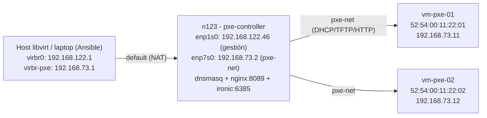
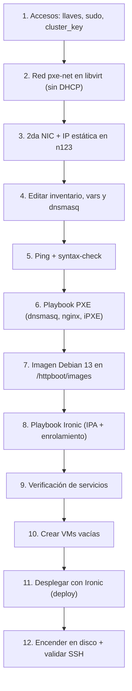

# Manual y Testeo — Instalación Masiva por PXE (Laboratorio con VMs)

Guía de punta a punta para que un controlador PXE (**n123**) instale Debian 13 de forma automática en VMs vacías conectadas a la red aislada `pxe-net`, usando **dnsmasq + iPXE + Nginx + OpenStack Ironic Standalone**.

---

## 0. Topología y datos del laboratorio



| Dato | Valor |
|---|---|
| Controlador | `n123@192.168.122.46` |
| Interfaz PXE en n123 | `enp7s0` → `192.168.73.2/24` (verificar nombre real con `ip -br a`) |
| Red PXE | `pxe-net` = `192.168.73.0/24`, gateway/DNS `192.168.73.1` (libvirt, **sin DHCP**) |
| Nodos a instalar | `vm-pxe-01` (`.11`), `vm-pxe-02` (`.12`) |
| SO a instalar | Debian 13 (imagen cloud genérica, usuario `debian`) |

> [!IMPORTANT]
> Todos los comandos se ejecutan desde la **raíz del repositorio** en el host (donde está `ansible.cfg`), salvo que se indique "**en n123**".

### Flujo completo



---

## 1. Accesos al controlador (una sola vez)

### 1.1 `.vault_pass` en la raíz del proyecto

```bash
echo "dummy" > .vault_pass && chmod 600 .vault_pass
```

### 1.2 Llave SSH + instalar `sudo` + sudo sin contraseña (en una sola sesión)

```bash
# Generar llave (omitir si ya existe ~/.ssh/id_ed25519)
ssh-keygen -t ed25519 -N "" -f ~/.ssh/id_ed25519

# Copiar la llave al controlador (pide la contraseña de n123)
ssh-copy-id -i ~/.ssh/id_ed25519.pub n123@192.168.122.46

# Instalar sudo y dar NOPASSWD (pide la contraseña de ROOT de n123)
ssh -t n123@192.168.122.46 'su -c "apt-get update && apt-get install -y sudo && \
  echo \"n123 ALL=(ALL) NOPASSWD:ALL\" > /etc/sudoers.d/99-n123 && \
  chmod 440 /etc/sudoers.d/99-n123 && visudo -cf /etc/sudoers.d/99-n123"'
```

> [!NOTE]
> Cambiar `n123` por el usuario/nodo que corresponda. El archivo `/etc/sudoers.d/99-<nodo>` debe tener permisos `440`.

### 1.3 Llave del proyecto `ansible/keys/cluster_key`

Los scripts del repo (`tunnels.sh`, `levantar-todo.sh`, etc.) usan esta ruta:

```bash
mkdir -p ansible/keys && chmod 700 ansible/keys
cp ~/.ssh/id_ed25519 ansible/keys/cluster_key && chmod 600 ansible/keys/cluster_key
# (alternativa: make bootstrap)
```

### 1.4 (Opcional) Quitar el warning de locale en n123

```bash
ssh n123@192.168.122.46 'sudo apt-get install -y locales && \
  sudo sed -i "s/^# *en_US.UTF-8/en_US.UTF-8/" /etc/locale.gen && sudo locale-gen'
```

### ✅ Test 1

```bash
test -f openstack/globals.yml && test -f inventory/lab/hosts.yml && echo "repo OK"
ssh -i ansible/keys/cluster_key n123@192.168.122.46 'hostname; grep PRETTY /etc/os-release; ip -br address; sudo -n true && echo "SUDO OK"'
```

Salida esperada: **sin pedir contraseña**, `Debian GNU/Linux 13 (trixie)`, la interfaz `enp1s0` con `192.168.122.46/24` y `SUDO OK`.

---

## 2. Crear la red `pxe-net` en libvirt (en el host)

> [!WARNING]
> La red **no debe tener DHCP** de libvirt. Si lo tiene, competirá con el dnsmasq de n123 y las VMs recibirán IP/boot del servidor equivocado.

```bash
cat > /tmp/pxe-net.xml <<'EOF'
<network>
  <name>pxe-net</name>
  <forward mode='nat'/>
  <bridge name='virbr-pxe' stp='on' delay='0'/>
  <ip address='192.168.73.1' netmask='255.255.255.0'/>
</network>
EOF

virsh --connect qemu:///system net-define /tmp/pxe-net.xml
virsh --connect qemu:///system net-start pxe-net
virsh --connect qemu:///system net-autostart pxe-net
```

Si `pxe-net` ya existía, verificar que **no** tenga bloque `<dhcp>`:

```bash
virsh --connect qemu:///system net-dumpxml pxe-net | grep -A3 '<dhcp>' && echo "!! QUITAR DHCP con: virsh net-edit pxe-net"
```

> El modo `nat` permite que `192.168.73.1` sea gateway/DNS real y que los nodos instalados tengan Internet.

---

## 3. Segunda interfaz + IP estática en n123

### 3.1 Conectar n123 a `pxe-net` (en el host)

```bash
virsh --connect qemu:///system list --all          # obtener el NOMBRE real de la VM de n123
virsh --connect qemu:///system attach-interface --domain <VM_DE_N123> \
  --type network --source pxe-net --model virtio --config --live
```

### 3.2 IP estática (en n123)

```bash
ip -br link        # identificar la interfaz nueva (ej. enp7s0)

sudo tee /etc/network/interfaces.d/pxe-net >/dev/null <<'EOF'
auto enp7s0
iface enp7s0 inet static
    address 192.168.73.2/24
EOF

# Asegurar que interfaces.d se cargue
grep -q 'source /etc/network/interfaces.d/\*' /etc/network/interfaces || \
  echo 'source /etc/network/interfaces.d/*' | sudo tee -a /etc/network/interfaces

sudo ifup enp7s0
```

> [!NOTE]
> **No** se pone `gateway` en esta interfaz: la salida por defecto de n123 sigue siendo `enp1s0`.

### ✅ Test 3

```bash
ssh n123@192.168.122.46 'ip -br a show enp7s0; ping -c2 192.168.73.1'
```

---

## 4. Ajustar el proyecto

### 4.1 `inventory/lab/hosts.yml`

Las plantillas de dnsmasq e Ironic recorren **`groups['baremetal']`**, así que las VMs deben quedar **dentro de `baremetal`**. Para el laboratorio, comentar/quitar los nodos físicos (bastion, nexus, k8s) con IPs `10.100.29.x`, porque generarían reservas DHCP fuera de la subred.

```yaml
---
all:
  children:
    baremetal:
      children:
        pxe_controller:
          hosts:
            n123:
              ansible_host: 192.168.122.46
              ansible_user: n123
              node_id: 123
              cluster_hostname: pxe-controller
              mac: "52:54:00:09:a0:04"      # MAC de enp1s0 de n123
              ram_gb: 8
              disk_gb: 40

        pxe_nodes:                          # nodos a instalar por PXE
          hosts:
            vm-pxe-01:
              ansible_host: 192.168.73.11
              ansible_user: debian
              node_id: 1
              cluster_hostname: vm-pxe-01
              mac: "52:54:00:11:22:01"
              ram_gb: 4
              disk_gb: 30
            vm-pxe-02:
              ansible_host: 192.168.73.12
              ansible_user: debian
              node_id: 2
              cluster_hostname: vm-pxe-02
              mac: "52:54:00:11:22:02"
              ram_gb: 4
              disk_gb: 30
```

> [!TIP]
> Para agregar más nodos: copiar un bloque de `pxe_nodes`, cambiar nombre, IP (`192.168.73.x`, fuera del rango `150-199`), `node_id` y MAC única `52:54:00:xx:xx:xx`.

### 4.2 `inventory/lab/group_vars/all/vars.yml`

**Líneas 13-17** — quitar el ProxyJump:

```yaml
ansible_ssh_common_args: >-
  -o StrictHostKeyChecking=no
  -o UserKnownHostsFile=/dev/null
  -o ConnectTimeout=5
```

**Líneas 29-38** — red del clúster → `pxe-net`:

```yaml
cluster_subnet: "192.168.73.0/24"
cluster_netmask: "255.255.255.0"
cluster_gateway: "192.168.73.1"
cluster_dns: "192.168.73.1"
dhcp_range_start: "192.168.73.150"
dhcp_range_end: "192.168.73.199"
dhcp_lease_time: "1h"
```

**Sección PXE** — `pxe_iface` debe ser **exactamente** la interfaz del paso 3.2:

```yaml
pxe_ip: "192.168.73.2"
pxe_wifi_ip: "192.168.122.46"
pxe_iface: "enp7s0"
ironic_image_name: "debian-baremetal.qcow2"
ironic_image_checksum: "<SHA256 del paso 7>"
```

### 4.3 `ansible/roles/pxe_controller/templates/dnsmasq.conf.j2` (línea 13)

El original tiene **7 octetos** (bug) y MAC de los equipos físicos:

```diff
- dhcp-mac=set:known,64:00:6a:2a:*:*:*
+ dhcp-mac=set:known,52:54:00:*:*:*
```

### 4.4 `ansible/roles/ironic/templates/baremetal.yaml.j2` (excluir al controlador)

Si no se cambia, Ironic enrola también a **n123** como nodo a instalar:

```diff
- 
+ 
```

Y agregar arranque UEFI dentro de `properties:` (las VMs se crean con `--boot uefi`):

```yaml
    properties:
      cpus: 2
      memory_mb: {{ hostvars[h].ram_gb * 1024 }}
      local_gb: {{ hostvars[h].disk_gb - 8 }}
      cpu_arch: "x86_64"
      capabilities: "boot_mode:uefi"
```

### 4.5 `inventory/nodes.csv` (solo documentación, ningún playbook lo lee)

```csv
id,mac,hostname,ip,role,ram_gb,disk_gb,bmc_ip
123,52:54:00:09:a0:04,pxe-controller,192.168.122.46,pxe,8,40,
1,52:54:00:11:22:01,vm-pxe-01,192.168.73.11,pxe-node,4,30,
2,52:54:00:11:22:02,vm-pxe-02,192.168.73.12,pxe-node,4,30,
```

---

## 5. Validaciones previas

```bash
ansible-inventory --graph                       # n123 en pxe_controller, VMs en pxe_nodes
ansible n123 -m ping                            # debe responder "pong"
make syntax-check
```

> [!CAUTION]
> Usar **siempre `--limit n123`** en esta etapa. Las VMs están en `baremetal` pero aún no existen: `make preflight`, `make base` o `make deploy` fallarán al intentar conectarse a ellas.

---

## 6. Desplegar el controlador PXE (dnsmasq + TFTP + iPXE + Nginx)

```bash
ansible-playbook ansible/playbooks/20-services/02_pxe_controller.yml --limit n123
```

### ✅ Test 6 (en n123)

```bash
sudo grep -E '^(interface|listen-address|dhcp-range|dhcp-host|dhcp-mac)' /etc/dnsmasq.conf
ls -l /tftpboot/                                 # ipxe.efi, undionly.kpxe, boot.ipxe
sudo ss -lunp | grep -E ':67 |:69 '              # dnsmasq en DHCP y TFTP
curl -s http://192.168.73.2:8089/boot.ipxe       # script iPXE
systemctl is-active dnsmasq nginx
```

Se esperan dos líneas `dhcp-host=52:54:00:11:22:0X,set:known,192.168.73.1X,vm-pxe-0X,infinite`.

---

## 7. Imagen de Debian 13 a instalar (en n123)

Ironic escribe una imagen de disco completo. Se usa la imagen cloud oficial (trae `cloud-init`, usuario `debian`):

```bash
cd /httpboot/images
sudo wget -O debian-baremetal.qcow2 \
  https://cloud.debian.org/images/cloud/trixie/latest/debian-13-generic-amd64.qcow2
sha256sum debian-baremetal.qcow2        # copiar el valor
curl -sI http://192.168.73.2:8089/images/debian-baremetal.qcow2 | head -1   # HTTP/1.1 200 OK
```

Poner el SHA256 en `ironic_image_checksum` de `vars.yml`.

---

## 8. Desplegar Ironic Standalone (descarga IPA + enrolamiento)

```bash
ansible-playbook ansible/playbooks/20-services/03_ironic_deploy.yml --limit n123
```

Este rol:
- descarga `ipa.kernel` / `ipa.initramfs` en `/httpboot/ipa/` (sin esto `boot.ipxe` no tiene qué arrancar),
- levanta `ironic-conductor` (Podman, API en `:6385`),
- genera `/opt/ironic/baremetal.yaml` y enrola los nodos.

### ✅ Test 8 (en n123)

```bash
ls -lh /httpboot/ipa/                             # ipa.kernel (~10MB) e ipa.initramfs (~400MB)
systemctl is-active ironic-conductor
curl -s http://192.168.73.2:6385/ | head -c 300   # JSON con "versions"
sudo ss -ltnp | grep -E ':8089|:6385'             # 8089 = nginx, 6385 = ironic

export OS_AUTH_TYPE=none OS_ENDPOINT=http://192.168.73.2:6385
baremetal node list                               # vm-pxe-01 y vm-pxe-02 en estado "enroll"
```

> [!WARNING]
> Si `:8089` lo ocupa otro proceso que no es nginx, o la API `:6385` no responde, revisar `journalctl -u ironic-conductor -f` antes de seguir.

Si `baremetal node list` sale vacío (el playbook no pasa `OS_ENDPOINT` y oculta errores con `failed_when: false`), enrolar manualmente:

```bash
baremetal create /opt/ironic/baremetal.yaml

# Si 'baremetal' no está instalado en n123, usar el del contenedor:
sudo podman exec -e OS_AUTH_TYPE=none -e OS_ENDPOINT=http://192.168.73.2:6385 \
  ironic-conductor baremetal create /opt/ironic/baremetal.yaml
```

---

## 9. Dejar los nodos en `available` (en n123)

```bash
export OS_AUTH_TYPE=none OS_ENDPOINT=http://192.168.73.2:6385
for n in vm-pxe-01 vm-pxe-02; do
  baremetal node set $n --property capabilities='boot_mode:uefi'
  baremetal node set $n --no-automated-clean        # las VMs aún no existen: saltar limpieza
  baremetal node manage  $n --wait 60
  baremetal node provide $n --wait 120
done
baremetal node list        # Provisioning State = available
```

> [!NOTE]
> Sin `--no-automated-clean`, `provide` queda en `clean wait` esperando que el nodo arranque IPA (con `manual-management` Ironic no puede encenderlo). En equipos físicos reales conviene dejar la limpieza activa y encender el nodo manualmente.

---

## 10. Crear las VMs vacías (en el host)

> [!TIP]
> Lo ideal es lanzar el `deploy` del **paso 11** primero y crear/encender las VMs justo después: así, cuando IPA arranca, Ironic ya lo está esperando. Si se crean antes, se puede hacer `virsh reset vm-pxe-0X` después del deploy.

```bash
for i in 1 2; do
virt-install \
  --connect qemu:///system \
  --name vm-pxe-0$i \
  --ram 4096 \
  --vcpus 2 \
  --disk size=30,format=qcow2,bus=virtio \
  --os-variant debian12 \
  --network network=pxe-net,model=virtio,mac=52:54:00:11:22:0$i \
  --graphics spice \
  --pxe \
  --boot loader=/usr/share/OVMF/OVMF_CODE_4M.fd,loader.readonly=yes,loader.type=pflash,nvram.template=/usr/share/OVMF/OVMF_VARS_4M.fd \
  --noautoconsole
done
```

> [!NOTE]
> - Se apunta explícitamente a `OVMF_CODE_4M.fd` (UEFI sin Secure Boot) porque con `--boot uefi` automático, libvirt en Debian 13 puede elegir `OVMF.amdsev.fd`, que **no trae arranque PXE** y falla con `Boot0002 "Grub Bootloader" : Not Found`.
> - **Si ya tienes las VMs creadas en `virt-manager`**, sáltate `virt-install`. Con la VM apagada, habilita **Edit → Preferences → General → Enable XML editing**, entra en la pestaña **XML** y asegúrate de que `<os>` use `OVMF_CODE_4M.fd` (`type="pflash"`) + `OVMF_VARS_4M.fd` en lugar de `OVMF.amdsev.fd`, y que la NIC (`pxe-net`, `virtio`, MAC correcta) tenga `<boot order='1'/>`.
> - `--os-variant debian13` si `osinfo-query os | grep debian13` lo reconoce.
> - `--pxe` arranca por red **solo en la primera ejecución**; luego la VM queda configurada para arrancar desde disco.
> - 4 GB de RAM es el mínimo razonable para el ramdisk IPA (CentOS 9).

### ✅ Test 10 — ver el arranque PXE

```bash
# en n123
sudo journalctl -fu dnsmasq
# esperado: DHCPDISCOVER/DHCPOFFER 192.168.73.11 52:54:00:11:22:01 ... sent /tftpboot/ipxe.efi

# en el host
virt-viewer --connect qemu:///system vm-pxe-01
```

Secuencia esperada en pantalla: `iPXE` → descarga `boot.ipxe` → `ipa.kernel` → `ipa.initramfs` → el agente IPA arranca y se reporta a Ironic.

---

## 11. Instalación masiva con Ironic

### 11.1 Enviar tu llave pública de la laptop a `n123` y definir imagen

En tu **laptop/host**:
```bash
scp ~/.ssh/id_ed25519.pub n123@192.168.122.46:/tmp/laptop.pub
```

En **`n123`**:
```bash
export OS_AUTH_TYPE=none OS_ENDPOINT=http://192.168.73.2:6385
IMG=http://192.168.73.2:8089/images/debian-baremetal.qcow2
SUM=$(sha256sum /httpboot/images/debian-baremetal.qcow2 | awk '{print $1}')
PUBKEY="$(cat /tmp/laptop.pub)"
echo "Usando llave: $PUBKEY"     # debe terminar en tu usuario@laptop, NO n123@321

for n in vm-pxe-01 vm-pxe-02; do
  baremetal node set $n \
    --instance-info image_source=$IMG \
    --instance-info image_os_hash_algo=sha256 \
    --instance-info image_os_hash_value=$SUM \
    --instance-info image_disk_format=qcow2 \
    --instance-info root_gb=20
done
```

### 11.2 Desplegar (con config-drive para usuario, hostname y llave)

```bash
for n in vm-pxe-01 vm-pxe-02; do
  cat > /tmp/cd-$n.json <<EOF
{
  "meta_data": {
    "uuid": "$(baremetal node show $n -f value -c uuid)",
    "hostname": "$n",
    "public_keys": {"0": "$PUBKEY"}
  },
  "user_data": "#cloud-config\nusers:\n  - default\n  - name: debian\n    sudo: ALL=(ALL) NOPASSWD:ALL\n    shell: /bin/bash\n    ssh_authorized_keys:\n      - $PUBKEY\npackage_update: true\npackages: [qemu-guest-agent, python3]\n"
}
EOF
  baremetal node deploy $n --config-drive /tmp/cd-$n.json
done

watch -n5 'baremetal node list'
```

Estados esperados: `deploying` → `wait call-back` → `deploying` → **`active`**.

> [!IMPORTANT]
> Con `manual-management` Ironic **no controla la energía**. Si un nodo queda en `wait call-back`, iniciarlo/reiniciarlo desde el host para que vuelva a arrancar por PXE:
> ```bash
> virsh --connect qemu:///system start vm-pxe-01       # o: virsh reset vm-pxe-01
> ```

---

## 12. Arrancar desde disco y validar (en el host)

Al llegar a `active`, IPA apaga la VM. Encenderla (arranca desde disco):

```bash
for i in 1 2; do virsh --connect qemu:///system start vm-pxe-0$i; done
```

Si alguna vuelve a entrar a iPXE en lugar del disco, forzar arranque por disco:

```bash
virsh --connect qemu:///system destroy vm-pxe-01
virt-xml --connect qemu:///system vm-pxe-01 --edit --boot hd
virsh --connect qemu:///system start vm-pxe-01
```

### ✅ Test final

```bash
ssh debian@192.168.73.11 'hostname; grep PRETTY /etc/os-release; ip -br a'
ssh debian@192.168.73.12 'hostname; grep PRETTY /etc/os-release; ip -br a'

# Ansible contra los nodos nuevos
ansible pxe_nodes -m ping                     # o: ansible vm-pxe-01,vm-pxe-02 -m ping
ansible vm-pxe-01,vm-pxe-02 -b -m command -a "uptime"
```

Esperado: `vm-pxe-0X`, `Debian GNU/Linux 13 (trixie)`, IP `192.168.73.1X/24` y `pong`.

> [!NOTE]
> - Si `ansible pxe_nodes -m ping` dice `Could not match supplied host pattern`, revisa con `ansible-inventory --graph` en qué grupo quedaron tus VMs en `hosts.yml` (o usa `vm-pxe-01,vm-pxe-02`).
> - Si vas a correr `ansible-playbook ansible/playbooks/10-base/01_os_base.yml --limit vm-pxe-01,vm-pxe-02`, asegúrate de que el grupo `k8s_cluster` exista en `hosts.yml` (aunque esté vacío), ya que el rol `common` lo referencia en la tarea de repositorios APT.
> - **Al pasar a PCs físicas en red aislada:** si tu laptop no está conectada al mismo switch que las PCs nuevas (solo llega por WiFi/LAN al controlador `n123`), vuelve a agregar `-o ProxyJump=n123@192.168.122.46` (con la IP real del controlador) en `ansible_ssh_common_args` dentro de `inventory/lab/group_vars/all/vars.yml`.

---

## 13. Troubleshooting rápido

| Síntoma | Causa probable | Solución |
|---|---|---|
| VM: `No DHCP offers` / `PXE-E16` | dnsmasq no escucha o MAC no autorizada | `journalctl -u dnsmasq`; revisar `pxe_iface`, `dhcp-mac=52:54:00:*:*:*` y `dhcp-host` |
| VM recibe IP de `192.168.73.2xx` desconocido | DHCP de libvirt activo en `pxe-net` | `virsh net-edit pxe-net` → quitar `<dhcp>` y reiniciar la red |
| `Access denied` / Secure Boot violation | Firmware con Secure Boot | Recrear VM con `OVMF_CODE_4M.fd` (sin Secure Boot) |
| `Boot0002 "Grub Bootloader" : Not Found` | Libvirt eligió `OVMF.amdsev.fd` (sin PXE) | Cambiar `<os>` en el XML de la VM a `/usr/share/OVMF/OVMF_CODE_4M.fd` (`pflash`) + `OVMF_VARS_4M.fd` |
| iPXE: `Connection refused` en `:8089` | nginx caído | `systemctl status nginx`; `curl http://192.168.73.2:8089/` |
| iPXE: `ipa.kernel ... Not found` | No se ejecutó el rol `ironic` | Paso 8 |
| IPA arranca pero nodo sigue en `wait call-back` | IPA no alcanza `:6385` | `curl http://192.168.73.2:6385` desde la red pxe; revisar firewall en n123 (`sudo nft list ruleset`) |
| `deploy failed` por checksum | Hash distinto al de la imagen | Recalcular `sha256sum` y volver a `node set --instance-info` |
| Nodo en `deploy failed` | Error durante el despliegue | `baremetal node show <n> -f value -c last_error`; luego `baremetal node undeploy <n>` y repetir 11 |
| Nodo atascado en `clean wait` | `provide` lanzó limpieza sin VM encendida | `baremetal node abort <n>`, esperar a `clean failed`, `baremetal node manage <n>`, `baremetal node set <n> --no-automated-clean`, `baremetal node provide <n>` |
| SSH `Permission denied (publickey)` tras instalar | Se inyectó otra llave (ej. `n123@321`) o falta la llave de la laptop | Verificar `/tmp/cd-vm-pxe-01.json`; re-desplegar con `/tmp/laptop.pub` o inyectar con `virt-customize -d <vm> --ssh-inject "debian:file:$HOME/.ssh/id_ed25519.pub"` |
| `Could not match supplied host pattern: pxe_nodes` | Las VMs no están en el grupo `pxe_nodes` en `hosts.yml` | Revisar `ansible-inventory --graph` o usar `ansible vm-pxe-01,vm-pxe-02 -m ping` |
| Ansible intenta conectar a VMs inexistentes | VMs en `baremetal` | Usar `--limit n123` hasta el paso 12 |

### Reiniciar un nodo para reinstalarlo

```bash
baremetal node undeploy vm-pxe-01 --wait 600
baremetal node deploy   vm-pxe-01 --config-drive /tmp/cd-vm-pxe-01.json
virsh --connect qemu:///system destroy vm-pxe-01
virt-xml --connect qemu:///system vm-pxe-01 --edit --boot network,hd
virsh --connect qemu:///system start vm-pxe-01
```

---

## 14. Checklist

- [ ] `.vault_pass` (600) en la raíz
- [ ] Llave SSH copiada, `sudo` instalado, `/etc/sudoers.d/99-n123` (440)
- [ ] `ansible/keys/cluster_key` (600)
- [ ] `pxe-net` en libvirt **sin DHCP**, autostart
- [ ] n123 con 2da NIC en `pxe-net` y `192.168.73.2/24`
- [ ] `hosts.yml` con VMs en `baremetal → pxe_nodes`, nodos físicos comentados
- [ ] `vars.yml`: sin ProxyJump, red `192.168.73.0/24`, `pxe_iface` correcto
- [ ] `dnsmasq.conf.j2`: `dhcp-mac=set:known,52:54:00:*:*:*`
- [ ] `baremetal.yaml.j2`: excluye `pxe_controller` + `boot_mode:uefi`
- [ ] Playbook `02_pxe_controller.yml --limit n123` OK
- [ ] Imagen Debian 13 en `/httpboot/images` + SHA256
- [ ] Playbook `03_ironic_deploy.yml --limit n123` OK, IPA descargado
- [ ] Nodos `available` en Ironic
- [ ] VMs creadas con UEFI sin Secure Boot
- [ ] `baremetal node deploy` → `active`
- [ ] SSH `debian@192.168.73.1X` y `ansible pxe_nodes -m ping` OK
