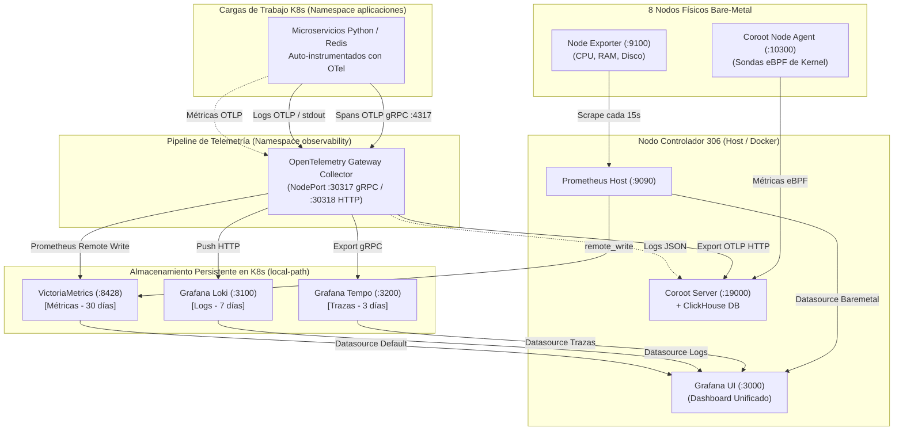

# Guía Oficial de Observabilidad en el Proyecto: Métricas, Logs, Trazas y eBPF

Esta guía corresponde al monitoreo de la plataforma sobre sistemas operativos existentes. El aprovisionamiento de sistemas operativos tiene [otra guía](GUIA_OPENSTACK.md) y no es un requisito de este procedimiento.

Esta guía explica de forma clara, directa y sin tecnicismos innecesarios cómo está diseñada, configurada y operada la plataforma de **observabilidad** en este clúster bare-metal y Kubernetes.

---

## 1. Conceptos Básicos

### ¿Qué es la observabilidad?
Si un servidor deja de responder o una aplicación se vuelve lenta, **no basta con saber que falló: necesitas entender *por qué* falló por dentro**. 

La observabilidad es la capacidad de deducir el estado interno de un sistema complejo a partir de las señales que emite hacia el exterior.

* **Métricas (¿Qué está pasando y cuánto?):** Son números medidos a lo largo del tiempo (series temporales). Ejemplos: porcentaje de uso de CPU, megabytes de RAM libres o cantidad de peticiones por segundo.
* **Logs (¿Qué ocurrió y cuándo?):** Son mensajes de texto con fecha y hora que las aplicaciones y el sistema operativo escriben al realizar una acción o encontrar un fallo. Ejemplo: `[12:00:01] ERROR: Conexión rechazada a la base de datos`.
* **Trazas (¿Por dónde viajó la petición?):** Es el mapa del recorrido que hace una solicitud de usuario a través de múltiples microservicios (Frontend $\rightarrow$ Backend $\rightarrow$ Redis $\rightarrow$ Base de Datos), midiendo cuánto tiempo tardó cada parada.

---

## 2. Herramientas de Observabilidad en el Proyecto

| Herramienta | Función Principal | Cómo se utiliza en este proyecto | Evidencia en el código | Estado |
| :--- | :--- | :--- | :--- | :---: |
| **Grafana** | Visualización centralizada | Panel web unificado en el Nodo 306 para ver dashboards de hardware, pods, logs y trazas correlacionadas. | `ansible/roles/monitoring/tasks/main.yml:40-60`<br>Puerto `:3000` activo | **Implementado** |
| **Prometheus** | Recolección de métricas host | Recolecta métricas de hardware cada 15s en el Nodo 306 y las reenvía a VictoriaMetrics. | `inventory/lab/group_vars/all/vars.yml:99`<br>Puerto `:9090` activo | **Implementado** |
| **VictoriaMetrics** | Almacén de métricas a largo plazo | Base de datos de series temporales de alto rendimiento en K8s con retención de 30 días. | `kubernetes/observability/backends/01_backends.yaml:18-74` | **Implementado** |
| **Grafana Loki** | Almacén y consulta de logs | Recibe los logs de los contenedores de Kubernetes y eventos del sistema mediante LogQL. | `kubernetes/observability/backends/01_backends.yaml:128-193` | **Implementado** |
| **Grafana Tempo** | Almacén de trazas distribuidas | Guarda los spans de llamadas entre microservicios recibidos por OTLP/gRPC con retención de 3 días. | `kubernetes/observability/backends/01_backends.yaml:232-302` | **Implementado** |
| **OpenTelemetry (OTel)** | Colector y enrutador universal | Recibe trazas y métricas de las apps, filtra datos y los reparte a Tempo, Loki, VictoriaMetrics y Coroot. | `kubernetes/observability/otel/02_otel_operator_and_collectors.yaml:1-85` | **Implementado** |
| **Coroot CE** | Observabilidad automática con eBPF | Plataforma con ClickHouse en Docker que detecta anomalías de red, CPU y dependencias sin instrumentar código. | `/opt/coroot/compose.yaml`<br>Puerto `:19000` activo en Nodo 306 | **Implementado** |
| **Coroot Node Agent** | Agente eBPF en el kernel | Demonio instalado en los 8 nodos bare-metal que inspecciona tráfico de red y sockets vía eBPF en puerto 10300. | `ansible/roles/coroot_node_agent/defaults/main.yml:1-10` | **Implementado** |
| **Node Exporter** | Exportador de hardware | Servicio en cada nodo bare-metal que expone métricas de CPU, disco SSD de 128 GB y RAM en puerto 9100. | `ansible/roles/monitoring/tasks/main.yml:10-25`<br>Verificado en los 8 nodos | **Implementado** |
| **Blackbox Exporter** | Sondas de red sintéticas | Ejecuta pruebas periódicas de ping ICMP y chequeos HTTP para validar si los nodos y servicios responden. | `ansible/roles/monitoring/tasks/main.yml:46` | **Implementado** |
| **Alertmanager** | Enrutador de alertas | Agrupa y despacha alertas de sobrecarga de disco, caída de nodos o saturación de memoria. | `inventory/lab/group_vars/all/vars.yml:100`<br>Puerto `:9093` activo | **Implementado** |

---

## 3. Arquitectura y Flujo de Datos

El clúster implementa una **estrategia híbrida**: el monitoreo de hardware físico corre en el sistema operativo del Nodo 306, mientras que el procesamiento pesado de logs, trazas y métricas de Kubernetes corre dentro del clúster RKE2.



### Cómo viaja la información
1. **Flujo de Métricas:**
   * Cada 15 segundos, **Prometheus** (`:9090`) consulta a **Node Exporter** (`:9100`) en los 8 nodos físicos.
   * Prometheus envía una copia de esas métricas vía `remote_write` a **VictoriaMetrics** (`:8428`) para conservarlas por 30 días.
2. **Flujo de Logs:**
   * Las aplicaciones escriben sus eventos a la salida estándar (*stdout*).
   * El agente de **OpenTelemetry** los recolecta, formatea y los empuja a **Grafana Loki** (`:3100`), donde se indexan por etiquetas como `namespace`, `pod` y `app`.
3. **Flujo de Trazas:**
   * Cuando un usuario hace una solicitud HTTP al frontend, la librería de OpenTelemetry inyecta un encabezado `traceparent`.
   * Los microservicios envían los fragmentos (*spans*) al **OTel Gateway Collector** (`:30317`), el cual aplica un muestreo del 20% para no saturar el disco de 128 GB y guarda las trazas en **Grafana Tempo** (`:3200`).
4. **Correlación entre datos (El valor añadido):**
   * En Grafana, cuando estás viendo una **traza lenta** en Tempo, puedes hacer un solo clic sobre un botón azul que dice *"Logs for this span"*: Grafana abre automáticamente **Loki** mostrando únicamente los logs que ocurrieron en ese milisegundo exacto para ese usuario.

---

## 4. Implementación Detallada por Herramienta

### 4.1 Grafana (Visualización Unificada)
* **Para qué sirve:** Es la pantalla donde los operadores ven gráficos, buscan logs y exploran trazas.
* **Dónde está desplegada:** En el sistema operativo del Nodo 306 como servicio systemd (`grafana-server`).
* **Qué datos recibe:** Consulta a VictoriaMetrics, Prometheus, Loki y Tempo.
* **Archivos que la controlan:** [ansible/roles/monitoring/tasks/main.yml:45-60](file:///home/rodrigo/Documents/gitlabinf/GuiaImplementacion/infra-scripts/ansible/roles/monitoring/tasks/main.yml#L45-L60) y [kubernetes/observability/grafana/datasources/datasources.yaml](file:///home/rodrigo/Documents/gitlabinf/GuiaImplementacion/infra-scripts/kubernetes/observability/grafana/datasources/datasources.yaml).
* **Acceso:** Navegador web en `http://192.168.29.25:3000` (o `http://localhost:3000` vía `make tunnels`).
* **Comprobar salud:** `curl -fsI http://10.100.29.30:3000/login` $\rightarrow$ `HTTP/1.1 200 OK`.

### 4.2 Prometheus Host & Alertmanager
* **Para qué sirve:** Sondea métricas de la infraestructura de base y procesa reglas de alerta de hardware.
* **Dónde está desplegada:** En el Nodo 306 (`prometheus.service` y `prometheus-alertmanager.service`).
* **Qué datos recibe:** Sockets `/metrics` de los 8 nodos (`node_exporter:9100`).
* **A quién envía datos:** Reenvía a VictoriaMetrics y despacha alertas a Alertmanager (`:9093`).
* **Archivos que la controlan:** `/etc/prometheus/prometheus.yml` y [ansible/roles/monitoring/templates/prometheus.yml.j2](file:///home/rodrigo/Documents/gitlabinf/GuiaImplementacion/infra-scripts/ansible/roles/monitoring/templates/prometheus.yml.j2).
* **Acceso:** `http://192.168.29.25:9090` (Prometheus) y `http://192.168.29.25:9093` (Alertmanager).
* **Comprobar salud:** `curl -fsS http://10.100.29.30:9090/-/ready` $\rightarrow$ `Prometheus is Ready`.

### 4.3 VictoriaMetrics (Long-Term TSDB)
* **Para qué sirve:** Guarda las métricas numéricas durante 30 días consumiendo hasta 4 veces menos RAM y disco que Prometheus clásico.
* **Dónde está desplegada:** En Kubernetes como StatefulSet `victoriametrics-0` en el namespace `observability`.
* **Qué datos recibe:** Peticiones HTTP `remote_write` en `/api/v1/write`.
* **Archivos que la controlan:** [kubernetes/observability/backends/01_backends.yaml:18-74](file:///home/rodrigo/Documents/gitlabinf/GuiaImplementacion/infra-scripts/kubernetes/observability/backends/01_backends.yaml#L18-L74).
* **Acceso:** Servicio ClusterIP interno en puerto `8428` y NodePort `30428`.
* **Comprobar salud:** `curl -fsS http://10.100.29.101:30428/health` $\rightarrow$ `OK`.

### 4.4 Grafana Loki (Agregador de Logs)
* **Para qué sirve:** Indexa metadatos de los logs (etiquetas) en lugar del texto completo, logrando búsquedas ultrarrápidas sin saturar el almacenamiento.
* **Dónde está desplegada:** En Kubernetes como StatefulSet `loki-0` en el namespace `observability`.
* **Qué datos recibe:** Registros enviados por OTel Collector en puerto HTTP `3100`.
* **Archivos que la controlan:** [kubernetes/observability/backends/01_backends.yaml:84-193](file:///home/rodrigo/Documents/gitlabinf/GuiaImplementacion/infra-scripts/kubernetes/observability/backends/01_backends.yaml#L84-L193).
* **Acceso:** Puerto interno `3100` y NodePort `30100`.
* **Comprobar salud:** `curl -fsS http://10.100.29.101:30100/ready` $\rightarrow$ `ready`.

### 4.5 Grafana Tempo (Trazas Distribuidas)
* **Para qué sirve:** Almacén masivo de trazas de llamadas entre microservicios, compatible con OpenTelemetry.
* **Dónde está desplegada:** En Kubernetes como StatefulSet `tempo-0` en el namespace `observability`.
* **Qué datos recibe:** Protocolo OTLP en puerto `4317` (gRPC) y puerto `4318` (HTTP).
* **Archivos que la controlan:** [kubernetes/observability/backends/01_backends.yaml:203-302](file:///home/rodrigo/Documents/gitlabinf/GuiaImplementacion/infra-scripts/kubernetes/observability/backends/01_backends.yaml#L203-L302).
* **Acceso:** Puerto de consulta TraceQL `3200` y NodePort `30200`.
* **Comprobar salud:** `curl -fsS http://10.100.29.101:30200/ready` $\rightarrow$ `ready`.

### 4.6 OpenTelemetry Gateway Collector & Operator
* **Para qué sirve:** Es la "aduana" de la telemetría. Recibe datos en formato OTLP estándar, los procesa en memoria y los traduce al formato de cada base de datos.
* **Dónde está desplegada:** En Kubernetes como Deployment de 2 réplicas (`otel-gateway-collector`).
* **Qué datos recibe:** Trazas, métricas y logs de las aplicaciones en los puertos `4317` y `4318`.
* **Archivos que la controlan:** [kubernetes/observability/otel/02_otel_operator_and_collectors.yaml:1-85](file:///home/rodrigo/Documents/gitlabinf/GuiaImplementacion/infra-scripts/kubernetes/observability/otel/02_otel_operator_and_collectors.yaml#L1-L85).
* **Acceso:** NodePort `30317` (gRPC) y NodePort `30318` (HTTP).
* **Comprobar salud:** `curl -fsS http://10.100.29.101:13133/` $\rightarrow$ Endpoint de healthcheck de OTel.

### 4.7 Coroot CE & Coroot Node Agent (Observabilidad eBPF)
* **Para qué sirve:** Analiza el comportamiento del clúster sin necesidad de modificar el código de los desarrolladores. Lee los sockets del kernel Linux mediante **eBPF** y dibuja el mapa de dependencias y latencias automáticamente.
* **Dónde está desplegada:**
  * Servidor Central + ClickHouse: Contenedores Docker en el Nodo 306 (`/opt/coroot/compose.yaml`).
  * Agentes de nodo: Servicio `coroot-node-agent` en los 8 nodos físicos bare-metal.
  * Agente de clúster: Deployment `coroot-cluster-agent` en el namespace `observability`.
* **Archivos que la controlan:** [ansible/roles/coroot_node_agent/defaults/main.yml](file:///home/rodrigo/Documents/gitlabinf/GuiaImplementacion/infra-scripts/ansible/roles/coroot_node_agent/defaults/main.yml) y [kubernetes/observability/coroot/03_coroot_cluster_agent.yaml](file:///home/rodrigo/Documents/gitlabinf/GuiaImplementacion/infra-scripts/kubernetes/observability/coroot/03_coroot_cluster_agent.yaml).
* **Acceso:** Panel web en `http://192.168.29.25:19000`.
* **Comprobar salud:** `curl -fsI http://192.168.29.25:19000/` $\rightarrow$ `HTTP/1.1 200 OK`.

---

## 5. Configuración Importante del Stack

### Namespaces y Puertos Críticos

| Namespace K8s | Componente | Puerto Contenedor | Puerto NodePort Externo | Protocolo |
| :--- | :--- | :---: | :---: | :--- |
| `observability` | VictoriaMetrics | 8428 | `30428` | HTTP (PromQL / Write) |
| `observability` | Grafana Loki | 3100 | `30100` | HTTP (LogQL) |
| `observability` | Grafana Tempo | 3200 / 4317 | `30200` | HTTP / OTLP gRPC |
| `observability` | OTel Gateway Collector | 4317 / 4318 | `30317` / `30318` | OTLP gRPC / HTTP |
| `observability` | Coroot Cluster Agent | N/A (Cliente) | N/A | HTTP saliente a `:19000` |
| `(Host nodo-306)` | Grafana Server | 3000 | Directo host | HTTP Web UI |
| `(Host nodo-306)` | Prometheus Server | 9090 | Directo host | HTTP Scrape Engine |
| `(Host todos)` | Node Exporter | 9100 | Directo host | HTTP Metrics Exporter |
| `(Host todos)` | Coroot Node Agent | 10300 | Directo host | HTTP / Sondas eBPF |

### Políticas de Retención de Datos (Protección para SSD de 128 GB)
Para evitar que los discos de 128 GB de los miniPCs se llenen, el proyecto define límites estrictos en [kubernetes/observability/backends/01_backends.yaml](file:///home/rodrigo/Documents/gitlabinf/GuiaImplementacion/infra-scripts/kubernetes/observability/backends/01_backends.yaml):
* **VictoriaMetrics:** `-retentionPeriod=30d` (30 días). Volumen persistente de `25 GiB`.
* **Grafana Loki:** `retention_period: 168h` (7 días). Volumen persistente de `20 GiB`.
* **Grafana Tempo:** `block_retention: 72h` (3 días) con muestreo (*sampling*) probabilístico del 20%. Volumen de `15 GiB`.

### Alertas y Reglas del Sistema
Configuradas en [kubernetes/observability/alerting/rules/alerts_k8s.yaml:12-35](file:///home/rodrigo/Documents/gitlabinf/GuiaImplementacion/infra-scripts/kubernetes/observability/alerting/rules/alerts_k8s.yaml#L12-L35):
1. **`KubernetesNodeNotReady`:** Se dispara si un nodo físico permanece más de 5 minutos en estado `NotReady`. Severidad: `critical`.
2. **`HighMemoryPressure`:** Se activa si el consumo de memoria RAM supera el `90%` durante 5 minutos en cualquier servidor bare-metal.
3. **`HighDiskUsage128GB`:** Se activa si la partición raíz (`/`) supera el `80%` de ocupación.

### Credenciales y Seguridad
* **Grafana:** Usuario administrador por defecto `admin` (la contraseña se define en variables protegidas o se sincroniza mediante Ansible).
* **Coroot:** Las comunicaciones internas entre el agente de clúster y el servidor central utilizan un token API administrativo (`x-api-key: <COROOT_API_KEY>`).

---

## 6. Instalación y Despliegue Paso a Paso

### 1. Requisitos y Dependencias
* Clúster Kubernetes HA (RKE2) en estado `Ready`.
* StorageClass `local-path` activa en Kubernetes para crear volúmenes persistentes.
* Kernel Linux con soporte BTF activo (`test -r /sys/kernel/btf/vmlinux`) para Coroot eBPF.

---

### Procedimiento de Despliegue

#### Paso 6.1: Desplegar monitoreo en los hosts bare-metal con Ansible
* **Dónde se ejecuta:** En la PC remota.
* **Para qué sirve:** Instala Prometheus, Grafana, Node Exporter y Alertmanager en el sistema operativo host.
* **Comando:**
  ```bash
  ansible-playbook -i inventory/lab/hosts.yml ansible/playbooks/40-observability/01_monitoring.yml
  ```
* **Resultado esperado:** Tareas en verde (`ok`), servicios systemd activos en toda la flota.

#### Paso 6.2: Desplegar backends en Kubernetes (VictoriaMetrics, Loki, Tempo)
* **Dónde se ejecuta:** En la PC remota (o nodo con `kubectl`).
* **Para qué sirve:** Crea el namespace `observability`, los StatefulSets y los volúmenes en disco.
* **Comando:**
  ```bash
  kubectl apply -k kubernetes/observability/backends
  ```
* **Resultado esperado:**
  ```bash
  kubectl get statefulset -n observability
  # Muestra: victoriametrics (1/1), loki (1/1), tempo (1/1) en estado READY.
  ```

#### Paso 6.3: Desplegar OpenTelemetry Operator y Gateway Collector
* **Dónde se ejecuta:** En la PC remota.
* **Para qué sirve:** Levanta el colector universal para enrutar trazas a Tempo y logs a Loki.
* **Comando:**
  ```bash
  kubectl apply -k kubernetes/observability/otel
  ```
* **Resultado esperado:** `kubectl get deployment -n observability otel-gateway-collector` muestra `2/2 READY`.

#### Paso 6.4: Levantar el servidor central de Coroot en el Nodo 306
* **Dónde se ejecuta:** En el Nodo 306.
* **Para qué sirve:** Inicia la base de datos ClickHouse y el servidor web analítico de Coroot.
* **Comando:**
  ```bash
  ssh -i ansible/keys/cluster_key n306@192.168.29.25 "cd /opt/coroot && sudo docker compose -f compose.yaml up -d"
  ```
* **Resultado esperado:** Contenedores `coroot-clickhouse-1` y `coroot-coroot-1` en estado `Up (healthy)`.

#### Paso 6.5: Distribuir el agente eBPF de Coroot en la flota
* **Dónde se ejecuta:** En la PC remota.
* **Para qué sirve:** Instala `coroot-node-agent` en los 8 nodos físicos y despliega el agente de clúster en K8s.
* **Comando:**
  ```bash
  ansible-playbook -i inventory/lab/hosts.yml ansible/playbooks/40-observability/02_coroot_agent.yml
  kubectl apply -k kubernetes/observability/coroot
  ```
* **Resultado esperado:** `ansible baremetal -i inventory/lab/hosts.yml -m command -a "systemctl is-active coroot-node-agent"` responde `active` en todos los nodos.

---

## 7. Consultas y Ejemplos Prácticos

### 7.1 Consultar Métricas en Prometheus / VictoriaMetrics (PromQL)

Abre la consola web de VictoriaMetrics (`http://10.100.29.101:30428`) o Prometheus (`http://192.168.29.25:9090`):

1. **Memoria RAM disponible en gigabytes por servidor bare-metal:**
   ```promql
   node_memory_MemAvailable_bytes / 1024 / 1024 / 1024
   ```
2. **Porcentaje de uso de CPU por nodo en los últimos 5 minutos:**
   ```promql
   100 - (avg by (instance) (rate(node_cpu_seconds_total{mode="idle"}[5m])) * 100)
   ```
3. **Tasa de peticiones por segundo recibidas en la API:**
   ```promql
   rate(http_requests_total{app="backend-api"}[1m])
   ```

### 7.2 Buscar Logs en Grafana Loki (LogQL)

En Grafana $\rightarrow$ **Explore** $\rightarrow$ Selecciona origen **Loki**:

1. **Ver todos los logs de los microservicios en vivo:**
   ```logql
   {namespace="aplicaciones"}
   ```
2. **Filtrar únicamente errores o excepciones en el backend:**
   ```logql
   {namespace="aplicaciones", app="backend-api"} |= "ERROR"
   ```
3. **Contar cantidad de errores por minuto agrupados por pod:**
   ```logql
   sum by (pod) (count_over_time({namespace="aplicaciones"} |= "ERROR" [1m]))
   ```

### 7.3 Consultar Trazas en Grafana Tempo (TraceQL)

En Grafana $\rightarrow$ **Explore** $\rightarrow$ Selecciona origen **Tempo**:

1. **Buscar trazas que hayan tardado más de medio segundo (500 ms):**
   ```traceql
   { resource.service.name = "backend-api" && duration > 500ms }
   ```
2. **Buscar llamadas HTTP que hayan devuelto código de error 500:**
   ```traceql
   { status = error && http.status_code = 500 }
   ```

### 7.4 Investigar la Red y Servicios desde Coroot eBPF

Abre en tu navegador `http://192.168.29.25:19000`:
* Ve a la pestaña **Applications**: Verás un mapa interactivo con flechas automáticas que conectan `frontend-web` $\rightarrow$ `backend-api` $\rightarrow$ `redis`.
* Si un servicio falla, Coroot dibuja la flecha en **rojo** e indica la causa exacta (*ejemplo: "TCP connection timeout: Redis connection limit reached"*).

---

## 8. Verificación y Errores Frecuentes

### Comprobación del Recorrido End-to-End
Para verificar que toda la cadena de telemetría funciona:
1. Genera tráfico en la aplicación: `curl -fsS http://192.168.29.25:30080/api/v1/data`.
2. Verifica en VictoriaMetrics que la métrica de peticiones aumentó.
3. Verifica en Loki que apareció la línea de log de acceso HTTP.
4. Verifica en Tempo que se generó un nuevo Trace ID.

---

### Errores Frecuentes y Solución Directa

| Error o Síntoma | Causa Probable | Solución Directa |
| :--- | :--- | :--- |
| **Conflicto en puerto 9090 al iniciar Coroot** | El contenedor `coroot-prometheus-1` intenta abrir el puerto 9090 en el host, colisionando con el Prometheus local. | Revisa `/opt/coroot/compose.yaml` y asegúrate de que el servicio interno de Prometheus no tenga publicado `9090:9090` hacia el host (debe usar la red bridge interna). |
| **`CrashLoopBackOff` en pod de VictoriaMetrics o Loki** | La StorageClass `local-path` no tiene permisos de escritura en el directorio del nodo o el disco está lleno. | Ejecuta `df -h /` en el nodo donde corre el pod para verificar espacio y revisa `kubectl describe pod <nombre> -n observability`. |
| **No aparecen trazas en Tempo** | El microservicio no tiene activado el agente OTel o el OTel Gateway no alcanza a Tempo. | Verifica que las variables `OTEL_EXPORTER_OTLP_ENDPOINT` apunten a `http://otel-gateway.observability.svc.cluster.local:4317`. |
| **Coroot Node Agent falla al iniciar (`bpf program load failed`)** | El kernel de la máquina física no tiene activado el soporte de tipos BTF (*BPF Type Format*). | Comprueba que exista `/sys/kernel/btf/vmlinux`. En Debian 13 viene activo por defecto en kernels 6.12+. Si falta, instala `linux-headers-$(uname -r)`. |
| **Loki rechaza logs con error `entry too far behind`** | Hay desfase de tiempo entre los servidores físicos bare-metal. | Sincroniza los relojes de toda la flota ejecutando `ansible baremetal -i inventory/lab/hosts.yml -m command -a "chronyc makestep"`. |
| **Datasources en rojo en Grafana** | La IP del NodePort cambió o los pods de backend en Kubernetes se reiniciaron en otro nodo. | Comprueba que los servicios `victoriametrics`, `loki` y `tempo` tengan sus NodePorts levantados con `kubectl get svc -n observability`. |

---

## 9. Archivos Importantes y Próximos Pasos

### Archivos de Configuración Principales
* **[kubernetes/observability/backends/01_backends.yaml](file:///home/rodrigo/Documents/gitlabinf/GuiaImplementacion/infra-scripts/kubernetes/observability/backends/01_backends.yaml):** Define los StatefulSets y servicios de VictoriaMetrics, Loki y Tempo.
* **[kubernetes/observability/otel/02_otel_operator_and_collectors.yaml](file:///home/rodrigo/Documents/gitlabinf/GuiaImplementacion/infra-scripts/kubernetes/observability/otel/02_otel_operator_and_collectors.yaml):** Configura los pipelines OTLP para procesar métricas, logs y trazas.
* **[kubernetes/observability/coroot/03_coroot_cluster_agent.yaml](file:///home/rodrigo/Documents/gitlabinf/GuiaImplementacion/infra-scripts/kubernetes/observability/coroot/03_coroot_cluster_agent.yaml):** Agente de Kubernetes para alimentar la topología de Coroot CE.
* **[kubernetes/observability/grafana/datasources/datasources.yaml](file:///home/rodrigo/Documents/gitlabinf/GuiaImplementacion/infra-scripts/kubernetes/observability/grafana/datasources/datasources.yaml):** Aprovisionamiento declarativo de orígenes de datos en Grafana.
* **[kubernetes/observability/alerting/rules/alerts_k8s.yaml](file:///home/rodrigo/Documents/gitlabinf/GuiaImplementacion/infra-scripts/kubernetes/observability/alerting/rules/alerts_k8s.yaml):** Reglas de alerta para salud de nodos, memoria y límites de disco en SSD de 128 GB.
* **[ansible/roles/monitoring/tasks/main.yml](file:///home/rodrigo/Documents/gitlabinf/GuiaImplementacion/infra-scripts/ansible/roles/monitoring/tasks/main.yml):** Despliegue automatizado de Prometheus, Grafana y Node Exporter en el host.
* **[ansible/roles/coroot_node_agent/tasks/main.yml](file:///home/rodrigo/Documents/gitlabinf/GuiaImplementacion/infra-scripts/ansible/roles/coroot_node_agent/tasks/main.yml):** Despliegue del agente eBPF en los 8 servidores físicos.

---

### Estado de la Implementación
* **100% Implementado y Verificado en Vivo:** Todos los pods de observabilidad (`victoriametrics-0`, `loki-0`, `tempo-0`, `otel-gateway-collector`, `coroot-cluster-agent`) están en estado **Running** en el clúster.
* **Verificado en Hosts:** Prometheus (:9090), Grafana (:3000), Node Exporter (:9100 en los 8 nodos) y Coroot CE (:19000) están operativos.

### Próximos Pasos Recomendados en Orden de Prioridad
1. **Prioridad 1:** Crear un dashboard de Grafana consolidado para negocio que muestre ventas y tiempos de respuesta de los microservicios de demostración (`backend-api` y `orders-service`).
2. **Prioridad 2:** Configurar rotación y compresión de logs antiguos en `/var/log` de los servidores físicos para asegurar que el uso de disco nunca supere el umbral de advertencia del 80%.
