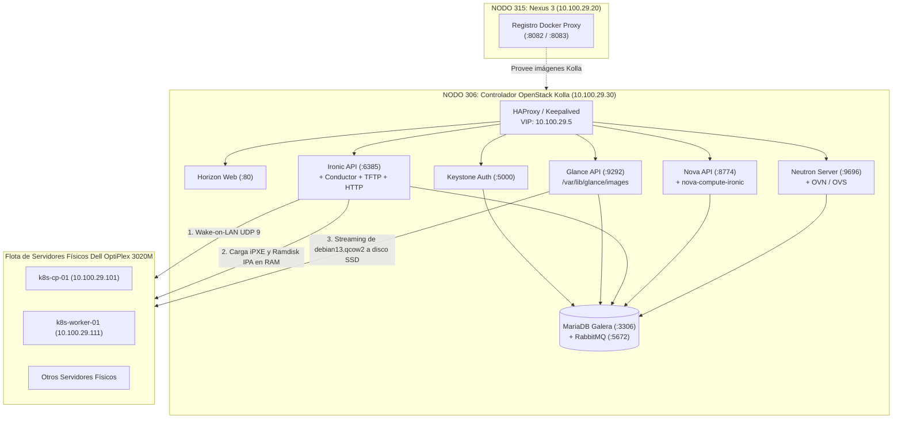
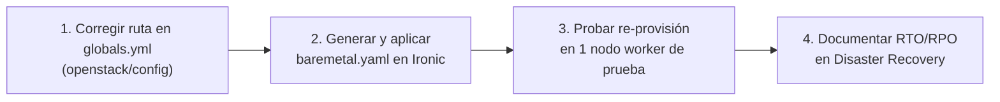

# ☁️ Guía Oficial de OpenStack en el Proyecto: Arquitectura, Operación y Bare-Metal

Esta guía explica de forma didáctica, rigurosa y directa al grano cómo está diseñado, configurado, desplegado y operado **OpenStack** dentro de este clúster bare-metal.

---

## 1. ¿Qué es OpenStack?

### ¿Qué es y para qué sirve?
Imagina que tienes una habitación llena de computadoras físicas, cables y discos duros. Para instalar un sistema operativo o cambiar la red en una máquina tradicional, tendrías que ir físicamente con un teclado, una pantalla y un pendrive USB a cada una. 

**OpenStack** es un conjunto de programas de código abierto que convierte ese grupo de computadoras físicas en una **nube privada**. En lugar de tocar las máquinas con las manos, envías órdenes a través de una página web o comandos de terminal (APIs), y OpenStack se encarga de encender los servidores, configurar las tarjetas de red y escribir el sistema operativo en sus discos automáticamente.

### ¿Qué es una nube privada?
Una **nube pública** (como AWS, Google Cloud o Azure) es infraestructura que pertenece a una empresa externa y que alquilas por horas. Una **nube privada** es exactamente la misma experiencia de automatización y autoservicio, pero instalada sobre **servidores propios**, dentro de tu propia red local, garantizando control total de los datos y costos predecibles.

### ¿Qué problema resuelve dentro de este proyecto?
El objetivo de este proyecto es montar un clúster de alta disponibilidad de **Kubernetes (RKE2)** sobre **8 micro-PCs Dell OptiPlex 3020M**. 

Instalar Debian en 8 computadoras una por una mediante instaladores interactivos toma horas y genera errores humanos. OpenStack resuelve esto mediante **aprovisionamiento bare-metal**:
1. Guarda una "imagen dorada" del sistema operativo Debian 13 pre-configurado.
2. Enciende los miniPCs a través de la red (Wake-on-LAN).
3. Escribe la imagen directamente en los discos SSD en menos de 90 segundos.
4. Si un disco o máquina falla, permite reinstalar el servidor desde cero con un solo comando.

---

## 2. OpenStack en mi proyecto

### Función que cumple en el proyecto
OpenStack actúa como el **motor de automatización de hardware físico (Bare Metal as a Service - BMaaS)**. No se utiliza para crear máquinas virtuales lentas ni pesadas, sino para gestionar servidores de metal desnudo (*bare-metal*) como si fueran instancias en la nube.

### Cómo se integra con los demás sistemas
OpenStack no trabaja solo; se conecta con los otros componentes del laboratorio:
* **Con Sonatype Nexus 3 (`nodo-315:8082`):** Descarga las imágenes de contenedores Docker oficiales de OpenStack Kolla a velocidad de red local gigabit.
* **Con dnsmasq e iPXE (`nodo-306:8089`):** Coordina el arranque inicial de red de los equipos Dell antes de que tengan sistema operativo.
* **Con HashiCorp Packer:** Recibe el archivo de disco `.qcow2` compilado por Packer y lo almacena en su catálogo de imágenes.
* **Con Kubernetes HA (RKE2):** OpenStack entrega los servidores físicos listos, particionados y con llaves SSH para que Ansible instale RKE2 y levante los pods.

### Nivel de madurez de la implementación

| Estado | Elementos comprobados |
| :--- | :--- |
| **Implementado** *(Evidencia activa en el clúster)* | • Despliegue contenerizado con **Kolla-Ansible 2025.1 (Epoxy)** sobre Ubuntu 24.04 (Noble).<br>• 25+ contenedores Docker activos y saludables en `nodo-306` (`keystone`, `glance_api`, `ironic_api`, `ironic_conductor`, `nova_api`, `nova_compute_ironic`, `neutron_server`, `horizon`, `mariadb`, `rabbitmq`, `haproxy`, `keepalived`).<br>• Catálogo **Glance** activo con 5 imágenes registradas.<br>• Red virtual **Neutron** `public1` creada.<br>• Panel web **Horizon** respondiendo en HTTP 200.<br>• Base de datos MariaDB Galera y endpoints Keystone en la VIP `10.100.29.5`. |
| **Documentado** *(Diseñado en archivos y scripts, ejecución bajo demanda)* | • Enrolamiento declarativo de los 8 nodos físicos mediante plantilla `baremetal.yaml.j2`.<br>• Re-aprovisionamiento destructivo automatizado ante fallo de SSD con `scripts/ops/disaster-recovery.sh --reprovision <NODO>`.<br>• Respaldo lógico de bases de datos OpenStack mediante `disaster-recovery.sh --backup-openstack`. |
| **No confirmado / Pendiente** | • Registro activo de los miniPCs en `openstack baremetal node list` (el comando responde exitoso pero sin filas; los nodos se levantaron inicialmente por PXE/Preseed/Ansible y el enrolamiento en la base de datos de Ironic está pendiente). |

---

## 3. Arquitectura

### Nodos y servidores que participan
Toda la suite de control de OpenStack está consolidada en el **Nodo 306** en una arquitectura *All-in-One*, mientras que los demás nodos son los receptores de las imágenes:

1. **Nodo Controlador (`nodo-306` | `10.100.29.30` y `192.168.29.25`):**
   * Es el cerebro de la nube. Tiene 16 GB de RAM y aloja todos los servicios de OpenStack empaquetados en contenedores Docker gestionados por Kolla.
   * Maneja la **VIP interna (`10.100.29.5`)** a través de HAProxy y Keepalived para que las APIs siempre tengan una dirección fija.
2. **Nodo de Repositorios (`nodo-315` | `10.100.29.20`):**
   * Aloja Nexus 3, sirviendo de caché para no descargar imágenes de internet repetidamente.
3. **Flota Bare-Metal Gestionada (Nodos 314, 269, 280, 320, 321, 279):**
   * Computadoras Dell OptiPlex 3020M que reciben las imágenes de disco y ejecutan Bastión y Kubernetes.

### Redes, Direcciones IP y Puertos

| Servicio / Endpoint | Dirección IP | Puerto | Protocolo | Función |
| :--- | :--- | :---: | :---: | :--- |
| **Kolla Internal VIP** | `10.100.29.5` | Varios | TCP | Dirección virtual compartida por HAProxy |
| **Horizon Dashboard** | `10.100.29.5` *(Túnel: :8080)* | 80 | HTTP | Interfaz web gráfica de administración |
| **Keystone Identity API** | `10.100.29.5` | 5000 | HTTP | Autenticación, usuarios y catálogo de tokens |
| **Glance Image API** | `10.100.29.5` | 9292 | HTTP | Subida y distribución de imágenes de disco |
| **Ironic Baremetal API** | `10.100.29.5` | 6385 | HTTP | Control de aprovisionamiento de hardware físico |
| **Ironic Inspector API** | `10.100.29.5` | 5050 | HTTP | Descubrimiento e inspección de hardware |
| **Nova Compute API** | `10.100.29.5` | 8774 | HTTP | Orquestación de ciclo de vida de cómputo |
| **Placement API** | `10.100.29.5` | 8780 | HTTP | Seguimiento de capacidad de recursos |
| **Neutron Networking API**| `10.100.29.5` | 9696 | HTTP | Gestión de redes L2/L3 y puertos |
| **MariaDB Galera Database**| `10.100.29.30` | 3306 | TCP | Base de datos relacional central de OpenStack |
| **RabbitMQ Message Queue** | `10.100.29.30` | 5672 | TCP | Cola de mensajería asíncrona entre servicios |

> [!IMPORTANT]
> **Aislamiento de Red en Hardware con 1 sola Tarjeta de Red (Single-NIC):**
> Los miniPCs Dell 3020M solo tienen un puerto de red físico (`enp2s0`). En [openstack/globals.yml:51-53](file:///home/rodrigo/Documents/gitlabinf/GuiaImplementacion/infra-scripts/openstack/globals.yml#L51-L53), la red externa de Neutron se configuró con un par virtual `veth-neutron`. Si se hubiera asignado directamente a `enp2s0`, el conmutador Open vSwitch (OVS/OVN) habría secuestrado la tarjeta física, dejando al servidor incomunicado por SSH.

### Diagrama de la Arquitectura de OpenStack



---

## 4. Componentes de OpenStack en el Proyecto

| Componente | Para qué sirve en general | Cómo se utiliza en este proyecto | Evidencia en el código |
| :--- | :--- | :--- | :--- |
| **Keystone** | Autenticación y catálogo de servicios | Emite tokens de seguridad para que la CLI y los demás servicios se comuniquen | `openstack/secrets/admin-openrc.sh:1-14`<br>Contenedor `keystone` activo en Docker |
| **Glance** | Almacén y registro de imágenes de disco | Almacena localmente las imágenes `.qcow2` compiladas con Packer y los kernels IPA | `openstack/config/glance.conf:1-12`<br>Imágenes verificadas con `openstack image list` |
| **Ironic** | Aprovisionamiento de servidores físicos | Coordina el encendido, borrado y escritura de imágenes sobre los discos SSD | `openstack/config/ironic.conf:1-20`<br>`ansible/roles/ironic/tasks/main.yml:1-105` |
| **Nova** | Orquestador de cómputo | Ejecuta `nova-compute-ironic`. En lugar de crear VMs en KVM, delega el cómputo a Ironic | `openstack/globals.yml:45`<br>Contenedor `nova_compute_ironic` activo |
| **Neutron** | Redes definidas por software (SDN) | Gestiona la red `public1` (`10.100.29.0/24`) y la asignación de puertos físicos | `openstack/globals.yml:46-54`<br>Red verificada con `openstack network list` |
| **Horizon** | Panel de control web visual | Permite ver el estado del clúster, imágenes y redes desde el navegador | `openstack/globals.yml:48`<br>Responde en `http://10.100.29.5:80` (HTTP 200) |
| **Placement** | Seguimiento de recursos | Registra el inventario de CPUs, memoria y disco disponible en los servidores bare-metal | `openstack/inventory/multinode:252`<br>Contenedor `placement_api` activo |
| **MariaDB** | Base de datos relacional interna | Guarda el estado de todos los servicios en Galera Cluster | `scripts/ops/disaster-recovery.sh:60`<br>Contenedor `mariadb` escuchando en `:3306` |
| **RabbitMQ** | Bus de mensajería | Permite a los servicios comunicarse asíncronamente | `openstack/globals.yml:58`<br>Contenedor `rabbitmq` activo |
| **Cinder** | Discos de almacenamiento de bloques | **Deshabilitado intencionalmente** para ahorrar memoria RAM en el Nodo 306 | `openstack/globals.yml:71` (`enable_cinder: "no"`) |

### ¿Cómo se relacionan Glance, Ironic y los Servidores Físicos?
Existe una confusión habitual: creer que Ironic instala servidores usando un archivo instalador `.iso` tradicional de Debian. **En este proyecto no funciona así**:
1. **Glance** guarda un molde exacto ya pre-instalado (`debian13-coroot-lab` en formato `.qcow2`), además de un micro-sistema operativo que corre en memoria RAM llamado **IPA (Ironic Python Agent)**.
2. Cuando se ordena instalar una máquina física, **Ironic** envía una orden Wake-on-LAN para encenderla por red.
3. El miniPC arranca por PXE y carga en su memoria RAM el kernel y el initramfs de **IPA**.
4. IPA corre dentro de la memoria RAM del miniPC y se conecta a **Glance**.
5. Usando la herramienta `qemu-img`, IPA descarga la imagen `.qcow2` y **escribe los bloques crudos directamente sobre el disco SSD físico (`/dev/sda`)**.
6. Ironic reinicia el miniPC, y la máquina arranca directamente desde su propio disco SSD con Debian 13 ya instalado en solo un minuto.

---

## 5. Requisitos e Instalación

### 1. Requisitos de Hardware y Sistema Operativo
* **Servidor Controlador (`nodo-306`):** Dell OptiPlex 3020M, procesador Intel Core i5 (4 núcleos), **16 GB de memoria RAM** (indispensable para soportar la suite de Kolla), disco SSD de 128 GB y sistema operativo base **Debian 13 (Trixie)** con Docker Engine instalado.
* **Flota de Nodos Destino:** Mínimo 8 GB de RAM, tarjeta de red Realtek RTL8111G integrada, modo BIOS configurado en **UEFI**, **SATA AHCI** y **PXE Boot activado**.

### 2. Versiones Verificadas en el Repositorio
* **OpenStack Release:** `2025.1 (Epoxy)` ([openstack/globals.yml:22](file:///home/rodrigo/Documents/gitlabinf/GuiaImplementacion/infra-scripts/openstack/globals.yml#L22)).
* **Distribución base de contenedores:** `ubuntu:noble` (Ubuntu 24.04 LTS) ([openstack/globals.yml:19-23](file:///home/rodrigo/Documents/gitlabinf/GuiaImplementacion/infra-scripts/openstack/globals.yml#L19-L23)).
* **Ironic Python Agent (IPA):** Versión estable `2024.1` basada en CentOS 9 ([artifacts/download_ipa.sh:19-20](file:///home/rodrigo/Documents/gitlabinf/GuiaImplementacion/infra-scripts/artifacts/download_ipa.sh#L19-L20)).

---

### Procedimiento de Despliegue Paso a Paso

#### Paso 5.1: Preparar las credenciales y variables de Kolla
* **Dónde se realiza:** En una pc externa, dentro de la carpeta raíz del repositorio.
* **Qué hace:** Crea los archivos de contraseñas de OpenStack y define los servicios habilitados.
* **Comando:**
  ```bash
  # Copiar plantillas de secretos
  cp openstack/secrets/passwords.yml.example openstack/secrets/passwords.yml
  cp openstack/secrets/clouds.yaml.example openstack/secrets/clouds.yaml
  ```
* **Comprobación:**
  ```bash
  test -f openstack/secrets/passwords.yml && echo "Secretos listos"
  ```
  *Resultado esperado:* `Secretos listos`.

#### Paso 5.2: Descargar el agente de aprovisionamiento IPA
* **Dónde se realiza:** pc/laptop externa .
* **Qué hace:** Descarga los binarios oficiales del kernel y ramdisk que los miniPCs cargarán en memoria para formatearse.
* **Comando:**
  ```bash
  ./artifacts/download_ipa.sh
  ```
  *(Código respaldado en [artifacts/download_ipa.sh:1-44](file:///home/rodrigo/Documents/gitlabinf/GuiaImplementacion/infra-scripts/artifacts/download_ipa.sh#L1-L44)).*
* **Comprobación:**
  ```bash
  ls -lh artifacts/openstack/ironic-agent.*
  ```
  *Resultado esperado:* Ver `ironic-agent.kernel` (~15 MB) y `ironic-agent.initramfs` (~600 MB).

#### Paso 5.3: Iniciar y verificar los contenedores de Kolla
* **Dónde se realiza:** En el Nodo 306 (`pxe-controller`).
* **Qué hace:** Levanta todos los servicios contenerizados de OpenStack (Glance, Ironic, Nova, MariaDB, Keystone).
* **Comando:**
  ```bash
  ssh -i ansible/keys/cluster_key n306@192.168.29.25 "sudo docker start \$(sudo docker ps -a -q)"
  ```
  *(Código respaldado en [scripts/ops/levantar-todo.sh:37-40](file:///home/rodrigo/Documents/gitlabinf/GuiaImplementacion/infra-scripts/scripts/ops/levantar-todo.sh#L37-L40)).*
* **Comprobación:**
  ```bash
  ssh -i ansible/keys/cluster_key n306@192.168.29.25 "sudo docker ps --filter name=keystone --format '{{.Status}}'"
  ```
  *Resultado esperado:* `Up ... (healthy)`.

#### Paso 5.4: Registrar la imagen dorada en Glance
* **Dónde se realiza:** En el Nodo 306.
* **Qué hace:** Sube la imagen del sistema operativo Debian 13 para que esté disponible para instalación.
* **Comando:**
  ```bash
  ssh -i ansible/keys/cluster_key n306@192.168.29.25 "source /etc/kolla/admin-openrc.sh && openstack image create debian13-coroot-lab --disk-format qcow2 --container-format bare --public --file /tmp/debian13-coroot.qcow2"
  ```
  *(Código respaldado en [INSTALL.md:135](file:///home/#######/######/gitlabinf/GuiaImplementacion/infra-scripts/INSTALL.md#L135)).*
* **Comprobación:**
  ```bash
  ssh -i ansible/keys/cluster_key n306@192.168.29.25 "source /etc/kolla/admin-openrc.sh && openstack image show debian13-coroot-lab -c status -f value"
  ```
  *Resultado esperado:* `active`.

#### Paso 5.5: Aplicar configuración de Ironic con Ansible
* **Dónde se realiza:** En tu Laptop.
* **Qué hace:** Ejecuta el playbook que valida la coexistencia con Kolla y prepara los directorios de arranque de Ironic.
* **Comando:**
  ```bash
  ansible-playbook -i inventory/lab/hosts.yml ansible/playbooks/20-services/03_ironic_deploy.yml
  ```
  *(Código respaldado en [ansible/playbooks/20-services/03_ironic_deploy.yml:1-14](file:///home/rodrigo/Documents/gitlabinf/GuiaImplementacion/infra-scripts/ansible/playbooks/20-services/03_ironic_deploy.yml#L1-L14)).*
* **Comprobación:**
  ```bash
  ssh -i ansible/keys/cluster_key n306@192.168.29.25 "source /etc/kolla/admin-openrc.sh && openstack endpoint list --service ironic -c Enabled -f value"
  ```
  *Resultado esperado:* Muestra líneas con `True`.

---

## 6. ¿Cómo funciona de principio a fin?

El ciclo de vida del aprovisionamiento bare-metal en este proyecto sigue 6 fases cortas:

```
[1. Packer] ---> [2. Glance] ---> [3. Ironic Enroll] ---> [4. Wake-on-LAN] ---> [5. IPA Ramdisk] ---> [6. SSD Boot]
```

1. **Compilación de la Imagen:** Packer crea una máquina virtual temporal en la laptop, instala Debian 13 y el agente Coroot, la apaga y comprime el disco resultante en `debian13-coroot-compressed.qcow2`.
2. **Subida a Glance:** La imagen comprimida y los kernels IPA se suben al catálogo de Glance en el Nodo 306.
3. **Registro del Nodo:** Se declara el miniPC en Ironic asociándole su dirección MAC física (ej. `64:00:6a:2a:5f:f9`), sus recursos (4 CPUs, 16 GB RAM) y el driver de encendido `manual-management` o `staging-wol`.
4. **Encendido Remoto:** Ironic (o el script de recuperación) envía un paquete de red Wake-on-LAN (UDP puerto 9) a la MAC del equipo Dell. El equipo se enciende solo.
5. **Formateo y Volcado por Red:** El miniPC arranca por red iPXE, descarga en su memoria RAM el kernel e initramfs de IPA. IPA corre en RAM, jala la imagen de Glance por HTTP y escribe la partición directamente al disco SSD físico `/dev/sda`.
6. **Inyección Cloud-Init y Arranque:** Antes de reiniciar, se inyectan las llaves SSH y la configuración de IP fija en la partición. El miniPC se reinicia, apaga el modo PXE y arranca Debian 13 directamente desde su SSD físico listo para unirse a Kubernetes.

---

## 7. Comandos útiles

Todos los comandos requieren cargar previamente las variables de entorno de administración de OpenStack en el Nodo 306 (`source /etc/kolla/admin-openrc.sh` o `source openstack/secrets/admin-openrc.sh`):

| Objetivo | Comando | Qué debería mostrar | Estado comprobado |
| :--- | :--- | :--- | :---: |
| **Verificar salud de endpoints** | `openstack endpoint list` | Tabla con URLs `http://10.100.29.5:...` para keystone, glance, ironic, nova, neutron en estado `True`. | **Comprobado en vivo** |
| **Listar imágenes del catálogo** | `openstack image list` | Tabla con `cirros-test`, `debian-13-baremetal`, `debian13-coroot-lab` en estado `active`. | **Comprobado en vivo** |
| **Listar redes virtuales** | `openstack network list` | Red `public1` con su respectiva ID de subred. | **Comprobado en vivo** |
| **Listar servidores bare-metal** | `openstack baremetal node list` | Tabla de nodos físicos registrados con su UUID, estado de energía y estado de provisión. | **Comprobado en vivo** *(Actualmente vacía)* |
| **Ver conductores de Ironic** | `openstack baremetal driver list` | Lista de drivers soportados (`manual-management`, `ipmi`, `staging-wol`). | **Comprobado en vivo** |
| **Inspeccionar un nodo bare-metal** | `openstack baremetal node show <NOMBRE_O_UUID>` | Detalle completo de CPU, RAM, MAC address y estado del hardware. | Requiere nodo enrolado |
| **Poner nodo en mantenimiento** | `openstack baremetal node maintenance set <UUID>` | Pone el flag `maintenance = True` para evitar que reciba cargas. | Requiere nodo enrolado |
| **Re-aprovisionar un nodo caído** | `scripts/ops/disaster-recovery.sh --reprovision <NODO>` | Confirmación interactiva y proceso de sobreescritura del SSD físico. | **Comprobado en código** |
| **Respaldar base de datos MariaDB** | `scripts/ops/disaster-recovery.sh --backup-openstack` | Genera archivo comprimido `.sql.gz` con las tablas de keystone, glance e ironic. | **Comprobado en vivo** |
| **Abrir consola Horizon en laptop** | `make tunnels` *(luego abrir `http://localhost:8080`)* | Pantalla de inicio de sesión de OpenStack Horizon. | **Comprobado en vivo** |

---

## 8. Errores frecuentes y Soluciones

| Error o síntoma | Causa probable en este proyecto | Solución directa |
| :--- | :--- | :--- |
| **`Missing value auth-url` o error 401 Unauthorized** | Intentaste ejecutar comandos `openstack` sin haber cargado las credenciales del clúster. | Ejecuta `source /etc/kolla/admin-openrc.sh` antes de invocar cualquier comando. |
| **Conflicto en el puerto UDP 67 al iniciar Kolla** | El contenedor `ironic_dnsmasq` intenta escuchar en el puerto 67, colisionando con el `dnsmasq` nativo del host. | Desactiva `ironic_dnsmasq` en Kolla o asegúrate de que el dnsmasq local bindea exclusivamente en su IP. |
| **El servidor Dell pierde conexión SSH tras configurar Neutron** | Se asignó la tarjeta física `enp2s0` a Neutron en lugar del par virtual `veth-neutron`. | Revisa [openstack/globals.yml:51](file:///home/rodrigo/Documents/gitlabinf/GuiaImplementacion/infra-scripts/openstack/globals.yml#L51) y verifica que `neutron_external_interface` sea `"veth-neutron"`. |
| **Imagen en Glance aparece en estado `killed` o `queued`** | Falló la transferencia o se agotó el espacio en disco en la partición `/var/lib/glance/images/` del Nodo 306. | Revisa el espacio libre con `df -h /var/lib/docker` y vuelve a subir la imagen verificando conectividad. |
| **El nodo físico no enciende tras orden de aprovisionamiento** | La placa madre Dell tiene el Wake-on-LAN desactivado en BIOS o la MAC está mal escrita. | Entra al BIOS con F2, activa `Integrated NIC: Enabled w/PXE` y verifica la MAC exacta en `inventory/nodes.csv`. |
| **Ironic marca error `clean failed` en el nodo** | Los equipos Dell OptiPlex no tienen tarjeta IPMI dedicada para borrado seguro de disco fuera de banda. | Asegúrate de tener `automated_clean = false` en [openstack/config/ironic.conf:15](file:///home/rodrigo/Documents/gitlabinf/GuiaImplementacion/infra-scripts/openstack/ironic.conf#L15) y en `openstack/globals.yml:92`. |
| **Túnel a Horizon no conecta (`Connection refused` en 8080)** | El contenedor `horizon` o `haproxy` está detenido en el Nodo 306, o no abriste el túnel SSH. | Ejecuta `scripts/client/tunnels.sh` en tu laptop y verifica con `docker ps \| grep horizon` en el Nodo 306. |

---

## 9. Archivos Importantes del Proyecto

* **[openstack/globals.yml](file:///home/rodrigo/Documents/gitlabinf/GuiaImplementacion/infra-scripts/openstack/globals.yml):** Archivo central de configuración de Kolla-Ansible; define la versión 2025.1, la VIP `10.100.29.5`, los servicios activos y las interfaces de red.
* **[openstack/inventory/multinode](file:///home/rodrigo/Documents/gitlabinf/GuiaImplementacion/infra-scripts/openstack/inventory/multinode):** Inventario que mapea qué servicios de OpenStack corren en el Nodo 306.
* **[openstack/config/ironic.conf](file:///home/rodrigo/Documents/gitlabinf/GuiaImplementacion/infra-scripts/openstack/config/ironic.conf):** Parámetros personalizados para Ironic Conductor, desactivando el cleaning automático y fijando el booteo por iPXE.
* **[openstack/config/glance.conf](file:///home/rodrigo/Documents/gitlabinf/GuiaImplementacion/infra-scripts/openstack/config/glance.conf):** Parámetros de almacenamiento local en disco para las imágenes de Glance.
* **[openstack/secrets/admin-openrc.sh](file:///home/rodrigo/Documents/gitlabinf/GuiaImplementacion/infra-scripts/openstack/secrets/admin-openrc.sh):** Script de variables de entorno para autenticarse como administrador en la CLI de OpenStack.
* **[openstack/secrets/clouds.yaml](file:///home/rodrigo/Documents/gitlabinf/GuiaImplementacion/infra-scripts/openstack/secrets/clouds.yaml):** Archivo de configuración estándar para herramientas que interactúan con las APIs de OpenStack.
* **[openstack/secrets/passwords.yml](file:///home/rodrigo/Documents/gitlabinf/GuiaImplementacion/infra-scripts/openstack/secrets/passwords.yml):** Archivo cifrado con Ansible Vault que contiene todas las contraseñas internas de MariaDB, RabbitMQ y Keystone.
* **[ansible/roles/ironic/tasks/main.yml](file:///home/rodrigo/Documents/gitlabinf/GuiaImplementacion/infra-scripts/ansible/roles/ironic/tasks/main.yml):** Tareas de Ansible para comprobar la presencia de Kolla o desplegar Ironic Standalone.
* **[ansible/roles/ironic/templates/baremetal.yaml.j2](file:///home/rodrigo/Documents/gitlabinf/GuiaImplementacion/infra-scripts/ansible/roles/ironic/templates/baremetal.yaml.j2):** Plantilla Jinja2 que traduce el inventario de miniPCs al formato declarativo que entiende Ironic.
* **[artifacts/download_ipa.sh](file:///home/rodrigo/Documents/gitlabinf/GuiaImplementacion/infra-scripts/artifacts/download_ipa.sh):** Script que descarga y valida las sumas SHA256 del kernel y ramdisk de Ironic Python Agent.
* **[scripts/ops/disaster-recovery.sh](file:///home/rodrigo/Documents/gitlabinf/GuiaImplementacion/infra-scripts/scripts/ops/disaster-recovery.sh):** Script de contingencia que automatiza el respaldo de MariaDB y el re-aprovisionamiento de miniPCs con fallo de disco.
* **[docs/architecture/openstack/glance_ironic_bifrost_arquitectura_comparativa.md](file:///home/rodrigo/Documents/gitlabinf/GuiaImplementacion/infra-scripts/docs/architecture/openstack/glance_ironic_bifrost_arquitectura_comparativa.md):** Documento técnico de referencia que explica la tesis de arquitectura entre Glance, Ironic y Bifrost.

---

## 10. Estado y Próximos Pasos

### Lo que ya está implementado y funcionando
1. Toda la plataforma de servicios de OpenStack 2025.1 está desplegada y corriendo en contenedores Docker saludables en el Nodo 306.
2. Keystone autentica correctamente tanto en CLI como en la interfaz web Horizon (`:80`).
3. Glance tiene cargadas y listas las imágenes base de Debian 13 y los kernels de booteo de IPA.
4. Neutron tiene configurada la red L2/L3 `public1` sin interferir con la tarjeta física del nodo.
5. Los respaldos lógicos de MariaDB Galera están automatizados en el script de Disaster Recovery.

### Lo que falta configurar o verificar
1. **Enrolar formalmente los 8 nodos en Ironic:** Ejecutar la carga del inventario `baremetal.yaml` para que los 8 miniPCs aparezcan listados en `openstack baremetal node list`.
2. **Corregir ruta de configuración personalizada:** En [openstack/globals.yml:28](file:///home/rodrigo/Documents/gitlabinf/GuiaImplementacion/infra-scripts/openstack/globals.yml#L28), la variable `node_custom_config` apunta a `.../kolla/config`, carpeta inexistente; debe apuntar a la ruta real `openstack/config`.
3. **Validar flujo completo de reprovisión:** Ejecutar una prueba controlada de `disaster-recovery.sh --reprovision` sobre un nodo de pruebas para cronometrar el tiempo exacto de reescritura de imagen por red.

### Próximos pasos recomendados en orden de prioridad



1. **Prioridad 1:** Modificar `openstack/globals.yml` para que `node_custom_config` apunte a `openstack/config` dentro del repositorio.
2. **Prioridad 2:** Generar el archivo `/opt/ironic/baremetal.yaml` usando la plantilla del proyecto y registrar los nodos en Ironic con `openstack baremetal create /opt/ironic/baremetal.yaml`.
3. **Prioridad 3:** Realizar un simulacro de recuperación ante desastres en `k8s-worker-02` (`nodo-279`) para certificar que el volcado de imagen desde Glance mediante Wake-on-LAN opera en menos de 90 segundos.
4. **Prioridad 4:** Implementar el script de restauración automatizada para los respaldos SQL de MariaDB en `disaster-recovery.sh`.
