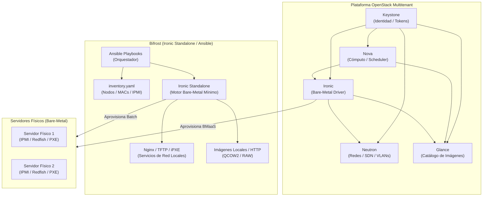
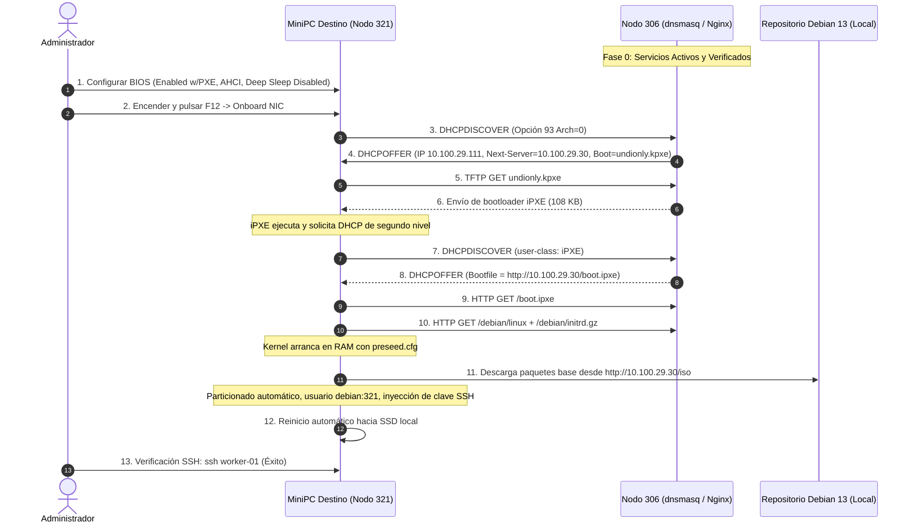

# Arquitectura y Comparativa: OpenStack Glance, Ironic y Bifrost
## Análisis de Viabilidad, Complementariedad y Selección Arquitectónica en Centros de Datos y Laboratorios Bare-Metal

---

## 1. Resumen Ejecutivo y Tesis Central

En la ingeniería de infraestructura moderna, existe un error conceptual frecuente: tratar a **Glance**, **Ironic** y **Bifrost** como alternativas que compiten entre sí. 

> [!IMPORTANT]
> **Tesis Arquitectónica**: **Glance, Ironic y Bifrost no compiten ni se excluyen mutuamente.** Pertenecen a niveles de abstracción y capas arquitectónicas distintas dentro del ecosistema de computación en la nube y aprovisionamiento bare-metal:
> * **Glance** es una *capa de catálogo y almacenamiento de imágenes* (el almacén de plantillas).
> * **Ironic** es un *motor de aprovisionamiento y gestión de ciclo de vida de hardware físico* (Bare Metal as a Service).
> * **Bifrost** es un *mecanismo de empaquetado y automatización ligera* que opera a Ironic en modo independiente (*standalone*) mediante Ansible, prescindiendo del resto de la suite OpenStack.

A continuación se detalla **por qué** están diseñados de esta manera, **por qué** se complementan, cuáles son los *trade-offs* de cada enfoque y cómo se aplican a entornos de producción y a nuestro laboratorio de miniPCs.

---

## 2. Analogía de Ingeniería para Comprensión Inmediata

Para visualizar la relación funcional entre los tres componentes, consideremos la analogía de una **planta automotriz industrial**:

| Componente | Analogía Industrial | Rol en Infraestructura |
| :--- | :--- | :--- |
| **Glance** | **El depósito central de planos y matrices de troquelado.** | Almacena y cataloga las imágenes de disco (`.qcow2`, `.raw`, `.iso`), controlando versiones, metadatos y visibilidad. |
| **Ironic (Completo)** | **La línea de ensamblaje robótica totalmente automatizada.** | Toma un chasis de metal desnudo, lo alimenta con energía, conecta el cableado a la línea adecuada y le estampa la matriz del molde. |
| **Bifrost (Standalone)** | **El técnico especialista con un brazo robótico portátil y un manual.** | Utiliza el mismo brazo mecánico (Ironic) pero sin necesidad de construir todo el edificio de la fábrica (sin Nova, Keystone, Neutron). |
| **OpenStack Completo** | **La corporación automotriz completa con concesionaria y portal web.** | Incluye ventas, facturación, cuentas de clientes (Keystone), contratos de red (Neutron) y entrega bajo demanda tanto de autos virtuales como físicos. |

---

## 3. Desglose Técnico en Profundidad: ¿Por qué existe cada uno y cómo opera?



---

### 3.1. OpenStack con Glance: El Estándar Esencial de Almacenamiento

#### ¿Por qué existe Glance?
En sistemas distribuidos, desacoplar el **cómputo** del **almacenamiento de plantillas** es una regla de diseño fundamental. Si Nova (máquinas virtuales) o Ironic (bare-metal) tuvieran que gestionar directamente la subida, compresión, deduplicación y almacenamiento de las imágenes de disco en múltiples backends (Ceph, S3, NFS, Swift), la complejidad de cada servicio se dispararía.

Glance existe para resolver un único problema con excelencia: **ser la única fuente de verdad para imágenes de disco y plantillas de sistemas operativos**.

#### ¿Cómo opera internamente?
1. **API y Catálogo**: Expone una API REST que permite registrar metadatos (arquitectura de CPU, hipervisor recomendado, tipo de firmware BIOS/UEFI, propiedades de cloud-init).
2. **Backend de Almacenamiento**: Glance almacena los metadatos en una base de datos relacional (MariaDB/PostgreSQL) y el contenido binario real en un *storage backend* desacoplado:
   * **Ceph RBD**: Permite clonación instantánea (*Copy-on-Write*) en milisegundos.
   * **Directorio de Archivos Local (`file`)**: Almacenamiento en disco `/var/lib/glance/images/`.
   * **OpenStack Swift / S3**: Almacenamiento de objetos escalable.
3. **Flujo con los consumidores**:
   * Cuando Nova lanza una VM, le pide a Glance la imagen `debian-13.qcow2`.
   * Cuando Ironic aprovisiona un servidor físico, consulta a Glance para descargar la imagen RAW/QCOW2 que se volcará sobre el NVMe o SSD.

#### ¿Por qué Glance NO es un instalador de servidores?
Glance almacena bits de disco pasivos. **No sabe encender un servidor físico, no sabe configurar un switch de red y no ejecuta instaladores interactivos.** Por eso Glance nunca puede operar en solitario para instalar un servidor; requiere forzosamente de Nova o de Ironic.

---

### 3.2. OpenStack con Ironic: Bare Metal as a Service (BMaaS) Completo

#### ¿Por qué existe Ironic?
Durante años, la nube privada fue sinónimo exclusivo de **Máquinas Virtuales** (hipervisores KVM/Xen/VMware). Sin embargo, ciertos escenarios no toleran la capa de virtualización:
1. **Pérdida de rendimiento (*Hypervisor Tax*)**: En cargas de trabajo de Machine Learning, GPU Pass-through masivo o bases de datos con millones de IOPS en NVMe.
2. **Virtualización anidada ineficiente**: Desplegar Kubernetes o OpenShift sobre VMs añade capas redundantes de SDN y aislamiento.
3. **Licenciamiento por socket/core**: Ciertos motores de software corporativo exigen ejecutarse sobre hardware físico directo.

Ironic se creó para transformar un servidor físico en una instancia gestionable por API **exactamente como si fuera una máquina virtual**, con el mismo ciclo de vida: creación, asignación de IP, encendido, apagado, formateo y eliminación.

#### ¿Cómo opera el ciclo de vida de Ironic?
Ironic orquesta un flujo riguroso de estados en cada servidor físico:

```text
+----------+      Enroll      +------------+     Inspect     +-------------+
|  Físico  | ---------------> | Manageable | --------------> |  Available  |
| Apagado  |                  +------------+                 +------+------+
+----------+                                                        |
                                                              Deploy| (Nova/API)
                                                                    v
+----------+     Delete       +------------+     IPA Write   +-------------+
|  Active  | ---------------> |  Cleaning  | <-------------- |  Deploying  |
|  (Listo) |                  +------------+     (Ramdisk)   +-------------+
+----------+
```

1. **Gestión Fuera de Banda (OOB / BMC)**: Ironic se conecta al BMC del servidor físico vía **IPMI**, **Redfish**, **iDRAC** (Dell) o **iLO** (HPE) para controlar el encendido, apagado y orden de arranque de forma remota y sin intervención humana.
2. **Inspección de Hardware**: Enciende el servidor por PXE cargando un ramdisk en memoria RAM denominado **IPA (Ironic Python Agent)**. Este agente audita la CPU, cantidad de RAM, modelo exacto de discos y direcciones MAC, reportando el inventario a la base de datos de Ironic.
3. **Despliegue Asistido (Deploying)**:
   * Ironic vuelve a encender el nodo con IPA.
   * IPA descarga la imagen dorada (`.qcow2` o `.raw`) directamente desde Glance o un servidor HTTP.
   * IPA escribe los bloques binarios directamente sobre el disco físico `/dev/sda` o `/dev/nvme0n1` usando `dd` o `qemu-img`.
   * Escribe la partición de arranque EFI y configura la configuración de red y llaves SSH mediante `cloud-init`.
4. **Limpieza Automatizada (*Cleaning*)**: Al destruir la instancia, Ironic limpia los discos (borrado seguro de bloques con `shred` o borrado criptográfico ATA/NVMe) para que el siguiente usuario no pueda recuperar datos del anterior (garantía multitenant).
5. **Aislamiento Dinámico de Red (Neutron)**: A través del plugin `networking-generic-switch` o agentes ML2, Ironic reconfigura los switches físicos del centro de datos para cambiar el puerto del servidor de la VLAN de aprovisionamiento hacia la VLAN privada del cliente.

---

### 3.3. OpenStack con Bifrost: Ironic Independiente (Standalone)

#### ¿Por qué existe Bifrost?
Desplegar una nube OpenStack completa implica levantar decenas de servicios: Keystone, MariaDB Galera, RabbitMQ, Nova (Scheduler, Conductor, API), Neutron (Server, OVS/OVN agents), Glance, Horizon, Memcached, etc. Esto requiere:
* Al menos **3 servidores dedicados de plano de control** en alta disponibilidad.
* Entre **32 GB y 64 GB de memoria RAM** solo para mantener vivos los servicios de OpenStack.
* Semanas de configuración y resolución de problemas de integración entre microservicios.

El propio equipo de OpenStack se enfrentó a un dilema fundamental:
> *"Para desplegar OpenStack en servidores físicos, necesitamos que los servidores físicos tengan instalado un sistema operativo base. Si necesitamos OpenStack para instalar servidores físicos, ¿quién instala los servidores físicos que van a ejecutar OpenStack?"*

Este problema del huevo y la gallina (*bootstraping* del centro de datos o **Undercloud**) dio origen a **Bifrost**:
* **Bifrost** es un conjunto de playbooks y roles de **Ansible** que instala e inicializa **Ironic en modo independiente (*standalone*)**.
* **Elimina Keystone**: Ironic opera sin tokens ni autenticación compleja; la seguridad reside en la máquina de administración.
* **Elimina Nova**: No hay planificador de máquinas virtuales; el inventario de qué servidor instalar se define en un archivo estático `inventory.yaml`.
* **Elimina Neutron**: La red de aprovisionamiento se gestiona con un servicio local ligero (`dnsmasq` con soporte TFTP/iPXE).
* **Elimina Glance**: Las imágenes pueden ser archivos `.qcow2` servidos directamente desde un Nginx local.

#### ¿Cómo opera Bifrost?
1. Se define un archivo `inventory.yaml` con la lista de servidores:
   ```yaml
   nodes:
     - name: k8s-worker-01
       driver: ipmi # o redfish / manual-power
       ipmi_address: 10.100.29.211
       ipmi_username: root
       ipmi_password: calvin
       driver_info:
         deploy_kernel: http://10.100.29.30/ipa.kernel
         deploy_ramdisk: http://10.100.29.30/ipa.initramfs
       instance_info:
         image_source: http://10.100.29.30/images/debian-13.qcow2
         image_checksum: a1b2c3d4...
   ```
2. Se ejecuta el playbook de Ansible:
   ```bash
   ansible-playbook -vvvv -i inventory/localhost enroll.yaml
   ansible-playbook -vvvv -i inventory/localhost deploy-dynamic.yaml
   ```
3. Bifrost le ordena a Ironic encender los nodos por IPMI/Redfish, descargar la imagen dorada y escribirla en disco, dejando el sistema operativo instalado en minutos sin haber instalado jamás OpenStack completo.

---

## 4. Matriz Comparativa y Criterios de Selección Arquitectónica

A continuación se analizan las diferencias operativas y técnicas reales entre las tres arquitecturas:

| Criterio de Comparación | 1. OpenStack Clásico (con Glance) | 2. OpenStack + Ironic + Glance | 3. Bifrost (Ironic Standalone) |
| :--- | :--- | :--- | :--- |
| **Tipo de Instancia que entrega** | **Máquinas Virtuales** (KVM / QEMU). | **Servidores Físicos** (Bare-Metal). | **Servidores Físicos** (Bare-Metal). |
| **Servicios Requeridos** | Keystone, Nova, Glance, Neutron, Cinder, MariaDB, RabbitMQ. | Ironic + Keystone + Nova + Glance + Neutron + MariaDB + RabbitMQ. | Ironic (mínimo) + Ansible + dnsmasq + SQLite/MariaDB mínima. |
| **Consumo de Recursos de Control** | **Alto** (16 a 32 GB RAM para el control plane). | **Muy Alto** (32 a 64 GB RAM para el control plane redundante). | **Extremadamente Bajo** (2 a 4 GB RAM en un único nodo). |
| **Soporte Multitenancy** | **Total**: Aislamiento estricto de proyectos, cuotas de cómputo y redes virtuales. | **Total**: Redes físicas aisladas dinámicamente en switches por proyecto. | **Nulo**: Entorno de un solo usuario (herramienta interna para administradores). |
| **Interfaz de Usuario** | Portal Web (Horizon) y CLI unificada (`openstack server create`). | Portal Web (Horizon) y CLI unificada (`openstack server create --flavor baremetal`). | Línea de comandos mediante Playbooks de Ansible (`ansible-playbook`). |
| **Gestión de Redes de Clientes** | Redes virtuales sobre SDN (Geneve, VXLAN, VLAN). | Reconfiguración dinámica de puertos en switches físicos L2/L3 (Neutron). | Red estática preconfigurada en los switches (VLAN fija). |
| **Limpieza de Discos (*Cleaning*)** | Instantánea (se destruye el archivo de disco virtual). | Profunda y automatizada tras cada uso (borrado criptográfico ATA/NVMe). | Opcional o simplificada (definida por Ansible). |
| **Curva de Aprendizaje** | Media a Alta (requiere dominar OpenStack). | Muy Alta (requiere dominar OpenStack + redes físicas + firmware de servidores). | Baja a Media (requiere dominar Ansible e Ironic básico). |
| **Caso de Uso Primario** | Nube privada para desarrollo ágil, microservicios y VMs tradicionales. | Nube privada/pública para IA/ML, GPU clusters y Kubernetes sobre metal. | Preparación inicial de centros de datos (*Undercloud*) y despliegue masivo por lotes. |

---

## 5. Justificación Técnica: ¿Por qué NO implementar OpenStack, Ironic o Bifrost en nuestro trabajo actual?

En este punto surge la pregunta arquitectónica obligada:
> *"Si OpenStack con Ironic y Bifrost son estándares consolidados en la industria, ¿por qué no implementarlos directamente en el trabajo que estamos realizando en nuestro laboratorio?"*

La respuesta no es ideológica ni de preferencia personal; es **una decisión técnica y pragmática de ingeniería de infraestructura basada en tres realidades ineludibles**:
1. **El uso y agotamiento de recursos (RAM, CPU, Almacenamiento)**.
2. **La naturaleza de la BIOS y el firmware de nuestros miniPCs (Dell OptiPlex 3020M)**.
3. **La topología de la infraestructura de red física y la convivencia con la oficina**.

A continuación se desglosa en detalle cada una de estas tres razones.

---

### 5.1. Razones por el Uso de Recursos (Cómputo, Memoria y Almacenamiento)

#### A. El Balance de Inventario Real de Nuestro Laboratorio
Nuestro parque de hardware está compuesto exactamente por **8 miniPCs físicos** con especificaciones de escritorio:
* **Nodo 314 (`bastion`)**: 8 GB RAM, 128 GB disco (Bastión SSH, K8s control).
* **Nodo 315 (`nexus-repo`)**: 16 GB RAM, 128 GB disco (Sonatype Nexus 3 en Java JVM + PostgreSQL 17; consume actualmente ~4 a 6 GB de RAM continua).
* **Nodo 306 (`pxe-controller`)**: 16 GB RAM, 128 GB disco (Servidor PXE, TFTP, Nginx, Gateway Wi-Fi).
* **Nodos de Cómputo (5 miniPCs)**:
  - `k8s-cp-01` (Nodo 269): 16 GB RAM, 128 GB disco.
  - `k8s-cp-02` (Nodo 280): 16 GB RAM, 128 GB disco.
  - `k8s-cp-03` (Nodo 320): 16 GB RAM, 128 GB disco.
  - `k8s-worker-01` (Nodo 321): 8 GB RAM, 128 GB disco.
  - `k8s-worker-02` (Nodo 279): 8 GB RAM, 128 GB disco.

El **objetivo primario** del proyecto es desplegar un **clúster de Kubernetes en alta disponibilidad** (3 nodos de plano de control para quórum etcd impar + 2 nodos workers para cargas de trabajo). Esto requiere **los 5 nodos completos dedicados al clúster**.

#### B. La Huella de Memoria (*Memory Footprint*) de OpenStack
Incluso en su versión más compacta y contenerizada (mediante herramientas como *Kolla-Ansible* o *OpenStack-Ansible*), el plano de control mínimo de OpenStack para soportar Ironic y Glance requiere ejecutar en segundo plano:

| Microservicio / Demonio | Función Crítica | Consumo de RAM Mínimo Estimado |
| :--- | :--- | :--- |
| **MariaDB Galera Cluster** | Base de datos relacional para todos los microservicios | 2.0 GB - 4.0 GB |
| **RabbitMQ** | Bus de mensajería AMQP para coordinación interna | 1.0 GB - 2.0 GB |
| **Keystone** (API + WSGI) | Servicio de autenticación, catálogo y tokens criptográficos | 1.0 GB - 1.5 GB |
| **Nova Controller + Conductor + API** | Planificación y ciclo de vida de cómputo | 2.5 GB - 4.0 GB |
| **Glance API + Registry** | Catálogo, subida y streaming de imágenes de disco | 1.0 GB - 2.0 GB |
| **Neutron Server + Agentes SDN** | Gestión de topología de red física y virtual | 2.0 GB - 3.5 GB |
| **Ironic Conductor + Ironic API** | Motor de aprovisionamiento Bare-Metal y control OOB | 2.0 GB - 3.0 GB |
| **Memcached, HAProxy, Keepalived** | Balanceo de carga y caché de sesiones | 1.0 GB |
| **Total Mínimo de Control Plane:** | — | **12.5 GB a 21.0 GB de RAM continua** |

#### C. El Impacto de Ingeniería en Nuestro Hardware:
1. **Imposibilidad de ejecución en Nodo 306**: Si desplegamos este plano de control en el Nodo 306 (que dispone de 16 GB), el uso de memoria rondaría el 100%, provocando que el kernel invoque el **OOM-Killer (Out of Memory Killer)**, terminando de forma aleatoria procesos críticos como Nginx, PostgreSQL o dnsmasq.
2. **Canibalización del Clúster de Kubernetes**: Si desplegamos el plano de control distribuido de OpenStack entre varios nodos para no saturar al Nodo 306, tendríamos que "sacrificar" **al menos 3 miniPCs enteros** exclusivamente para el control de OpenStack. Nos quedaríamos únicamente con 2 miniPCs, haciendo **imposible** tener un clúster de Kubernetes HA (que requiere un mínimo de 3 nodos de control para el algoritmo de consenso Raft de etcd).
3. **Limitación de Almacenamiento en Disco (128 GB)**:
   * Las imágenes que Glance maneja para bare-metal son de gran tamaño. Una imagen dorada de Debian o Ubuntu en formato `.qcow2` pesa ~2 GB comprimida, pero para que Ironic la estampe sobre el metal mediante IPA, debe descomprimirse o convertirse a formato `.raw` (ocupando entre **10 GB y 30 GB por imagen**).
   * Almacenar múltiples versiones de imágenes, instantáneas y el caché local de Ironic agotaría rápidamente el disco de 128 GB, dejando al nodo sin espacio para logs del sistema o repositorios de paquetes.

#### D. Comparativa de Consumo: Solución Actual vs OpenStack
* **Nuestra Solución Actual (`dnsmasq` + `iPXE` + `Nginx` + `preseed.cfg`)**:
  - Consumo de RAM de `dnsmasq`: **< 10 MB**.
  - Consumo de RAM de `Nginx`: **< 25 MB**.
  - Espacio en disco de la ISO Debian montada: **750 MB** (montaje loop de solo lectura).
  - **Sobrecarga total en el Nodo 306: Menos del 0.5% de los recursos del equipo.**
  - Deja el **99.5% de CPU, RAM y disco libres** para el funcionamiento holgado de Nexus Sonatype, tareas de compilación y monitoreo.

---

### 5.2. Razones por la BIOS y el Firmware (Dell OptiPlex 3020M y Ausencia de BMC)

#### A. La Dependencia Estricta de Ironic hacia Controladoras Fuera de Banda (BMC)
En centros de datos reales, OpenStack Ironic está diseñado para comunicarse con servidores empresariales (ej. Dell PowerEdge con **iDRAC Enterprise**, HPE ProLiant con **iLO Advanced**, o servidores Open Compute con **OpenBMC**).
Estas plataformas cuentan con un **procesador de servicio autónomo (BMC)** que dispone de:
* Un puerto Ethernet físico independiente con su propia dirección MAC e IP fija.
* Hardware que opera 24/7 incluso con el servidor apagado (*standby power*).
* Soporte nativo para protocolos estándar: **IPMI sobre LAN (UDP 623)** y **Redfish API (HTTPS)**.
* Capacidad de manipular por software el orden de arranque antes de encender:
  ```bash
  # Ironic fuerza al hardware a arrancar por red una sola vez mediante IPMI:
  ipmitool -H 10.100.29.200 -U root -P secret chassis bootdev pxe options=efiboot
  ipmitool -H 10.100.29.200 -U root -P secret power reset
  ```

#### B. La Realidad Física de los Dell OptiPlex 3020 Micro (`3020M`):
Nuestros equipos son computadoras de escritorio comerciales (*Small/Micro Form Factor*), arquitectura Intel Haswell (4ª generación). Sus limitaciones de firmware son críticas:
1. **Ausencia Total de BMC / iDRAC Dedicado**:
   * No existe una controladora de gestión con IP independiente a la cual Ironic pueda conectarse.
   * No existe compatibilidad con **IPMI sobre LAN** ni con la API moderna de **Redfish**.
   * No hay sensores de telemetría de energía, temperatura ni diagnóstico de chasis.
2. **El "Callejón sin Salida" de Wake-on-LAN (WoL)**:
   * En equipos de escritorio, la única alternativa de encendido remoto es **Wake-on-LAN (WoL)** mediante paquetes mágicos UDP broadcast.
   * WoL es un mecanismo ciego y unidireccional: **no tiene confirmación de estado (*handshake*)**. Si el miniPC no enciende (por modo de ahorro de energía ErP/EuP activo en la BIOS, o cable desconectado), Ironic no tiene forma de saber si el comando tuvo éxito y entrará en bucle de error (*Node State: Maintenance*).
   * WoL **no puede forzar un apagado de emergencia (*hard power-off*)** ni puede destrabar un nodo si el sistema operativo queda congelado (*kernel panic*).
3. **Limitaciones Específicas de la BIOS Dell A05 (OptiPlex 3020M)**:
   * Como comprobamos directamente en las pruebas prácticas de laboratorio, la BIOS de estos equipos:
     - No expone un menú moderno de configuración de *Network Stack* con separación explícita de "IPv4 PXE" e "IPv6 PXE".
     - Mantiene el firmware PXE desactivado por defecto (`Integrated NIC: Disabled` o `Enabled` sin PXE), requiriendo intervención humana obligatoria para cambiarlo a `Enabled w/PXE`.
     - En el menú de arranque F12, el arranque por red se expone únicamente como opción Legacy bajo la etiqueta **`Onboard NIC`** a través de la Option ROM de Realtek.
     - **No permite manipular el orden de arranque por red de forma remota**: Ironic no puede ordenarle a la BIOS de la OptiPlex 3020M "arranca por red solo esta vez para instalar y luego arranca desde el disco SSD". Si dejamos `Onboard NIC` en primer lugar, el nodo entrará en un ciclo infinito de reinstalación cada vez que se reinicie.

---

### 5.3. Razones por la Infraestructura de Red Física (Switches, VLANs y Convivencia de Oficina)

#### A. El Modelo de Red Exigido por OpenStack Ironic + Neutron
Para operar de forma limpia y segura, Ironic exige una topología de red física segmentada en al menos dos VLANs aisladas controladas por software (SDN):
1. **VLAN de Aprovisionamiento (*Provisioning Network*)**: Red aislada y no enrutada donde el servicio DHCP de Ironic/Neutron atiende peticiones PXE y transfiere los ramdisks IPA y las imágenes de sistema operativo.
2. **VLAN de Producción / Tenant (*Tenant Network*)**: Red definitiva donde el nodo opera tras ser instalado.

Para alternar entre ambas redes de forma 100% automatizada, OpenStack Neutron se integra directamente con los switches físicos del centro de datos mediante plugins como `networking-generic-switch` o controladores OpenFlow/NETCONF. Cuando un nodo va a ser aprovisionado, Neutron reconfigura el puerto del switch del nodo a la VLAN de aprovisionamiento; cuando termina, cambia el puerto a la VLAN de producción.

```text
+-------------------------------------------------------------------------+
|                  RED DE OFICINA COMPARTIDA (10.100.29.0/24)             |
|  [Teléfonos Móviles]   [Laptops Personales]   [Impresoras]   [Gateway]  |
+------------------------------------+------------------------------------+
                                     | (Mismo dominio de broadcast)
                                     v
+------------------------------------+------------------------------------+
|                      SWITCH FÍSICO DE LABORATORIO                       |
|   Puerto 1      Puerto 2      Puerto 3      Puerto 4      Puerto 5      |
+-------+-------------+-------------+-------------+-------------+---------+
        |             |             |             |             |
        v             v             v             v             v
   [Nodo 314]    [Nodo 315]    [Nodo 306]    [Nodo 320]    [Nodo 321]
   (Bastión)      (Nexus)        (PXE)       (K8s-CP-03)   (K8s-Work-01)
```

#### B. La Realidad de Nuestra Infraestructura Física Actual:
1. **Convivencia Directa en el Mismo Dominio de Broadcast (`10.100.29.0/24`)**:
   * En nuestro laboratorio, el puerto Ethernet de los miniPCs comparte el mismo medio de red con la red de oficina.
   * Como evidenciamos en los registros de `dnsmasq`, dispositivos ajenos como teléfonos celulares (`Redmi-Note-14-Pro`), laptops (`MBP-de-Santos`) y equipos de otros usuarios emiten continuamente paquetes `DHCPDISCOVER`.
2. **El Peligro Crítico de un Servidor DHCP No Blindado (Ironic / Neutron)**:
   * El servicio DHCP de OpenStack Neutron está diseñado para asumir que controla la red completa: responde a **cualquier cliente** que emita un broadcast en su VLAN de aprovisionamiento.
   * Si levantamos el servicio DHCP de OpenStack en esta red sin switches con aislamiento estricto de VLANs 802.1Q:
     - **Ironic respondería a las laptops y teléfonos de la oficina**, entregándoles configuraciones de arranque por red o IPs del clúster.
     - Provocaría una **caída masiva de red en la oficina** por colisión de servidores DHCP (*Rogue DHCP Server*), un incidente grave de infraestructura.
3. **Por qué Nuestra Solución Actual con `dnsmasq` Blindado es Superior para esta Realidad**:
   * Hemos implementado un filtrado estricto en el archivo de configuración de `dnsmasq` mediante:
     ```conf
     # Regla comodín para identificar solo el hardware del clúster Dell
     dhcp-mac=set:known,64:00:6a:2a:*:*:*
     # Ignorar cualquier petición ajena
     dhcp-ignore=tag:!known
     ```
   * Esta regla actúa como un **cortafuegos de Capa 2**: cuando una laptop de la oficina o un teléfono móvil emite una petición DHCP, `dnsmasq` la descarta silenciosamente (`ignorado`). Atiende **única y exclusivamente** a los miniPCs del clúster cuya MAC coincida con el fabricante Dell del laboratorio. Ironic y Neutron no ofrecen esta flexibilidad ligera sin una compleja infraestructura SDN.

---

### 5.4. ¿Por qué tampoco implementar Bifrost Standalone en ESTA fase exacta?

Si bien Bifrost elimina la pesadez de Nova, Keystone y Neutron, implementarlo en esta fase exacta presenta dos inconvenientes técnicos:

1. **El Peso del Ramdisk IPA (*Ironic Python Agent*)**:
   * Bifrost no utiliza un instalador clásico de Debian; utiliza el ramdisk IPA en memoria RAM.
   * El ramdisk de IPA (`ipa.kernel` + `ipa.initramfs`) tiene un tamaño aproximado de **600 MB a 800 MB**.
   * En enlaces Ethernet de 100 Mbps o con tarjetas de red que negocian en modo Legacy PXE, transferir un archivo de 800 MB por TFTP/HTTP antes de que la máquina inicie toma varios minutos y satura la red local.
   * En contraste, el instalador de red Debian que tenemos en el Nodo 306 (`linux` + `initrd.gz`) pesa únicamente **~50 MB** y descarga en menos de 3 segundos.
2. **Dependencia de Imágenes Doradas Precompiladas**:
   * Bifrost exige contar de antemano con una imagen completa del disco (`.qcow2` o `.raw`) con `cloud-init` listo.
   * Para producir imágenes doradas limpias, reproducibles y seguras, se requiere un pipeline automatizado con **Packer**.
   * Intentar usar Bifrost antes de tener el pipeline de Packer y el almacenamiento en **Nexus Sonatype** es poner la carreta delante de los bueyes: tendríamos el instalador pero no tendríamos qué imagen estampar.

---

### 5.5. Hoja de Ruta Pragmática de Implementación

Para asegurar el éxito del proyecto sin sobrecargar el hardware ni romper la red de la oficina, la estrategia técnica de adopción por fases es la siguiente:

```text
+---------------------------------------------------------------------------------+
| FASE 1: Aprovisionamiento Base (ESTADO ACTUAL)                                  |
| * Tecnología: dnsmasq blindado + iPXE + Nginx + Preseed.cfg.                    |
| * Consumo: < 50 MB RAM en Nodo 306.                                             |
| * Resultado: Despliegue 100% desatendido de Debian 13 en los 5 nodos del clúster.|
| * Seguridad: Cero colisiones con la red de oficina.                             |
+---------------------------------------+-----------------------------------------+
                                        |
                                        v
+---------------------------------------------------------------------------------+
| FASE 2: Automatización de Imágenes Doradas (SIGUIENTE PASO)                     |
| * Tecnología: HashiCorp Packer + Nexus Sonatype (Nodo 315) + Bifrost (Ansible). |
| * Flujo: Packer compila Debian 13 optimizado con Kubernetes preinstalado.       |
| * Almacenamiento: La imagen .qcow2 se versiona en el repositorio Nexus.         |
| * Despliegue: Bifrost vuelva la imagen al disco en 90 segundos por nodo.        |
+---------------------------------------+-----------------------------------------+
                                        |
                                        v
+---------------------------------------------------------------------------------+
| FASE 3: Nube Privada y BMaaS Completo (PRODUCCIÓN EMPRESARIAL)                  |
| * Hardware Requerido: Servidores de rack (PowerEdge/ProLiant) con iDRAC/iLO     |
|   dedicado + Switches Top-of-Rack gestionados con soporte 802.1Q / SDN.        |
| * Tecnología: OpenStack Completo (Glance + Ironic + Nova + Neutron + Keystone). |
| * Propósito: Entregar infraestructura física y virtual como servicio (IaaS)     |
|   multitenant con facturación, cuotas y portales de autoservicio.               |
+---------------------------------------------------------------------------------+
```

---

## 6. Requerimientos Precisos de BIOS y Guía Operativa de Despliegue Paso a Paso

Para que el aprovisionamiento bare-metal de los nodos funcione de forma **100% predecible, ordenada y funcional**, se requiere estandarizar el firmware de los miniPCs y seguir un procedimiento operativo riguroso. A continuación se detallan los requisitos de la BIOS Dell y el paso a paso de ejecución.

---

### 6.1. Requerimientos Precisos de Configuración de la BIOS (Dell OptiPlex 3020M)

En las máquinas **Dell OptiPlex 3020 Micro (`3020M`)** con versión de BIOS A05 (o similar), los ajustes de fábrica vienen orientados al ahorro de energía en oficinas y ocultan el arranque por red. 

Para habilitar el despliegue bare-metal desatendido, **cada nodo debe configurarse exactamente con los siguientes parámetros**:

| Menú de la BIOS Dell (F2) | Parámetro / Opción | Valor de Fábrica | Valor OBLIGATORIO para Despliegue | Justificación Técnica de Ingeniería |
| :--- | :--- | :--- | :--- | :--- |
| **`System Configuration`** ➔ **`Integrated NIC`** | Firmware de Red y PXE | `Enabled` | 👉 **`Enabled w/PXE`** | **Crítico**: Si está solo en `Enabled`, la tarjeta de red funciona en el SO pero la BIOS oculta y bloquea el arranque por red. Debe estar en `Enabled w/PXE`. |
| **`System Configuration`** ➔ **`SATA Operation`** | Modo de Controladora de Disco | `RAID On` | 👉 **`AHCI`** | El instalador de Debian y el kernel Linux se comunican directamente con el SSD SATA/NVMe mediante el driver estándar AHCI sin requerir drivers propietarios Intel RST. |
| **`General`** ➔ **`Boot Sequence`** | Lista de Arranque | Disco local | 👉 Marcar **`Onboard NIC`** *(o `UEFI: IP4 Realtek...`)* | Si la casilla `[ ]` está desmarcada, el dispositivo no aparecerá en el menú de arranque F12. Debe estar marcada `[X]`. |
| **`General`** ➔ **`Advanced Boot Options`** | Option ROMs Heredadas | Desmarcado | 👉 **`Enable Legacy Option ROMs`** | Requerido en OptiPlex 3020 para permitir la carga del firmware PXE de Realtek en arranque híbrido/Legacy. |
| **`Security`** ➔ **`Secure Boot`** | Arranque Seguro UEFI | `Enabled` | 👉 **`Disabled`** | El encadenamiento hacia `undionly.kpxe` o scripts dinámicos de iPXE no firmados por Microsoft falla si Secure Boot está activo. |
| **`Power Management`** ➔ **`Deep Sleep Control`** | Ahorro Profundo de Energía | `Enabled` | 👉 **`Disabled`** | **Crítico**: Si está en `Enabled`, la tarjeta de red apaga sus chips al apagarse el equipo, perdiendo el enlace Ethernet y bloqueando Wake-on-LAN. |
| **`Power Management`** ➔ **`Wake on LAN`** | Encendido Remoto por Red | `Disabled` | 👉 **`LAN Only`** *(o `LAN with PXE Boot`)* | Permite enviar paquetes mágicos para despertar o encender los nodos remotamente desde el Nodo 306 o el Bastión. |
| **`POST Behavior`** ➔ **`Fastboot`** | Inicialización Rápida POST | `Minimal` | 👉 **`Thorough`** | Fuerza a la BIOS a inicializar y detectar todos los dispositivos de red y puertos USB en cada arranque en frío sin saltarse la ROM de red. |

---

### 6.2. Procedimiento Operativo de Despliegue Paso a Paso (Runbook Zero-Touch)

Para desplegar un nodo desde cero (ejemplo: Nodo 321 / `k8s-worker-01`), sigue este orden estricto de operaciones:



#### Fase 0: Verificación Previa del Controlador (Nodo 306)
Antes de encender el miniPC de destino, confirma en el Nodo 306 que los servicios base estén activos:
```bash
# 1. Verificar que el cable Ethernet tenga enlace físico (carrier = 1)
cat /sys/class/net/enp2s0/carrier

# 2. Verificar que dnsmasq esté activo y escuchando en la interfaz correcta
sudo systemctl is-active dnsmasq

# 3. Verificar que Nginx esté entregando el script y el kernel por HTTP
curl -sI http://10.100.29.30/boot.ipxe | grep "HTTP/1.1 200 OK"
curl -sI http://10.100.29.30/debian/linux | grep "HTTP/1.1 200 OK"
```

#### Fase 1: Preparación Física
1. Conectar el cable de red RJ45 del miniPC destino al switch del clúster.
2. Confirmar que los LEDs verde/ámbar del conector RJ45 parpadeen (señal de enlace de Capa 1).

#### Fase 2: Configuración de BIOS en el MiniPC (Solo la primera vez)
1. Encender el miniPC y presionar inmediatamente la tecla **`F2`** repetidamente.
2. Ir a **`System Configuration` ➔ `Integrated NIC`** y cambiar a **`Enabled w/PXE`**.
3. Ir a **`Power Management` ➔ `Deep Sleep Control`** y cambiar a **`Disabled`**.
4. Ir a **`General` ➔ `Boot Sequence`** y verificar que la casilla de red esté marcada `[X]`.
5. Clic en **`Apply`** y luego en **`Exit`**.

#### Fase 3: Disparo del Despliegue de Red
1. En cuanto la máquina reinicie de la BIOS, presionar repetidamente **`F12`** (Boot Menu de Dell).
2. En la lista de arranque, seleccionar:
   * En modo Legacy: 👉 **`Onboard NIC`**
   * En modo UEFI: 👉 **`UEFI: IP4 Realtek PCIe GBE Family Controller`**
3. Presionar **Enter**.

#### Fase 4: Monitoreo en Tiempo Real (Desde tu Terminal de Administrador)
Abre una terminal y observa la captura en vivo en el Nodo 306:
```bash
ssh n306-wifi "sudo journalctl -u dnsmasq -f"
```
**Salida esperada en tiempo real**:
```text
DHCPDISCOVER(enp2s0) 64:00:6a:2a:62:a4
DHCPOFFER(enp2s0) 10.100.29.111 64:00:6a:2a:62:a4
sent /tftpboot/undionly.kpxe to 10.100.29.111
DHCPDISCOVER(enp2s0) 64:00:6a:2a:62:a4 (user-class: iPXE)
sent size: 35 option: 67 bootfile-name http://10.100.29.30/boot.ipxe
```

**Lo que verás en la pantalla física del MiniPC**:
1. Menú azul iPXE:
   ```text
   ================================================================
     INSTALACION DEBIAN 13 (TRIXIE) 100% OFFLINE DESDE ISO NODO 306
   ================================================================
   Configurando red desde DHCP... IP asignada: 10.100.29.111
   Descargando Kernel Linux Debian 13.7.0... ok
   Descargando Initrd con Firmware y Preseed... ok
   Iniciando instalador desatendido 100% offline...
   ```
2. Pantalla azul del instalador Debian corriendo en modo completamente automático:
   * Particiona el disco de 128 GB en esquema atómico (`/` + swap).
   * Instala los paquetes base desde `http://10.100.29.30/iso`.
   * Crea el usuario `debian` con clave `321` y privilegios `sudo NOPASSWD`.
   * Inyecta la clave pública SSH corporativa en `/home/debian/.ssh/authorized_keys`.
   * Instala el cargador GRUB en el disco local y reinicia automáticamente.

#### Fase 5: Validación Post-Despliegue y Acceso SSH
Una vez que el miniPC se reinicie, arrancará directamente desde su disco local SSD sin volver a entrar al instalador.

Prueba la conexión desde tu terminal de trabajo:
```bash
# Probar ping
ping -c 2 10.100.29.111

# Conectarse vía SSH (entra directo sin contraseña gracias a tu clave pública)
ssh worker-01
```

Comprueba el estado final dentro del nodo:
```bash
# Verificar hostname asignado por DHCP
hostname -f
# Salida esperada: k8s-worker-01.lab.local

# Verificar salida a internet a través del Gateway del Nodo 306
curl -I https://www.google.com
# Salida esperada: HTTP/2 200
```

---

### 6.3. Matriz de Diagnóstico y Resolución de Problemas (Troubleshooting)

Si algún paso del despliegue presenta comportamientos inesperados, consulta esta tabla de causas raíz y soluciones inmediatas:

| Síntoma en Pantalla | Causa Raíz Técnica | Solución Inmediata |
| :--- | :--- | :--- |
| **No aparece "Onboard NIC" en el menú F12** | En la BIOS, la opción `Integrated NIC` está en `Enabled` simple o `Disabled`. | Entrar a la BIOS (F2) ➔ `System Configuration` ➔ `Integrated NIC` ➔ Seleccionar **`Enabled w/PXE`** ➔ Guardar (Apply). |
| **Se queda clavado en `>>Start PXE over IPv4...`** | El cable Ethernet de Nodo 306 o del miniPC está desconectado (`carrier = 0`), o `dnsmasq` está ignorando la MAC. | 1. Verificar `cat /sys/class/net/enp2s0/carrier` en Nodo 306 (debe ser 1).<br>2. Confirmar que la MAC del nodo comience con `64:00:6a:2a:` para coincidir con la regla comodín de `dnsmasq`. |
| **Dice `TFTP Aborted` o `Timeout` al descargar el bootloader** | El cable tiene falso contacto, negocia a half-duplex o el puerto del switch tiene tormenta de broadcast. | Reasentar el conector RJ45 hasta que haga clic firme. Verificar en `dmesg` que negocie `100Mbps/Full` o `1Gbps/Full`. |
| **Arranca el sistema viejo en disco en vez de la instalación** | No se presionó F12 a tiempo o el orden de arranque de la BIOS tiene el disco SSD por encima de la red. | Reiniciar la máquina y presionar inmediatamente la tecla **F12** en cuanto se encienda la luz del botón de encendido. |
| **Bucle infinito: El nodo se instala, reinicia y vuelve a reinstalarse** | La opción `Onboard NIC` se colocó de primera en el orden estático de arranque de la BIOS. | En la BIOS (F2) ➔ `Boot Sequence`, dejar el **disco local SSD de primero**, y usar **F12 de forma manual** únicamente cuando se desee reinstalar el nodo. |
| **Error `No se ha podido localizar el paquete openssh-server`** | En instalaciones manuales, la puerta de enlace (`gateway`) no tiene salida a internet o `/etc/apt/sources.list` apunta a repositorios viejos. | Apuntar la ruta por defecto al Nodo 306 (`sudo ip route replace default via 10.100.29.30`) y usar el repositorio oficial de Debian 13 (`trixie`). |

---

## 7. Referencias Oficiales y Documentación de Arquitectura

1. **OpenStack Glance Documentation**: [https://docs.openstack.org/glance/latest/](https://docs.openstack.org/glance/latest/)
2. **OpenStack Ironic (Bare Metal) Architecture Guide**: [https://docs.openstack.org/ironic/latest/user/architecture.html](https://docs.openstack.org/ironic/latest/user/architecture.html)
3. **OpenStack Bifrost (Standalone Ironic Deployment)**: [https://docs.openstack.org/bifrost/latest/](https://docs.openstack.org/bifrost/latest/)
4. **Ironic Python Agent (IPA) Internals**: [https://docs.openstack.org/ironic-python-agent/latest/](https://docs.openstack.org/ironic-python-agent/latest/)
5. **OpenStack Kolla-Ansible Baremetal Deployment Guide**: [https://docs.openstack.org/kolla-ansible/latest/reference/bare-metal/ironic-guide.html](https://docs.openstack.org/kolla-ansible/latest/reference/bare-metal/ironic-guide.html)
6. **Dell OptiPlex 3020 / 3020M Technical Guidebook**: [https://i.dell.com/sites/csdocuments/Shared-Content_data-Sheets_Documents/en/optiplex-3020-micro-spec-sheet.pdf](https://i.dell.com/sites/csdocuments/Shared-Content_data-Sheets_Documents/en/optiplex-3020-micro-spec-sheet.pdf)


