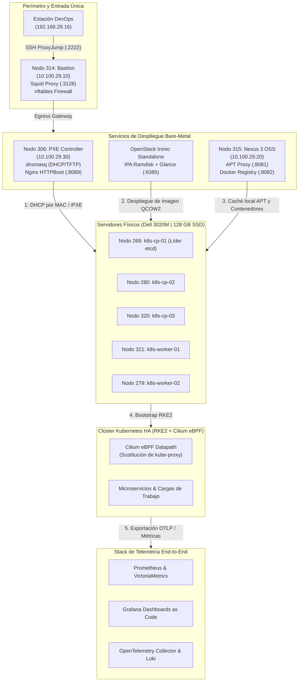

# Infraestructura Bare-Metal Edge, OpenStack Ironic & Kubernetes HA


Plataforma de infraestructura bare-metal, automatización declarativa y clúster de Kubernetes de Alta Disponibilidad desplegado sobre **8 servidores físicos Dell OptiPlex 3020M** en una subred privada aislada (`10.100.29.0/24`).

---

## 🏗️ Diagrama de Arquitectura y Flujo de Aprovisionamiento



---

## ⚡ Quickstart de 10 Líneas

Para verificar, desplegar y auditar la infraestructura desde tu terminal:

```bash
# 1. Crear entorno seguro de claves y contraseñas
echo "tu_password_maestra" > .vault_pass && chmod 600 .vault_pass

# 2. Validar sintaxis y estándares de calidad
make lint

# 3. Comprobar conectividad y telemetría de hardware
make preflight

# 4. Desplegar configuración base y endurecimiento perimetral
make base

# 5. Desplegar servicios centrales (Nexus, PXE, Ironic)
make services

# 6. Desplegar el clúster Kubernetes HA (RKE2 + Cilium)
make platform

# 7. Desplegar la suite de observabilidad
make observability

# 8. Verificar salud integral de la flota
make health
```

---

## 📁 Estructura del Repositorio

```text
infra-scripts/
├── Makefile                   # Punto de entrada unificado para todas las operaciones
├── ansible.cfg                # Configuración canónica de Ansible para la infraestructura
├── inventory/                 # ÚNICA FUENTE DE VERDAD física y lógica
│   ├── nodes.csv              # Matriz de hardware (MACs, IPs, roles, especificaciones)
│   ├── lab/                   # Entorno de pruebas / staging activo
│   │   ├── hosts.yml          # Inventario YAML de Ansible por roles
│   │   └── group_vars/        # Variables (vars.yml, observability.yml, vault.yml)
│   └── prod/                  # Entorno productivo segregado
├── ansible/                   # Automatización declarativa por fases numeradas
│   ├── site.yml               # Orquestador maestro integral
│   ├── playbooks/             # 00-preflight, 10-base, 20-services, 30-platform, etc.
│   └── roles/                 # common, bastion, nexus, pxe_controller, ironic, rke2_ha, monitoring
├── openstack/                 # Aprovisionamiento Kolla-Ansible (Ironic Standalone & Glance)
│   ├── globals.yml, inventory/multinode, config/, secrets/
├── cloud-init/                # Plantillas Packer HCL2, user-data y generador de ConfigDrive
├── nexus/                     # Repositorios, cuotas de disco y políticas de purga como código
├── kubernetes/                # Manifiestos K8s, apps y observabilidad (Kustomize base/overlays)
├── network/                   # dnsmasq DHCP/TFTP, toolchain iPXE custom y reglas nftables
├── scripts/                   # Scripts auxiliares (bootstrap, diagnostics, ops, client)
├── artifacts/                 # [GITIGNORED] Binarios IPA, ISOs e imágenes con script de descarga
├── backups/                   # [GITIGNORED] Snapshots y volcados temporales de DR
└── docs/                      # Documentación completa, runbooks, referencias y ADRs
```

Para consultar la documentación completa, diagramas y runbooks operativos, accede al [**Índice Maestro de Documentación (`docs/README.md`)**](docs/README.md).
