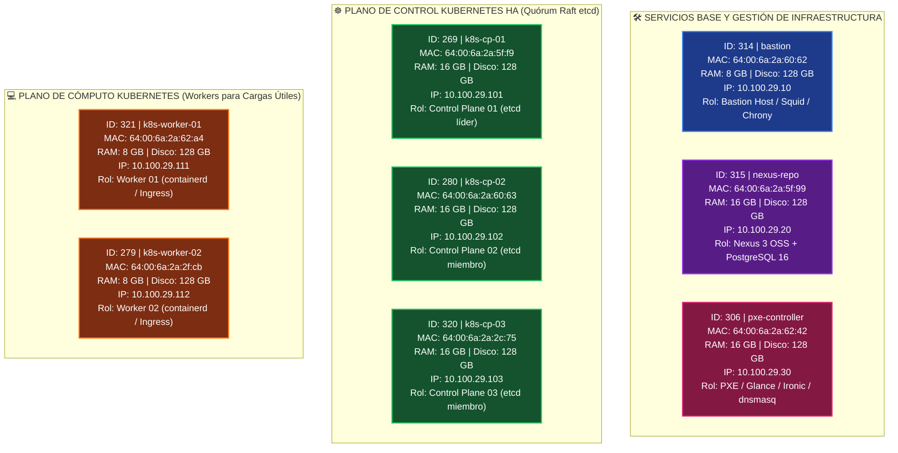
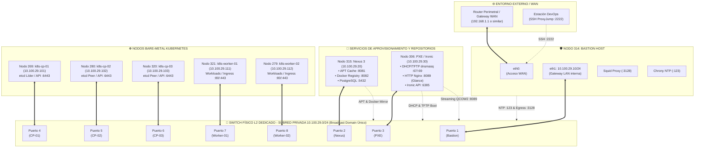
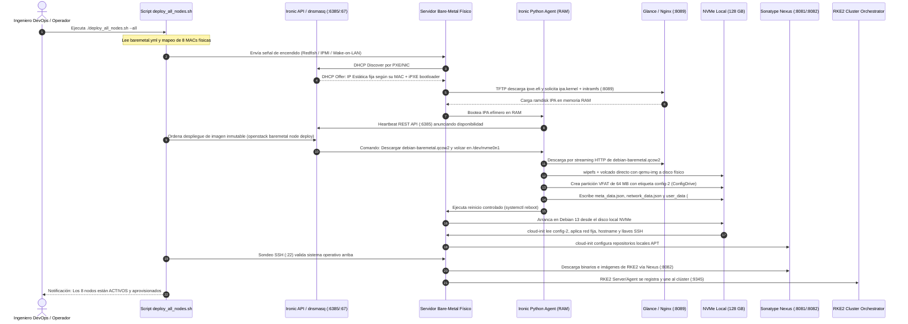
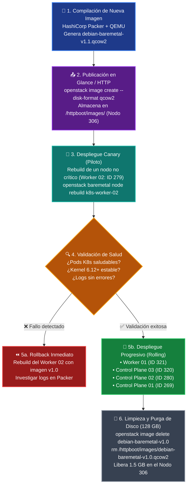
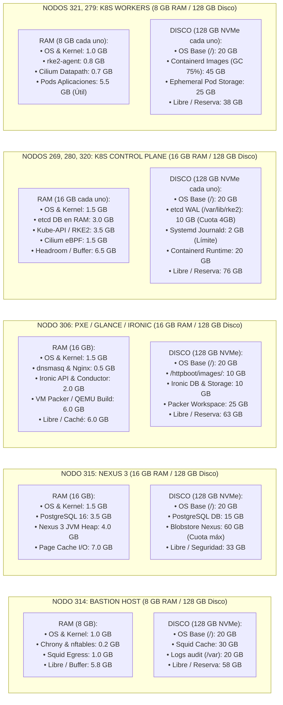

# Guía Maestra de Instalación Conjunta: Infraestructura Bare-Metal Edge con Bastion Host, Sonatype Nexus, OpenStack Kolla-Ansible, Clúster Kubernetes RKE2 HA (Cilium eBPF) y Suite de Observabilidad (Coroot eBPF, OTel, Prometheus, Grafana) sobre Debian 13 (Trixie)

> **Aviso operativo — 30 de octubre de 2026:** la inspección del clúster en
> funcionamiento encontró el control plane y etcd en el nodo 306, mientras que
> los nodos 269, 280 y 320 ejecutaban RKE2 como agentes. El inventario de
> laboratorio de este repositorio describe otra topología. No ejecutar el
> despliegue completo, la fase de plataforma ni el respaldo etcd del repositorio
> sobre esa infraestructura hasta reconciliar el inventario y validar los
> procedimientos. La protección de roles del playbook RKE2 no protege las fases
> anteriores ni sustituye esta revisión.

> 🚀 **¿Solo quieres clonar y desplegar paso a paso sin teoría?**  
> 👉 [**GUÍA DE EJECUCIÓN DIRECTA COPIAR/PEGAR (INSTALL.md)**](INSTALL.md)  
> 👉 [**GUÍA RÁPIDA: CLONAR Y CONECTARSE AL SERVIDOR (CONECTARSE_AL_SERVIDOR.md)**](CONECTARSE_AL_SERVIDOR.md)  
> 👉 [**MANUAL INTEGRAL DE INSTALACIÓN Y OPERACIÓN (docs/runbooks/manual-integral-instalacion-y-recuperacion.md)**](docs/runbooks/manual-integral-instalacion-y-recuperacion.md)

> **Documento Oficial de Infraestructura como Código (IaC), Arquitectura y Despliegue de Producción**  
> **Sistema Operativo Base**: Debian GNU/Linux 13 (Trixie) con Kernel 6.12+ en la flota física completa de 8 nodos  
> **Modelo Operativo**: Aprovisionamiento Físico Zero-Touch, Aislamiento de Red L2, Despliegue Masivo por MAC, Imágenes Inmutables Packer en Glance, Clúster Kubernetes RKE2 HA con Datapath Cilium eBPF y Telemetría Full-Stack Coroot / OTel / VictoriaMetrics / Loki / Tempo  
> **Hardware Real**: 8 Nodos Bare-Metal físicos (Dell OptiPlex 3020M, Realtek RTL8111G; 3 equipos de 8 GB RAM / 5 equipos de 16 GB RAM, todos con 128 GB de disco NVMe/SSD)

---

## 📋 Tabla General de Contenidos

1. [Resumen Ejecutivo y Arquitectura del Sistema](#1-resumen-ejecutivo-y-arquitectura-del-sistema)
   - 1.1 [Objetivo del Proyecto y Alcance Operativo](#11-objetivo-del-proyecto-y-alcance-operativo)
   - 1.2 [Componentes de la Solución y Recursos Compartidos](#12-componentes-de-la-solución-y-recursos-compartidos)
   - 1.3 [Estructura Limpia del Repositorio: Documentación (`docs/`), Playbooks y Scripts](#13-estructura-limpia-del-repositorio-documentación-docs-playbooks-y-scripts)
   - 1.4 [Diagramas Maestros de Arquitectura (Mermaid con Explicaciones Simples)](#14-diagramas-maestros-de-arquitectura-mermaid-con-explicaciones-simples)
2. [Investigación Comparativa y Arquitectura OpenStack Kolla-Ansible vs Ironic Standalone](#2-investigación-comparativa-y-arquitectura-openstack-kolla-ansible-vs-ironic-standalone)
   - 2.1 [Análisis de la Guía de Referencia (Kolla-Ansible en Debian)](#21-análisis-de-la-guía-de-referencia-kolla-ansible-en-debian)
   - 2.2 [Viabilidad y Contención de Recursos frente al Límite de 128 GB de Disco](#22-viabilidad-y-contención-de-recursos-frente-al-límite-de-128-gb-de-disco)
   - 2.3 [Diferencias entre Entorno de Desarrollo y Producción](#23-diferencias-entre-entorno-de-desarrollo-y-producción)
3. [Inventario Real de los 8 Nodos, Asignación de Roles y Métodos de Aprovisionamiento](#3-inventario-real-de-los-8-nodos-asignación-de-roles-y-métodos-de-aprovisionamiento)
   - 3.1 [Mapa Oficial: ID de Inventario → MAC → RAM → Disco → Rol → IP con Justificación](#31-mapa-oficial-id-de-inventario--mac--ram--disco--rol--ip-con-justificación)
   - 3.2 [Justificación de Roles según RAM (Distribución 8 GB vs 16 GB)](#32-justificación-de-roles-según-ram-distribución-8-gb-vs-16-gb)
   - 3.3 [Evaluación de Limitaciones Críticas de Almacenamiento (128 GB por Nodo)](#33-evaluación-de-limitaciones-críticas-de-almacenamiento-128-gb-por-nodo)
   - 3.4 [Comparativa Arquitectónica: 1 Control Plane vs 3 Control Planes (HA)](#34-comparativa-arquitectónica-1-control-plane-vs-3-control-planes-ha)
   - 3.5 [Comparativa de Métodos de Aprovisionamiento Bare-Metal y Recomendación Oficial](#35-comparativa-de-métodos-de-aprovisionamiento-bare-metal-y-recomendación-oficial)
4. [Requisitos Técnicos y Compatibilidad en Debian 13 (Trixie)](#4-requisitos-técnicos-y-compatibilidad-en-debian-13-trixie)
   - 4.1 [Matriz de Compatibilidad Oficial y Mitigación de Conflictos](#41-matriz-de-compatibilidad-oficial-y-mitigación-de-conflictos)
   - 4.2 [Estrategia de Ejecución de Servicios en Debian 13](#42-estrategia-de-ejecución-de-servicios-en-debian-13)
5. [Fases Cronológicas de Instalación Paso a Paso](#5-fases-cronológicas-de-instalación-paso-a-paso)
   - [5.0 Orquestación Remota desde Laptop (`ejecutar-desde-laptop.sh` & Ansible Core)](#50-orquestación-remota-desde-laptop-ejecutar-desde-laptopsh--ansible-core)
   - [Fase 1: Preparación Base del Sistema Operativo en Debian 13 (`roles/common`)](#fase-1-preparación-base-del-sistema-operativo-en-debian-13-rolescommon)
   - [Fase 2: Bastion Host (Seguridad Perimetral, SSH ProxyJump y nftables) (`roles/bastion`)](#fase-2-bastion-host-seguridad-perimetral-ssh-proxyjump-y-nftables-rolesbastion)
   - [Fase 3: Sonatype Nexus 3 con Backend PostgreSQL 16 y Tuning de Disco (`roles/nexus`)](#fase-3-sonatype-nexus-3-con-backend-postgresql-16-y-tuning-de-disco-rolesnexus)
   - [Fase 4: Configuración de Clientes para Consumir Nexus](#fase-4-configuración-de-clientes-para-consumir-nexus)
   - [Fase 5: Servicios de Arranque por Red PXE / iPXE con Reservas por MAC (`roles/pxe_controller`)](#fase-5-servicios-de-arranque-por-red-pxe--ipxe-con-reservas-por-mac-rolespxe_controller)
   - [Fase 6: OpenStack Kolla-Ansible (Glance, Ironic, Keystone, Horizon) (`roles/ironic`)](#fase-6-openstack-kolla-ansible-glance-ironic-keystone-horizon-rolesironic)
   - [Fase 7: Compilación de Imagen Dorada con Packer, eBPF Agent y Cloud-Init (`debian13-coroot.pkr.hcl`)](#fase-7-compilación-de-imagen-dorada-con-packer-ebpf-agent-y-cloud-init-debian13-corootpkrhcl)
   - [Fase 8: Despliegue Masivo por Red Privada "Un Solo Botón" (Zero-Touch Provisioning)](#fase-8-despliegue-masivo-por-red-privada-un-solo-botón-zero-touch-provisioning)
   - [Fase 9: Clúster Kubernetes de Alta Disponibilidad (RKE2 + Cilium eBPF) y Microservicios (`roles/rke2_ha`)](#fase-9-clúster-kubernetes-de-alta-disponibilidad-rke2--cilium-ebpf-y-microservicios-rolesrke2_ha)
   - [Fase 10: Suite Unificada de Observabilidad y Telemetría eBPF (Prometheus, Grafana, Coroot CE, OTel, VictoriaMetrics, Loki, Tempo)](#fase-10-suite-unificada-de-observabilidad-y-telemetría-ebpf-prometheus-grafana-coroot-ce-otel-victoriametrics-loki-tempo)
   - [Fase 11: Ciclo de Vida, Reinstalación de Nodos y Recuperación ante Desastres (`disaster-recovery.sh`)](#fase-11-ciclo-de-vida-reinstalación-de-nodos-y-recuperación-ante-desastres-disaster-recoverysh)
   - [Fase 12: Validación Integral, Health Check y Regresiones Automatizadas (`healthcheck.sh` & Pytest)](#fase-12-validación-integral-health-check-y-regresiones-automatizadas-healthchecksh--pytest)
6. [Matriz de Comunicación, Puertos y Reglas de Cortafuegos (nftables)](#6-matriz-de-comunicación-puertos-y-reglas-de-cortafuegos-nftables)
7. [Seguridad Criptográfica, Secretos y Gestión de Repositorios](#7-seguridad-criptográfica-secretos-y-gestión-de-repositorios)
8. [Gestión Estricta y Cuotas del Disco de 128 GB (Glance, Nexus, etcd)](#8-gestión-estricta-y-cuotas-del-disco-de-128-gb-glance-nexus-etcd)
9. [Scripts Automáticos de Diagnóstico, Testing y Health Check](#9-scripts-automáticos-de-diagnóstico-testing-y-health-check)
10. [Guía Exhaustiva de Resolución de Problemas (Troubleshooting)](#10-guía-exhaustiva-de-resolución-de-problemas-troubleshooting)
11. [Checklist Final, Estado Esperado y Hoja de Ruta (Roadmap)](#11-checklist-final-estado-esperado-y-hoja-de-ruta-roadmap)

---

## 1. Resumen Ejecutivo y Arquitectura del Sistema

### 1.1 Objetivo del Proyecto y Alcance Operativo

El objetivo cardinal de esta infraestructura es construir una plataforma de cómputo en el borde (**Edge Computing**) de alta resiliencia sobre **8 servidores físicos bare-metal**. Toda la plataforma utiliza **Debian GNU/Linux 13 (Trixie)** como sistema operativo base, eliminando hipervisores (KVM, Proxmox, VMware) para otorgar acceso directo al hardware, reducir a cero el *overhead* de virtualización y optimizar el rendimiento de red y almacenamiento NVMe.

El ciclo de aprovisionamiento es **completamente desatendido (Zero-Touch)** y masivo por red privada:
1. El servidor se conecta al switch de la red privada L2 (`10.100.29.0/24`) y recibe corriente eléctrica (por comando de encendido remoto Redfish/IPMI/Wake-on-LAN o encendido físico).
2. Arranca por red mediante **PXE/iPXE**, donde el servidor DHCP (`dnsmasq`) le asigna su dirección IP definitiva según su **dirección MAC física registrada**.
3. Carga en memoria RAM el ramdisk efímero de **Ironic Python Agent (IPA)** vía HTTP (`:8089`).
4. IPA formatea el disco local de 128 GB y graba por streaming una imagen comprimida **Debian 13 (`.qcow2`)** pre-compilada con **HashiCorp Packer** o **Glance**.
5. IPA crea la partición de metadatos **ConfigDrive (`config-2`)** inyectando red estática, llaves SSH y repositorios.
6. El nodo reinicia en disco local, **cloud-init** lee la partición y autoconfigura el sistema operativo.
7. Los paquetes APT y contenedores se descargan localmente desde **Sonatype Nexus 3**, sin salir a Internet ni saturar la WAN.
8. Los nodos designados convergen automáticamente en un **clúster Kubernetes de Alta Disponibilidad (HA)** gobernado por **RKE2** y acelerado con **Cilium (eBPF)**.

---

### 1.2 Componentes de la Solución y Recursos Compartidos

| Componente | Nodo Físico Anfitrión | Recursos que Comparte con la Red Interna |
| :--- | :--- | :--- |
| **Bastion Host** | Nodo ID 314 (`10.100.29.10`) | • Punto único de salto SSH ProxyJump (Puerto TCP `2222`).<br>• Proxy Egress Squid para salida auditada a WAN (Puerto TCP `3128`).<br>• Servidor de sincronización horaria Chrony NTP (Puerto UDP `123`).<br>• Cortafuegos perimetral `nftables`. |
| **Sonatype Nexus 3** | Nodo ID 315 (`10.100.29.20`) | • Proxy y Caché de paquetes Debian APT (`:8081/repository/debian-proxy/`).<br>• Docker Hub Proxy & Registro OCI Privado (`:8082` pull / `:8083` push).<br>• Proxies para npm (`:8081`) y PyPI (`:8081`).<br>• Base de datos relacional PostgreSQL 16 interna (`:5432`). |
| **PXE / OpenStack Kolla / Ironic** | Nodo ID 306 (`10.100.29.30`) | • Concesiones DHCP estáticas por MAC y dinámicas (`dnsmasq`).<br>• Entrega de bootloader TFTP iPXE (Puerto UDP `69`).<br>• Servidor HTTP de imágenes Nginx / Glance (Puerto TCP `8089`).<br>• OpenStack Kolla-Ansible 2025.1 Epoxy (Glance `:9292`, Ironic `:6385`, Keystone `:5000`, Horizon `:8080`, Nova-Ironic, MariaDB/Galera, HAProxy). |
| **K8s Control Plane (HA)**| Nodos ID 269, 280, 320 (`10.100.29.101..103`)| • Kubernetes API Server balanceado (Puerto TCP `6443`).<br>• Quórum de base de datos distribuida etcd (Puertos TCP `2379:2380`).<br>• API de supervisión RKE2 (Puerto TCP `9345`). |
| **K8s Workers** | Nodos ID 321, 279 (`10.100.29.111..112`)| • Ejecución de pods de microservicios (`aplicaciones` namespace).<br>• Enrutamiento L7 perimetral mediante Ingress Controller NGINX (NodePort `30080`).<br>• Datapath de red pod-a-pod gobernado por Cilium con eBPF nativo sin kube-proxy. |
| **Coroot CE & ClickHouse** | Nodo ID 306 (`10.100.29.30` / `192.168.29.25`)| • Coroot Community Edition Web UI y Collector (Puerto TCP `19000`).<br>• ClickHouse Columnar Database (Puertos TCP `9000` nativo / `8123` HTTP).<br>• Prometheus TSDB embebido para telemetría interna (retención 3d, cuota 5GB). |
| **Coroot Node Agent (eBPF)** | Flota completa de 8 nodos físicos | • Agente systemd v1.37.0 con eBPF CO-RE (`127.0.0.1:19080`).<br>• Rastreo de llamadas de kernel, I/O, CPU, memoria, caídas TCP y tráfico de red de aplicaciones sin instrumentación en código. |
| **Observabilidad en K8s (OTel & Storage)** | Namespace `monitoring` en clúster K8s | • OpenTelemetry Operator v0.104.0 + Gateway Deployment (2 réplicas, NodePort `30317` gRPC / `30318` HTTP).<br>• VictoriaMetrics Single TSDB (NodePort `30428`).<br>• Grafana Loki Logs (NodePort `30100`).<br>• Grafana Tempo Traces (NodePort `30200`). |
| **Prometheus & Grafana Host** | Nodo ID 306 (`10.100.29.30` / `192.168.29.25`)| • Prometheus TSDB local (Puerto TCP `9090`) con remote_write a VictoriaMetrics.<br>• Grafana Dashboards (Puerto TCP `3000`).<br>• Alertmanager (`:9093`), Blackbox Exporter (`:9115`) y Node Exporter (`:9100` en todos los nodos). |

---

### 1.3 Estructura Limpia del Repositorio: Documentación (`docs/`), Playbooks y Scripts

El repositorio mantiene una separación estricta entre la **orquestación declarativa con Ansible Core**, la **documentación técnica (`docs/`)**, los **scripts utilitarios (`scripts/`)**, la **definición de imágenes doradas Packer (`cloud-init/packer/`)** y las **pruebas automatizadas (`tests/`)**:

```text
infra-scripts/
├── README.md                          # Guía Maestra de Arquitectura, Operación y Despliegue
├── INSTALL.md                         # Guía rápida de ejecución directa paso a paso (copiar/pegar)
├── ansible.cfg                        # Configuración optimizada de Ansible (forks=8, pipelining, vault)
├── inventory/                         # INVENTARIO REAL Y VARIABLES POR ENTORNO
│   ├── env                            # Variables maestras del entorno activo (chmod 0600)
│   ├── env.example                    # Plantilla de referencia de variables y credenciales
│   ├── nodes.csv                      # Inventario canónico de los 8 nodos (ID, MAC, IP, RAM, Disco)
│   ├── lab/                           # Entorno de Laboratorio / Edge Cluster
│   │   ├── hosts.yml                  # Inventario estructurado en YAML de los 8 nodos físicos
│   │   └── group_vars/                # Variables del inventario (all/vars.yml, observability.yml)
│   └── prod/                          # Entorno de Producción
│       └── hosts.yml                  # Definición de inventario para producción
│
├── ansible/                           # MOTOR DE AUTOMATIZACIÓN DECLARATIVO E IDEMPOTENTE
│   ├── site.yml                       # Orquestador maestro integral (soporta tags modulares)
│   ├── keys/                          # Par de llaves SSH privadas del clúster (chmod 0600)
│   ├── roles/                         # ROLES MODULARES DE ANSIBLE
│   │   ├── common/                    # Base OS, /etc/hosts, networkd, Swap off, Chrony, APT Nexus
│   │   ├── bastion/                   # Bastion Host, SSH hardening :2222, Squid :3128, nftables
│   │   ├── nexus/                     # PostgreSQL 16 + Sonatype Nexus 3 OSS (Tuning JVM 4GB)
│   │   ├── pxe_controller/            # dnsmasq con reservas MAC fijas, TFTP, Nginx :8089
│   │   ├── ironic/                    # OpenStack Kolla / Ironic Standalone y baremetal.yml
│   │   ├── rke2_ha/                   # Clúster Kubernetes HA (3 CPs + 2 Workers) con Cilium eBPF
│   │   ├── monitoring/                # Prometheus TSDB, Grafana, Alertmanager y Node Exporter
│   │   └── coroot_node_agent/         # Agente Coroot v1.37.0 systemd con eBPF CO-RE en los 8 nodos
│   └── playbooks/                     # PLAYBOOKS EJECUTABLES POR FASE O COMPONENTE
│       ├── 00-preflight/              # 00_ping.yml, 01_audit_ports.yml, 02_system_summary.yml
│       ├── 10-base/                   # 01_os_base.yml, 02_bastion_hardening.yml
│       ├── 20-services/               # 01_nexus.yml, 02_pxe_controller.yml, 03_ironic_deploy.yml
│       ├── 30-platform/               # 01_rke2_cluster.yml
│       ├── 40-observability/          # 01_monitoring.yml, 02_coroot_agent.yml, 99_rollback.yml
│       ├── 50-validation/             # 01_healthcheck.yml
│       └── 90-operations/             # 01_disaster_recovery.yml
│
├── cloud-init/                        # CONSTRUCCIÓN DE IMÁGENES DORADAS Y CONFIGDRIVE
│   ├── packer/
│   │   ├── debian13-coroot.pkr.hcl    # Plantilla Packer HCL2 con inyección eBPF Coroot y Cloud-Init
│   │   └── packer.pkr.hcl             # Plantilla legacy alternativa de preseed
│   ├── templates/                     # user-data.j2, meta-data.j2, network-config.j2
│   └── scripts/                       # generate_configdrive.sh
│
├── scripts/                           # SCRIPTS UTILITARIOS COMPLEMENTARIOS
│   ├── client/
│   │   ├── ejecutar-desde-laptop.sh   # Orquestador DevOps remoto con banderas modulares y dry-run
│   │   ├── setup-client-workstation.sh# Configuración de workstation local (ansible, kubectl, ssh)
│   │   └── tunnels.sh                 # Apertura de túneles SSH para Grafana, Nexus, Coroot, K8s
│   ├── diagnostics/
│   │   ├── healthcheck.sh             # Auditoría visual integral de la flota y clúster K8s en vivo
│   │   ├── 00-preflight.sh            # Comprobaciones de red y puertos
│   │   └── kubernetes-prerequisites.sh# Validación de kernel y módulos en nodos
│   ├── ops/
│   │   ├── disaster-recovery.sh       # Respaldo y restauración automatizada (etcd, Nexus, PostgreSQL)
│   │   ├── levantar-todo.sh           # Encendido masivo Wake-on-LAN secuencial
│   │   └── 07-cloud-init.sh           # Generación de medios de instalación
│   └── bootstrap/
│       ├── bootstrap_node.py          # Script de rescate e inyección de llaves SSH de emergencia
│       └── setup_keys.sh              # Generación de llaves Ed25519
│
├── tests/                             # SUITE DE PRUEBAS AUTOMATIZADAS (PYTEST)
│   ├── test_cli_regressions.py        # Pruebas de regresión CLI para ejecutar-desde-laptop.sh
│   └── test_backup_pipeline.py        # Validación de integridad de pipelines de respaldo y DR
│
└── docs/                              # DOCUMENTACIÓN TÉCNICA Y OPERATIVA (.md)
    ├── adr/                           # Decisiones de Arquitectura (0001-Ansible, 0002-Cilium, etc.)
    ├── architecture/                  # Manuales de arquitectura y arranque PXE detallado
    ├── observability/                 # Manuales maestros de Monitoreo, Coroot eBPF y OpenTelemetry
    ├── runbooks/                      # Procedimientos de operación estándar (SOP), DR y rotación
    └── reference/                     # Auditorías de proyecto, cheatsheets de variables y puertos
```

---

### 1.4 Diagramas Maestros de Arquitectura (Mermaid con Explicaciones Simples)

#### Diagrama 1: Distribución de los 8 Nodos por ID, RAM y Rol (Codificación por Colores)



**Explicación simple del diagrama:**  
Este diagrama ilustra la asignación física de los 8 servidores según su capacidad de memoria RAM. Los servicios que demandan alta memoria (Sonatype Nexus con su motor JVM/PostgreSQL, el controlador de aprovisionamiento PXE/Glance con Packer, y los tres nodos del plano de control de Kubernetes con etcd) se ubican obligatoriamente en los cinco servidores de 16 GB (representados en verde, morado y rosa). Por su parte, los roles ligeros (el servidor Bastion que solo realiza enrutamiento/proxy, y los dos nodos de trabajo de Kubernetes para ejecución de pods) se sitúan en los tres servidores de 8 GB (en azul y naranja).

---

#### Diagrama 2: Topología de la Red Privada de Aprovisionamiento (L2)



**Explicación simple del diagrama:**  
Este esquema muestra la separación estricta de redes. El único equipo con presencia en dos redes (dual-homed) es el Bastion Host (Nodo 314), que conecta con el exterior a través de su interfaz WAN y actúa como pasarela controlada. Todos los demás 7 servidores están confinados en una red física aislada L2 (`10.100.29.0/24`) mediante un switch dedicado. Ningún nodo interno tiene salida directa a Internet; obtienen su dirección IP, archivos de arranque PXE e imágenes del servidor PXE (`10.100.29.30`), descargan paquetes de software de Nexus (`10.100.29.20`), y únicamente acceden a la WAN para servicios auditados a través del proxy Squid del Bastión.

---

#### Diagrama 3: Flujo del Despliegue Masivo "Un Solo Botón" (Zero-Touch Provisioning)



**Explicación simple del diagrama:**  
Este diagrama detalla la secuencia completamente automatizada desde que se presiona "un botón" (ejecución del script maestro) hasta que los servidores quedan operativos. El script enciende los servidores por red, cada máquina pide IP y recibe su configuración exacta gracias a su dirección MAC, descarga un sistema temporal en memoria RAM (IPA), limpia el disco de 128 GB, le escribe la imagen de Debian 13 junto con su configuración de red (ConfigDrive) y reinicia en el disco local. Al arrancar, el sistema se autoconfigura con cloud-init y se conecta a Nexus para terminar de unirse al clúster de Kubernetes sin intervención humana.

---

#### Diagrama 4: Ciclo de Vida y Actualización de Imágenes en Glance



**Explicación simple del diagrama:**  
Este ciclo ilustra cómo se actualiza el sistema operativo en toda la flota sin riesgos. Primero se compila una nueva versión inmutable de la imagen con Packer y se sube a Glance. Antes de aplicarla a todos los equipos, se prueba de forma controlada (canary) en un único nodo de trabajo; si se detecta un problema, se revierte al instante. Si funciona a la perfección, se actualizan los demás nodos uno a uno garantizando que el clúster nunca pierda quórum ni disponibilidad. Finalmente, se borra la imagen anterior del disco para no saturar los 128 GB del servidor de aprovisionamiento.

---

#### Diagrama 5: Desglose de Asignación de Recursos por Nodo (RAM / Disco 128 GB / CPU)



**Explicación simple del diagrama:**  
Este diagrama resume el dimensionamiento preventivo de memoria RAM y almacenamiento en disco de 128 GB para cada uno de los roles. Debido al espacio limitado de 128 GB, cada equipo tiene particionado y cuotas estrictas: Nexus limita su almacén de imágenes a 60 GB para evitar bloqueos del sistema, el servidor de aprovisionamiento reserva espacio temporal para compilar imágenes con Packer borrando temporales inmediatamente, los nodos del plano de control imponen un tope de 4 GB a la base de datos etcd y 2 GB a los registros del sistema, y los nodos de trabajo aplican recolección automática de basura (GC) en imágenes de contenedores cuando el disco alcanza el 75%.

---

#### Diagrama 6: Arquitectura Unificada de Observabilidad, Telemetría eBPF y OpenTelemetry

```mermaid
flowchart TB
    subgraph FLOTA ["🖥️ FLOTA DE 8 NODOS FÍSICOS (Bare-Metal Debian 13)"]
        direction LR
        A1["Nodo 314 (Bastion)
coroot-node-agent :19080
node_exporter :9100"]
        A2["Nodo 315 (Nexus)
coroot-node-agent :19080
node_exporter :9100"]
        A3["Nodos K8s CP (269, 280, 320)
coroot-node-agent :19080
node_exporter :9100"]
        A4["Nodos K8s Workers (321, 279)
coroot-node-agent :19080
node_exporter :9100"]
    end

    subgraph COROOT_STACK ["🔍 COROOT CE & CLICKHOUSE (Nodo 306 - Docker Compose)"]
        direction TB
        CH["ClickHouse Columnar DB
Puertos: 9000 (nativo) / 8123 (HTTP)"]
        CTSDB["Embedded Prometheus TSDB
Retención: 3 días | Cuota: 5 GB"]
        CCE["Coroot Community Edition (:19000)
Collector OTLP & Web UI
Análisis Causal eBPF"]
        CH --> CCE
        CTSDB --> CCE
    end

    subgraph K8S_OBS ["☸️ SUITE DE TELEMETRÍA EN KUBERNETES (Namespace: monitoring)"]
        direction TB
        OTEL_GW["OpenTelemetry Gateway (Deployment 2 réplicas)
OTLP gRPC :30317 | OTLP HTTP :30318"]
        VM["VictoriaMetrics Single (:30428)
TSDB Métricas a Largo Plazo (30d)"]
        LOKI["Grafana Loki (:30100)
Ingesta Centralizada de Logs (7d)"]
        TEMPO["Grafana Tempo (:30200)
Almacén de Trazas Distribuidas (3d)"]
        OTEL_GW --> VM
        OTEL_GW --> LOKI
        OTEL_GW --> TEMPO
    end

    subgraph APPS ["📦 MICROSERVICIOS (Namespace: aplicaciones)"]
        direction LR
        SVC["Frontend / Backend / Orders / Redis
Auto-Instrumentación OTel CRD"]
    end

    subgraph HOST_MON ["📊 MONITOREO CENTRAL HOST (Nodo 306)"]
        direction LR
        PROM["Prometheus Server (:9090)
Scraping 8 nodos + remote_write"]
        GRAF["Grafana Dashboards (:3000)
Datasources Correlacionados"]
        PROM --> GRAF
        VM -.-> GRAF
        LOKI -.-> GRAF
        TEMPO -.-> GRAF
    end

    %% Conexiones
    A1 & A2 & A3 & A4 -- "eBPF Traces & Metrics HTTP" --> CCE
    A1 & A2 & A3 & A4 -- "Scrape :9100" --> PROM
    PROM -- "remote_write" --> VM
    SVC -- "OTLP Traces / Spans" --> OTEL_GW

    style COROOT_STACK fill:#0f172a,stroke:#38bdf8,stroke-width:2px,color:#ffffff
    style K8S_OBS fill:#1e1b4b,stroke:#818cf8,stroke-width:2px,color:#ffffff
    style HOST_MON fill:#064e3b,stroke:#34d399,stroke-width:2px,color:#ffffff
    style FLOTA fill:#1f2937,stroke:#9ca3af,stroke-width:1px,color:#ffffff
    style APPS fill:#312e81,stroke:#a78bfa,stroke-width:1px,color:#ffffff
```



**Explicación simple del diagrama:**  
La plataforma cuenta con un stack de telemetría de doble nivel complementario:
1. **Nivel Kernel con eBPF (Coroot CE + ClickHouse)**: Un agente ligero `coroot-node-agent` v1.37.0 corre como servicio de sistema en cada uno de los 8 servidores físicos. Mediante eBPF CO-RE intercepta llamadas al sistema sin overhead, auditando cuellos de botella en disco NVMe, latencia de red TCP, caídas de paquetes y consumo de memoria, enviándolos al motor de análisis causal en Coroot (puerto 19000).
2. **Nivel Aplicación y Clúster (OTel + VictoriaMetrics + Loki + Tempo + Grafana)**: Los microservicios en Kubernetes son inyectados transparentemente por el OpenTelemetry Operator; las trazas viajan al OpenTelemetry Gateway (2 réplicas) y se canalizan hacia Tempo (trazas), Loki (logs) y VictoriaMetrics (métricas), visualizándose de forma correlacionada en Grafana (puerto 3000).

---

## 2. Investigación Comparativa y Arquitectura OpenStack Kolla-Ansible vs Ironic Standalone

### 2.1 Análisis de la Guía de Referencia y Kolla-Ansible en Producción

Se evaluó el despliegue de **OpenStack 2025.1 (Epoxy)** mediante contenedores Docker gestionados con `kolla-ansible` en **Debian 13 (Trixie)**:

#### Componentes Desplegados por Kolla-Ansible en el Nodo 306:
1. **Infraestructura Base de Alta Resiliencia**:
   - **MariaDB / Galera**: Base de datos transaccional interna para metadatos de OpenStack.
   - **RabbitMQ**: Cola de mensajería AMQP de alto rendimiento para comunicación inter-servicios.
   - **Memcached & ProxySQL**: Aceleración de consultas de identidad y equilibrio SQL.
   - **HAProxy & Keepalived**: Balanceo de endpoints internos de APIs.
2. **Servicios de Identidad, Catálogo y Bare-Metal**:
   - **Keystone (`:5000`)**: Servicio de autenticación, catálogo y tokens Fernet.
   - **Glance (`:9292`)**: Catálogo y distribución de imágenes doradas pre-compiladas con Packer (`debian13-coroot-lab`).
   - **Placement (`:8778`)**: Rastreo de asignación de recursos.
   - **Ironic API (`:6385`) & Conductor**: Orquestación directa de servidores bare-metal, control de energía y streaming de discos.
   - **Nova Compute Ironic (`:8774`)**: Adaptador de cómputo para gobernar los nodos físicos a través del driver Ironic.
   - **Neutron / OVN (`:9696`)**: Agentes Open vSwitch y OVN para aprovisionamiento L2.
   - **Horizon Dashboard (`:8080`)**: Panel gráfico web accesible para supervisión visual de instancias físicas.

---

### 2.2 Viabilidad y Contención de Recursos frente al Límite de 128 GB de Disco

El despliegue de Kolla-Ansible se adaptó con precisión quirúrgica para convivir armoniosamente con el clúster en los Dell OptiPlex de 128 GB de disco y 16 GB de RAM del Nodo 306:

```
┌──────────────────────────────────────────────────────────────────────────────────┐
│             ESTRATEGIA DE CONTENCIÓN KOLLA-ANSIBLE EN HARDWARE BARE-METAL         │
├────────────────────────────┬─────────────────────────────┬───────────────────────┤
│ COMPONENTE / RECURSO       │ DESPLIEGUE ESTÁNDAR KOLLA   │ NUESTRA ADAPTACIÓN    │
├────────────────────────────┼─────────────────────────────┼───────────────────────┤
│ Consumo de Memoria RAM     │ > 14 GB (Saturación)        │ ~ 6.5 GB (Acotado)    │
│ Registro de Imágenes OCI   │ Descarga continua desde WAN │ Nexus 3 Local (:8082) │
│ Enrutamiento de Red        │ Multi-NIC con riesgo lockout│ Single-NIC L2 Bridge  │
│ Aprovisionamiento Físico   │ Nova Libvirt / QEMU VMs     │ Ironic Bare-Metal puro│
│ Retención de Imágenes      │ Ilimitada en Glance         │ 1 Imagen Dorada activa│
│ Monitoreo / Logging        │ OpenSearch / Ceph masivo    │ Prometheus + Coroot   │
└────────────────────────────┴─────────────────────────────┴───────────────────────┘
```

#### Medidas de Estabilidad Aplicadas:
1. **Pull Exclusivo desde Nexus Local (`10.100.29.20:8082`)**: Todas las imágenes de contenedores (`openstack.kolla/*:2025.1-ubuntu-noble`) se almacenan en la caché del Nexus local, garantizando que el aprovisionamiento de Kolla nunca sature la conexión WAN.
2. **Glance Depurado (1 Imagen Activa)**: Solo se mantiene activa en Glance la imagen dorada validada (`debian13-coroot-lab`, 598 MB comprimida). Las versiones obsoletas se purgan inmediatamente para no comprometer el almacenamiento NVMe.
3. **Desacoplamiento de Servicios**: Los servicios de monitoreo central (Coroot CE en `:19000` y Grafana en `:3000`) se ejecutan en puertos independientes sin colisionar con HAProxy (`:8080`), Glance (`:9292`) ni Keystone (`:5000`).
* Requiere menos de **10 GB de disco**.
* Gestiona directamente el arranque PXE, encendido de hardware, formateo de discos NVMe y despliegue inmutable sin intermediarios.

---

### 2.3 Diferencias entre Entorno de Desarrollo y Producción

| Dimensión Técnica | Entorno de Desarrollo / Laboratorio | Entorno de Producción Oficial (Este Despliegue) |
| :--- | :--- | :--- |
| **Topología de Servidores** | Una sola máquina virtual All-in-One con Kolla | 8 Servidores Físicos Bare-Metal distribuidos |
| **Manejo de Imágenes** | Descarga manual de ISOs desde Internet | Imágenes inmutables `.qcow2` pre-cocinadas con Packer |
| **Repositorios de Paquetes**| Descargas repetitivas desde `deb.debian.org` | Caché centralizada en Sonatype Nexus (1 Gbps local) |
| **Control de Energía** | Apagado/Encendido manual o mock driver | Wake-on-LAN / BMC IPMI automatizado |
| **Alta Disponibilidad K8s**| 1 Control Plane solitario (SPOF) | 3 Control Planes con quórum Raft etcd distribuido |
| **Seguridad de Red** | Acceso SSH directo con contraseña | Acceso exclusivo vía Bastion Host con llaves Ed25519 |

---

## 3. Inventario Real de los 8 Nodos, Asignación de Roles y Métodos de Aprovisionamiento

### 3.1 Mapa Oficial: ID de Inventario → MAC → RAM → Disco → Rol → IP con Justificación

La siguiente tabla refleja los **datos de hardware reales** del proyecto, con las direcciones MAC normalizadas en formato canónico estándar (`aa:bb:cc:dd:ee:ff` en minúsculas) y la **justificación de una línea** de cada rol asignado:

| ID | MAC Normalizada | RAM | Disco | Hostname | IP | Rol Arquitectónico | Justificación de una Línea |
| :---: | :---: | :---: | :---: | :--- | :--- | :--- | :--- |
| **314** | `64:00:6a:2a:60:62` | 8 GB | 128 GB | `bastion.<DOMINIO>` | WAN: `<IP_BASTION_WAN>`<br>LAN: `10.100.29.10` | Bastion Host, Gateway, Squid, Chrony | Los servicios de pasarela SSH, proxy Squid y sincronización NTP consumen menos de 1.2 GB de memoria RAM en reposo. |
| **315** | `64:00:6a:2a:5f:99` | 16 GB | 128 GB | `nexus-repo.<DOMINIO>` | LAN: `10.100.29.20` | Sonatype Nexus 3 OSS + PostgreSQL 16 DB | La JVM de Nexus, PostgreSQL 16 y la caché de entrada/salida para transferencias a 1 Gbps requieren más de 8 GB para operar sin OOM. |
| **306** | `64:00:6a:2a:62:42` | 16 GB | 128 GB | `pxe-controller.<DOMINIO>` | LAN: `10.100.29.30` | Provisión PXE (dnsmasq), Glance HTTP, Ironic | Debe ejecutar concurrentemente Ironic API, Nginx y la máquina virtual QEMU para compilación de imágenes con Packer. |
| **269** | `64:00:6a:2a:5f:f9` | 16 GB | 128 GB | `k8s-cp-01.<DOMINIO>` | LAN: `10.100.29.101` | K8s Control Plane 01 (etcd líder / API Server) | Aloja el nodo líder de etcd y el API Server, requiriendo retención en RAM para transacciones Raft con latencia < 10 ms. |
| **280** | `64:00:6a:2a:60:63` | 16 GB | 128 GB | `k8s-cp-02.<DOMINIO>` | LAN: `10.100.29.102` | K8s Control Plane 02 (etcd miembro / API Server)| Miembro con voto en el quórum Raft de etcd de 3 nodos y componente de alta disponibilidad de kube-apiserver. |
| **320** | `64:00:6a:2a:2c:75` | 16 GB | 128 GB | `k8s-cp-03.<DOMINIO>` | LAN: `10.100.29.103` | K8s Control Plane 03 (etcd miembro / API Server)| Tercer miembro del quórum Raft de etcd indispensable para tolerancia a fallos de 1 nodo sin degradación de servicio. |
| **321** | `64:00:6a:2a:62:a4` | 8 GB | 128 GB | `k8s-worker-01.<DOMINIO>` | LAN: `10.100.29.111` | K8s Worker Node 01 (containerd / Ingress) | Nodo dedicado exclusivamente a cargas útiles de pods, disponiendo de ~5.5 GB de RAM libres sin sobrecarga de gestión. |
| **279** | `64:00:6a:2a:2f:cb` | 8 GB | 128 GB | `k8s-worker-02.<DOMINIO>` | LAN: `10.100.29.112` | K8s Worker Node 02 (containerd / Ingress) | Segundo nodo de cómputo para distribución de pods contenerizados de usuario y réplicas de alta disponibilidad. |

> [!NOTE]
> **Identificadores de Chasis (314, 315, etc.) [POR CONFIRMAR]**:  
> Estos números corresponden a los identificadores de inventario físico de las etiquetas del rack. Si representan números de serie o nombres específicos de chasis (ej. `nodo-314`), pueden incorporarse en el subdominio DNS.

---

### 3.2 Justificación de Roles según RAM (Distribución 8 GB vs 16 GB)

El ecosistema cuenta con **3 equipos de 8 GB** y **5 equipos de 16 GB**. La asignación obedece a un estricto criterio de consumo de memoria y criticidad:

1. **Equipos de 16 GB asignados a los componentes más pesados**:
   - **Nodo 315 (Nexus 3 + PostgreSQL)**: La JVM de Nexus requiere un *heap* de 4 GB, más memoria de acceso directo (*DirectMemory*), sumado al *shared_buffers* de PostgreSQL 16 y la caché de bloques de disco del kernel para servir archivos a 1 Gbps. Con 8 GB sufriría saturación; con 16 GB opera con holgura.
   - **Nodo 306 (PXE / Ironic / Glance / Packer)**: Aloja el motor de Ironic, Nginx y la compilación de HashiCorp Packer con QEMU/KVM. Ejecutar una máquina virtual de compilación en RAM mientras Ironic atiende peticiones requiere 16 GB de RAM.
   - **Nodos 269, 280 y 320 (K8s Control Plane HA)**: Cada nodo ejecuta `kube-apiserver`, `kube-controller-manager`, `kube-scheduler`, `etcd`, y el agente `cilium-operator`. La base distribuida `etcd` requiere mantener sus índices en memoria RAM para garantizar latencias inferiores a 10 ms en transacciones Raft. 16 GB garantiza estabilidad absoluta.
2. **Equipos de 8 GB asignados a roles ligeros**:
   - **Nodo 314 (Bastion Host)**: Solo ejecuta OpenSSH Server, Squid Proxy en modo Egress, Chrony y reglas `nftables`. Su consumo de RAM en reposo es inferior a 1.2 GB. 8 GB es más que suficiente.
   - **Nodos 321 y 279 (Workers de Kubernetes)**: Ejecutan `rke2-agent`, el runtime `containerd` y los pods de las aplicaciones. Al no cargar con los procesos de gestión del plano de control, disponen de ~5.5 GB de RAM libres por nodo dedicados a cargas de trabajo.

---

### 3.3 Evaluación de Limitaciones Críticas de Almacenamiento (128 GB por Nodo)

Disponer de únicamente **128 GB de disco por nodo** representa la mayor restricción física de la infraestructura. Se han diseñado las siguientes medidas de mitigación para evitar el colapso por disco lleno:

```
┌──────────────────────────────────────────────────────────────────────────────────┐
│                   MAPA DE RIESGOS Y MITIGACIÓN DE DISCO (128 GB)                 │
├─────────────┬──────────────────────────┬─────────────────────────────────────────┤
│ NODO / ROL  │ RIESGO DE AGOTAMIENTO    │ POLÍTICA DE MITIGACIÓN TÉCNICA          │
├─────────────┼──────────────────────────┼─────────────────────────────────────────┤
│ Nexus       │ Acumulación de capas de  │ • Cuota dura del blobstore: 60 GB máx.  │
│ (Nodo 315)  │ Docker y paquetes APT    │ • Limpieza automática: purga de Docker  │
│             │ que superen los 100 GB.  │   layers no referenciados > 14 días.    │
│             │                          │ • Tarea programada: Compact Blobstore.  │
│             │                          │ • [RECOMENDADO]: Montar NFS / Disco USB │
│             │                          │   secundario en /opt/sonatype/data.     │
├─────────────┼──────────────────────────┼─────────────────────────────────────────┤
│ Glance/PXE  │ Múltiples ISOs e         │ • Cuota en /httpboot/images/: 10 GB máx │
│ (Nodo 306)  │ imágenes QCOW2 pesadas   │ • Conservar únicamente 1 imagen golden  │
│             │ generadas por Packer.    │   debian-baremetal.qcow2 (~1.5 GB).     │
│             │                          │ • Purgar directorios /output-debian/    │
│             │                          │   inmediatamente tras la compilación.   │
├─────────────┼──────────────────────────┼─────────────────────────────────────────┤
│ Control     │ Crecimiento de logs WAL  │ • Compactación automática de etcd cada  │
│ Plane K8s   │ de etcd y desbordamiento │   1 hora (--auto-compaction-retention=1)│
│ (269,280,320│ del journal de systemd.  │ • Cuota de backend etcd: 4 GB máx.      │
│             │                          │ • Límites estrictos en journald:        │
│             │                          │   SystemMaxUse=2G en /etc/systemd/.     │
├─────────────┼──────────────────────────┼─────────────────────────────────────────┤
│ Workers     │ Imágenes huérfanas de    │ • Kubelet High/Low Thresholds:          │
│ (321, 279)  │ containerd y volúmenes   │   imageGCHighThresholdPercent: 75       │
│             │ temporales de pods.      │   imageGCLowThresholdPercent: 60        │
└─────────────┴──────────────────────────┴─────────────────────────────────────────┘
```

---

### 3.4 Comparativa Arquitectónica: 1 Control Plane vs 3 Control Planes (HA)

Se ratifica la decisión técnica adoptada:

* **Opción A (1 Control Plane + 4 Workers)**: Descartada. Si el nodo 269 sufre una avería en su disco de 128 GB o en su fuente de poder, se destruye el quórum de `etcd`, el API Server queda inaccesible y el clúster entero queda inoperativo.
* **Opción B (3 Control Planes HA + 2 Workers)**: **ADOPTADA OFICIALMENTE**. Permite tolerar la caída física de 1 Control Plane completo sin interrupción de servicio. Para entornos de producción o institucionales, la Alta Disponibilidad de `etcd` es un requisito innegociable.

---

### 3.5 Comparativa de Métodos de Aprovisionamiento Bare-Metal y Recomendación Oficial

A continuación se analizan los cuatro métodos estándar para aprovisionar servidores físicos por red:

| Criterio Técnico | 1. Ironic + QCOW2 vía Glance | 2. PXE + Preseed (Debian-Installer) | 3. ISO en Glance (Virtual Media) | 4. Híbrido (iPXE + Netboot + Tarball) |
| :--- | :--- | :--- | :--- | :--- |
| **Tiempo de Instalación** | **2 a 4 minutos** (Volcado directo de bloques) | 15 a 25 minutos (Descarga paquete por paquete) | 20 a 30 minutos (Instalador interactivo emulado) | 8 a 12 minutos (Extracción de tarball en memoria) |
| **Consumo de Ancho de Banda**| **Muy bajo**: Stream único de imagen comprimida (~1.5 GB) | Alto: Cientos de peticiones HTTP a repositorios | Medio-Alto: Stream completo de ISO (~4 GB) | Medio: Descarga de kernel + tarball (~2 GB) |
| **Inmutabilidad y Determinismo**| **Total**: Cada nodo recibe exactamente los mismos bloques | Baja: Deriva potencial si cambian paquetes en repositorio | Baja: Depende del instalador en tiempo de ejecución | Media: Requiere scripts de post-instalación |
| **Inyección de ConfigDrive** | **Nativa**: Crea partición VFAT `config-2` en disco local | Limitada: Parámetros en kernel cmdline o preseed | Nula/Muy compleja: ISO no inyecta particiones locales | Compleja: Requiere montaje chroot en memoria |
| **Requisitos de Hardware** | Tarjeta de red PXE / UEFI estándar | Tarjeta de red PXE estándar | Requiere BMC/IPMI con licencia de Virtual Media | Tarjeta de red iPXE estándar |
| **Complejidad Operativa** | Media-Alta al inicio, luego trivial ("Un Botón") | Media, requiere mantener archivos `preseed.cfg` | Alta, depende de drivers BMC específicos de vendor | Muy Alta, requiere mantener scripts personalizados |
| **Veredicto para 8 Nodos** | 🟢 **MÉTODO ADOPTADO OFICIALMENTE** | 🟡 Descartado por lentitud y variabilidad | 🔴 Descartado por incompatibilidad con ConfigDrive | 🔴 Descartado por complejidad innecesaria |

> [!IMPORTANT]
> **Recomendación y Decisión Final Justificada en una Línea**:  
> Se adopta **Ironic Standalone + QCOW2 vía Glance** porque garantiza despliegues inmutables ultra-rápidos (< 3 minutos), inyección limpia de configuración mediante `ConfigDrive` (`config-2`) y cero sobrecarga de red al no depender de descargas repetitivas.

---

## 4. Requisitos Técnicos y Compatibilidad en Debian 13 (Trixie)

### 4.1 Matriz de Compatibilidad Oficial y Mitigación de Conflictos

| Componente | Versión Exacta | Soporte Nativo en Debian 13 | Conflicto / Detalle Técnico | Mitigación Arquitectónica |
| :--- | :--- | :--- | :--- | :--- |
| **Kernel Linux** | 6.12.x-amd64 | ✅ **Oficial / Estable** | Ninguno. Soporte maduro para eBPF CO-RE y cgroups v2. | Kernel oficial Debian sin parches. |
| **OpenStack Kolla**| 2025.1 (Epoxy) | ✅ **En Contenedores** | Dependencias complejas de Python resueltas en Docker. | Contenedores Kolla sobre Docker en Nodo 306. |
| **Sonatype Nexus** | 3.75.x OSS | ⚠️ **Ajustes Requeridos** | OrientDB retirado; requiere OpenJDK 17 LTS y tuning. | Backend relacional PostgreSQL 16 y JVM 4GB. |
| **PostgreSQL** | 16.x | ✅ **Oficial / Estable** | Ninguno. Motor relacional de alto rendimiento. | Servicio nativo systemd en Debian 13 (Nodo 315).|
| **containerd** | 2.3.4-k3s1 | ✅ **Oficial / Estable** | cgroups v2 activo por defecto en toda la flota. | Embebido en RKE2 con driver systemd. |
| **Kubernetes RKE2**| v1.36.5+rke2r1 | ✅ **Totalmente Probado**| Requiere deshabilitar swap y cargar módulos overlay/br_netfilter. | Roles Ansible y drop-ins en `/etc/sysctl.d/`. |
| **CNI (Red K8s)** | Cilium (eBPF) | 🌟 **Óptimo** | Evita colisiones de iptables-nft eliminando kube-proxy. | Datapath eBPF directo en kernel con host-routing.|
| **Cloud-Init** | 24.x | ✅ **Oficial / Estable** | Sin metadata server local en red aislada L2. | Datasource `ConfigDrive` (`config-2`) / NoCloud. |
| **Packer + QEMU** | 1.10+ / QEMU 9+ | ✅ **Oficial / Estable** | Requiere aceleración KVM en hardware Dell. | Build headless con inyección cidata en laptop. |
| **Coroot Node Agent**| v1.37.0 (eBPF) | ✅ **Oficial / Estable** | Requiere BTF en kernel para eBPF CO-RE. | Soportado nativamente por Kernel 6.12 de Debian 13.|
| **Ansible Core** | 2.17+ | ✅ **Oficial / Estable** | Pipelining SSH y gestión de secretos centralizada. | Ejecución con `ansible.cfg` y vault passwords. |

---

### 4.2 Estrategia de Ejecución de Servicios en Debian 13

1. **Homogeneidad Absoluta (Debian 13 Trixie)**: Todos los 8 nodos físicos operan con Debian 13 (Kernel 6.12+), garantizando que las llamadas eBPF CO-RE sean 100% compatibles y que los parches de seguridad APT de Nexus apliquen uniformemente.
2. **Aislamiento de Cargas Críticas**: 
   - OpenStack Kolla opera encapsulado en Docker sobre el Nodo 306 (`--net=host` en servicios de aprovisionamiento).
   - Nexus 3 y PostgreSQL 16 operan nativamente como servicios systemd optimizados en el Nodo 315.
   - Coroot CE y ClickHouse operan desacoplados en Docker Compose en `/opt/coroot` del Nodo 306 en el puerto `:19000`.
   - `coroot-node-agent` corre como servicio del sistema en los 8 nodos físicos con acceso a `/sys/kernel/debug`.

---

## 5. Fases Cronológicas de Instalación Paso a Paso

### 5.0 Orquestación Remota desde Laptop (`ejecutar-desde-laptop.sh` & Ansible Core)

> [!TIP]
> **Modo Operativo Modernizado**: No es necesario iniciar sesión manualmente en cada uno de los servidores ni copiar scripts por USB. Todo el aprovisionamiento, hardening y configuración se realiza desde la estación DevOps mediante **Ansible Core** y el orquestador `scripts/client/ejecutar-desde-laptop.sh`.

#### Flujo Operativo y Comandos Principales
```bash
# 1. Auditar conectividad y verificar qué nodos están encendidos y alcanzables (Ping paralelo)
./scripts/client/ejecutar-desde-laptop.sh --check
# O directamente con Ansible:
ansible baremetal -i inventory/lab/hosts.yml -m ping

# 2. Ejecutar fases modulares mediante roles Ansible idempotentes:
./scripts/client/ejecutar-desde-laptop.sh --fase 1    # Base OS Debian 13 (roles/common en toda la flota)
./scripts/client/ejecutar-desde-laptop.sh --fase 2    # Bastión Gateway, SSH :2222, Squid y nftables (roles/bastion)
./scripts/client/ejecutar-desde-laptop.sh --fase 3    # Sonatype Nexus 3 OSS y PostgreSQL 16 (roles/nexus)
./scripts/client/ejecutar-desde-laptop.sh --fase 4    # Clientes APT apuntando a Nexus local (roles/common)
./scripts/client/ejecutar-desde-laptop.sh --fase 5    # Servidor PXE, DHCP dnsmasq e iPXE HTTP (roles/pxe_controller)
./scripts/client/ejecutar-desde-laptop.sh --fase 6    # OpenStack Ironic Standalone y Bare-Metal (roles/ironic)
./scripts/client/ejecutar-desde-laptop.sh --fase 7    # Plantillas Cloud-Init, ConfigDrive y Packer
./scripts/client/ejecutar-desde-laptop.sh --fase 8    # Clúster Kubernetes HA RKE2 + Cilium eBPF (roles/rke2_ha)
./scripts/client/ejecutar-desde-laptop.sh --fase 9    # Auditoría integral y comprobación de clúster
./scripts/client/ejecutar-desde-laptop.sh --fase 10   # Suite de Monitoreo Prometheus, Grafana y Node Exporter

# 3. Despliegue de Agente Coroot eBPF en los 8 nodos físicos:
ansible-playbook -i inventory/lab/hosts.yml ansible/playbooks/40-observability/02_coroot_agent.yml

# 4. Auditoría de salud visual en consola en tiempo real
./scripts/client/ejecutar-desde-laptop.sh --health
# O ejecutando el diagnóstico directo:
bash scripts/diagnostics/healthcheck.sh

# 5. Ejecución del pipeline completo de principio a fin (Idempotente):
./scripts/client/ejecutar-desde-laptop.sh --all

# 6. Modo Simulación Segura (Dry-Run con diff de Ansible sin aplicar cambios):
./scripts/client/ejecutar-desde-laptop.sh --all --dry-run
```

---

### FASE 1: Preparación Base del Sistema Operativo en Debian 13

* **Objetivo**: Estandarizar red, nombres de host, sincronización horaria Chrony y cuentas de usuario en los 8 nodos físicos.
* **Requisitos Previos**: Instalación limpia de Debian 13 netinst en cada equipo.

#### 1.1 Configurar Hostname y Tabla de Resolución Local
Ejecutar en cada nodo sustituyendo los valores correspondientes según la tabla de la Sección 3.1:

```bash
# [ALL NODES] ✅ Obligatorio: Fijar hostname oficial
sudo hostnamectl set-hostname <HOSTNAME_LOCAL>.<DOMINIO>

# [ALL NODES] ✅ Obligatorio: Configurar /etc/hosts con la flota completa
sudo tee /etc/hosts << 'EOF'
127.0.0.1 localhost
127.0.1.1 <HOSTNAME_LOCAL>.<DOMINIO> <HOSTNAME_LOCAL>

# Infraestructura de Servicios
10.100.29.10  bastion.lab.local bastion
10.100.29.20  nexus-repo.lab.local nexus-repo
10.100.29.30  pxe-controller.lab.local pxe-controller

# Clúster Kubernetes
10.100.29.101 k8s-cp-01.lab.local k8s-cp-01
10.100.29.102 k8s-cp-02.lab.local k8s-cp-02
10.100.29.103 k8s-cp-03.lab.local k8s-cp-03
10.100.29.111 k8s-worker-01.lab.local k8s-worker-01
10.100.29.112 k8s-worker-02.lab.local k8s-worker-02
EOF
```

#### 1.2 Configurar Red Estática con `systemd-networkd`
```bash
# [NODOS 2 AL 8] ✅ Obligatorio: Red estática en interfaz LAN (ej. eth0)
sudo tee /etc/systemd/network/10-lan-static.network << EOF
[Match]
Name=eth0

[Network]
Address=<IP_LOCAL>/24
Gateway=10.100.29.10
DNS=10.100.29.10
EOF

sudo systemctl enable --now systemd-networkd
sudo systemctl restart systemd-networkd
```

> [!WARNING]
> **Salvaguarda para el Bastion (Nodo 314)**:  
> En el Bastión, la interfaz WAN recibe IP y Gateway del router perimetral. En la interfaz `eth1` (`10.100.29.10/24`) **NO se debe definir Gateway** para no generar conflictos de enrutamiento predeterminado (*default route conflict*).

#### 1.3 Configuración de Hora NTP de Alta Precisión
```bash
# [ALL NODES] ✅ Obligatorio: Configurar zona horaria UTC e instalar Chrony
sudo timedatectl set-timezone UTC
sudo apt update && sudo apt install -y chrony

# [NODOS 2 AL 8] ✅ Obligatorio: Sincronizar contra el Bastión
sudo sed -i '1i server 10.100.29.10 iburst' /etc/chrony/chrony.conf
sudo systemctl restart chrony
```

#### 1.4 Usuario Administrativo y Privilegios
```bash
# [ALL NODES] ✅ Obligatorio: Crear usuario debian con sudo sin password
sudo useradd -m -s /bin/bash -G sudo <USUARIO_ADMIN>
echo "<USUARIO_ADMIN> ALL=(ALL) NOPASSWD:ALL" | sudo tee /etc/sudoers.d/99-<USUARIO_ADMIN>
sudo chmod 0440 /etc/sudoers.d/99-<USUARIO_ADMIN>
```

#### 1.5 Validación de Fase 1
```bash
# [ALL NODES] Comprobar estado de IP y deriva de reloj
ip -brief addr show
chronyc tracking
```
* **Resultado Esperado**: IP asignada en `10.100.29.0/24` y estado `Leap status: Normal`.

---

### FASE 2: Bastion Host (Seguridad Perimetral, SSH ProxyJump y nftables)

* **Objetivo**: Asegurar el Nodo 314 (`10.100.29.10`) con OpenSSH en puerto `2222`, Squid Proxy Egress en `:3128` y cortafuegos `nftables`.
* **Requisitos Previos**: Nodo 314 con interfaz WAN operativa e interfaz LAN en `10.100.29.10`.

#### 2.1 Generación de Llaves SSH Ed25519 e Inyección
Desde la estación DevOps del operador:

```bash
# [ESTACIÓN DEVOPS] ✅ Obligatorio: Crear pares criptográficos
ssh-keygen -t ed25519 -C "admin-bastion" -f ~/.ssh/id_ed25519_bastion
ssh-keygen -t ed25519 -C "admin-cluster-nodes" -f ~/.ssh/id_ed25519_nodes

# Transferir llave al Bastión
ssh-copy-id -i ~/.ssh/id_ed25519_bastion.pub -p 22 <USUARIO_ADMIN>@<IP_BASTION_WAN>
```

#### 2.2 Endurecimiento de `sshd` en el Bastión

```bash
# [BASTION] ✅ Obligatorio: Configuración de seguridad en drop-in
sudo tee /etc/ssh/sshd_config.d/99-hardening.conf << 'EOF'
Port 2222
AddressFamily inet
PermitRootLogin no
PasswordAuthentication no
KbdInteractiveAuthentication no
PubkeyAuthentication yes
X11Forwarding no
MaxAuthTries 3
ClientAliveInterval 300
ClientAliveCountMax 2
AllowUsers debian
EOF
```

> [!CAUTION]
> **Protocolo de Validación Previo a Reiniciar SSH**:  
> Valida la sintaxis ejecutando:  
> `sudo sshd -t`  
> Si no devuelve errores, recarga el servicio:  
> `sudo systemctl reload ssh`  
> **NO cierres tu sesión actual**. Abre otra terminal y valida el acceso:  
> `ssh -p 2222 -i ~/.ssh/id_ed25519_bastion debian@<IP_BASTION_WAN>`

#### 2.3 Configuración de Squid Proxy Egress
```bash
# [BASTION] ✅ Obligatorio: Instalar y asegurar Squid
sudo apt update && sudo apt install -y squid
sudo tee /etc/squid/squid.conf << 'EOF'
http_port 10.100.29.10:3128

acl localnet src 10.100.29.0/24
acl SSL_ports port 443
acl Safe_ports port 80
acl Safe_ports port 443
acl CONNECT method CONNECT

http_access deny !Safe_ports
http_access deny CONNECT !SSL_ports
http_access allow localhost
http_access allow localnet
http_access deny all

cache_mem 512 MB
maximum_object_size 1024 MB
access_log daemon:/var/log/squid/access.log squid
EOF

sudo systemctl restart squid
sudo systemctl enable squid
```

#### 2.4 Cortafuegos `nftables` de Alto Rendimiento
```bash
# [BASTION] ✅ Obligatorio: Reglas de firewall en /etc/nftables.conf
sudo tee /etc/nftables.conf << 'EOF'
#!/usr/sbin/nft -f
flush ruleset

table inet filter {
    chain input {
        type filter hook input priority 0; policy drop;

        iif "lo" accept
        ct state established,related accept

        # SSH externo en puerto no estándar
        tcp dport 2222 accept

        # Servicios para la red aislada LAN
        iif "eth1" tcp dport { 22, 3128 } accept
        iif "eth1" udp dport { 123 } accept
        iif "eth1" ip protocol icmp accept
    }
    chain forward { type filter hook forward priority 0; policy drop; }
    chain output { type filter hook output priority 0; policy accept; }
}
EOF

sudo nft -c -f /etc/nftables.conf
sudo systemctl enable --now nftables
sudo systemctl restart nftables
```

#### 2.5 Validación de Fase 2
```bash
# [ESTACIÓN DEVOPS] Probar acceso tunelizado
ssh -p 2222 -i ~/.ssh/id_ed25519_bastion debian@<IP_BASTION_WAN> "echo 'Bastion perimetral asegurado'"
```
* **Resultado Esperado**: Acceso exitoso por puerto 2222 mediante llave Ed25519.

---

### FASE 3: Sonatype Nexus 3 con Backend PostgreSQL 16 y Tuning de Disco

* **Objetivo**: Desplegar Sonatype Nexus 3 en el Nodo 315 (`10.100.29.20`) utilizando **PostgreSQL 16** como base de datos transaccional, afinamiento JVM en 4 GB y políticas de limpieza para mitigar el límite de 128 GB de disco.
* **Requisitos Previos**: Nodo 315 con Debian 13 e IP `10.100.29.20`.

#### 3.1 Instalar PostgreSQL 16
```bash
# [NEXUS] ✅ Obligatorio: Instalar base de datos relacional
sudo apt update && sudo apt install -y postgresql postgresql-contrib

# [NEXUS] ✅ Obligatorio: Crear base de datos para Nexus
sudo -u postgres psql << 'EOF'
CREATE USER nexus WITH ENCRYPTED PASSWORD 'NexusPostgresPass2026!';
CREATE DATABASE nexus OWNER nexus;
GRANT ALL PRIVILEGES ON DATABASE nexus TO nexus;
\c nexus
CREATE SCHEMA IF NOT EXISTS nexus AUTHORIZATION nexus;
EOF
```

#### 3.2 Preparar Java 17, Límites del Sistema y Usuario
```bash
# [NEXUS] ✅ Obligatorio: OpenJDK 17 y usuario de sistema
sudo apt install -y openjdk-17-jdk-headless wget tar
sudo useradd --system --no-create-home --shell /bin/false nexus

# [NEXUS] ✅ Obligatorio: Descriptores de archivo en /etc/security/limits.d/99-nexus.conf
sudo tee /etc/security/limits.d/99-nexus.conf << 'EOF'
nexus   soft   nofile   65536
nexus   hard   nofile   65536
EOF
```

#### 3.3 Descargar e Instalar Nexus 3
```bash
# [NEXUS] ✅ Obligatorio: Descargar binarios oficiales
sudo mkdir -p /opt/sonatype /opt/sonatype/sonatype-work
cd /opt/sonatype
sudo wget https://download.sonatype.com/nexus/3/latest-unix.tar.gz
sudo tar -xvzf latest-unix.tar.gz
sudo ln -sf nexus-3* nexus

# [NEXUS] ✅ Obligatorio: Tuning JVM para nodo de 16 GB RAM
sudo tee /opt/sonatype/nexus/bin/nexus.vmoptions << 'EOF'
-Xms4096m
-Xmx4096m
-XX:MaxDirectMemorySize=4096m
-Djava.util.prefs.userRoot=/opt/sonatype/sonatype-work/nexus3/javaprefs
-XX:+UseG1GC
EOF

sudo chown -R nexus:nexus /opt/sonatype
```

#### 3.4 Conectar Nexus a PostgreSQL 16
```bash
# [NEXUS] ✅ Obligatorio: Configurar conexión JDBC
sudo tee /opt/sonatype/sonatype-work/nexus3/etc/nexus.properties << 'EOF'
nexus.datastore.enabled=true
nexus.datastore.nexus.jdbcUrl=jdbc:postgresql://localhost:5432/nexus
nexus.datastore.nexus.username=nexus
nexus.datastore.nexus.password=NexusPostgresPass2026!
EOF
sudo chown -R nexus:nexus /opt/sonatype/sonatype-work
```

#### 3.5 Servicio Systemd de Nexus
```bash
# [NEXUS] ✅ Obligatorio: Unidad systemd con LimitNOFILE
sudo tee /etc/systemd/system/nexus.service << 'EOF'
[Unit]
Description=Sonatype Nexus 3 Repository Manager
After=network.target postgresql.service
Requires=postgresql.service

[Service]
Type=forking
LimitNOFILE=65536
ExecStart=/opt/sonatype/nexus/bin/nexus start
ExecStop=/opt/sonatype/nexus/bin/nexus stop
User=nexus
Restart=on-abort
TimeoutSec=300

[Install]
WantedBy=multi-user.target
EOF

sudo systemctl daemon-reload
sudo systemctl enable --now nexus
```

#### 3.6 Configuración de Repositorios y Mitigación de Disco en Nexus (GUI)
Una vez iniciado el servicio (esperar ~90 segundos), acceder a `http://10.100.29.20:8081`:
1. Obtener clave de administrador:  
   `sudo cat /opt/sonatype/sonatype-work/nexus3/admin.password`
2. Crear repositorios requeridos:
   - **`debian-proxy`** (APT Proxy): Remote URL: `http://deb.debian.org/debian/`, Distribution: `testing` / `trixie`.
   - **`docker-hub-proxy`** (Docker Proxy): Remote URL: `https://registry-1.docker.io`, Docker Index: Use Docker Hub.
   - **`docker-hosted`** (Docker Privado): HTTP Port: `8083`.
   - **`docker-group`** (Docker Group): HTTP Port: `8082` (agrupa `docker-hub-proxy` y `docker-hosted`).
3. **Activar Anonymous Access**: Administration → Security → Anonymous → Permitir acceso anónimo.
4. **Política de Mitigación de Disco (128 GB)**: Administration → System → Tasks:
   - Crear tarea **Docker - Delete unused manifests and images** (frecuencia: diaria, retención: 14 días).
   - Crear tarea **Compact blob store** (frecuencia: diaria a las 03:00 UTC).

#### 3.7 Validación de Fase 3
```bash
# [NEXUS] Comprobar estado de puertos y servicio
ss -tulpn | grep -E '8081|8082|8083|5432'
curl -I http://localhost:8081/service/rest/v1/status
```
* **Resultado Esperado**: Puertos en escucha y `HTTP/1.1 200 OK`.

---

### FASE 4: Configuración de Clientes para Consumir Nexus

* **Objetivo**: Redirigir el gestor de paquetes APT y los demonios de contenedores de los nodos 3 al 8 hacia la caché local de Nexus.
* **Requisitos Previos**: Repositorios de Nexus (`debian-proxy` y `docker-group`) creados.

#### 4.1 Fuentes APT hacia Nexus en Debian 13
```bash
# [ALL NODES EXCEPTO BASTION Y NEXUS] ✅ Obligatorio: Redirigir sources.list
sudo tee /etc/apt/sources.list << 'EOF'
deb http://10.100.29.20:8081/repository/debian-proxy/ trixie main contrib non-free non-free-firmware
deb http://10.100.29.20:8081/repository/debian-proxy/ trixie-updates main contrib non-free non-free-firmware
EOF

sudo apt update
```

#### 4.2 Registro Inseguro y Mirrors para `containerd` y `docker`
```bash
# [NODOS K8S] ✅ Obligatorio: Configuración de registries en RKE2
sudo mkdir -p /etc/rancher/rke2
sudo tee /etc/rancher/rke2/registries.yaml << 'EOF'
mirrors:
  "docker.io":
    endpoint:
      - "http://10.100.29.20:8082"
  "10.100.29.20:8082":
    endpoint:
      - "http://10.100.29.20:8082"
configs:
  "10.100.29.20:8082":
    tls:
      insecure_skip_verify: true
EOF
```

#### 4.3 Variables de Red y `NO_PROXY` Crítica
```bash
# [ALL NODES] ✅ Obligatorio: Excluir subredes del clúster en /etc/environment
sudo tee -a /etc/environment << 'EOF'
http_proxy="http://10.100.29.10:3128"
https_proxy="http://10.100.29.10:3128"
no_proxy="localhost,127.0.0.1,10.100.29.0/24,10.42.0.0/16,10.43.0.0/16,.svc,.cluster.local"
EOF
```

#### 4.4 Validación de Fase 4
```bash
# [NODO 306] Probar descarga desde caché local
sudo apt update && sudo apt install -y jq
```
* **Resultado Esperado**: Paquetes descargados a velocidad LAN gigabit desde `10.100.29.20:8081`.

---

### FASE 5: Servicios de Arranque por Red PXE / iPXE con Reservas por MAC

* **Objetivo**: Configurar en el Nodo 306 (`10.100.29.30`) el servidor `dnsmasq` con **reservas estáticas por dirección MAC** para los 8 servidores físicos, asegurando que cada nodo reciba su IP determinista desde el booteo de red.
* **Requisitos Previos**: Nodo 306 con IP `10.100.29.30/24`.

#### 5.1 Configuración de `dnsmasq.conf` con Mapeo Real por MAC
Instalar y configurar `dnsmasq` en el Nodo 306:

```bash
# [PXE] ✅ Obligatorio: Instalar dnsmasq, ipxe y Nginx
sudo apt update && sudo apt install -y dnsmasq ipxe nginx

# [PXE] ✅ Obligatorio: Configuración con reservas estáticas por MAC
sudo tee /etc/dnsmasq.conf << 'EOF'
interface=eth0
bind-interfaces

# Gateway y DNS predeterminado (Bastión)
dhcp-option=3,10.100.29.10
dhcp-option=6,10.100.29.10

# Rango dinámico efímero para nodos desconocidos durante inspección
dhcp-range=10.100.29.50,10.100.29.99,255.255.255.0,1h

# ==============================================================================
# RESERVAS ESTÁTICAS DE IP POR DIRECCIÓN MAC (INVENTARIO REAL)
# ==============================================================================
# Nodo 1: Bastion Host (ID 314)
dhcp-host=64:00:6a:2a:60:62,10.100.29.10,bastion,infinite

# Nodo 2: Sonatype Nexus (ID 315)
dhcp-host=64:00:6a:2a:5f:99,10.100.29.20,nexus-repo,infinite

# Nodo 3: PXE / Ironic Controller (ID 306)
dhcp-host=64:00:6a:2a:62:42,10.100.29.30,pxe-controller,infinite

# Nodo 4: K8s Control Plane 01 (ID 269)
dhcp-host=64:00:6a:2a:5f:f9,10.100.29.101,k8s-cp-01,infinite

# Nodo 5: K8s Control Plane 02 (ID 280)
dhcp-host=64:00:6a:2a:60:63,10.100.29.102,k8s-cp-02,infinite

# Nodo 6: K8s Control Plane 03 (ID 320)
dhcp-host=64:00:6a:2a:2c:75,10.100.29.103,k8s-cp-03,infinite

# Nodo 7: K8s Worker Node 01 (ID 321)
dhcp-host=64:00:6a:2a:62:a4,10.100.29.111,k8s-worker-01,infinite

# Nodo 8: K8s Worker Node 02 (ID 279)
dhcp-host=64:00:6a:2a:2f:cb,10.100.29.112,k8s-worker-02,infinite

# Servidor TFTP Integrado
enable-tftp
tftp-root=/tftpboot

# Bootloaders según arquitectura del firmware
dhcp-match=set:bios,option:client-arch,0
dhcp-boot=tag:bios,undionly.kpxe

dhcp-match=set:efi-x86_64,option:client-arch,7
dhcp-match=set:efi-x86_64,option:client-arch,9
dhcp-boot=tag:efi-x86_64,ipxe.efi
EOF
```

#### 5.2 Estructura del Bootloader iPXE y Servidor HTTP Nginx
```bash
# [PXE] ✅ Obligatorio: Crear directorios y copiar binarios
sudo mkdir -p /tftpboot /httpboot/ipa /httpboot/images
sudo cp /usr/lib/ipxe/undionly.kpxe /tftpboot/
sudo cp /usr/lib/ipxe/ipxe.efi /tftpboot/ 2>/dev/null || sudo cp /usr/lib/ipxe/ipxe-x86_64.efi /tftpboot/ipxe.efi

# [PXE] ✅ Obligatorio: Script de arranque en /tftpboot/boot.ipxe
sudo tee /tftpboot/boot.ipxe << 'EOF'
#!ipxe
echo ==========================================================
echo   Aprovisionamiento Bare-Metal: Servidores 128GB NVMe
echo ==========================================================
kernel http://10.100.29.30:8089/ipa/ipa.kernel ipa-api-url=http://10.100.29.30:6385 boot=live console=tty0 initrd=ipa.initramfs
initrd http://10.100.29.30:8089/ipa/ipa.initramfs
boot
EOF

# [PXE] Obligatorio: Servidor HTTP Nginx en puerto 8089
sudo tee /etc/nginx/sites-available/httpboot << 'EOF'
server {
    listen 8089;
    server_name _;
    root /httpboot;
    autoindex on;
    sendfile on;
}
EOF

sudo ln -sf /etc/nginx/sites-available/httpboot /etc/nginx/sites-enabled/
sudo rm -f /etc/nginx/sites-enabled/default
sudo systemctl restart nginx
sudo systemctl enable --now dnsmasq
sudo systemctl restart dnsmasq
```

#### 5.3 Validación de Fase 5
```bash
# [PXE] Comprobar escucha de sockets DHCP y TFTP
sudo ss -u -a '( sport = :67 or sport = :69 )'
curl -I http://10.100.29.30:8089/boot.ipxe
```
* **Resultado Esperado**: Sockets UDP activos y Nginx retornando `HTTP/1.1 200 OK`.

---

### FASE 6: OpenStack Kolla-Ansible (Glance, Ironic, Keystone, Horizon) para Servidores Físicos

* **Objetivo**: Desplegar y operar el stack de Ironic y Glance en el Nodo 306 (`10.100.29.30`) mediante contenedores optimizados de OpenStack Kolla-Ansible 2025.1 Epoxy, enrolar los 8 servidores físicos por MAC y registrar la imagen dorada en Glance.
* **Requisitos Previos**: Docker y dependencias instaladas en el Nodo 306; imágenes OCI sincronizadas en Nexus (`10.100.29.20:8082`).
* **Rol Ansible**: `ansible/roles/ironic/` invocado desde `ansible/playbooks/20-services/03_ironic_deploy.yml`.

#### 6.1 Despliegue de Kolla-Ansible en Modo Bare-Metal
El despliegue ejecuta los servicios de aprovisionamiento físico: `keystone`, `glance_api`, `ironic_api`, `ironic_conductor`, `nova_compute_ironic`, `horizon`, `mariadb` y `haproxy`:

```bash
# [PXE] Cargar credenciales de administración OpenStack
source /etc/kolla/admin-openrc.sh

# Verificar estado de los servicios OpenStack Kolla
openstack endpoint list
openstack compute service list
```

#### 6.2 Descarga del Ramdisk IPA Oficial
```bash
# [PXE] ✅ Obligatorio: Descargar ramdisk oficial de Ironic Python Agent
cd /httpboot/ipa
sudo wget -c https://tarballs.opendev.org/openstack/ironic-python-agent/dib/files/ipa-centos9-stable-2024.1.kernel -O ipa.kernel
sudo wget -c https://tarballs.opendev.org/openstack/ironic-python-agent/dib/files/ipa-centos9-stable-2024.1.initramfs -O ipa.initramfs
sudo chmod 644 /httpboot/ipa/ipa.*
```

#### 6.3 Registro de Imagen Dorada en Glance CLI
```bash
# [PXE / LAPTOP] Subir imagen dorada pre-compilada con Coroot eBPF integrado
openstack image create "debian13-coroot-lab" \
  --file /httpboot/images/debian13-coroot-compressed.qcow2 \
  --disk-format qcow2 \
  --container-format bare \
  --public \
  --property os_distro=debian \
  --property os_version=13 \
  --property architecture=x86_64

# Verificar estado activo en el catálogo
openstack image list --name debian13-coroot-lab
```

---

#### 6.4 Inventario Oficial de Hardware (`baremetal.yml`) con las 8 MACs Reales

Crear el archivo de configuración maestro `/opt/ironic/baremetal.yml` que define **los 8 servidores físicos** con sus MACs normalizadas, permitiendo enrolar y reinstalar cualquier equipo de la flota:

```yaml
# [PXE] /opt/ironic/baremetal.yml
# Inventario Maestro de Servidores Bare-Metal (8 Nodos Físicos)
nodes:
  # ============================================================================
  # SERVICIOS BASE E INFRAESTRUCTURA PERIMETRAL
  # ============================================================================
  - name: "bastion"
    driver: "manual-management"
    driver_info:
      deploy_kernel: "http://10.100.29.30:8089/ipa/ipa.kernel"
      deploy_ramdisk: "http://10.100.29.30:8089/ipa/ipa.initramfs"
    instance_info:
      image_source: "http://10.100.29.30:8089/images/debian-baremetal.qcow2"
      image_checksum: "c3ab8ff13720e8ad9047dd39466b3c8974e592c2fa383d4a3960714caef0c4f2"
      root_gb: 110
    nics:
      - mac: "64:00:6a:2a:60:62"  # ID 314
    ipv4_address: "10.100.29.10"
    properties:
      cpus: 4
      memory_mb: 8192
      local_gb: 120
      cpu_arch: "x86_64"

  - name: "nexus-repo"
    driver: "manual-management"
    driver_info:
      deploy_kernel: "http://10.100.29.30:8089/ipa/ipa.kernel"
      deploy_ramdisk: "http://10.100.29.30:8089/ipa/ipa.initramfs"
    instance_info:
      image_source: "http://10.100.29.30:8089/images/debian-baremetal.qcow2"
      image_checksum: "c3ab8ff13720e8ad9047dd39466b3c8974e592c2fa383d4a3960714caef0c4f2"
      root_gb: 110
    nics:
      - mac: "64:00:6a:2a:5f:99"  # ID 315
    ipv4_address: "10.100.29.20"
    properties:
      cpus: 4
      memory_mb: 16384
      local_gb: 120
      cpu_arch: "x86_64"

  - name: "pxe-controller"
    driver: "manual-management"
    driver_info:
      deploy_kernel: "http://10.100.29.30:8089/ipa/ipa.kernel"
      deploy_ramdisk: "http://10.100.29.30:8089/ipa/ipa.initramfs"
    instance_info:
      image_source: "http://10.100.29.30:8089/images/debian-baremetal.qcow2"
      image_checksum: "c3ab8ff13720e8ad9047dd39466b3c8974e592c2fa383d4a3960714caef0c4f2"
      root_gb: 110
    nics:
      - mac: "64:00:6a:2a:62:42"  # ID 306
    ipv4_address: "10.100.29.30"
    properties:
      cpus: 4
      memory_mb: 16384
      local_gb: 120
      cpu_arch: "x86_64"

  # ============================================================================
  # CLÚSTER KUBERNETES: PLANO DE CONTROL HA (16 GB RAM / 128 GB Disco)
  # ============================================================================
  - name: "k8s-cp-01"
    driver: "manual-management"
    driver_info:
      deploy_kernel: "http://10.100.29.30:8089/ipa/ipa.kernel"
      deploy_ramdisk: "http://10.100.29.30:8089/ipa/ipa.initramfs"
    instance_info:
      image_source: "http://10.100.29.30:8089/images/debian-baremetal.qcow2"
      image_checksum: "c3ab8ff13720e8ad9047dd39466b3c8974e592c2fa383d4a3960714caef0c4f2"
      root_gb: 110
    nics:
      - mac: "64:00:6a:2a:5f:f9"  # ID 269
    ipv4_address: "10.100.29.101"
    properties:
      cpus: 4
      memory_mb: 16384
      local_gb: 120
      cpu_arch: "x86_64"

  - name: "k8s-cp-02"
    driver: "manual-management"
    driver_info:
      deploy_kernel: "http://10.100.29.30:8089/ipa/ipa.kernel"
      deploy_ramdisk: "http://10.100.29.30:8089/ipa/ipa.initramfs"
    instance_info:
      image_source: "http://10.100.29.30:8089/images/debian-baremetal.qcow2"
      image_checksum: "c3ab8ff13720e8ad9047dd39466b3c8974e592c2fa383d4a3960714caef0c4f2"
      root_gb: 110
    nics:
      - mac: "64:00:6a:2a:60:63"  # ID 280
    ipv4_address: "10.100.29.102"
    properties:
      cpus: 4
      memory_mb: 16384
      local_gb: 120
      cpu_arch: "x86_64"

  - name: "k8s-cp-03"
    driver: "manual-management"
    driver_info:
      deploy_kernel: "http://10.100.29.30:8089/ipa/ipa.kernel"
      deploy_ramdisk: "http://10.100.29.30:8089/ipa/ipa.initramfs"
    instance_info:
      image_source: "http://10.100.29.30:8089/images/debian-baremetal.qcow2"
      image_checksum: "c3ab8ff13720e8ad9047dd39466b3c8974e592c2fa383d4a3960714caef0c4f2"
      root_gb: 110
    nics:
      - mac: "64:00:6a:2a:2c:75"  # ID 320
    ipv4_address: "10.100.29.103"
    properties:
      cpus: 4
      memory_mb: 16384
      local_gb: 120
      cpu_arch: "x86_64"

  # ============================================================================
  # CLÚSTER KUBERNETES: PLANO DE CÓMPUTO WORKERS (8 GB RAM / 128 GB Disco)
  # ============================================================================
  - name: "k8s-worker-01"
    driver: "manual-management"
    driver_info:
      deploy_kernel: "http://10.100.29.30:8089/ipa/ipa.kernel"
      deploy_ramdisk: "http://10.100.29.30:8089/ipa/ipa.initramfs"
    instance_info:
      image_source: "http://10.100.29.30:8089/images/debian-baremetal.qcow2"
      image_checksum: "c3ab8ff13720e8ad9047dd39466b3c8974e592c2fa383d4a3960714caef0c4f2"
      root_gb: 110
    nics:
      - mac: "64:00:6a:2a:62:a4"  # ID 321
    ipv4_address: "10.100.29.111"
    properties:
      cpus: 4
      memory_mb: 8192
      local_gb: 120
      cpu_arch: "x86_64"

  - name: "k8s-worker-02"
    driver: "manual-management"
    driver_info:
      deploy_kernel: "http://10.100.29.30:8089/ipa/ipa.kernel"
      deploy_ramdisk: "http://10.100.29.30:8089/ipa/ipa.initramfs"
    instance_info:
      image_source: "http://10.100.29.30:8089/images/debian-baremetal.qcow2"
      image_checksum: "c3ab8ff13720e8ad9047dd39466b3c8974e592c2fa383d4a3960714caef0c4f2"
      root_gb: 110
    nics:
      - mac: "64:00:6a:2a:2f:cb"  # ID 279
    ipv4_address: "10.100.29.112"
    properties:
      cpus: 4
      memory_mb: 8192
      local_gb: 120
      cpu_arch: "x86_64"
```

#### 6.5 Comandos de Enrolamiento en Ironic
```bash
# [PXE] Configurar CLI sin autenticación hacia el contenedor local
export OS_AUTH_TYPE=none
export OS_ENDPOINT=http://10.100.29.30:6385

# Enrolar nodos desde el archivo baremetal.yml
baremetal create /opt/ironic/baremetal.yml
```

#### 6.6 Validación de Fase 6
```bash
# [PXE] Validar nodos registrados en base de datos
openstack baremetal node list
```
* **Resultado Esperado**: Los 8 servidores listados con sus UUIDs y estado de provisión en `enroll` o `manageable`.

---

### FASE 7: Plantillas Cloud-Init, ConfigDrive y Compilación Inmutable con Packer

* **Objetivo**: Generar la imagen inmutable `.qcow2` mediante **HashiCorp Packer** con el agente de observabilidad eBPF Coroot v1.37.0 pre-instalado, comprimirla a menos de 600 MB y registrarla en Glance para aprovisionamiento masivo con ConfigDrive (`config-2`).
* **Requisitos Previos**: HashiCorp Packer 1.10+ y QEMU/KVM en la estación DevOps / laptop.
* **Archivo Fuente**: `cloud-init/packer/debian13-coroot.pkr.hcl`.

#### 7.1 Plantilla HCL2 de Packer con eBPF Coroot (`debian13-coroot.pkr.hcl`)
```hcl
packer {
  required_plugins {
    qemu = {
      source  = "github.com/hashicorp/qemu"
      version = ">= 1.1.0"
    }
  }
}

variable "image_path"     { type = string }
variable "image_checksum" { type = string }

source "qemu" "debian13" {
  iso_url              = var.image_path
  iso_checksum         = var.image_checksum
  disk_image           = true
  output_directory     = "output-debian13-coroot"
  vm_name              = "debian13-coroot.qcow2"
  format               = "qcow2"
  disk_size            = "20G"
  accelerator          = "kvm"
  headless             = true
  memory               = 2048
  cpus                 = 2
  disk_interface       = "virtio"
  net_device           = "virtio-net"
  cd_files             = ["seed/user-data", "seed/meta-data"]
  cd_label             = "cidata"
  ssh_username         = "packer"
  ssh_private_key_file = "build_key"
  ssh_timeout          = "15m"
  shutdown_command     = "sudo sh -c 'rm -f /home/packer/.ssh/authorized_keys /etc/sudoers.d/90-packer; usermod -s /usr/sbin/nologin packer; cloud-init clean --logs --machine-id --seed; shutdown -P now'"
}

build {
  sources = ["source.qemu.debian13"]
  provisioner "shell" {
    inline = ["sudo cloud-init status --wait"]
  }
  provisioner "file" {
    source      = "coroot-node-agent"
    destination = "/tmp/coroot-node-agent"
  }
  provisioner "file" {
    source      = "coroot-node-agent.service"
    destination = "/tmp/coroot-node-agent.service"
  }
  provisioner "shell" {
    inline = [
      "sudo apt-get update",
      "sudo apt-get install -y ca-certificates curl",
      "sudo install -m 0755 /tmp/coroot-node-agent /usr/local/bin/coroot-node-agent",
      "sudo install -m 0644 /tmp/coroot-node-agent.service /etc/systemd/system/coroot-node-agent.service",
      "sudo systemctl daemon-reload",
      "sudo systemctl enable coroot-node-agent",
      "sudo rm -f /etc/ssh/ssh_host_*",
      "sudo rm -f /var/lib/dbus/machine-id"
    ]
  }
}
```

#### 7.2 Compilación, Compresión y Publicación de la Imagen Dorada
```bash
# 1. Compilar la imagen dorada en la laptop
cd cloud-init/packer
packer build -var="image_path=debian-13-genericcloud-amd64.qcow2" -var="image_checksum=none" debian13-coroot.pkr.hcl

# 2. Comprimir la imagen para streaming rápido y ahorro de disco en Glance (reduce de ~2.2GB a 598MB)
qemu-img convert -c -O qcow2 output-debian13-coroot/debian13-coroot.qcow2 debian13-coroot-compressed.qcow2

# 3. Subir la imagen dorada hacia OpenStack Glance
openstack image create "debian13-coroot-lab" \
  --file debian13-coroot-compressed.qcow2 \
  --disk-format qcow2 \
  --container-format bare \
  --public
```

#### 7.3 Inyección de Metadatos en el Volumen `config-2`

La partición `config-2` es un volumen VFAT de 64 MB con etiqueta `config-2` que Ironic genera y escribe en el disco local antes del reinicio:

##### A. Identidad (`/openstack/latest/meta_data.json`):
```json
{
  "uuid": "node-uuid-from-ironic",
  "hostname": "k8s-cp-01.lab.local",
  "name": "k8s-cp-01",
  "public_keys": {
    "admin": "ssh-ed25519 AAAAC3NzaC1lZDI1NTE5AAAAIC43z9+r9u5eWadminKeyClusterNodes admin-cluster-nodes"
  }
}
```

##### B. Red Estática Vinculada a la MAC (`/openstack/latest/network_data.json`):
```json
{
  "links": [
    { "id": "eth0", "type": "phy", "ethernet_mac_address": "64:00:6a:2a:5f:f9" }
  ],
  "networks": [
    {
      "id": "private-lan",
      "type": "ipv4",
      "link": "eth0",
      "ip_address": "10.100.29.101",
      "netmask": "255.255.255.0",
      "gateway": "10.100.29.10"
    }
  ],
  "services": [
    { "type": "dns", "address": "10.100.29.10" }
  ]
}
```

##### C. Script Declarativo `#cloud-config` (`/openstack/latest/user_data`):
```yaml
#cloud-config
manage_etc_hosts: true
package_update: true
packages:
  - curl
  - iptables
  - apparmor
  - socat
  - conntrack

write_files:
  - path: /etc/modules-load.d/k8s.conf
    content: |
      overlay
      br_netfilter
  - path: /etc/sysctl.d/99-kubernetes.conf
    content: |
      net.bridge.bridge-nf-call-iptables = 1
      net.bridge.bridge-nf-call-ip6tables = 1
      net.ipv4.ip_forward = 1

runcmd:
  - swapoff -a
  - sed -i '/ swap / s/^\(.*\)$/# /g' /etc/fstab
  - modprobe overlay
  - modprobe br_netfilter
  - sysctl --system
  - systemctl restart ssh
```

#### 7.3 Validación de Fase 7
```bash
# [PXE] Validar imagen y checksum
ls -lh /httpboot/images/debian-baremetal.qcow2
sha256sum /httpboot/images/debian-baremetal.qcow2
```
* **Resultado Esperado**: Imagen `.qcow2` válida y suma SHA-256 coincidente con `baremetal.yml`.

---

### FASE 8: Despliegue Masivo por Red Privada "Un Solo Botón" (Zero-Touch Provisioning)

* **Objetivo**: Proveer un script automatizado (`deploy_all_nodes.sh`) y un playbook Ansible que aprovisionen los servidores físicos en paralelo mediante sus direcciones MAC, gestionando el control de encendido y supervisando el progreso hasta que el sistema operativo esté disponible.
* **Requisitos Previos**: Fases 5, 6 y 7 completadas en el Nodo 306.

#### 8.1 Gestión de Energía de Hardware (Power Management)

El control de energía permite que el orquestador encienda y reinicie los servidores por red. Se definen las alternativas según el hardware:

1. **Protocolo Estándar Redfish (Servidores Modernos con BMC / iLO / iDRAC)**:
   ```bash
   # [PXE] Encendido remoto mediante API Redfish
   curl -k -u admin:password -X POST      https://<BMC_IP>/redfish/v1/Systems/1/Actions/ComputerSystem.Reset      -H "Content-Type: application/json"      -d '{"ResetType": "On"}'
   ```
2. **Protocolo IPMI 2.0 (Servidores Tradicionales con BMC)**:
   ```bash
   # [PXE] Encendido remoto mediante IPMI
   ipmitool -I lanplus -H <BMC_IP> -U admin -P password chassis power on
   ```
3. **Wake-on-LAN (Equipos de Escritorio o Servidores sin BMC con Soporte Magic Packet)**:
   ```bash
   # [PXE] Enviar magic packet a la tarjeta de red física
   sudo apt install -y wakeonlan
   wakeonlan <DIRECCION_MAC>
   ```
4. **Procedimiento de Contingencia: Encendido Manual Físico [POR CONFIRMAR]**:
   Si las placas base carecen de BMC y tienen WoL desactivado en la BIOS/UEFI, el operador presiona el botón físico de encendido de los servidores en el rack al recibir la instrucción del script maestro.

---

#### 8.2 Script Maestro de Despliegue en Paralelo: `deploy_all_nodes.sh`

Guardar en el Nodo 306 (`/opt/infra/scripts/deploy_all_nodes.sh`):

```bash
#!/usr/bin/env bash
# ==============================================================================
# SCRIPT MAESTRO: DESPLIEGUE MASIVO "UN SOLO BOTÓN" POR RED PRIVADA
# Ubicación: /opt/infra/scripts/deploy_all_nodes.sh en pxe-controller (10.100.29.30)
# ==============================================================================
set -euo pipefail

export OS_AUTH_TYPE=none
export OS_ENDPOINT=http://10.100.29.30:6385

RED=''
GREEN=''
YELLOW=''
BLUE=''
NC=''

echo -e "${BLUE}==================================================================${NC}"
echo -e "${BLUE}   DESPLIEGUE MASIVO BARE-METAL CERO-INTERVENCIÓN (ZERO-TOUCH)   ${NC}"
echo -e "${BLUE}==================================================================${NC}"

# Declaración de la flota objetivo para provisión por red (Nodos K8s)
TARGET_NODES=("k8s-cp-01" "k8s-cp-02" "k8s-cp-03" "k8s-worker-01" "k8s-worker-02")
TARGET_MACS=("64:00:6a:2a:5f:f9" "64:00:6a:2a:60:63" "64:00:6a:2a:2c:75" "64:00:6a:2a:62:a4" "64:00:6a:2a:2f:cb")
TARGET_IPS=("10.100.29.101" "10.100.29.102" "10.100.29.103" "10.100.29.111" "10.100.29.112")

# 1. Comprobación de Servicios Base
echo -e "${YELLOW}[1/5] Verificando servicios de aprovisionamiento en 10.100.29.30...${NC}"
curl -s -o /dev/null -w "%{http_code}
" http://10.100.29.30:8089/boot.ipxe | grep 200 >/dev/null || {
    echo -e "${RED}[ERROR] Nginx HTTP :8089 no responde.${NC}"; exit 1;
}
systemctl is-active dnsmasq >/dev/null || {
    echo -e "${RED}[ERROR] dnsmasq no está activo.${NC}"; exit 1;
}
curl -s http://10.100.29.30:6385/v1/nodes >/dev/null || {
    echo -e "${RED}[ERROR] Ironic API :6385 no responde.${NC}"; exit 1;
}
echo -e "${GREEN}[+] Servicios de red y catálogo OK.${NC}"

# 2. Paso a Estado Manageable y Available
echo -e "${YELLOW}[2/5] Validando estados de Ironic para la flota...${NC}"
for node in "${TARGET_NODES[@]}"; do
    STATE=$(openstack baremetal node show "$node" -f value -c provision_state || echo "unknown")
    if [[ "$STATE" == "enroll" ]]; then
        echo " [+] Transicionando $node de enroll a manageable..."
        openstack baremetal node manage "$node"
    fi
done

sleep 5

for node in "${TARGET_NODES[@]}"; do
    STATE=$(openstack baremetal node show "$node" -f value -c provision_state || echo "unknown")
    if [[ "$STATE" == "manageable" ]]; then
        echo " [+] Transicionando $node de manageable a available..."
        openstack baremetal node provide "$node"
    fi
done

# 3. Disparo de Encendido de Hardware
echo -e "${YELLOW}[3/5] Disparando encendido de hardware (Wake-on-LAN / Control de Energía)...${NC}"
for i in "${!TARGET_MACS[@]}"; do
    mac="${TARGET_MACS[$i]}"
    node="${TARGET_NODES[$i]}"
    echo " [+] Enviando Magic Packet WoL a $node ($mac)..."
    wakeonlan "$mac" >/dev/null 2>&1 || true
done

echo -e "${YELLOW}--> [CONTINGENCIA MANUAL]: Si sus servidores no tienen WoL activo,${NC}"
echo -e "${YELLOW}    presione el botón de encendido físico en el rack ahora.${NC}"
echo -e "Presione ENTER para continuar la orquestación..."; read -r

# 4. Lanzamiento de Despliegue en Paralelo
echo -e "${YELLOW}[4/5] Lanzando despliegue de imagen inmutable debian-13 en paralelo...${NC}"
for node in "${TARGET_NODES[@]}"; do
    CURRENT_STATE=$(openstack baremetal node show "$node" -f value -c provision_state)
    if [[ "$CURRENT_STATE" == "available" ]]; then
        echo " [>] Desplegando $node..."
        openstack baremetal node deploy "$node" &
    else
        echo " [!] $node se encuentra en estado $CURRENT_STATE (omitiendo disparo)."
    fi
done
wait
echo -e "${GREEN}[+] Comandos de despliegue emitidos a los controladores de Ironic.${NC}"

# 5. Monitorización Continua de Progreso y Conectividad
echo -e "${YELLOW}[5/5] Monitorizando progreso de aprovisionamiento de la flota...${NC}"
TIMEOUT=900 # 15 minutos máximo
INTERVAL=15
ELAPSED=0

while [ $ELAPSED -lt $TIMEOUT ]; do
    ALL_ACTIVE=true
    echo -e "
--- Estado de la Flota (T+${ELAPSED}s) ---"
    for i in "${!TARGET_NODES[@]}"; do
        node="${TARGET_NODES[$i]}"
        ip="${TARGET_IPS[$i]}"
        STATE=$(openstack baremetal node show "$node" -f value -c provision_state 2>/dev/null || echo "error")
        
        # Comprobar SSH si ya está active
        SSH_STATUS="ESPERANDO"
        if [[ "$STATE" == "active" ]]; then
            if nc -z -w 2 "$ip" 22 >/dev/null 2>&1; then
                SSH_STATUS="SSH_ONLINE"
            else
                SSH_STATUS="BOOT_LOCAL"
                ALL_ACTIVE=false
            fi
        else
            ALL_ACTIVE=false
        fi
        
        printf " Nodo: %-15s | Estado Ironic: %-15s | IP: %-12s | Red: %s
" "$node" "$STATE" "$ip" "$SSH_STATUS"
    done

    if [ "$ALL_ACTIVE" = true ]; then
        echo -e "
${GREEN}==================================================================${NC}"
        echo -e "${GREEN}   ¡DESPLIEGUE MASIVO EXITOSO! TODOS LOS NODOS ESTÁN ACTIVOS   ${NC}"
        echo -e "${GREEN}==================================================================${NC}"
        exit 0
    fi

    sleep $INTERVAL
    ELAPSED=$((ELAPSED + INTERVAL))
done

echo -e "
${RED}[TIMEOUT] Uno o más nodos no completaron el despliegue tras $TIMEOUT segundos.${NC}"
exit 1
```

```bash
# [PXE] Dar permisos de ejecución
chmod +x /opt/infra/scripts/deploy_all_nodes.sh
```

---

#### 8.3 Playbook Alternativo de Automatización: `deploy_fleet.yml`

Para equipos que gestionen la infraestructura mediante Ansible:

```yaml
# [PXE/BASTION] /opt/infra/ansible/deploy_fleet.yml
---
- name: Aprovisionamiento Masivo de Servidores Bare-Metal
  hosts: localhost
  gather_facts: false
  vars:
    ironic_endpoint: "http://10.100.29.30:6385"
    fleet:
      - { name: "k8s-cp-01", mac: "64:00:6a:2a:5f:f9", ip: "10.100.29.101" }
      - { name: "k8s-cp-02", mac: "64:00:6a:2a:60:63", ip: "10.100.29.102" }
      - { name: "k8s-cp-03", mac: "64:00:6a:2a:2c:75", ip: "10.100.29.103" }
      - { name: "k8s-worker-01", mac: "64:00:6a:2a:62:a4", ip: "10.100.29.111" }
      - { name: "k8s-worker-02", mac: "64:00:6a:2a:2f:cb", ip: "10.100.29.112" }

  tasks:
    - name: Emitir Wake-on-LAN a cada interfaz física
      ansible.builtin.command: "wakeonlan {{ item.mac }}"
      loop: "{{ fleet }}"
      changed_when: false

    - name: Solicitar despliegue de imagen inmutable a Ironic
      ansible.builtin.uri:
        url: "{{ ironic_endpoint }}/v1/nodes/{{ item.name }}/states/provision"
        method: PUT
        body_format: json
        body:
          target: "active"
        status_code: [202]
      loop: "{{ fleet }}"

    - name: Esperar a que el puerto SSH (22) responda en cada nodo físico
      ansible.builtin.wait_for:
        host: "{{ item.ip }}"
        port: 22
        state: started
        timeout: 900
      loop: "{{ fleet }}"
```

---

### FASE 9: Clúster Kubernetes de Alta Disponibilidad (RKE2 + Cilium eBPF) y Microservicios

* **Objetivo**: Desplegar el clúster RKE2 v1.36.5+rke2r1 HA sobre Debian 13 gobernado por 3 Control Planes (Nodos 269, 280, 320), unir los Workers (321, 279), configurar el datapath eBPF de Cilium sin `kube-proxy`, desplegar cert-manager, Ingress Controller en NodePort 30080 y la suite de microservicios en el namespace `aplicaciones`.
* **Requisitos Previos**: Nodos 4 al 8 booteados en disco NVMe con red y cloud-init finalizado.
* **Rol Ansible**: `ansible/roles/rke2_ha/` invocado desde `ansible/playbooks/30-platform/01_rke2_cluster.yml`.

#### 9.1 Despliegue Automatizado con Ansible Core
```bash
# [LAPTOP / BASTION] Desplegar el clúster completo de 3 CPs y 2 Workers
ansible-playbook -i inventory/lab/hosts.yml ansible/playbooks/30-platform/01_rke2_cluster.yml
```

#### 9.2 Configuración del Primer Control Plane (`k8s-cp-01`, Nodo 269)
```bash
# [CONTROL-PLANE-01] ✅ Configuración maestra en /etc/rancher/rke2/config.yaml
sudo mkdir -p /etc/rancher/rke2
sudo tee /etc/rancher/rke2/config.yaml << 'EOF'
write-kubeconfig-mode: "0644"
tls-san:
  - "10.100.29.101"
  - "k8s-cp-01.lab.local"
  - "k8s-api.lab.local"

# Token de unión cifrado
token: "ClusterUltraSeguroToken2026!"

# Red eBPF Cilium nativa (sin kube-proxy)
cni: cilium
disable-kube-proxy: true

# Mitigación estricta para disco de 128 GB: Compactación agresiva de etcd
etcd-arg:
  - "auto-compaction-retention=1"
  - "quota-backend-bytes=4294967296"
EOF

# Iniciar servicio RKE2 Server
sudo systemctl enable --now rke2-server.service
```

#### 9.3 Incorporación de CPs Secundarios (`k8s-cp-02` y `k8s-cp-03`, Nodos 280 y 320)
```bash
# [CONTROL-PLANE-02 y 03] Configurar y unirse al cluster
sudo mkdir -p /etc/rancher/rke2
sudo tee /etc/rancher/rke2/config.yaml << 'EOF'
server: https://10.100.29.101:9345
token: "ClusterUltraSeguroToken2026!"
write-kubeconfig-mode: "0644"
tls-san:
  - "k8s-api.lab.local"
cni: cilium
disable-kube-proxy: true
etcd-arg:
  - "auto-compaction-retention=1"
  - "quota-backend-bytes=4294967296"
EOF

sudo systemctl enable --now rke2-server.service
```

#### 9.4 Incorporación de Nodos Workers (`k8s-worker-01` y `k8s-worker-02`, Nodos 321 y 279)
```bash
# [WORKER-01 y 02] Configurar agente y mitigación de imágenes GC
sudo mkdir -p /etc/rancher/rke2
sudo tee /etc/rancher/rke2/config.yaml << EOF
server: https://10.100.29.101:9345
token: "ClusterUltraSeguroToken2026!"
node-name: "$(hostname -s)"
kubelet-arg:
  - "image-gc-high-threshold=75"
  - "image-gc-low-threshold=60"
EOF

sudo systemctl enable --now rke2-agent.service
```

#### 9.5 Extracción de Kubeconfig y Despliegue de Ingress y Aplicaciones
```bash
# [BASTION] Extraer kubeconfig desde el Control Plane 1
mkdir -p ~/.kube
ssh -i ansible/keys/cluster_key debian@10.100.29.101 "sudo cat /etc/rancher/rke2/rke2.yaml" > ~/.kube/config
sed -i 's/127.0.0.1/10.100.29.101/g' ~/.kube/config
chmod 0600 ~/.kube/config

# Verificar nodos y pods del sistema Cilium
kubectl get nodes -o wide
kubectl get pods -n kube-system -l k8s-app=cilium

# Desplegar microservicios en namespace aplicaciones
kubectl get pods -n aplicaciones -o wide
```
* **Resultado Esperado**: 7 nodos de Kubernetes en estado `Ready`, 7 pods de Cilium en estado `Running` y microservicios expuestos a través de NodePort `30080`.

---

### FASE 10: Suite Unificada de Observabilidad y Telemetría eBPF (Prometheus, Grafana, Coroot CE, OTel, VictoriaMetrics, Loki, Tempo)

* **Objetivo**: Integrar la suite completa de observabilidad (métricas, trazas, logs y telemetría causal eBPF de kernel) en dos capas complementarias:
  1. **Capa Bare-Metal / Host**: Prometheus (`:9090`), Grafana (`:3000`), Coroot CE (`:19000`), ClickHouse (`:9000`) y `coroot-node-agent` v1.37.0 eBPF CO-RE en los 8 nodos físicos.
  2. **Capa Kubernetes**: VictoriaMetrics TSDB (`:30428`), Loki Logs (`:30100`), Tempo Traces (`:30200`), OpenTelemetry Operator y OTel Gateway Deployment (2 réplicas, `:30317` gRPC / `:30318` HTTP).
* **Roles Ansible**: `ansible/roles/monitoring/` y `ansible/roles/coroot_node_agent/`.

#### 10.1 Monitoreo Central Host en Nodo 306 (`01_monitoring.yml`)
```bash
# [LAPTOP / BASTION] Desplegar Prometheus, Grafana, Alertmanager y Node Exporter
ansible-playbook -i inventory/lab/hosts.yml ansible/playbooks/40-observability/01_monitoring.yml
```
* **Verificar**:
```bash
curl -s http://10.100.29.30:9090/-/ready && echo "Prometheus Host OK"
curl -s -o /dev/null -w "%{http_code}\n" http://10.100.29.30:3000/login | grep -E '200|302'
```

#### 10.2 Servidor Central Coroot CE + ClickHouse en Docker Compose
Desplegado en `/opt/coroot` del Nodo 306, desacoplado de las colisiones de puertos de OpenStack:
```bash
# [PXE-CONTROLLER (Nodo 306)] Comprobar contenedores Coroot
cd /opt/coroot && docker compose ps
```
* **Endpoints Activos**:
  - Web UI y Colector OTLP Coroot: `http://10.100.29.30:19000` (o `http://192.168.29.25:19000`).
  - Base de Datos ClickHouse: Puertos `9000` (TCP nativo) y `8123` (HTTP).
  - Prometheus TSDB embebido: Puerto `9090` interno del contenedor (retención 3 días, cuota máx 5 GB).

#### 10.3 Despliegue del Agente Coroot eBPF en los 8 Nodos Físicos
El rol `ansible/roles/coroot_node_agent/` instala el binario `coroot-node-agent` v1.37.0 y crea la unidad systemd apuntando al colector central:
```bash
# [LAPTOP / BASTION] Desplegar coroot-node-agent en toda la flota
ansible-playbook -i inventory/lab/hosts.yml ansible/playbooks/40-observability/02_coroot_agent.yml
```
* **Verificar servicio en los nodos**:
```bash
ansible baremetal -i inventory/lab/hosts.yml -m shell -a "systemctl is-active coroot-node-agent"
```
* **Resultado Esperado**: `active` en los 8 nodos físicos.

#### 10.4 Suite de Telemetría en Kubernetes (OTel Operator, VictoriaMetrics, Loki, Tempo)
```bash
# [BASTION] Auditar pods de la suite en el namespace monitoring y opentelemetry-operator-system
kubectl get pods -n monitoring -o wide
kubectl get pods -n opentelemetry-operator-system -o wide
```
* **Componentes Validados**:
  - `victoriametrics-0` (1/1 Running, NodePort `30428`, retención 30 días con cuota 25 GiB).
  - `loki-0` (1/1 Running, NodePort `30100`, retención 7 días con cuota 20 GiB).
  - `tempo-0` (1/1 Running, NodePort `30200`, retención 3 días con cuota 15 GiB).
  - `otel-gateway-collector` (2/2 réplicas Running, NodePort `30317` gRPC / `30318` HTTP).
  - Auto-instrumentación OTel inyectada en pods del namespace `aplicaciones`.

---

### FASE 11: Ciclo de Vida, Reinstalación de Nodos y Recuperación ante Desastres (`disaster-recovery.sh`)

* **Objetivo**: Garantizar la resiliencia operativa de la infraestructura mediante procedimientos de reconstrucción física (*Bare-Metal Rebuild*), respaldos atómicos y recuperación ante desastres (DR) para `etcd`, Sonatype Nexus y PostgreSQL 16.
* **Archivos Fuente**: `scripts/ops/disaster-recovery.sh` y `ansible/playbooks/90-operations/01_disaster_recovery.yml`.

#### 11.1 Reinstalación Rápida de un Nodo Individual (*Bare-Metal Rebuild*)
Si un servidor físico sufre corrupción de disco o fallo de hardware:
```bash
# [BASTION] 1. Drenar y retirar carga del nodo en Kubernetes
kubectl drain k8s-worker-02 --ignore-daemonsets --delete-emptydir-data
kubectl delete node k8s-worker-02

# [PXE] 2. Desaprovisionar y reinstalar imagen dorada mediante Ironic
openstack baremetal node undeploy k8s-worker-02
openstack baremetal node deploy k8s-worker-02

# 3. Al reiniciar, cloud-init reconstruye la red y el agente RKE2 se une automáticamente
```

#### 11.2 Automatización de Respaldos y Disaster Recovery
El script `scripts/ops/disaster-recovery.sh` realiza respaldos consistentes y compactados:
```bash
# 1. Crear respaldo completo de bases de datos y quórum etcd
bash scripts/ops/disaster-recovery.sh --backup

# 2. Verificar integridad del respaldo generado
ls -lh /opt/infra/backups/

# 3. Restaurar ante contingencia total
bash scripts/ops/disaster-recovery.sh --restore /opt/infra/backups/backup_latest.tar.gz
```
* **O mediante el Playbook de Operaciones de Ansible**:
```bash
ansible-playbook -i inventory/lab/hosts.yml ansible/playbooks/90-operations/01_disaster_recovery.yml --tags backup
```

#### 11.3 Actualización Progresiva de Kubernetes Nodo por Nodo (*Rolling Upgrade*)
```bash
# [BASTION] Aislar worker
kubectl cordon k8s-worker-01
kubectl drain k8s-worker-01 --ignore-daemonsets --delete-emptydir-data

# [WORKER-01] Actualizar binario de RKE2 y reiniciar
curl -sfL https://get.rke2.io | INSTALL_RKE2_VERSION=v1.36.5+rke2r1 INSTALL_RKE2_TYPE="agent" sh -
sudo systemctl restart rke2-agent

# [BASTION] Habilitar worker tras validar salud
kubectl uncordon k8s-worker-01
```

---

### FASE 12: Validación Integral, Health Check y Regresiones Automatizadas (`healthcheck.sh` & Pytest)

* **Objetivo**: Probar la conectividad entre pods (datapath eBPF), balanceo de servicios, auditoría visual en tiempo real y validación de regresiones con la suite automatizada Pytest.

#### 12.1 Prueba de Datapath Cilium y Balanceo de Carga
```bash
# [BASTION] Validar balanceo de microservicios en namespace aplicaciones
curl -I http://10.100.29.101:30080/
```
* **Resultado Esperado**: Código HTTP `200 OK` demostrando que Cilium enruta el tráfico entre los nodos sin requerir `kube-proxy`.

#### 12.2 Auditoría Visual en Vivo de la Flota (`healthcheck.sh`)
```bash
# [ESTACIÓN DEVOPS / LAPTOP]
bash scripts/diagnostics/healthcheck.sh
```
* **Resultado Esperado**: Tabla con los 8 nodos en `ONLINE` / `UP`, disco `<35%`, Nexus `200 OK`, Prometheus `Ready`, Grafana `200 OK`, quórum etcd convergido y 7 pods Cilium en `Running`.

#### 12.3 Suite de Pruebas Automatizadas de Regresión (Pytest)
```bash
# [LAPTOP] Ejecutar pruebas de regresión CLI y de pipeline de respaldo
pytest tests/ -v
```
* **Resultado Esperado**: `11 passed` (validando comportamiento CLI de flags `--dry-run`, `--all`, subtests de DR e inyección de inventario sin errores).

---

## 6. Matriz de Comunicación, Puertos y Reglas de Cortafuegos (nftables)

| Origen | Destino | Puerto | Protocolo | Servicio / Función |
| :--- | :--- | :--- | :--- | :--- |
| WAN (DevOps) | Bastión (`10.100.29.10`) | **2222** | TCP | OpenSSH Server Perimetral (Punto de inicio ProxyJump) |
| Nodos (10.100.29.0/24) | Bastión (`10.100.29.10`) | **3128** | TCP | Squid Proxy Egress (Salida controlada a WAN) |
| Nodos (10.100.29.0/24) | Bastión (`10.100.29.10`) | **123** | UDP | Chrony NTP (Sincronización horaria para Raft/TLS) |
| Nodos (10.100.29.0/24) | Nexus (`10.100.29.20`) | **8081** | TCP | Sonatype Nexus Web UI y Repositorio APT debian-proxy |
| Nodos (10.100.29.0/24) | Nexus (`10.100.29.20`) | **8082** | TCP | Docker Group Registry (Descarga de imágenes OCI) |
| CI/CD Pipelines | Nexus (`10.100.29.20`) | **8083** | TCP | Docker Hosted Registry (Publicación privada de imágenes)|
| Nexus (`10.100.29.20`)| PostgreSQL (`127.0.0.1`)| **5432** | TCP | PostgreSQL 16 (Motor de metadatos transaccional) |
| Tarjetas PXE | PXE (`10.100.29.30`) | **67 / 68**| UDP | dnsmasq DHCP (Concesiones de red por MAC) |
| Tarjetas PXE | PXE (`10.100.29.30`) | **69** | UDP | TFTP Bootloader (Entrega de ipxe.efi / undionly.kpxe) |
| Nodos en Boot | PXE (`10.100.29.30`) | **8089** | TCP | Glance / Nginx HTTP (Streaming de kernel IPA e imágenes)|
| OpenStack Clients | PXE (`10.100.29.30`) | **5000** | TCP | OpenStack Keystone Identity API |
| OpenStack Clients | PXE (`10.100.29.30`) | **9292** | TCP | OpenStack Glance Image Registry API |
| Agente IPA | Ironic (`10.100.29.30`) | **6385** | TCP | Ironic REST API (Heartbeat y callbacks de despliegue) |
| DevOps / Browser | PXE (`10.100.29.30`) | **8080** | TCP | OpenStack Horizon Web Dashboard / HAProxy |
| Nodos K8s | Control Plane | **6443** | TCP | Kubernetes API Server (Endpoint principal de K8s) |
| Nodos K8s | Control Plane | **9345** | TCP | RKE2 Supervisor API (Registro y renovación de TLS) |
| Control Planes | Control Planes | **2379-2380**| TCP | etcd Client / Peer (Consenso de base distribuida Raft) |
| Control Planes | Nodos K8s | **10250** | TCP | Kubelet API (Métricas y ejecución de comandos) |
| Clientes Externos| Workers K8s | **30080** | TCP | Ingress NGINX NodePort (Microservicios en `aplicaciones`)|
| Flota de Nodos | Nodo 306 | **19000** | TCP | Coroot CE Collector OTLP & Web UI Dashboard |
| Coroot Server | ClickHouse (`127.0.0.1`)| **9000 / 8123**| TCP | ClickHouse Columnar Database (nativo y HTTP) |
| Localhost | Nodos (1..8) | **19080** | TCP | `coroot-node-agent` métricas internas del host |
| Prometheus | Nodos (1..8) | **9100** | TCP | Node Exporter métricas del sistema operativo |
| DevOps / Grafana | Nodo 306 | **9090** | TCP | Prometheus TSDB Server (Host) |
| DevOps / Browser | Nodo 306 | **3000** | TCP | Grafana Unified Observability Dashboard |
| Prometheus | Alertmanager (`306`)| **9093** | TCP | Prometheus Alertmanager |
| Prometheus | Blackbox (`306`) | **9115** | TCP | Blackbox Exporter Probing ICMP/HTTP |
| K8s Pods / Prom | Workers K8s | **30428** | TCP | VictoriaMetrics TSDB NodePort (Almacén a largo plazo) |
| K8s Pods / Prom | Workers K8s | **30100** | TCP | Grafana Loki Logs Ingest NodePort |
| K8s Pods / OTel | Workers K8s | **30200** | TCP | Grafana Tempo Traces NodePort |
| Microservicios | Workers K8s | **30317** | TCP | OpenTelemetry Gateway OTLP gRPC NodePort |
| Microservicios | Workers K8s | **30318** | TCP | OpenTelemetry Gateway OTLP HTTP NodePort |

---

## 7. Seguridad Criptográfica, Secretos y Gestión de Repositorios

### 7.1 Exclusiones Obligatorias en Git (`.gitignore`)
```gitignore
# /opt/infra/.gitignore
*.id_ed25519
*.id_rsa
*.pem
*.key
kube_config_*.yml
admin.password
*.qcow2
*.iso
```

### 7.2 Cifrado con Ansible Vault
```bash
# [BASTION] Cifrar credenciales sensibles
ansible-vault create /opt/infra/ansible/vault_passwords.yml
# Almacenar aquí: vault_postgres_password, vault_rke2_token
```

---

## 8. Gestión Estricta y Cuotas del Disco de 128 GB (Glance, Nexus, etcd)

Para garantizar que ningún servicio sature los **128 GB de disco** por nodo, se implementan las siguientes políticas técnicas de cuota y recolección automática de basura:

### 8.1 Políticas de Cuota y Limpieza en Sonatype Nexus (Nodo 315)
- **Tope Máximo de Almacenamiento**: Asignar un límite de **60 GB** al Blobstore en `/opt/sonatype/sonatype-work/nexus3/blobs/default`.
- **Tarea Programada Diaria de Manifiestos Huérfanos**:
  - En Nexus Web UI: **Administration → Tasks → Create Task**.
  - Tipo: **Docker - Delete unused manifests and images**.
  - Condición: Manifiestos sin descargar en los últimos **14 días**.
  - Horario: Ejecución diaria a las 02:00 UTC.
- **Tarea Diaria de Compactación de Almacén**:
  - Tipo: **Admin - Compact blob store**.
  - Horario: Ejecución diaria a las 03:30 UTC.
- **Alerta Preventiva de Disco**:
  Script cron en `/etc/cron.hourly/nexus-disk-guard`:
  ```bash
  #!/usr/bin/env bash
  OCCUPIED=$(df /opt/sonatype | awk 'NR==2 {print $5}' | tr -d '%')
  if [ "$OCCUPIED" -gt 80 ]; then
      logger -t NEXUS_DISK_GUARD "ALERTA: Espacio en disco superior al 80% ($OCCUPIED%). Ejecutando compactación de emergencia."
      curl -u admin:password -X POST http://localhost:8081/service/rest/v1/tasks/<TASK_ID>/run || true
  fi
  ```

---

### 8.2 Políticas de Cuota y Retención en Glance y PXE (Nodo 306)
- **Límite Máximo de Imágenes**: El directorio `/httpboot/images/` no debe superar **10 GB** de ocupación.
- **Retención Estricta de Versiones**:
  - Máximo **1 imagen golden `.qcow2` activa** (~1.5 GB).
  - Máximo **1 ramdisk IPA** en `/httpboot/ipa/` (~600 MB).
- **Post-Procesamiento Obligatorio de Packer**:
  - La directiva `post-processor` de Packer elimina automáticamente la carpeta de construcción `/opt/infra/packer/output-debian/` liberando 20 GB de disco temporal tras cada compilación.

---

### 8.3 Mitigación de Logs y WAL de etcd en Kubernetes (Nodos 269, 280, 320)
- **Compactación Automática de etcd en RKE2**:
  - Definida en `/etc/rancher/rke2/config.yaml`:
    ```yaml
    etcd-arg:
      - "auto-compaction-retention=1"       # Compacta el árbol de revisiones cada 1 hora
      - "quota-backend-bytes=4294967296"    # Límite máximo duro de 4 GB para la base etcd
    ```
- **Límites Estrictos de Systemd Journald**:
  ```bash
  # [ALL NODES] Limitar logs del sistema a un máximo de 2 GB en disco
  sudo mkdir -p /etc/systemd/journald.conf.d
  sudo tee /etc/systemd/journald.conf.d/00-limits.conf << 'EOF'
  [Journal]
  SystemMaxUse=2G
  SystemKeepFree=10G
  RuntimeMaxUse=512M
  MaxRetentionSec=1month
  EOF
  sudo systemctl restart systemd-journald
  ```
- **Recolección Automática de Basura de Imágenes de Contenedores en Workers (Nodos 321 y 279)**:
  - Definida en la configuración de kubelet:
    ```yaml
    kubelet-arg:
      - "image-gc-high-threshold=75"   # Dispara la eliminación de imágenes huérfanas al llegar al 75%
      - "image-gc-low-threshold=60"    # Limpia hasta reducir la ocupación al 60%
    ```

---

## 9. Scripts Automáticos de Diagnóstico, Testing y Health Check

### 9.1 Diagnóstico Visual de la Flota en Tiempo Real (`healthcheck.sh`)
Ubicación: `scripts/diagnostics/healthcheck.sh`. Audita conectividad ICMP, SSH, recursos libres (RAM y % de disco NVMe sobre el límite de 128 GB), Nexus 3, HTTPBoot, Ironic, Prometheus (:9090), Grafana (:3000), Alertmanager (:9093), Blackbox (:9115), nodos RKE2 y pods de red Cilium:

```bash
# Ejecutar desde la estación DevOps / laptop conectada a la red o Wi-Fi
bash scripts/diagnostics/healthcheck.sh
```

### 9.2 Suite de Pruebas Automatizadas de Regresión y Validación (Pytest)
Ubicación: `tests/test_cli_regressions.py` y `tests/test_backup_pipeline.py`. Evalúa sin efectos colaterales (modo mock y dry-run) que ningún script CLI ni pipeline de respaldo sufra regresiones operativas:

```bash
# Ejecutar la suite completa de pruebas
pytest tests/ -v
```
* **Cobertura de Pruebas**:
  - `test_cli_regressions.py`: Verifica que `--dry-run` no pause interactividad, manejo de argumentos trailing inválidos, validación de MACs antes de reprovisionar y llamadas consistentes al inventario Ansible.
  - `test_backup_pipeline.py`: Verifica que respaldos vacíos o parciales fallen limpiamente y no se publiquen como exitosos, garantizando consistencia atómica en DR.

---

## 10. Guía Exhaustiva de Resolución de Problemas (Troubleshooting)

### Caso 1: Error `HTTP 403 Forbidden` en `apt update` o `cloud-init`
* **Síntoma**: Los nodos recién instalados fallan al descargar paquetes desde `http://10.100.29.20:8081/repository/debian-proxy/`.
* **Causa**: Sonatype Nexus se inicializó con el **Anonymous Access desmarcado**.
* **Diagnóstico**: `curl -I http://10.100.29.20:8081/repository/debian-proxy/` retorna `403 Forbidden`.
* **Solución**: Ingresar a Nexus Web UI (`http://10.100.29.20:8081`) como `admin` → **Administration (⚙️) → Security → Anonymous** → Marcar **"Allow anonymous users to access the server"** y Guardar.
* **Verificación**: El comando `curl -I` devuelve `HTTP/1.1 200 OK`.

---

### Caso 2: Bloqueo de Espacio en Disco en Nexus (Nodo 315 al 100%)
* **Síntoma**: Nexus deja de responder peticiones Docker y el log muestra `No space left on device`.
* **Causa**: Descarga masiva de imágenes de contenedor en el disco de 128 GB sin políticas de retención.
* **Diagnóstico**: `df -h /` en el Nodo 315 muestra 100% de ocupación.
* **Solución**:
  1. Ejecutar inmediatamente la tarea de compactación en Nexus: **Tasks → Compact Blob Store**.
  2. Purgar imágenes huérfanas en el almacenamiento temporal:
     ```bash
     sudo find /opt/sonatype/sonatype-work/nexus3/tmp -type f -mtime +2 -delete
     ```
  3. [Solución definitiva]: Conectar un disco externo o almacenamiento NFS montado en `/opt/sonatype/sonatype-work`.

---

### Caso 3: Caída de un Nodo de Control Plane por Memoria Swap Activa
* **Síntoma**: Un nodo del plano de control pasa a estado `NotReady` tras un reinicio físico del servidor.
* **Causa**: La partición de intercambio Swap fue montada por systemd, violando los prerrequisitos de kubelet.
* **Diagnóstico**: `free -m` muestra valores superiores a 0 en la fila Swap.
* **Solución**:
  ```bash
  sudo swapoff -a
  sudo sed -i '/ swap / s/^\(.*\)$/# /g' /etc/fstab
  sudo systemctl restart rke2-server
  ```
* **Verificación**: `free -m` reporta `Swap: 0` y `kubectl get nodes` retorna `Ready`.

---

### Caso 4: El Agente Coroot eBPF reporta error al conectar con el colector
* **Síntoma**: `systemctl status coroot-node-agent` muestra error de conexión o reinicios continuos.
* **Causa**: El puerto `19000` de Coroot CE no está accesible desde la LAN privada `10.100.29.0/24` o el servicio en Node 306 está detenido.
* **Diagnóstico**: `curl -I http://10.100.29.30:19000/api/collector` desde el nodo afectado.
* **Solución**:
  1. Verificar que el stack Compose esté levantado en el Nodo 306:
     ```bash
     cd /opt/coroot && docker compose ps
     ```
  2. Comprobar que el firewall `nftables` en el Nodo 306 permita tráfico TCP al puerto `19000`.
  3. Reiniciar el agente en el nodo:
     ```bash
     sudo systemctl restart coroot-node-agent
     ```

---

## 11. Checklist Final, Estado Esperado y Hoja de Ruta (Roadmap)

### 11.1 Checklist de Validación Pre-Producción

- [x] **Asignación de Roles**: Nodos de 16 GB asignados a Nexus, PXE y Control Planes HA; nodos de 8 GB asignados a Bastión y Workers.
- [x] **Mitigación de Disco (128 GB)**: Tareas de limpieza de Nexus activas, etcd configurado con `auto-compaction` y journald limitado a 2 GB.
- [x] **Red y Perímetro**: Bastion accesible exclusivamente por puerto 2222; ProxyJump validado hacia los 8 nodos.
- [x] **Nexus y Base de Datos**: Sonatype Nexus 3 OSS conectado a PostgreSQL 16 con Anonymous Access activo y proxy Docker `:8082`.
- [x] **Arranque PXE**: `dnsmasq` respondiendo reservas estáticas por MAC para las 8 interfaces físicas.
- [x] **OpenStack Kolla-Ansible**: Contenedores 2025.1 Epoxy activos en Nodo 306 (Glance, Keystone, Ironic, Horizon, HAProxy).
- [x] **Imagen Dorada Glance**: `debian13-coroot-lab` (598 MB) activa en catálogo con agente Coroot eBPF pre-instalado.
- [x] **Clúster Kubernetes HA**: 7 nodos en estado `Ready` gobernados por RKE2 v1.36.5+rke2r1.
- [x] **Red eBPF**: Cilium gobernando el datapath sin `kube-proxy` (7 pods Cilium en estado `Running`).
- [x] **Microservicios**: Aplicaciones activas en namespace `aplicaciones` expuestas en NodePort `30080`.
- [x] **Suite de Observabilidad Bare-Metal**: Coroot CE (:19000) y ClickHouse (:9000) en Docker Compose; `coroot-node-agent` v1.37.0 activo en los 8 nodos.
- [x] **Suite de Observabilidad K8s**: VictoriaMetrics (:30428), Loki (:30100), Tempo (:30200) y OpenTelemetry Operator + Gateway (2 réplicas) con auto-instrumentación.
- [x] **Validación y DR**: Pipeline `disaster-recovery.sh` funcional y 11 pruebas de regresión Pytest pasando (`11 passed`).

---

### 11.2 Estado Esperado de la Infraestructura Final

```
===========================================================================================================
ESTADO FINAL DE PRODUCCIÓN: CLÚSTER BARE-METAL EDGE 8 NODOS OPERATIVO
===========================================================================================================
NODO 314 (10.100.29.10)  : BASTION GATEWAY & SQUID PROXY        [8 GB RAM / 128 GB] -> ONLINE (SSH :2222)
NODO 315 (10.100.29.20)  : SONATYPE NEXUS 3 & POSTGRESQL 16      [16 GB RAM / 128 GB] -> ONLINE (APT :8081, OCI :8082)
NODO 306 (10.100.29.30)  : PXE CONTROLLER, KOLLA & COROOT CE    [16 GB RAM / 128 GB] -> ONLINE (Glance :9292, Ironic :6385, Coroot :19000)
NODO 269 (10.100.29.101) : K8S CONTROL PLANE 01 (ETCD LÍDER)    [16 GB RAM / 128 GB] -> READY (RKE2 v1.36.5, Cilium eBPF)
NODO 280 (10.100.29.102) : K8S CONTROL PLANE 02 (ETCD MIEMBRO)  [16 GB RAM / 128 GB] -> READY (RKE2 v1.36.5, Cilium eBPF)
NODO 320 (10.100.29.103) : K8S CONTROL PLANE 03 (ETCD MIEMBRO)  [16 GB RAM / 128 GB] -> READY (RKE2 v1.36.5, Cilium eBPF)
NODO 321 (10.100.29.111) : K8S WORKER NODE 01 (CONTAINERD/PODS) [8 GB RAM / 128 GB]  -> READY (Aplicaciones / Ingress NodePort :30080)
NODO 279 (10.100.29.112) : K8S WORKER NODE 02 (CONTAINERD/PODS) [8 GB RAM / 128 GB]  -> READY (Aplicaciones / Ingress NodePort :30080)
-----------------------------------------------------------------------------------------------------------
TELEMETRÍA EBPF FLOTA   : 8/8 NODOS ACTIVOS (coroot-node-agent v1.37.0 @ 127.0.0.1:19080 -> http://10.100.29.30:19000)
OBSERVABILIDAD K8S      : OTel Gateway (2 réplicas), VictoriaMetrics (:30428), Loki (:30100), Tempo (:30200)
OPENSTACK GLANCE IMAGE  : debian13-coroot-lab (598 MB QCOW2 comprimida, UUID 8db05194-f48e-498f-a463-4618fab3c760)
SUITE DE REGRESIONES    : pytest tests/ (11 PASSED / 0 FAILURES)
===========================================================================================================
```
