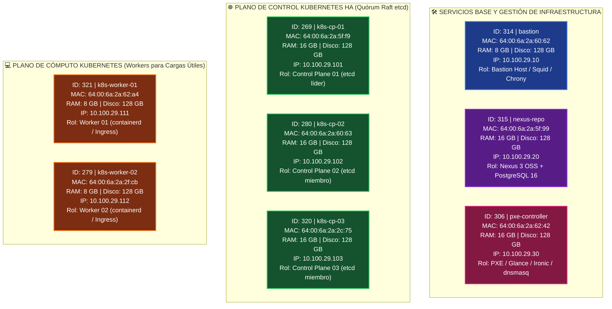
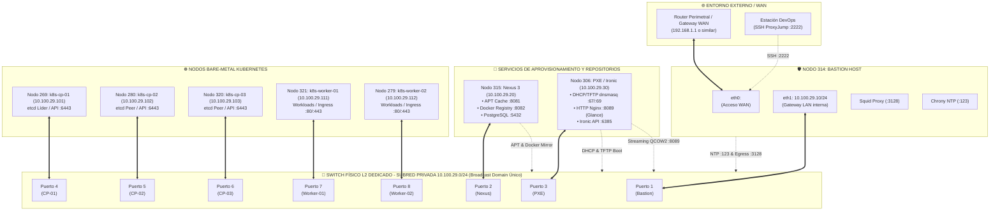
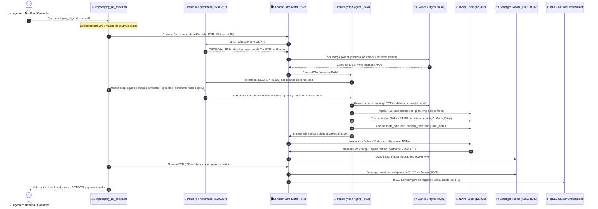
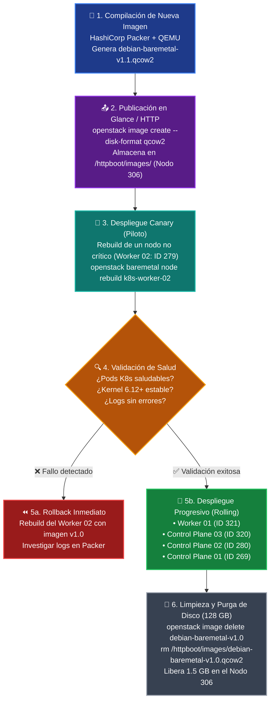
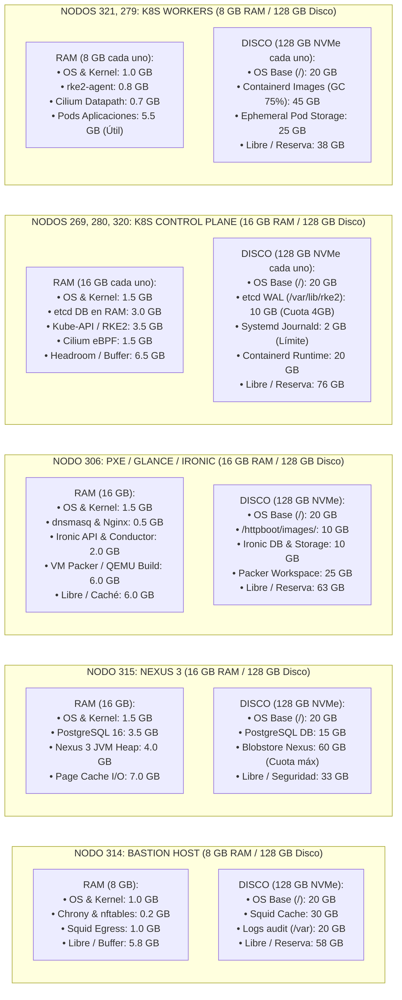

# Guía Maestra de Instalación Conjunta: Infraestructura Bare-Metal Edge con Bastion Host, Sonatype Nexus, PXE/Glance, OpenStack Ironic y Clúster Kubernetes sobre Debian 13 (Trixie)

> **Documento Oficial de Infraestructura como Código (IaC), Arquitectura y Despliegue de Producción**  
> **Sistema Operativo Base**: Debian GNU/Linux 13 (Trixie) con Kernel 6.12+ en la flota física completa de 8 nodos  
> **Modelo Operativo**: Aprovisionamiento Físico Zero-Touch, Aislamiento de Red L2, Despliegue Masivo por MAC, Inmutabilidad de Imágenes y Clúster Kubernetes de Alta Disponibilidad (HA)  
> **Hardware Real**: 8 Nodos Bare-Metal físicos (3 equipos de 8 GB RAM / 5 equipos de 16 GB RAM, todos con 128 GB de disco NVMe/SSD)

---

## 📋 Tabla General de Contenidos

1. [Resumen Ejecutivo y Arquitectura del Sistema](#1-resumen-ejecutivo-y-arquitectura-del-sistema)
   - 1.1 [Objetivo del Proyecto y Alcance Operativo](#11-objetivo-del-proyecto-y-alcance-operativo)
   - 1.2 [Componentes de la Solución y Recursos Compartidos](#12-componentes-de-la-solución-y-recursos-compartidos)
   - 1.3 [Estructura Limpia del Repositorio: Documentación (`docs/`) y Scripts (`scripts/`)](#13-estructura-limpia-del-repositorio-documentación-docs-y-scripts-scripts)
   - 1.4 [Diagramas Maestros de Arquitectura (Mermaid con Explicaciones Simples)](#14-diagramas-maestros-de-arquitectura-mermaid-con-explicaciones-simples)
2. [Investigación Comparativa: OpenStack Kolla-Ansible vs Bifrost/Ironic Standalone](#2-investigación-comparativa-openstack-kolla-ansible-vs-bifrostironic-standalone)
   - 2.1 [Análisis de la Guía de Referencia (Kolla-Ansible en Debian)](#21-análisis-de-la-guía-de-referencia-kolla-ansible-en-debian)
   - 2.2 [Viabilidad de OpenStack Completo frente a Limitaciones de Hardware](#22-viabilidad-de-openstack-completo-frente-a-limitaciones-de-hardware)
   - 2.3 [Diferencias entre Entorno de Desarrollo y Producción](#23-diferencias-entre-entorno-de-desarrollo-y-producción)
3. [Inventario Real de los 8 Nodos, Asignación de Roles y Métodos de Aprovisionamiento](#3-inventario-real-de-los-8-nodos-asignación-de-roles-y-métodos-de-aprovisionamiento)
   - 3.1 [Mapa Oficial: ID de Inventario → MAC → RAM → Disco → Rol → IP con Justificación](#31-mapa-oficial-id-de-inventario--mac--ram--disco--rol--ip-con-justificación)
   - 3.2 [Justificación de Roles según RAM (Distribución 8 GB vs 16 GB)](#32-justificación-de-roles-según-ram-distribución-8-gb-vs-16-gb)
   - 3.3 [Evaluación de Limitaciones Críticas de Almacenamiento (128 GB por Nodo)](#33-evaluación-de-limitaciones-críticas-de-almacenamiento-128-gb-por-nodo)
   - 3.4 [Comparativa Arquitectónica: 1 Control Plane vs 3 Control Planes (HA)](#34-comparativa-arquitectónica-1-control-plane-vs-3-control-planes-ha)
   - 3.5 [Comparativa de Métodos de Aprovisionamiento Bare-Metal y Recomendación Oficial](#35-comparativa-de-métodos-de-aprovisionamiento-bare-metal-y-recomendación-oficial)
4. [Requisitos Técnicos y Compatibilidad en Debian 13 (Trixie)](#4-requisitos-técnicos-y-compatibilidad-en-debian-13-trixie)
   - 4.1 [Matriz de Compatibilidad Oficial y Mitigación de Conflictos](#41-matriz-de-compatibilidad-oficial-y-mitigación-de-conflictos)
   - 4.2 [Estrategia de Ejecución de Servicios en Debian 13](#42-estrategia-de-ejecución-de-servicios-en-debian-13)
5. [Fases Cronológicas de Instalación Paso a Paso](#5-fases-cronológicas-de-instalación-paso-a-paso)
   - [5.0 Orquestación Remota desde Laptop (`ejecutar-desde-laptop.sh`)](#50-orquestación-remota-desde-laptop-ejecutar-desde-laptopsh)
   - [Fase 1: Preparación Base del Sistema Operativo en Debian 13](#fase-1-preparación-base-del-sistema-operativo-en-debian-13)
   - [Fase 2: Bastion Host (Seguridad Perimetral, SSH ProxyJump y nftables)](#fase-2-bastion-host-seguridad-perimetral-ssh-proxyjump-y-nftables)
   - [Fase 3: Sonatype Nexus 3 con Backend PostgreSQL 16 y Tuning de Disco](#fase-3-sonatype-nexus-3-con-backend-postgresql-16-y-tuning-de-disco)
   - [Fase 4: Configuración de Clientes para Consumir Nexus](#fase-4-configuración-de-clientes-para-consumir-nexus)
   - [Fase 5: Servicios de Arranque por Red PXE / iPXE con Reservas por MAC](#fase-5-servicios-de-arranque-por-red-pxe--ipxe-con-reservas-por-mac)
   - [Fase 6: OpenStack Glance e Ironic Standalone para Servidores Físicos](#fase-6-openstack-glance-e-ironic-standalone-para-servidores-físicos)
   - [Fase 7: Plantillas Cloud-Init, ConfigDrive y Compilación Inmutable con Packer](#fase-7-plantillas-cloud-init-configdrive-y-compilación-inmutable-con-packer)
   - [Fase 8: Despliegue Masivo por Red Privada "Un Solo Botón" (Zero-Touch Provisioning)](#fase-8-despliegue-masivo-por-red-privada-un-solo-botón-zero-touch-provisioning)
   - [Fase 9: Clúster Kubernetes de Alta Disponibilidad (RKE2 + Cilium eBPF)](#fase-9-clúster-kubernetes-de-alta-disponibilidad-rke2--cilium-ebpf)
   - [Fase 10: Ciclo de Vida, Reinstalación de Nodos y Actualizaciones Continuas](#fase-10-ciclo-de-vida-reinstalación-de-nodos-y-actualizaciones-continuas)
   - [Fase 11: Validación Integral del Clúster y Acceso Remoto](#fase-11-validación-integral-del-clúster-y-acceso-remoto)
6. [Matriz de Comunicación, Puertos y Reglas de Cortafuegos (nftables)](#6-matriz-de-comunicación-puertos-y-reglas-de-cortafuegos-nftables)
7. [Seguridad Criptográfica, Secretos y Gestión de Repositorios](#7-seguridad-criptográfica-secretos-y-gestión-de-repositorios)
8. [Gestión Estricta y Cuotas del Disco de 128 GB (Glance, Nexus, etcd)](#8-gestión-estricta-y-cuotas-del-disco-de-128-gb-glance-nexus-etcd)
9. [Scripts Automáticos de Diagnóstico y Health Check](#9-scripts-automáticos-de-diagnóstico-y-health-check)
10. [Guía Exhaustiva de Resolución de Problemas (Troubleshooting)](#10-guía-exhaustiva-de-resolución-de-problemas-troubleshooting)
11. [Checklist Final, Estado Esperado y Hoja de Ruta (Roadmap)](#11-checklist-final-estado-esperado-y-hoja-de-ruta-roadmap)

---

## 1. Resumen Ejecutivo y Arquitectura del Sistema

### 1.1 Objetivo del Proyecto y Alcance Operativo

El objetivo cardinal de esta infraestructura es construir una plataforma de cómputo en el borde (**Edge Computing**) de alta resiliencia sobre **8 servidores físicos bare-metal**. Toda la plataforma utiliza **Debian GNU/Linux 13 (Trixie)** como sistema operativo base, eliminando hipervisores (KVM, Proxmox, VMware) para otorgar acceso directo al hardware, reducir a cero el *overhead* de virtualización y optimizar el rendimiento de red y almacenamiento NVMe.

El ciclo de aprovisionamiento es **completamente desatendido (Zero-Touch)** y masivo por red privada:
1. El servidor se conecta al switch de la red privada L2 (`10.100.29.0/24`) y recibe corriente eléctrica (por comando de encendido remoto Redfish/IPMI/Wake-on-LAN o encendido físico).
2. Arranca por red mediante **PXE/iPXE**, donde el servidor DHCP (`dnsmasq`) le asigna su dirección IP definitiva según su **dirección MAC física registrada**.
3. Carga en memoria RAM el ramdisk efímero de **Ironic Python Agent (IPA)** vía HTTP (`:8089`).
4. IPA formatea el disco local de 128 GB y graba por streaming una imagen comprimida **Debian 13 (`.qcow2`)** pre-compilada con **HashiCorp Packer** o **Glance**.
5. IPA crea la partición de metadatos **ConfigDrive (`config-2`)** inyectando red estática, llaves SSH y repositorios.
6. El nodo reinicia en disco local, **cloud-init** lee la partición y autoconfigura el sistema operativo.
7. Los paquetes APT y contenedores se descargan localmente desde **Sonatype Nexus 3**, sin salir a Internet ni saturar la WAN.
8. Los nodos designados convergen automáticamente en un **clúster Kubernetes de Alta Disponibilidad (HA)** gobernado por **RKE2** y acelerado con **Cilium (eBPF)**.

---

### 1.2 Componentes de la Solución y Recursos Compartidos

| Componente | Nodo Físico Anfitrión | Recursos que Comparte con la Red Interna |
| :--- | :--- | :--- |
| **Bastion Host** | Nodo ID 314 (`10.100.29.10`) | • Punto único de salto SSH ProxyJump (Puerto TCP `2222`).<br>• Proxy Egress Squid para salida auditada a WAN (Puerto TCP `3128`).<br>• Servidor de sincronización horaria Chrony NTP (Puerto UDP `123`).<br>• Cortafuegos perimetral `nftables`. |
| **Sonatype Nexus 3** | Nodo ID 315 (`10.100.29.20`) | • Proxy y Caché de paquetes Debian APT (`:8081/repository/debian-proxy/`).<br>• Docker Hub Proxy & Registro OCI Privado (`:8082` pull / `:8083` push).<br>• Proxies para npm (`:8081`) y PyPI (`:8081`).<br>• Base de datos relacional PostgreSQL 16 interna (`:5432`). |
| **PXE / Glance / Ironic** | Nodo ID 306 (`10.100.29.30`) | • Concesiones DHCP estáticas por MAC y dinámicas efímeras (`dnsmasq`).<br>• Entrega de bootloader TFTP iPXE (Puerto UDP `69`).<br>• Servidor HTTP de imágenes Nginx / Glance (Puerto TCP `8089`).<br>• Orquestador de hardware Ironic API (Puerto TCP `6385`). |
| **K8s Control Plane (HA)**| Nodos ID 269, 280, 320 (`10.100.29.101..103`)| • Kubernetes API Server balanceado (Puerto TCP `6443`).<br>• Quórum de base de datos distribuida etcd (Puertos TCP `2379:2380`).<br>• API de supervisión RKE2 (Puerto TCP `9345`). |
| **K8s Workers** | Nodos ID 321, 279 (`10.100.29.111..112`)| • Ejecución de pods de aplicaciones contenerizadas.<br>• Enrutamiento L7 perimetral mediante Ingress Controller NGINX (`80/443`).<br>• Datapath de red pod-a-pod gestionado por Cilium con eBPF. |

---

### 1.3 Estructura Limpia del Repositorio: Documentación (`docs/`) y Scripts (`scripts/`)

El repositorio mantiene una separación estricta entre la **documentación técnica (`docs/`)** y los **scripts ejecutables de automatización (`scripts/`)**:

```text
infra-scripts/
├── README.md                          # Guía Maestra de Arquitectura y Despliegue
├── ejecutar-desde-laptop.sh           # Orquestador DevOps Remoto (Motor Ansible Core)
├── .gitignore                         # Exclusión de claves, certificados, respaldos e ISOs
├── todo.md                            # Control de Tareas y Auditoría del Proyecto
│
├── ansible/                           # MOTOR DE ORQUESTACIÓN DECLARATIVO E IDEMPOTENTE
│   ├── ansible.cfg                    # Optimización SSH, forks=8, pipelining y ControlPersist
│   ├── inventory/
│   │   ├── hosts.yml                  # Inventario estructurado en YAML de los 8 nodos físicos
│   │   └── group_vars/all/vars.yml    # Variables maestras del clúster (IPs, subredes, puertos)
│   ├── roles/                         # ROLES MODULARES DE ANSIBLE
│   │   ├── common/                    # Base OS, /etc/hosts, networkd, Swap, Chrony, APT Nexus
│   │   ├── bastion/                   # Bastion Host, SSH hardening :22, Squid :3128, nftables NAT
│   │   ├── nexus/                     # PostgreSQL 16 + Sonatype Nexus 3 OSS (Tuning 4GB RAM)
│   │   ├── pxe_controller/            # dnsmasq con reservas MAC dinámicas, TFTP, Nginx :8089
│   │   ├── ironic/                    # OpenStack Ironic Standalone en Podman y baremetal.yaml
│   │   ├── rke2_ha/                   # Clúster Kubernetes HA (3 CPs + 2 Workers) con Cilium eBPF
│   │   └── monitoring/                # Prometheus TSDB, Grafana y Node Exporter en la flota
│   ├── playbooks/                     # PLAYBOOKS EJECUTABLES POR FASE O COMPONENTE
│   │   ├── 00_ping.yml                # Validación de conectividad SSH paralela
│   │   ├── 01_system_summary.yml      # Telemetría de hardware (RAM, Disco, CPU, Kernel)
│   │   ├── 02_base_config.yml         # Homologación del SO (invoca rol common)
│   │   ├── 03_bastion.yml             # Despliegue perimetral en Nodo 314
│   │   ├── 04_nexus.yml               # Despliegue de Nexus y PostgreSQL en Nodo 315
│   │   ├── 05_pxe_controller.yml      # Servicios PXE, dnsmasq e iPXE en Nodo 306
│   │   ├── 06_ironic_deploy.yml       # OpenStack Ironic Standalone en Nodo 306
│   │   ├── 07_kubernetes_ha.yml       # Clúster Kubernetes HA RKE2 + Cilium
│   │   ├── 08_monitoring.yml          # Suite de Monitoreo Centralizado
│   │   └── 09_healthcheck.yml         # Auditoría integral de puertos y servicios
│   └── site.yml                       # Orquestador maestro integral (soporta tags)
│
├── config/                            # Parámetros, variables y catálogo de red
│   ├── env                            # Variables maestras activas del clúster (chmod 600)
│   ├── env.example                    # Plantilla de variables de entorno y puertos
│   ├── nodes.csv                      # Inventario físico de los 8 nodos con MACs normalizadas
│   └── dnsmasq.conf                   # Plantilla de referencia para reservas DHCP y PXE
│
├── docs/                              # DOCUMENTACIÓN TÉCNICA Y OPERATIVA (.md)
│   ├── env.md                         # Cheat-sheet de IPs, claves, BIOS y alias SSH
│   ├── estructura.md                  # Manual de operación y trazabilidad del repositorio
│   ├── manual_maestro_infraestructura_pxe_openstack.md # Manual técnico exhaustivo
│   ├── arranque_e_instalacion_por_red_pxe.md # Guía e investigación técnica de arranque por red PXE
│   ├── monitoreo_prometheus_grafana.md # Manual Maestro de Monitoreo (Prometheus, Grafana, Alertmanager)
│   ├── redes/                         # Arquitectura y seguridad de redes
│   ├── runbooks/                      # Procedimientos operativos estándar (SOP)
│   └── openstack/                     # Decisiones de diseño y arquitectura bare-metal
│
├── lib/                               # Biblioteca compartida
│   └── common.sh                      # Logging, comprobaciones, traps y carga de configuración
│
└── scripts/                           # SCRIPTS UTILITARIOS COMPLEMENTARIOS (.sh / .py)
    ├── 00-preflight.sh                # Auditoría previa de compatibilidad y hardware en Debian 13
    ├── 07-cloud-init.sh               # Compilación de plantillas Packer HCL y ConfigDrive
    ├── 09-verificacion.sh             # Validación interactiva integral de 14 pruebas
    ├── bootstrap_node.py              # Inyección de claves y bootstrap de emergencia
    ├── compilar-ipxe-custom.sh        # Compilación modular de binarios iPXE embebidos
    └── healthcheck.sh                 # Auditoría de estado en vivo y tabla visual en consola
```

---

### 1.4 Diagramas Maestros de Arquitectura (Mermaid con Explicaciones Simples)

#### Diagrama 1: Distribución de los 8 Nodos por ID, RAM y Rol (Codificación por Colores)



**Explicación simple del diagrama:**  
Este diagrama ilustra la asignación física de los 8 servidores según su capacidad de memoria RAM. Los servicios que demandan alta memoria (Sonatype Nexus con su motor JVM/PostgreSQL, el controlador de aprovisionamiento PXE/Glance con Packer, y los tres nodos del plano de control de Kubernetes con etcd) se ubican obligatoriamente en los cinco servidores de 16 GB (representados en verde, morado y rosa). Por su parte, los roles ligeros (el servidor Bastion que solo realiza enrutamiento/proxy, y los dos nodos de trabajo de Kubernetes para ejecución de pods) se sitúan en los tres servidores de 8 GB (en azul y naranja).

---

#### Diagrama 2: Topología de la Red Privada de Aprovisionamiento (L2)



**Explicación simple del diagrama:**  
Este esquema muestra la separación estricta de redes. El único equipo con presencia en dos redes (dual-homed) es el Bastion Host (Nodo 314), que conecta con el exterior a través de su interfaz WAN y actúa como pasarela controlada. Todos los demás 7 servidores están confinados en una red física aislada L2 (`10.100.29.0/24`) mediante un switch dedicado. Ningún nodo interno tiene salida directa a Internet; obtienen su dirección IP, archivos de arranque PXE e imágenes del servidor PXE (`10.100.29.30`), descargan paquetes de software de Nexus (`10.100.29.20`), y únicamente acceden a la WAN para servicios auditados a través del proxy Squid del Bastión.

---

#### Diagrama 3: Flujo del Despliegue Masivo "Un Solo Botón" (Zero-Touch Provisioning)



**Explicación simple del diagrama:**  
Este diagrama detalla la secuencia completamente automatizada desde que se presiona "un botón" (ejecución del script maestro) hasta que los servidores quedan operativos. El script enciende los servidores por red, cada máquina pide IP y recibe su configuración exacta gracias a su dirección MAC, descarga un sistema temporal en memoria RAM (IPA), limpia el disco de 128 GB, le escribe la imagen de Debian 13 junto con su configuración de red (ConfigDrive) y reinicia en el disco local. Al arrancar, el sistema se autoconfigura con cloud-init y se conecta a Nexus para terminar de unirse al clúster de Kubernetes sin intervención humana.

---

#### Diagrama 4: Ciclo de Vida y Actualización de Imágenes en Glance



**Explicación simple del diagrama:**  
Este ciclo ilustra cómo se actualiza el sistema operativo en toda la flota sin riesgos. Primero se compila una nueva versión inmutable de la imagen con Packer y se sube a Glance. Antes de aplicarla a todos los equipos, se prueba de forma controlada (canary) en un único nodo de trabajo; si se detecta un problema, se revierte al instante. Si funciona a la perfección, se actualizan los demás nodos uno a uno garantizando que el clúster nunca pierda quórum ni disponibilidad. Finalmente, se borra la imagen anterior del disco para no saturar los 128 GB del servidor de aprovisionamiento.

---

#### Diagrama 5: Desglose de Asignación de Recursos por Nodo (RAM / Disco 128 GB / CPU)



**Explicación simple del diagrama:**  
Este diagrama resume el dimensionamiento preventivo de memoria RAM y almacenamiento en disco de 128 GB para cada uno de los roles. Debido al espacio limitado de 128 GB, cada equipo tiene particionado y cuotas estrictas: Nexus limita su almacén de imágenes a 60 GB para evitar bloqueos del sistema, el servidor de aprovisionamiento reserva espacio temporal para compilar imágenes con Packer borrando temporales inmediatamente, los nodos del plano de control imponen un tope de 4 GB a la base de datos etcd y 2 GB a los registros del sistema, y los nodos de trabajo aplican recolección automática de basura (GC) en imágenes de contenedores cuando el disco alcanza el 75%.

---

## 2. Investigación Comparativa: OpenStack Kolla-Ansible vs Bifrost/Ironic Standalone

### 2.1 Análisis de la Guía de Referencia (Kolla-Ansible en Debian)

Se analizó en profundidad el artículo de referencia (*Install OpenStack on Debian 12 with Kolla-Ansible*, ComputingForGeeks), el cual documenta el despliegue de **OpenStack 2025.2 (Flamingo) / 2024.x** mediante contenedores Docker orquestados con `kolla-ansible` en **Debian 12 (Bookworm)**.

#### Componentes que Despliega Kolla-Ansible según la Guía:
1. **Infraestructura Base**: MariaDB (puerto `3306`), RabbitMQ (mensajería AMQP en puerto `5672`), Memcached (caché en memoria puerto `11211`), ProxySQL.
2. **Servicios Centrales de OpenStack**:
   - **Keystone**: Servicio de identidad y catálogo de endpoints (puerto `5000`).
   - **Glance**: Catálogo y almacenamiento de imágenes de máquinas virtuales (puerto `9292`).
   - **Placement**: Rastreo de recursos de cómputo y asignaciones (puerto `8778`).
   - **Nova**: Planificador y controlador de hipervisores KVM/QEMU (puerto `8774`).
   - **Neutron**: Agentes de red Open vSwitch (OVS) y control de puentes virtuales (puerto `9696`).
   - **Horizon**: Panel gráfico de gestión web (puerto `80`/`443`).

#### Requisitos y Reglas de Kolla-Ansible en Debian:
- **Exigencia de Red Dual (2 NICs)**: Una interfaz de gestión (`network_interface: "ens3"`) y una interfaz externa de Neutron (`neutron_external_interface: "ens4"`). La guía advierte severamente: **si se usa la misma interfaz para ambas, el agente Open vSwitch de Neutron secuestra la tarjeta y provoca el bloqueo inmediato de SSH (*SSH lockout*)**.
- **Consumo de Memoria**: Mínimo 16 GB de RAM (32 GB recomendados) únicamente para levantar los contenedores del plano de control de OpenStack.
- **Almacenamiento Mínimo**: 80 GB de disco dedicados al plano de control.
- **Entorno Python**: Requiere `python3 -m venv --system-site-packages` para permitir acceso al módulo del sistema `dbus`.

---

### 2.2 Viabilidad de OpenStack Completo frente a Limitaciones de Hardware

Al cruzar los requerimientos de la guía con nuestro hardware real (nodos con **128 GB de disco** y nodos de **8 GB / 16 GB de RAM**), se concluye lo siguiente:

```
┌──────────────────────────────────────────────────────────────────────────────────┐
│                   EVALUACIÓN DE VIABILIDAD ARQUITECTÓNICA                        │
├────────────────────────────┬─────────────────────────────┬───────────────────────┤
│ PARÁMETRO                  │ OPENSTACK COMPLETO (KOLLA)  │ BIFROST / IRONIC      │
├────────────────────────────┼─────────────────────────────┼───────────────────────┤
│ Consumo de Memoria RAM     │ 14 GB a 16 GB (Crítico)     │ 1.5 GB a 2 GB (Bajo)  │
│ Consumo de Disco Base      │ 65 GB a 85 GB (Peligroso)   │ 8 GB a 12 GB (Seguro) │
│ Propósito en el Proyecto   │ Virtualización (Crear VMs)  │ Bare-Metal (Servidores)│
│ Complejidad de Red         │ Open vSwitch / Bridges      │ dnsmasq L2 nativo     │
│ Riesgo de Bloqueo SSH      │ Muy Alto (Neutron takeover) │ Nulo (No usa Neutron) │
│ Viabilidad en Nuestro Lab  │ 🔴 INVIABLE / INEFICIENTE   │ 🟢 ÓPTIMO Y ADOPTADO  │
└────────────────────────────┴─────────────────────────────┴───────────────────────┘
```

#### ¿Por qué OpenStack completo no es viable ni necesario?
1. **El objetivo no es crear Máquinas Virtuales**: Nuestro objetivo es desplegar un clúster Kubernetes sobre **metal desnudo (bare-metal)**. Instalar Nova, Neutron, Cinder y Horizon añade 20 contenedores pesados que no aportan ninguna utilidad a Kubernetes y compiten ferozmente por los escasos 128 GB de disco.
2. **Agotamiento de RAM**: El nodo de aprovisionamiento cuenta con 16 GB de RAM. Kolla-Ansible consumiría más de 14 GB, impidiendo que el nodo ejecute tareas esenciales como compilar imágenes con Packer o gestionar el servidor de repositorios.
3. **Peligro de Bloqueo de Red**: En servidores bare-metal con una sola tarjeta conectada al switch privado, Neutron Open vSwitch rompería la conectividad de administración.

#### La Solución Adoptada: OpenStack Ironic Standalone + Glance HTTP
Se implementa **OpenStack Ironic en modo independiente (*noauth*)**, respaldado por el motor de distribución de imágenes de **Glance/Nginx**. Esta solución:
* Consume menos de **2 GB de RAM**.
* Requiere menos de **10 GB de disco**.
* Gestiona directamente el arranque PXE, encendido de hardware, formateo de discos NVMe y despliegue inmutable sin intermediarios.

---

### 2.3 Diferencias entre Entorno de Desarrollo y Producción

| Dimensión Técnica | Entorno de Desarrollo / Laboratorio | Entorno de Producción Oficial (Este Despliegue) |
| :--- | :--- | :--- |
| **Topología de Servidores** | Una sola máquina virtual All-in-One con Kolla | 8 Servidores Físicos Bare-Metal distribuidos |
| **Manejo de Imágenes** | Descarga manual de ISOs desde Internet | Imágenes inmutables `.qcow2` pre-cocinadas con Packer |
| **Repositorios de Paquetes**| Descargas repetitivas desde `deb.debian.org` | Caché centralizada en Sonatype Nexus (1 Gbps local) |
| **Control de Energía** | Apagado/Encendido manual o mock driver | Wake-on-LAN / BMC IPMI automatizado |
| **Alta Disponibilidad K8s**| 1 Control Plane solitario (SPOF) | 3 Control Planes con quórum Raft etcd distribuido |
| **Seguridad de Red** | Acceso SSH directo con contraseña | Acceso exclusivo vía Bastion Host con llaves Ed25519 |

---

## 3. Inventario Real de los 8 Nodos, Asignación de Roles y Métodos de Aprovisionamiento

### 3.1 Mapa Oficial: ID de Inventario → MAC → RAM → Disco → Rol → IP con Justificación

La siguiente tabla refleja los **datos de hardware reales** del proyecto, con las direcciones MAC normalizadas en formato canónico estándar (`aa:bb:cc:dd:ee:ff` en minúsculas) y la **justificación de una línea** de cada rol asignado:

| ID | MAC Normalizada | RAM | Disco | Hostname | IP | Rol Arquitectónico | Justificación de una Línea |
| :---: | :---: | :---: | :---: | :--- | :--- | :--- | :--- |
| **314** | `64:00:6a:2a:60:62` | 8 GB | 128 GB | `bastion.<DOMINIO>` | WAN: `<IP_BASTION_WAN>`<br>LAN: `10.100.29.10` | Bastion Host, Gateway, Squid, Chrony | Los servicios de pasarela SSH, proxy Squid y sincronización NTP consumen menos de 1.2 GB de memoria RAM en reposo. |
| **315** | `64:00:6a:2a:5f:99` | 16 GB | 128 GB | `nexus-repo.<DOMINIO>` | LAN: `10.100.29.20` | Sonatype Nexus 3 OSS + PostgreSQL 16 DB | La JVM de Nexus, PostgreSQL 16 y la caché de entrada/salida para transferencias a 1 Gbps requieren más de 8 GB para operar sin OOM. |
| **306** | `64:00:6a:2a:62:42` | 16 GB | 128 GB | `pxe-controller.<DOMINIO>` | LAN: `10.100.29.30` | Provisión PXE (dnsmasq), Glance HTTP, Ironic | Debe ejecutar concurrentemente Ironic API, Nginx y la máquina virtual QEMU para compilación de imágenes con Packer. |
| **269** | `64:00:6a:2a:5f:f9` | 16 GB | 128 GB | `k8s-cp-01.<DOMINIO>` | LAN: `10.100.29.101` | K8s Control Plane 01 (etcd líder / API Server) | Aloja el nodo líder de etcd y el API Server, requiriendo retención en RAM para transacciones Raft con latencia < 10 ms. |
| **280** | `64:00:6a:2a:60:63` | 16 GB | 128 GB | `k8s-cp-02.<DOMINIO>` | LAN: `10.100.29.102` | K8s Control Plane 02 (etcd miembro / API Server)| Miembro con voto en el quórum Raft de etcd de 3 nodos y componente de alta disponibilidad de kube-apiserver. |
| **320** | `64:00:6a:2a:2c:75` | 16 GB | 128 GB | `k8s-cp-03.<DOMINIO>` | LAN: `10.100.29.103` | K8s Control Plane 03 (etcd miembro / API Server)| Tercer miembro del quórum Raft de etcd indispensable para tolerancia a fallos de 1 nodo sin degradación de servicio. |
| **321** | `64:00:6a:2a:62:a4` | 8 GB | 128 GB | `k8s-worker-01.<DOMINIO>` | LAN: `10.100.29.111` | K8s Worker Node 01 (containerd / Ingress) | Nodo dedicado exclusivamente a cargas útiles de pods, disponiendo de ~5.5 GB de RAM libres sin sobrecarga de gestión. |
| **279** | `64:00:6a:2a:2f:cb` | 8 GB | 128 GB | `k8s-worker-02.<DOMINIO>` | LAN: `10.100.29.112` | K8s Worker Node 02 (containerd / Ingress) | Segundo nodo de cómputo para distribución de pods contenerizados de usuario y réplicas de alta disponibilidad. |

> [!NOTE]
> **Identificadores de Chasis (314, 315, etc.) [POR CONFIRMAR]**:  
> Estos números corresponden a los identificadores de inventario físico de las etiquetas del rack. Si representan números de serie o nombres específicos de chasis (ej. `nodo-314`), pueden incorporarse en el subdominio DNS.

---

### 3.2 Justificación de Roles según RAM (Distribución 8 GB vs 16 GB)

El ecosistema cuenta con **3 equipos de 8 GB** y **5 equipos de 16 GB**. La asignación obedece a un estricto criterio de consumo de memoria y criticidad:

1. **Equipos de 16 GB asignados a los componentes más pesados**:
   - **Nodo 315 (Nexus 3 + PostgreSQL)**: La JVM de Nexus requiere un *heap* de 4 GB, más memoria de acceso directo (*DirectMemory*), sumado al *shared_buffers* de PostgreSQL 16 y la caché de bloques de disco del kernel para servir archivos a 1 Gbps. Con 8 GB sufriría saturación; con 16 GB opera con holgura.
   - **Nodo 306 (PXE / Ironic / Glance / Packer)**: Aloja el motor de Ironic, Nginx y la compilación de HashiCorp Packer con QEMU/KVM. Ejecutar una máquina virtual de compilación en RAM mientras Ironic atiende peticiones requiere 16 GB de RAM.
   - **Nodos 269, 280 y 320 (K8s Control Plane HA)**: Cada nodo ejecuta `kube-apiserver`, `kube-controller-manager`, `kube-scheduler`, `etcd`, y el agente `cilium-operator`. La base distribuida `etcd` requiere mantener sus índices en memoria RAM para garantizar latencias inferiores a 10 ms en transacciones Raft. 16 GB garantiza estabilidad absoluta.
2. **Equipos de 8 GB asignados a roles ligeros**:
   - **Nodo 314 (Bastion Host)**: Solo ejecuta OpenSSH Server, Squid Proxy en modo Egress, Chrony y reglas `nftables`. Su consumo de RAM en reposo es inferior a 1.2 GB. 8 GB es más que suficiente.
   - **Nodos 321 y 279 (Workers de Kubernetes)**: Ejecutan `rke2-agent`, el runtime `containerd` y los pods de las aplicaciones. Al no cargar con los procesos de gestión del plano de control, disponen de ~5.5 GB de RAM libres por nodo dedicados a cargas de trabajo.

---

### 3.3 Evaluación de Limitaciones Críticas de Almacenamiento (128 GB por Nodo)

Disponer de únicamente **128 GB de disco por nodo** representa la mayor restricción física de la infraestructura. Se han diseñado las siguientes medidas de mitigación para evitar el colapso por disco lleno:

```
┌──────────────────────────────────────────────────────────────────────────────────┐
│                   MAPA DE RIESGOS Y MITIGACIÓN DE DISCO (128 GB)                 │
├─────────────┬──────────────────────────┬─────────────────────────────────────────┤
│ NODO / ROL  │ RIESGO DE AGOTAMIENTO    │ POLÍTICA DE MITIGACIÓN TÉCNICA          │
├─────────────┼──────────────────────────┼─────────────────────────────────────────┤
│ Nexus       │ Acumulación de capas de  │ • Cuota dura del blobstore: 60 GB máx.  │
│ (Nodo 315)  │ Docker y paquetes APT    │ • Limpieza automática: purga de Docker  │
│             │ que superen los 100 GB.  │   layers no referenciados > 14 días.    │
│             │                          │ • Tarea programada: Compact Blobstore.  │
│             │                          │ • [RECOMENDADO]: Montar NFS / Disco USB │
│             │                          │   secundario en /opt/sonatype/data.     │
├─────────────┼──────────────────────────┼─────────────────────────────────────────┤
│ Glance/PXE  │ Múltiples ISOs e         │ • Cuota en /httpboot/images/: 10 GB máx │
│ (Nodo 306)  │ imágenes QCOW2 pesadas   │ • Conservar únicamente 1 imagen golden  │
│             │ generadas por Packer.    │   debian-baremetal.qcow2 (~1.5 GB).     │
│             │                          │ • Purgar directorios /output-debian/    │
│             │                          │   inmediatamente tras la compilación.   │
├─────────────┼──────────────────────────┼─────────────────────────────────────────┤
│ Control     │ Crecimiento de logs WAL  │ • Compactación automática de etcd cada  │
│ Plane K8s   │ de etcd y desbordamiento │   1 hora (--auto-compaction-retention=1)│
│ (269,280,320│ del journal de systemd.  │ • Cuota de backend etcd: 4 GB máx.      │
│             │                          │ • Límites estrictos en journald:        │
│             │                          │   SystemMaxUse=2G en /etc/systemd/.     │
├─────────────┼──────────────────────────┼─────────────────────────────────────────┤
│ Workers     │ Imágenes huérfanas de    │ • Kubelet High/Low Thresholds:          │
│ (321, 279)  │ containerd y volúmenes   │   imageGCHighThresholdPercent: 75       │
│             │ temporales de pods.      │   imageGCLowThresholdPercent: 60        │
└─────────────┴──────────────────────────┴─────────────────────────────────────────┘
```

---

### 3.4 Comparativa Arquitectónica: 1 Control Plane vs 3 Control Planes (HA)

Se ratifica la decisión técnica adoptada:

* **Opción A (1 Control Plane + 4 Workers)**: Descartada. Si el nodo 269 sufre una avería en su disco de 128 GB o en su fuente de poder, se destruye el quórum de `etcd`, el API Server queda inaccesible y el clúster entero queda inoperativo.
* **Opción B (3 Control Planes HA + 2 Workers)**: **ADOPTADA OFICIALMENTE**. Permite tolerar la caída física de 1 Control Plane completo sin interrupción de servicio. Para entornos de producción o institucionales, la Alta Disponibilidad de `etcd` es un requisito innegociable.

---

### 3.5 Comparativa de Métodos de Aprovisionamiento Bare-Metal y Recomendación Oficial

A continuación se analizan los cuatro métodos estándar para aprovisionar servidores físicos por red:

| Criterio Técnico | 1. Ironic + QCOW2 vía Glance | 2. PXE + Preseed (Debian-Installer) | 3. ISO en Glance (Virtual Media) | 4. Híbrido (iPXE + Netboot + Tarball) |
| :--- | :--- | :--- | :--- | :--- |
| **Tiempo de Instalación** | **2 a 4 minutos** (Volcado directo de bloques) | 15 a 25 minutos (Descarga paquete por paquete) | 20 a 30 minutos (Instalador interactivo emulado) | 8 a 12 minutos (Extracción de tarball en memoria) |
| **Consumo de Ancho de Banda**| **Muy bajo**: Stream único de imagen comprimida (~1.5 GB) | Alto: Cientos de peticiones HTTP a repositorios | Medio-Alto: Stream completo de ISO (~4 GB) | Medio: Descarga de kernel + tarball (~2 GB) |
| **Inmutabilidad y Determinismo**| **Total**: Cada nodo recibe exactamente los mismos bloques | Baja: Deriva potencial si cambian paquetes en repositorio | Baja: Depende del instalador en tiempo de ejecución | Media: Requiere scripts de post-instalación |
| **Inyección de ConfigDrive** | **Nativa**: Crea partición VFAT `config-2` en disco local | Limitada: Parámetros en kernel cmdline o preseed | Nula/Muy compleja: ISO no inyecta particiones locales | Compleja: Requiere montaje chroot en memoria |
| **Requisitos de Hardware** | Tarjeta de red PXE / UEFI estándar | Tarjeta de red PXE estándar | Requiere BMC/IPMI con licencia de Virtual Media | Tarjeta de red iPXE estándar |
| **Complejidad Operativa** | Media-Alta al inicio, luego trivial ("Un Botón") | Media, requiere mantener archivos `preseed.cfg` | Alta, depende de drivers BMC específicos de vendor | Muy Alta, requiere mantener scripts personalizados |
| **Veredicto para 8 Nodos** | 🟢 **MÉTODO ADOPTADO OFICIALMENTE** | 🟡 Descartado por lentitud y variabilidad | 🔴 Descartado por incompatibilidad con ConfigDrive | 🔴 Descartado por complejidad innecesaria |

> [!IMPORTANT]
> **Recomendación y Decisión Final Justificada en una Línea**:  
> Se adopta **Ironic Standalone + QCOW2 vía Glance** porque garantiza despliegues inmutables ultra-rápidos (< 3 minutos), inyección limpia de configuración mediante `ConfigDrive` (`config-2`) y cero sobrecarga de red al no depender de descargas repetitivas.

---

## 4. Requisitos Técnicos y Compatibilidad en Debian 13 (Trixie)

### 4.1 Matriz de Compatibilidad Oficial y Mitigación de Conflictos

| Componente | Versión Exacta | Soporte Nativo en Debian 13 | Conflicto / Detalle Técnico | Mitigación Arquitectónica |
| :--- | :--- | :--- | :--- | :--- |
| **Kernel Linux** | 6.12.x-amd64 | ✅ **Oficial / Estable** | Ninguno. Soporte maduro para eBPF y cgroups v2. | Kernel oficial Debian sin parches. |
| **OpenStack Ironic** | 2024.1 (Caracal) | 🔴 **No Nativo** | Pip y paquetes fallan por Python 3.12/3.13 en Trixie. | Ejecución en contenedor Podman sobre Debian 13. |
| **Sonatype Nexus** | 3.70.x - 3.75.x | ⚠️ **Ajustes Requeridos** | OrientDB retirado; requiere OpenJDK 17 LTS. | Base de datos externa PostgreSQL 16 y JVM 17. |
| **PostgreSQL** | 16.x | ✅ **Oficial / Estable** | Ninguno. Motor relacional de alto rendimiento. | Servicio nativo systemd en Debian 13. |
| **containerd** | 1.7.x / 2.0.x | ✅ **Oficial / Estable** | cgroups v2 activo por defecto. | Embebido en RKE2 con driver systemd. |
| **Kubernetes RKE2**| v1.30.x+rke2r1 | ✅ **Totalmente Probado**| Requiere módulos del kernel y AppArmor. | Script `/etc/modules-load.d/k8s.conf`. |
| **CNI (Red K8s)** | Cilium (eBPF) | 🌟 **Óptimo** | Canal/Flannel fallan por iptables-nft. | Cilium reemplaza `kube-proxy` directo en kernel. |
| **Cloud-Init** | 24.x | ✅ **Oficial / Estable** | Sin metadata server local en red aislada. | Datasource `ConfigDrive` (`config-2`). |

---

### 4.2 Estrategia de Ejecución de Servicios en Debian 13

1. **No se degrada ningún equipo a Debian 12**: Todos los 8 nodos operan con **Debian 13 (Trixie)**, garantizando uniformidad en el despliegue de paquetes, compatibilidad con drivers modernos y homogeneidad de parches de seguridad.
2. **Aislamiento mediante Contenedores para Ironic**: En el Nodo 306 (`pxe-controller`), el demonio de Ironic se ejecuta en un contenedor Podman/Docker con acceso a los sockets de red del host (`--net=host`), desacoplando el ciclo de vida de Python del sistema operativo base.

---

## 5. Fases Cronológicas de Instalación Paso a Paso

### 5.0 Orquestación Remota desde Laptop (`ejecutar-desde-laptop.sh`)

> [!TIP]
> **Modo Operativo Recomendado**: No es necesario iniciar sesión manualmente en cada uno de los servidores ni copiar archivos a mano con memorias USB. Todo el ciclo de aprovisionamiento, sincronización de código y ejecución de fases se orquesta desde la **laptop de administración conectada por Wi-Fi** a través del script maestro `./ejecutar-desde-laptop.sh`.

#### Flujo Operativo y Comandos Principales
```bash
# 1. Auditar conectividad y verificar qué nodos están encendidos y alcanzables
./ejecutar-desde-laptop.sh --check

# 2. Sincronizar el repositorio de scripts hacia /tmp/infra-scripts en los nodos remotos
./ejecutar-desde-laptop.sh --sync

# 3. Ejecutar fases modulares de instalación:
./ejecutar-desde-laptop.sh --fase 1    # 01-base-servidores.sh (Flota completa)
./ejecutar-desde-laptop.sh --fase 2    # 02-bastion.sh (Nodo 314 - Bastion Host)
./ejecutar-desde-laptop.sh --fase 3    # 03-nexus.sh (Nodo 315 - Sonatype Nexus 3)
./ejecutar-desde-laptop.sh --fase 4    # 04-clientes-nexus.sh (Configurar mirrors APT)
./ejecutar-desde-laptop.sh --fase 5    # 05-pxe-dhcp-tftp.sh (Nodo 306 - PXE/TFTP/dnsmasq)
./ejecutar-desde-laptop.sh --fase 6    # 06-openstack-glance-bifrost.sh (Glance / Ironic)
./ejecutar-desde-laptop.sh --fase 7    # 07-cloud-init.sh (Cloud-Init y ConfigDrive)
./ejecutar-desde-laptop.sh --fase 8    # 08-kubernetes.sh (Clúster RKE2 + Cilium)
./ejecutar-desde-laptop.sh --fase 9    # 09-verificacion.sh (Auditoría final)

# 4. Auditoría de salud general del clúster en tiempo real
./ejecutar-desde-laptop.sh --health
```

#### Parámetros Avanzados
- `--dry-run`: Simula todas las conexiones SSH y despliegue de comandos sin alterar el estado de los nodos.
- `--all`: Ejecuta el pipeline completo de principio a fin de manera secuencial e idempotente.

---

### FASE 1: Preparación Base del Sistema Operativo en Debian 13

* **Objetivo**: Estandarizar red, nombres de host, sincronización horaria Chrony y cuentas de usuario en los 8 nodos físicos.
* **Requisitos Previos**: Instalación limpia de Debian 13 netinst en cada equipo.

#### 1.1 Configurar Hostname y Tabla de Resolución Local
Ejecutar en cada nodo sustituyendo los valores correspondientes según la tabla de la Sección 3.1:

```bash
# [ALL NODES] ✅ Obligatorio: Fijar hostname oficial
sudo hostnamectl set-hostname <HOSTNAME_LOCAL>.<DOMINIO>

# [ALL NODES] ✅ Obligatorio: Configurar /etc/hosts con la flota completa
sudo tee /etc/hosts << 'EOF'
127.0.0.1 localhost
127.0.1.1 <HOSTNAME_LOCAL>.<DOMINIO> <HOSTNAME_LOCAL>

# Infraestructura de Servicios
10.100.29.10  bastion.lab.local bastion
10.100.29.20  nexus-repo.lab.local nexus-repo
10.100.29.30  pxe-controller.lab.local pxe-controller

# Clúster Kubernetes
10.100.29.101 k8s-cp-01.lab.local k8s-cp-01
10.100.29.102 k8s-cp-02.lab.local k8s-cp-02
10.100.29.103 k8s-cp-03.lab.local k8s-cp-03
10.100.29.111 k8s-worker-01.lab.local k8s-worker-01
10.100.29.112 k8s-worker-02.lab.local k8s-worker-02
EOF
```

#### 1.2 Configurar Red Estática con `systemd-networkd`
```bash
# [NODOS 2 AL 8] ✅ Obligatorio: Red estática en interfaz LAN (ej. eth0)
sudo tee /etc/systemd/network/10-lan-static.network << EOF
[Match]
Name=eth0

[Network]
Address=<IP_LOCAL>/24
Gateway=10.100.29.10
DNS=10.100.29.10
EOF

sudo systemctl enable --now systemd-networkd
sudo systemctl restart systemd-networkd
```

> [!WARNING]
> **Salvaguarda para el Bastion (Nodo 314)**:  
> En el Bastión, la interfaz WAN recibe IP y Gateway del router perimetral. En la interfaz `eth1` (`10.100.29.10/24`) **NO se debe definir Gateway** para no generar conflictos de enrutamiento predeterminado (*default route conflict*).

#### 1.3 Configuración de Hora NTP de Alta Precisión
```bash
# [ALL NODES] ✅ Obligatorio: Configurar zona horaria UTC e instalar Chrony
sudo timedatectl set-timezone UTC
sudo apt update && sudo apt install -y chrony

# [NODOS 2 AL 8] ✅ Obligatorio: Sincronizar contra el Bastión
sudo sed -i '1i server 10.100.29.10 iburst' /etc/chrony/chrony.conf
sudo systemctl restart chrony
```

#### 1.4 Usuario Administrativo y Privilegios
```bash
# [ALL NODES] ✅ Obligatorio: Crear usuario debian con sudo sin password
sudo useradd -m -s /bin/bash -G sudo <USUARIO_ADMIN>
echo "<USUARIO_ADMIN> ALL=(ALL) NOPASSWD:ALL" | sudo tee /etc/sudoers.d/99-<USUARIO_ADMIN>
sudo chmod 0440 /etc/sudoers.d/99-<USUARIO_ADMIN>
```

#### 1.5 Validación de Fase 1
```bash
# [ALL NODES] Comprobar estado de IP y deriva de reloj
ip -brief addr show
chronyc tracking
```
* **Resultado Esperado**: IP asignada en `10.100.29.0/24` y estado `Leap status: Normal`.

---

### FASE 2: Bastion Host (Seguridad Perimetral, SSH ProxyJump y nftables)

* **Objetivo**: Asegurar el Nodo 314 (`10.100.29.10`) con OpenSSH en puerto `2222`, Squid Proxy Egress en `:3128` y cortafuegos `nftables`.
* **Requisitos Previos**: Nodo 314 con interfaz WAN operativa e interfaz LAN en `10.100.29.10`.

#### 2.1 Generación de Llaves SSH Ed25519 e Inyección
Desde la estación DevOps del operador:

```bash
# [ESTACIÓN DEVOPS] ✅ Obligatorio: Crear pares criptográficos
ssh-keygen -t ed25519 -C "admin-bastion" -f ~/.ssh/id_ed25519_bastion
ssh-keygen -t ed25519 -C "admin-cluster-nodes" -f ~/.ssh/id_ed25519_nodes

# Transferir llave al Bastión
ssh-copy-id -i ~/.ssh/id_ed25519_bastion.pub -p 22 <USUARIO_ADMIN>@<IP_BASTION_WAN>
```

#### 2.2 Endurecimiento de `sshd` en el Bastión

```bash
# [BASTION] ✅ Obligatorio: Configuración de seguridad en drop-in
sudo tee /etc/ssh/sshd_config.d/99-hardening.conf << 'EOF'
Port 2222
AddressFamily inet
PermitRootLogin no
PasswordAuthentication no
KbdInteractiveAuthentication no
PubkeyAuthentication yes
X11Forwarding no
MaxAuthTries 3
ClientAliveInterval 300
ClientAliveCountMax 2
AllowUsers debian
EOF
```

> [!CAUTION]
> **Protocolo de Validación Previo a Reiniciar SSH**:  
> Valida la sintaxis ejecutando:  
> `sudo sshd -t`  
> Si no devuelve errores, recarga el servicio:  
> `sudo systemctl reload ssh`  
> **NO cierres tu sesión actual**. Abre otra terminal y valida el acceso:  
> `ssh -p 2222 -i ~/.ssh/id_ed25519_bastion debian@<IP_BASTION_WAN>`

#### 2.3 Configuración de Squid Proxy Egress
```bash
# [BASTION] ✅ Obligatorio: Instalar y asegurar Squid
sudo apt update && sudo apt install -y squid
sudo tee /etc/squid/squid.conf << 'EOF'
http_port 10.100.29.10:3128

acl localnet src 10.100.29.0/24
acl SSL_ports port 443
acl Safe_ports port 80
acl Safe_ports port 443
acl CONNECT method CONNECT

http_access deny !Safe_ports
http_access deny CONNECT !SSL_ports
http_access allow localhost
http_access allow localnet
http_access deny all

cache_mem 512 MB
maximum_object_size 1024 MB
access_log daemon:/var/log/squid/access.log squid
EOF

sudo systemctl restart squid
sudo systemctl enable squid
```

#### 2.4 Cortafuegos `nftables` de Alto Rendimiento
```bash
# [BASTION] ✅ Obligatorio: Reglas de firewall en /etc/nftables.conf
sudo tee /etc/nftables.conf << 'EOF'
#!/usr/sbin/nft -f
flush ruleset

table inet filter {
    chain input {
        type filter hook input priority 0; policy drop;

        iif "lo" accept
        ct state established,related accept

        # SSH externo en puerto no estándar
        tcp dport 2222 accept

        # Servicios para la red aislada LAN
        iif "eth1" tcp dport { 22, 3128 } accept
        iif "eth1" udp dport { 123 } accept
        iif "eth1" ip protocol icmp accept
    }
    chain forward { type filter hook forward priority 0; policy drop; }
    chain output { type filter hook output priority 0; policy accept; }
}
EOF

sudo nft -c -f /etc/nftables.conf
sudo systemctl enable --now nftables
sudo systemctl restart nftables
```

#### 2.5 Validación de Fase 2
```bash
# [ESTACIÓN DEVOPS] Probar acceso tunelizado
ssh -p 2222 -i ~/.ssh/id_ed25519_bastion debian@<IP_BASTION_WAN> "echo 'Bastion perimetral asegurado'"
```
* **Resultado Esperado**: Acceso exitoso por puerto 2222 mediante llave Ed25519.

---

### FASE 3: Sonatype Nexus 3 con Backend PostgreSQL 16 y Tuning de Disco

* **Objetivo**: Desplegar Sonatype Nexus 3 en el Nodo 315 (`10.100.29.20`) utilizando **PostgreSQL 16** como base de datos transaccional, afinamiento JVM en 4 GB y políticas de limpieza para mitigar el límite de 128 GB de disco.
* **Requisitos Previos**: Nodo 315 con Debian 13 e IP `10.100.29.20`.

#### 3.1 Instalar PostgreSQL 16
```bash
# [NEXUS] ✅ Obligatorio: Instalar base de datos relacional
sudo apt update && sudo apt install -y postgresql postgresql-contrib

# [NEXUS] ✅ Obligatorio: Crear base de datos para Nexus
sudo -u postgres psql << 'EOF'
CREATE USER nexus WITH ENCRYPTED PASSWORD 'NexusPostgresPass2026!';
CREATE DATABASE nexus OWNER nexus;
GRANT ALL PRIVILEGES ON DATABASE nexus TO nexus;
\c nexus
CREATE SCHEMA IF NOT EXISTS nexus AUTHORIZATION nexus;
EOF
```

#### 3.2 Preparar Java 17, Límites del Sistema y Usuario
```bash
# [NEXUS] ✅ Obligatorio: OpenJDK 17 y usuario de sistema
sudo apt install -y openjdk-17-jdk-headless wget tar
sudo useradd --system --no-create-home --shell /bin/false nexus

# [NEXUS] ✅ Obligatorio: Descriptores de archivo en /etc/security/limits.d/99-nexus.conf
sudo tee /etc/security/limits.d/99-nexus.conf << 'EOF'
nexus   soft   nofile   65536
nexus   hard   nofile   65536
EOF
```

#### 3.3 Descargar e Instalar Nexus 3
```bash
# [NEXUS] ✅ Obligatorio: Descargar binarios oficiales
sudo mkdir -p /opt/sonatype /opt/sonatype/sonatype-work
cd /opt/sonatype
sudo wget https://download.sonatype.com/nexus/3/latest-unix.tar.gz
sudo tar -xvzf latest-unix.tar.gz
sudo ln -sf nexus-3* nexus

# [NEXUS] ✅ Obligatorio: Tuning JVM para nodo de 16 GB RAM
sudo tee /opt/sonatype/nexus/bin/nexus.vmoptions << 'EOF'
-Xms4096m
-Xmx4096m
-XX:MaxDirectMemorySize=4096m
-Djava.util.prefs.userRoot=/opt/sonatype/sonatype-work/nexus3/javaprefs
-XX:+UseG1GC
EOF

sudo chown -R nexus:nexus /opt/sonatype
```

#### 3.4 Conectar Nexus a PostgreSQL 16
```bash
# [NEXUS] ✅ Obligatorio: Configurar conexión JDBC
sudo tee /opt/sonatype/sonatype-work/nexus3/etc/nexus.properties << 'EOF'
nexus.datastore.enabled=true
nexus.datastore.nexus.jdbcUrl=jdbc:postgresql://localhost:5432/nexus
nexus.datastore.nexus.username=nexus
nexus.datastore.nexus.password=NexusPostgresPass2026!
EOF
sudo chown -R nexus:nexus /opt/sonatype/sonatype-work
```

#### 3.5 Servicio Systemd de Nexus
```bash
# [NEXUS] ✅ Obligatorio: Unidad systemd con LimitNOFILE
sudo tee /etc/systemd/system/nexus.service << 'EOF'
[Unit]
Description=Sonatype Nexus 3 Repository Manager
After=network.target postgresql.service
Requires=postgresql.service

[Service]
Type=forking
LimitNOFILE=65536
ExecStart=/opt/sonatype/nexus/bin/nexus start
ExecStop=/opt/sonatype/nexus/bin/nexus stop
User=nexus
Restart=on-abort
TimeoutSec=300

[Install]
WantedBy=multi-user.target
EOF

sudo systemctl daemon-reload
sudo systemctl enable --now nexus
```

#### 3.6 Configuración de Repositorios y Mitigación de Disco en Nexus (GUI)
Una vez iniciado el servicio (esperar ~90 segundos), acceder a `http://10.100.29.20:8081`:
1. Obtener clave de administrador:  
   `sudo cat /opt/sonatype/sonatype-work/nexus3/admin.password`
2. Crear repositorios requeridos:
   - **`debian-proxy`** (APT Proxy): Remote URL: `http://deb.debian.org/debian/`, Distribution: `testing` / `trixie`.
   - **`docker-hub-proxy`** (Docker Proxy): Remote URL: `https://registry-1.docker.io`, Docker Index: Use Docker Hub.
   - **`docker-hosted`** (Docker Privado): HTTP Port: `8083`.
   - **`docker-group`** (Docker Group): HTTP Port: `8082` (agrupa `docker-hub-proxy` y `docker-hosted`).
3. **Activar Anonymous Access**: Administration → Security → Anonymous → Permitir acceso anónimo.
4. **Política de Mitigación de Disco (128 GB)**: Administration → System → Tasks:
   - Crear tarea **Docker - Delete unused manifests and images** (frecuencia: diaria, retención: 14 días).
   - Crear tarea **Compact blob store** (frecuencia: diaria a las 03:00 UTC).

#### 3.7 Validación de Fase 3
```bash
# [NEXUS] Comprobar estado de puertos y servicio
ss -tulpn | grep -E '8081|8082|8083|5432'
curl -I http://localhost:8081/service/rest/v1/status
```
* **Resultado Esperado**: Puertos en escucha y `HTTP/1.1 200 OK`.

---

### FASE 4: Configuración de Clientes para Consumir Nexus

* **Objetivo**: Redirigir el gestor de paquetes APT y los demonios de contenedores de los nodos 3 al 8 hacia la caché local de Nexus.
* **Requisitos Previos**: Repositorios de Nexus (`debian-proxy` y `docker-group`) creados.

#### 4.1 Fuentes APT hacia Nexus en Debian 13
```bash
# [ALL NODES EXCEPTO BASTION Y NEXUS] ✅ Obligatorio: Redirigir sources.list
sudo tee /etc/apt/sources.list << 'EOF'
deb http://10.100.29.20:8081/repository/debian-proxy/ trixie main contrib non-free non-free-firmware
deb http://10.100.29.20:8081/repository/debian-proxy/ trixie-updates main contrib non-free non-free-firmware
EOF

sudo apt update
```

#### 4.2 Registro Inseguro y Mirrors para `containerd` y `docker`
```bash
# [NODOS K8S] ✅ Obligatorio: Configuración de registries en RKE2
sudo mkdir -p /etc/rancher/rke2
sudo tee /etc/rancher/rke2/registries.yaml << 'EOF'
mirrors:
  "docker.io":
    endpoint:
      - "http://10.100.29.20:8082"
  "10.100.29.20:8082":
    endpoint:
      - "http://10.100.29.20:8082"
configs:
  "10.100.29.20:8082":
    tls:
      insecure_skip_verify: true
EOF
```

#### 4.3 Variables de Red y `NO_PROXY` Crítica
```bash
# [ALL NODES] ✅ Obligatorio: Excluir subredes del clúster en /etc/environment
sudo tee -a /etc/environment << 'EOF'
http_proxy="http://10.100.29.10:3128"
https_proxy="http://10.100.29.10:3128"
no_proxy="localhost,127.0.0.1,10.100.29.0/24,10.42.0.0/16,10.43.0.0/16,.svc,.cluster.local"
EOF
```

#### 4.4 Validación de Fase 4
```bash
# [NODO 306] Probar descarga desde caché local
sudo apt update && sudo apt install -y jq
```
* **Resultado Esperado**: Paquetes descargados a velocidad LAN gigabit desde `10.100.29.20:8081`.

---

### FASE 5: Servicios de Arranque por Red PXE / iPXE con Reservas por MAC

* **Objetivo**: Configurar en el Nodo 306 (`10.100.29.30`) el servidor `dnsmasq` con **reservas estáticas por dirección MAC** para los 8 servidores físicos, asegurando que cada nodo reciba su IP determinista desde el booteo de red.
* **Requisitos Previos**: Nodo 306 con IP `10.100.29.30/24`.

#### 5.1 Configuración de `dnsmasq.conf` con Mapeo Real por MAC
Instalar y configurar `dnsmasq` en el Nodo 306:

```bash
# [PXE] ✅ Obligatorio: Instalar dnsmasq, ipxe y Nginx
sudo apt update && sudo apt install -y dnsmasq ipxe nginx

# [PXE] ✅ Obligatorio: Configuración con reservas estáticas por MAC
sudo tee /etc/dnsmasq.conf << 'EOF'
interface=eth0
bind-interfaces

# Gateway y DNS predeterminado (Bastión)
dhcp-option=3,10.100.29.10
dhcp-option=6,10.100.29.10

# Rango dinámico efímero para nodos desconocidos durante inspección
dhcp-range=10.100.29.50,10.100.29.99,255.255.255.0,1h

# ==============================================================================
# RESERVAS ESTÁTICAS DE IP POR DIRECCIÓN MAC (INVENTARIO REAL)
# ==============================================================================
# Nodo 1: Bastion Host (ID 314)
dhcp-host=64:00:6a:2a:60:62,10.100.29.10,bastion,infinite

# Nodo 2: Sonatype Nexus (ID 315)
dhcp-host=64:00:6a:2a:5f:99,10.100.29.20,nexus-repo,infinite

# Nodo 3: PXE / Ironic Controller (ID 306)
dhcp-host=64:00:6a:2a:62:42,10.100.29.30,pxe-controller,infinite

# Nodo 4: K8s Control Plane 01 (ID 269)
dhcp-host=64:00:6a:2a:5f:f9,10.100.29.101,k8s-cp-01,infinite

# Nodo 5: K8s Control Plane 02 (ID 280)
dhcp-host=64:00:6a:2a:60:63,10.100.29.102,k8s-cp-02,infinite

# Nodo 6: K8s Control Plane 03 (ID 320)
dhcp-host=64:00:6a:2a:2c:75,10.100.29.103,k8s-cp-03,infinite

# Nodo 7: K8s Worker Node 01 (ID 321)
dhcp-host=64:00:6a:2a:62:a4,10.100.29.111,k8s-worker-01,infinite

# Nodo 8: K8s Worker Node 02 (ID 279)
dhcp-host=64:00:6a:2a:2f:cb,10.100.29.112,k8s-worker-02,infinite

# Servidor TFTP Integrado
enable-tftp
tftp-root=/tftpboot

# Bootloaders según arquitectura del firmware
dhcp-match=set:bios,option:client-arch,0
dhcp-boot=tag:bios,undionly.kpxe

dhcp-match=set:efi-x86_64,option:client-arch,7
dhcp-match=set:efi-x86_64,option:client-arch,9
dhcp-boot=tag:efi-x86_64,ipxe.efi
EOF
```

#### 5.2 Estructura del Bootloader iPXE y Servidor HTTP Nginx
```bash
# [PXE] ✅ Obligatorio: Crear directorios y copiar binarios
sudo mkdir -p /tftpboot /httpboot/ipa /httpboot/images
sudo cp /usr/lib/ipxe/undionly.kpxe /tftpboot/
sudo cp /usr/lib/ipxe/ipxe.efi /tftpboot/ 2>/dev/null || sudo cp /usr/lib/ipxe/ipxe-x86_64.efi /tftpboot/ipxe.efi

# [PXE] ✅ Obligatorio: Script de arranque en /tftpboot/boot.ipxe
sudo tee /tftpboot/boot.ipxe << 'EOF'
#!ipxe
echo ==========================================================
echo   Aprovisionamiento Bare-Metal: Servidores 128GB NVMe
echo ==========================================================
kernel http://10.100.29.30:8089/ipa/ipa.kernel ipa-api-url=http://10.100.29.30:6385 boot=live console=tty0 initrd=ipa.initramfs
initrd http://10.100.29.30:8089/ipa/ipa.initramfs
boot
EOF

# [PXE] ✅ Obligatorio: Servidor HTTP Nginx en puerto 8089
sudo tee /etc/nginx/sites-available/httpboot << 'EOF'
server {
    listen 8089;
    server_name _;
    root /httpboot;
    autoindex on;
    sendfile on;
}
EOF

sudo ln -sf /etc/nginx/sites-available/httpboot /etc/nginx/sites-enabled/
sudo rm -f /etc/nginx/sites-enabled/default
sudo systemctl restart nginx
sudo systemctl enable --now dnsmasq
sudo systemctl restart dnsmasq
```

#### 5.3 Validación de Fase 5
```bash
# [PXE] Comprobar escucha de sockets DHCP y TFTP
sudo ss -u -a '( sport = :67 or sport = :69 )'
curl -I http://10.100.29.30:8089/boot.ipxe
```
* **Resultado Esperado**: Sockets UDP activos y Nginx retornando `HTTP/1.1 200 OK`.

---

### FASE 6: OpenStack Glance e Ironic Standalone para Servidores Físicos

* **Objetivo**: Desplegar Ironic Standalone y Glance en el Nodo 306 (`10.100.29.30`) para orquestar el hardware físico, registrar el inventario completo de los 8 nodos por dirección MAC y distribuir imágenes inmutables.
* **Requisitos Previos**: Podman instalado en el Nodo 306.

#### 6.1 Desplegar Ironic Standalone con Podman
```bash
# [PXE] ✅ Obligatorio: Instalar Podman
sudo apt update && sudo apt install -y podman

# [PXE] ✅ Obligatorio: Levantar Ironic Standalone
sudo podman run -d --name ironic-conductor   --net=host   --privileged   --restart=always   -v /httpboot:/httpboot:shared   -v /tftpboot:/tftpboot:shared   -v /var/lib/ironic:/var/lib/ironic:rw   -e HTTP_PORT=8089   -e IRONIC_IP=10.100.29.30   -e OS_AUTH_TYPE=none   quay.io/metal3-io/ironic:latest
```

#### 6.2 Descarga del Ramdisk IPA Oficial
```bash
# [PXE] ✅ Obligatorio: Descargar ramdisk oficial de Ironic Python Agent
cd /httpboot/ipa
sudo wget https://tarballs.opendev.org/openstack/ironic-python-agent/dib/files/ipa-centos9-stable-2024.1.kernel -O ipa.kernel
sudo wget https://tarballs.opendev.org/openstack/ironic-python-agent/dib/files/ipa-centos9-stable-2024.1.initramfs -O ipa.initramfs
sudo chmod 644 /httpboot/ipa/ipa.*
```

#### 6.3 Gestión de Imágenes en Glance CLI (Formatos QCOW2 vs ISO)

##### Caso A: Creación de Imagen Inmutable Estándar (`--disk-format qcow2`)
Este es el formato oficial adoptado. Permite streaming de bloques e inyección directa de `ConfigDrive`:
```bash
# [PXE] Registrar imagen QCOW2 en el catálogo
openstack image create "debian-13-baremetal-v1.0"   --file /httpboot/images/debian-baremetal.qcow2   --disk-format qcow2   --container-format bare   --public   --property os_distro=debian   --property os_version=13   --property architecture=x86_64
```

##### Caso B: Registro de Imagen ISO (`--disk-format iso`) y sus Limitaciones Críticas
Glance permite registrar imágenes ISO crudas con el siguiente comando:
```bash
# [PXE] Registrar imagen ISO de instalación
openstack image create "debian-13-netinst-iso"   --file /httpboot/images/debian-13-netinst.iso   --disk-format iso   --container-format bare   --public
```

> [!WARNING]
> **Limitaciones Técnicas Severas de las Imágenes ISO en Bare-Metal**:  
> 1. **Falta de Inyección de ConfigDrive**: Una ISO está diseñada como un medio óptico de solo lectura. Ironic no puede adjuntar una partición local `config-2` formateada en VFAT en el mismo disco duro durante el arranque ISO, obligando a recurrir a medios virtuales (vMedia) por BMC o servidores de metadatos de red externos.  
> 2. **Instalación Interactiva vs Inmutabilidad**: Una ISO arranca el instalador del sistema operativo (`debian-installer`), el cual debe particionar, formatear y descargar paquetes en tiempo real, tardando 20 a 30 minutos por nodo y generando deriva de paquetes, a diferencia de los 3 minutos de volcado de una imagen `.qcow2`.  
> 3. **Bucle de Reinicio**: Si la placa base arranca desde la ISO grabada en disco y la BIOS no conmuta automáticamente a la partición del sistema, el servidor entrará en bucle continuo de instalación.

---

#### 6.4 Inventario Oficial de Hardware (`baremetal.yml`) con las 8 MACs Reales

Crear el archivo de configuración maestro `/opt/ironic/baremetal.yml` que define **los 8 servidores físicos** con sus MACs normalizadas, permitiendo enrolar y reinstalar cualquier equipo de la flota:

```yaml
# [PXE] /opt/ironic/baremetal.yml
# Inventario Maestro de Servidores Bare-Metal (8 Nodos Físicos)
nodes:
  # ============================================================================
  # SERVICIOS BASE E INFRAESTRUCTURA PERIMETRAL
  # ============================================================================
  - name: "bastion"
    driver: "manual-management"
    driver_info:
      deploy_kernel: "http://10.100.29.30:8089/ipa/ipa.kernel"
      deploy_ramdisk: "http://10.100.29.30:8089/ipa/ipa.initramfs"
    instance_info:
      image_source: "http://10.100.29.30:8089/images/debian-baremetal.qcow2"
      image_checksum: "c3ab8ff13720e8ad9047dd39466b3c8974e592c2fa383d4a3960714caef0c4f2"
      root_gb: 110
    nics:
      - mac: "64:00:6a:2a:60:62"  # ID 314
    ipv4_address: "10.100.29.10"
    properties:
      cpus: 4
      memory_mb: 8192
      local_gb: 120
      cpu_arch: "x86_64"

  - name: "nexus-repo"
    driver: "manual-management"
    driver_info:
      deploy_kernel: "http://10.100.29.30:8089/ipa/ipa.kernel"
      deploy_ramdisk: "http://10.100.29.30:8089/ipa/ipa.initramfs"
    instance_info:
      image_source: "http://10.100.29.30:8089/images/debian-baremetal.qcow2"
      image_checksum: "c3ab8ff13720e8ad9047dd39466b3c8974e592c2fa383d4a3960714caef0c4f2"
      root_gb: 110
    nics:
      - mac: "64:00:6a:2a:5f:99"  # ID 315
    ipv4_address: "10.100.29.20"
    properties:
      cpus: 4
      memory_mb: 16384
      local_gb: 120
      cpu_arch: "x86_64"

  - name: "pxe-controller"
    driver: "manual-management"
    driver_info:
      deploy_kernel: "http://10.100.29.30:8089/ipa/ipa.kernel"
      deploy_ramdisk: "http://10.100.29.30:8089/ipa/ipa.initramfs"
    instance_info:
      image_source: "http://10.100.29.30:8089/images/debian-baremetal.qcow2"
      image_checksum: "c3ab8ff13720e8ad9047dd39466b3c8974e592c2fa383d4a3960714caef0c4f2"
      root_gb: 110
    nics:
      - mac: "64:00:6a:2a:62:42"  # ID 306
    ipv4_address: "10.100.29.30"
    properties:
      cpus: 4
      memory_mb: 16384
      local_gb: 120
      cpu_arch: "x86_64"

  # ============================================================================
  # CLÚSTER KUBERNETES: PLANO DE CONTROL HA (16 GB RAM / 128 GB Disco)
  # ============================================================================
  - name: "k8s-cp-01"
    driver: "manual-management"
    driver_info:
      deploy_kernel: "http://10.100.29.30:8089/ipa/ipa.kernel"
      deploy_ramdisk: "http://10.100.29.30:8089/ipa/ipa.initramfs"
    instance_info:
      image_source: "http://10.100.29.30:8089/images/debian-baremetal.qcow2"
      image_checksum: "c3ab8ff13720e8ad9047dd39466b3c8974e592c2fa383d4a3960714caef0c4f2"
      root_gb: 110
    nics:
      - mac: "64:00:6a:2a:5f:f9"  # ID 269
    ipv4_address: "10.100.29.101"
    properties:
      cpus: 4
      memory_mb: 16384
      local_gb: 120
      cpu_arch: "x86_64"

  - name: "k8s-cp-02"
    driver: "manual-management"
    driver_info:
      deploy_kernel: "http://10.100.29.30:8089/ipa/ipa.kernel"
      deploy_ramdisk: "http://10.100.29.30:8089/ipa/ipa.initramfs"
    instance_info:
      image_source: "http://10.100.29.30:8089/images/debian-baremetal.qcow2"
      image_checksum: "c3ab8ff13720e8ad9047dd39466b3c8974e592c2fa383d4a3960714caef0c4f2"
      root_gb: 110
    nics:
      - mac: "64:00:6a:2a:60:63"  # ID 280
    ipv4_address: "10.100.29.102"
    properties:
      cpus: 4
      memory_mb: 16384
      local_gb: 120
      cpu_arch: "x86_64"

  - name: "k8s-cp-03"
    driver: "manual-management"
    driver_info:
      deploy_kernel: "http://10.100.29.30:8089/ipa/ipa.kernel"
      deploy_ramdisk: "http://10.100.29.30:8089/ipa/ipa.initramfs"
    instance_info:
      image_source: "http://10.100.29.30:8089/images/debian-baremetal.qcow2"
      image_checksum: "c3ab8ff13720e8ad9047dd39466b3c8974e592c2fa383d4a3960714caef0c4f2"
      root_gb: 110
    nics:
      - mac: "64:00:6a:2a:2c:75"  # ID 320
    ipv4_address: "10.100.29.103"
    properties:
      cpus: 4
      memory_mb: 16384
      local_gb: 120
      cpu_arch: "x86_64"

  # ============================================================================
  # CLÚSTER KUBERNETES: PLANO DE CÓMPUTO WORKERS (8 GB RAM / 128 GB Disco)
  # ============================================================================
  - name: "k8s-worker-01"
    driver: "manual-management"
    driver_info:
      deploy_kernel: "http://10.100.29.30:8089/ipa/ipa.kernel"
      deploy_ramdisk: "http://10.100.29.30:8089/ipa/ipa.initramfs"
    instance_info:
      image_source: "http://10.100.29.30:8089/images/debian-baremetal.qcow2"
      image_checksum: "c3ab8ff13720e8ad9047dd39466b3c8974e592c2fa383d4a3960714caef0c4f2"
      root_gb: 110
    nics:
      - mac: "64:00:6a:2a:62:a4"  # ID 321
    ipv4_address: "10.100.29.111"
    properties:
      cpus: 4
      memory_mb: 8192
      local_gb: 120
      cpu_arch: "x86_64"

  - name: "k8s-worker-02"
    driver: "manual-management"
    driver_info:
      deploy_kernel: "http://10.100.29.30:8089/ipa/ipa.kernel"
      deploy_ramdisk: "http://10.100.29.30:8089/ipa/ipa.initramfs"
    instance_info:
      image_source: "http://10.100.29.30:8089/images/debian-baremetal.qcow2"
      image_checksum: "c3ab8ff13720e8ad9047dd39466b3c8974e592c2fa383d4a3960714caef0c4f2"
      root_gb: 110
    nics:
      - mac: "64:00:6a:2a:2f:cb"  # ID 279
    ipv4_address: "10.100.29.112"
    properties:
      cpus: 4
      memory_mb: 8192
      local_gb: 120
      cpu_arch: "x86_64"
```

#### 6.5 Comandos de Enrolamiento en Ironic
```bash
# [PXE] Configurar CLI sin autenticación hacia el contenedor local
export OS_AUTH_TYPE=none
export OS_ENDPOINT=http://10.100.29.30:6385

# Enrolar nodos desde el archivo baremetal.yml
baremetal create /opt/ironic/baremetal.yml
```

#### 6.6 Validación de Fase 6
```bash
# [PXE] Validar nodos registrados en base de datos
openstack baremetal node list
```
* **Resultado Esperado**: Los 8 servidores listados con sus UUIDs y estado de provisión en `enroll` o `manageable`.

---

### FASE 7: Plantillas Cloud-Init, ConfigDrive y Compilación Inmutable con Packer

* **Objetivo**: Generar la imagen inmutable `.qcow2` con Packer y preconfigurar el volumen `config-2` de máx. 64 MB para inyectar configuración sin servidores de metadatos.
* **Requisitos Previos**: HashiCorp Packer y QEMU instalados en el Nodo 306.

#### 7.1 Plantilla HCL2 de Packer (`packer.pkr.hcl`)
```hcl
# [PXE] /opt/infra/packer/packer.pkr.hcl
packer {
  required_version = ">= 1.8.0"
  required_plugins {
    qemu = {
      version = ">= 1.0.0"
      source  = "github.com/hashicorp/qemu"
    }
  }
}

variable "nexus_ip" {
  type    = string
  default = "10.100.29.20"
}

source "qemu" "debian_baremetal" {
  iso_url          = "https://cdimage.debian.org/cdimage/weekly-builds/amd64/iso-cd/debian-testing-amd64-netinst.iso"
  iso_checksum     = "none"
  output_directory = "/opt/infra/packer/output-debian"
  vm_name          = "debian-baremetal.qcow2"
  disk_size        = "20G"
  format           = "qcow2"
  disk_interface   = "virtio"
  cpus             = 2
  memory           = 2048
  accelerator      = "kvm"
  headless         = true
  ssh_username     = "debian"
  ssh_password     = "temporaryPackerPass2026!"
  ssh_timeout      = "20m"
  boot_wait        = "5s"
  boot_command = [
    "<esc><wait>",
    "install auto=true priority=critical preseed/url=http://{{ .HTTPIP }}:{{ .HTTPPort }}/preseed.cfg<enter>"
  ]
}

build {
  sources = ["source.qemu.debian_baremetal"]

  provisioner "shell" {
    inline = [
      "sudo apt-get update",
      "sudo apt-get install -y cloud-init cloud-initramfs-growpart gdisk curl openssh-server",
      "sudo sed -i 's/.*PermitRootLogin.*/PermitRootLogin no/' /etc/ssh/sshd_config",
      "sudo cloud-init clean --logs"
    ]
  }

  post-processor "shell-local" {
    inline = [
      "cp /opt/infra/packer/output-debian/debian-baremetal.qcow2 /httpboot/images/",
      "sha256sum /httpboot/images/debian-baremetal.qcow2 > /httpboot/images/debian-baremetal.sha256",
      "rm -rf /opt/infra/packer/output-debian"
    ]
  }
}
```

#### 7.2 Inyección de Metadatos en el Volumen `config-2`

La partición `config-2` es un volumen VFAT de 64 MB con etiqueta `config-2` que Ironic genera y escribe en el disco local antes del reinicio:

##### A. Identidad (`/openstack/latest/meta_data.json`):
```json
{
  "uuid": "node-uuid-from-ironic",
  "hostname": "k8s-cp-01.lab.local",
  "name": "k8s-cp-01",
  "public_keys": {
    "admin": "ssh-ed25519 AAAAC3NzaC1lZDI1NTE5AAAAIC43z9+r9u5eWadminKeyClusterNodes admin-cluster-nodes"
  }
}
```

##### B. Red Estática Vinculada a la MAC (`/openstack/latest/network_data.json`):
```json
{
  "links": [
    { "id": "eth0", "type": "phy", "ethernet_mac_address": "64:00:6a:2a:5f:f9" }
  ],
  "networks": [
    {
      "id": "private-lan",
      "type": "ipv4",
      "link": "eth0",
      "ip_address": "10.100.29.101",
      "netmask": "255.255.255.0",
      "gateway": "10.100.29.10"
    }
  ],
  "services": [
    { "type": "dns", "address": "10.100.29.10" }
  ]
}
```

##### C. Script Declarativo `#cloud-config` (`/openstack/latest/user_data`):
```yaml
#cloud-config
manage_etc_hosts: true
package_update: true
packages:
  - curl
  - iptables
  - apparmor
  - socat
  - conntrack

write_files:
  - path: /etc/modules-load.d/k8s.conf
    content: |
      overlay
      br_netfilter
  - path: /etc/sysctl.d/99-kubernetes.conf
    content: |
      net.bridge.bridge-nf-call-iptables = 1
      net.bridge.bridge-nf-call-ip6tables = 1
      net.ipv4.ip_forward = 1

runcmd:
  - swapoff -a
  - sed -i '/ swap / s/^\(.*\)$/# /g' /etc/fstab
  - modprobe overlay
  - modprobe br_netfilter
  - sysctl --system
  - systemctl restart ssh
```

#### 7.3 Validación de Fase 7
```bash
# [PXE] Validar imagen y checksum
ls -lh /httpboot/images/debian-baremetal.qcow2
sha256sum /httpboot/images/debian-baremetal.qcow2
```
* **Resultado Esperado**: Imagen `.qcow2` válida y suma SHA-256 coincidente con `baremetal.yml`.

---

### FASE 8: Despliegue Masivo por Red Privada "Un Solo Botón" (Zero-Touch Provisioning)

* **Objetivo**: Proveer un script automatizado (`deploy_all_nodes.sh`) y un playbook Ansible que aprovisionen los servidores físicos en paralelo mediante sus direcciones MAC, gestionando el control de encendido y supervisando el progreso hasta que el sistema operativo esté disponible.
* **Requisitos Previos**: Fases 5, 6 y 7 completadas en el Nodo 306.

#### 8.1 Gestión de Energía de Hardware (Power Management)

El control de energía permite que el orquestador encienda y reinicie los servidores por red. Se definen las alternativas según el hardware:

1. **Protocolo Estándar Redfish (Servidores Modernos con BMC / iLO / iDRAC)**:
   ```bash
   # [PXE] Encendido remoto mediante API Redfish
   curl -k -u admin:password -X POST      https://<BMC_IP>/redfish/v1/Systems/1/Actions/ComputerSystem.Reset      -H "Content-Type: application/json"      -d '{"ResetType": "On"}'
   ```
2. **Protocolo IPMI 2.0 (Servidores Tradicionales con BMC)**:
   ```bash
   # [PXE] Encendido remoto mediante IPMI
   ipmitool -I lanplus -H <BMC_IP> -U admin -P password chassis power on
   ```
3. **Wake-on-LAN (Equipos de Escritorio o Servidores sin BMC con Soporte Magic Packet)**:
   ```bash
   # [PXE] Enviar magic packet a la tarjeta de red física
   sudo apt install -y wakeonlan
   wakeonlan <DIRECCION_MAC>
   ```
4. **Procedimiento de Contingencia: Encendido Manual Físico [POR CONFIRMAR]**:
   Si las placas base carecen de BMC y tienen WoL desactivado en la BIOS/UEFI, el operador presiona el botón físico de encendido de los servidores en el rack al recibir la instrucción del script maestro.

---

#### 8.2 Script Maestro de Despliegue en Paralelo: `deploy_all_nodes.sh`

Guardar en el Nodo 306 (`/opt/infra/scripts/deploy_all_nodes.sh`):

```bash
#!/usr/bin/env bash
# ==============================================================================
# SCRIPT MAESTRO: DESPLIEGUE MASIVO "UN SOLO BOTÓN" POR RED PRIVADA
# Ubicación: /opt/infra/scripts/deploy_all_nodes.sh en pxe-controller (10.100.29.30)
# ==============================================================================
set -euo pipefail

export OS_AUTH_TYPE=none
export OS_ENDPOINT=http://10.100.29.30:6385

RED=''
GREEN=''
YELLOW=''
BLUE=''
NC=''

echo -e "${BLUE}==================================================================${NC}"
echo -e "${BLUE}   DESPLIEGUE MASIVO BARE-METAL CERO-INTERVENCIÓN (ZERO-TOUCH)   ${NC}"
echo -e "${BLUE}==================================================================${NC}"

# Declaración de la flota objetivo para provisión por red (Nodos K8s)
TARGET_NODES=("k8s-cp-01" "k8s-cp-02" "k8s-cp-03" "k8s-worker-01" "k8s-worker-02")
TARGET_MACS=("64:00:6a:2a:5f:f9" "64:00:6a:2a:60:63" "64:00:6a:2a:2c:75" "64:00:6a:2a:62:a4" "64:00:6a:2a:2f:cb")
TARGET_IPS=("10.100.29.101" "10.100.29.102" "10.100.29.103" "10.100.29.111" "10.100.29.112")

# 1. Comprobación de Servicios Base
echo -e "${YELLOW}[1/5] Verificando servicios de aprovisionamiento en 10.100.29.30...${NC}"
curl -s -o /dev/null -w "%{http_code}
" http://10.100.29.30:8089/boot.ipxe | grep 200 >/dev/null || {
    echo -e "${RED}[ERROR] Nginx HTTP :8089 no responde.${NC}"; exit 1;
}
systemctl is-active dnsmasq >/dev/null || {
    echo -e "${RED}[ERROR] dnsmasq no está activo.${NC}"; exit 1;
}
curl -s http://10.100.29.30:6385/v1/nodes >/dev/null || {
    echo -e "${RED}[ERROR] Ironic API :6385 no responde.${NC}"; exit 1;
}
echo -e "${GREEN}[+] Servicios de red y catálogo OK.${NC}"

# 2. Paso a Estado Manageable y Available
echo -e "${YELLOW}[2/5] Validando estados de Ironic para la flota...${NC}"
for node in "${TARGET_NODES[@]}"; do
    STATE=$(openstack baremetal node show "$node" -f value -c provision_state || echo "unknown")
    if [[ "$STATE" == "enroll" ]]; then
        echo " [+] Transicionando $node de enroll a manageable..."
        openstack baremetal node manage "$node"
    fi
done

sleep 5

for node in "${TARGET_NODES[@]}"; do
    STATE=$(openstack baremetal node show "$node" -f value -c provision_state || echo "unknown")
    if [[ "$STATE" == "manageable" ]]; then
        echo " [+] Transicionando $node de manageable a available..."
        openstack baremetal node provide "$node"
    fi
done

# 3. Disparo de Encendido de Hardware
echo -e "${YELLOW}[3/5] Disparando encendido de hardware (Wake-on-LAN / Control de Energía)...${NC}"
for i in "${!TARGET_MACS[@]}"; do
    mac="${TARGET_MACS[$i]}"
    node="${TARGET_NODES[$i]}"
    echo " [+] Enviando Magic Packet WoL a $node ($mac)..."
    wakeonlan "$mac" >/dev/null 2>&1 || true
done

echo -e "${YELLOW}--> [CONTINGENCIA MANUAL]: Si sus servidores no tienen WoL activo,${NC}"
echo -e "${YELLOW}    presione el botón de encendido físico en el rack ahora.${NC}"
echo -e "Presione ENTER para continuar la orquestación..."; read -r

# 4. Lanzamiento de Despliegue en Paralelo
echo -e "${YELLOW}[4/5] Lanzando despliegue de imagen inmutable debian-13 en paralelo...${NC}"
for node in "${TARGET_NODES[@]}"; do
    CURRENT_STATE=$(openstack baremetal node show "$node" -f value -c provision_state)
    if [[ "$CURRENT_STATE" == "available" ]]; then
        echo " [>] Desplegando $node..."
        openstack baremetal node deploy "$node" &
    else
        echo " [!] $node se encuentra en estado $CURRENT_STATE (omitiendo disparo)."
    fi
done
wait
echo -e "${GREEN}[+] Comandos de despliegue emitidos a los controladores de Ironic.${NC}"

# 5. Monitorización Continua de Progreso y Conectividad
echo -e "${YELLOW}[5/5] Monitorizando progreso de aprovisionamiento de la flota...${NC}"
TIMEOUT=900 # 15 minutos máximo
INTERVAL=15
ELAPSED=0

while [ $ELAPSED -lt $TIMEOUT ]; do
    ALL_ACTIVE=true
    echo -e "
--- Estado de la Flota (T+${ELAPSED}s) ---"
    for i in "${!TARGET_NODES[@]}"; do
        node="${TARGET_NODES[$i]}"
        ip="${TARGET_IPS[$i]}"
        STATE=$(openstack baremetal node show "$node" -f value -c provision_state 2>/dev/null || echo "error")
        
        # Comprobar SSH si ya está active
        SSH_STATUS="ESPERANDO"
        if [[ "$STATE" == "active" ]]; then
            if nc -z -w 2 "$ip" 22 >/dev/null 2>&1; then
                SSH_STATUS="SSH_ONLINE"
            else
                SSH_STATUS="BOOT_LOCAL"
                ALL_ACTIVE=false
            fi
        else
            ALL_ACTIVE=false
        fi
        
        printf " Nodo: %-15s | Estado Ironic: %-15s | IP: %-12s | Red: %s
" "$node" "$STATE" "$ip" "$SSH_STATUS"
    done

    if [ "$ALL_ACTIVE" = true ]; then
        echo -e "
${GREEN}==================================================================${NC}"
        echo -e "${GREEN}   ¡DESPLIEGUE MASIVO EXITOSO! TODOS LOS NODOS ESTÁN ACTIVOS   ${NC}"
        echo -e "${GREEN}==================================================================${NC}"
        exit 0
    fi

    sleep $INTERVAL
    ELAPSED=$((ELAPSED + INTERVAL))
done

echo -e "
${RED}[TIMEOUT] Uno o más nodos no completaron el despliegue tras $TIMEOUT segundos.${NC}"
exit 1
```

```bash
# [PXE] Dar permisos de ejecución
chmod +x /opt/infra/scripts/deploy_all_nodes.sh
```

---

#### 8.3 Playbook Alternativo de Automatización: `deploy_fleet.yml`

Para equipos que gestionen la infraestructura mediante Ansible:

```yaml
# [PXE/BASTION] /opt/infra/ansible/deploy_fleet.yml
---
- name: Aprovisionamiento Masivo de Servidores Bare-Metal
  hosts: localhost
  gather_facts: false
  vars:
    ironic_endpoint: "http://10.100.29.30:6385"
    fleet:
      - { name: "k8s-cp-01", mac: "64:00:6a:2a:5f:f9", ip: "10.100.29.101" }
      - { name: "k8s-cp-02", mac: "64:00:6a:2a:60:63", ip: "10.100.29.102" }
      - { name: "k8s-cp-03", mac: "64:00:6a:2a:2c:75", ip: "10.100.29.103" }
      - { name: "k8s-worker-01", mac: "64:00:6a:2a:62:a4", ip: "10.100.29.111" }
      - { name: "k8s-worker-02", mac: "64:00:6a:2a:2f:cb", ip: "10.100.29.112" }

  tasks:
    - name: Emitir Wake-on-LAN a cada interfaz física
      ansible.builtin.command: "wakeonlan {{ item.mac }}"
      loop: "{{ fleet }}"
      changed_when: false

    - name: Solicitar despliegue de imagen inmutable a Ironic
      ansible.builtin.uri:
        url: "{{ ironic_endpoint }}/v1/nodes/{{ item.name }}/states/provision"
        method: PUT
        body_format: json
        body:
          target: "active"
        status_code: [202]
      loop: "{{ fleet }}"

    - name: Esperar a que el puerto SSH (22) responda en cada nodo físico
      ansible.builtin.wait_for:
        host: "{{ item.ip }}"
        port: 22
        state: started
        timeout: 900
      loop: "{{ fleet }}"
```

---

### FASE 9: Clúster Kubernetes de Alta Disponibilidad (RKE2 + Cilium eBPF)

* **Objetivo**: Inicializar el plano de control HA de 3 nodos (269, 280, 320) y unir los 2 workers (321, 279) usando RKE2 con Cilium eBPF en Debian 13.
* **Requisitos Previos**: Nodos 4 al 8 booteados en disco NVMe con red y cloud-init finalizado.

#### 9.1 Despliegue del Primer Control Plane (`k8s-cp-01`, Nodo 269)
```bash
# [CONTROL-PLANE-01] ✅ Obligatorio: Configuración inicial
sudo mkdir -p /etc/rancher/rke2
sudo tee /etc/rancher/rke2/config.yaml << 'EOF'
write-kubeconfig-mode: "0644"
tls-san:
  - "10.100.29.101"
  - "k8s-cp-01.lab.local"
  - "k8s-api.lab.local"

# Token estático para el clúster
token: "ClusterUltraSeguroToken2026!"

# Red eBPF Cilium
cni: cilium
disable-kube-proxy: true

# Mitigación para disco de 128 GB: Compactación agresiva de etcd
etcd-arg:
  - "auto-compaction-retention=1"
  - "quota-backend-bytes=4294967296"
EOF

# [CONTROL-PLANE-01] ✅ Obligatorio: Instalar e iniciar rke2-server
curl -sfL https://get.rke2.io | sh -
sudo systemctl enable --now rke2-server.service
```

#### 9.2 Incorporación de CPs Secundarios (`k8s-cp-02` y `k8s-cp-03`, Nodos 280 y 320)
```bash
# [CONTROL-PLANE-02 y 03] ✅ Obligatorio: Configurar y arrancar
sudo mkdir -p /etc/rancher/rke2
sudo tee /etc/rancher/rke2/config.yaml << 'EOF'
server: https://10.100.29.101:9345
token: "ClusterUltraSeguroToken2026!"
write-kubeconfig-mode: "0644"
tls-san:
  - "10.100.29.102"
  - "k8s-api.lab.local"
cni: cilium
disable-kube-proxy: true
etcd-arg:
  - "auto-compaction-retention=1"
  - "quota-backend-bytes=4294967296"
EOF

curl -sfL https://get.rke2.io | sh -
sudo systemctl enable --now rke2-server.service
```

#### 9.3 Incorporación de Nodos Workers (`k8s-worker-01` y `k8s-worker-02`, Nodos 321 y 279)
```bash
# [WORKER-01 y 02] ✅ Obligatorio: Configurar agente y arrancar
sudo mkdir -p /etc/rancher/rke2
sudo tee /etc/rancher/rke2/config.yaml << EOF
server: https://10.100.29.101:9345
token: "ClusterUltraSeguroToken2026!"
node-name: "$(hostname -s)"
kubelet-arg:
  - "image-gc-high-threshold=75"
  - "image-gc-low-threshold=60"
EOF

curl -sfL https://get.rke2.io | INSTALL_RKE2_TYPE="agent" sh -
sudo systemctl enable --now rke2-agent.service
```

#### 9.4 Configuración de Kubeconfig en el Bastión
```bash
# [BASTION] ✅ Obligatorio: Extraer kubeconfig desde el Control Plane 1
mkdir -p ~/.kube
ssh -i ~/.ssh/id_ed25519_nodes debian@10.100.29.101 "sudo cat /etc/rancher/rke2/rke2.yaml" > ~/.kube/config
sed -i 's/127.0.0.1/10.100.29.101/g' ~/.kube/config
chmod 0600 ~/.kube/config
sudo apt install -y kubectl
```

#### 9.5 Validación de Fase 9
```bash
# [BASTION] Comprobar el estado de convergencia de los 5 nodos K8s
kubectl get nodes -o wide
```
* **Resultado Esperado**: 3 nodos de control plane y 2 nodos workers en estado `Ready` con runtime `containerd`.

---

### FASE 10: Ciclo de Vida, Reinstalación de Nodos y Actualizaciones Continuas

* **Objetivo**: Documentar los procedimientos de reconstrucción (*rebuild*) de un nodo averiado, ciclo de actualización inmutable de imágenes mediante Glance, actualizaciones continuas de seguridad con Nexus y actualización progresiva de Kubernetes sin pérdida de quórum.

#### 10.1 Reinstalación Rápida de un Nodo Individual (*Bare-Metal Rebuild*)
Si un servidor físico sufre corrupción o reemplazo de disco NVMe:

```bash
# [PXE] 1. Colocar el nodo en estado de mantenimiento o desinstalar
export OS_AUTH_TYPE=none
export OS_ENDPOINT=http://10.100.29.30:6385

# Retirar carga del nodo en Kubernetes desde el Bastión
kubectl drain k8s-worker-02 --ignore-daemonsets --delete-emptydir-data
kubectl delete node k8s-worker-02

# En el PXE Controller: undeploy del nodo físico
openstack baremetal node undeploy k8s-worker-02

# 2. Re-desplegar la imagen inmutable limpia
openstack baremetal node deploy k8s-worker-02

# 3. Al reiniciar, cloud-init reconstruye la configuración y el agente RKE2 se une automáticamente
```

---

#### 10.2 Ciclo de Vida y Publicación de Nuevas Imágenes en Glance
Para desplegar parches mayores del kernel 6.12+ o actualizar librerías base:

1. **Compilar la nueva imagen con Packer**:
   ```bash
   # [PXE] Generar versión v1.1.0
   cd /opt/infra/packer
   packer build -var "image_version=v1.1" packer.pkr.hcl
   ```
2. **Publicar en Glance / Servidor HTTP**:
   ```bash
   # [PXE] Registrar versión v1.1 en Glance
   openstack image create "debian-13-baremetal-v1.1"      --file /httpboot/images/debian-baremetal-v1.1.qcow2      --disk-format qcow2      --container-format bare      --public
   ```
3. **Despliegue Piloto Canary (Worker 02)**:
   - Se actualiza la referencia de imagen únicamente en `k8s-worker-02`.
   - Se ejecuta el *rebuild*. Si tras 24 horas no hay errores de kernel ni regresiones, se aprueba la imagen para el resto de la flota.
4. **Purga de la Imagen Anterior (128 GB Disk Management)**:
   ```bash
   # [PXE] Eliminar versión v1.0 para liberar espacio en disco de 128 GB
   openstack image delete debian-13-baremetal-v1.0
   rm -f /httpboot/images/debian-baremetal-v1.0.qcow2
   ```

---

#### 10.3 Actualizaciones Continuas del Sistema Operativo con Nexus y `unattended-upgrades`

Para parches de seguridad menores que no requieran reconstruir toda la imagen `.qcow2`:

```bash
# [ALL NODES] Configurar actualizaciones automáticas de seguridad hacia Nexus
sudo apt install -y unattended-upgrades
sudo tee /etc/apt/apt.conf.d/50unattended-upgrades << 'EOF'
Unattended-Upgrade::Origins-Pattern {
    "origin=Debian,codename=${distro_codename}-updates";
    "origin=Debian,codename=${distro_codename},label=Debian-Security";
};
Unattended-Upgrade::Package-Blacklist {
    "rke2-*";
    "linux-image-*";
};
Unattended-Upgrade::AutoFixInterruptedDpkg "true";
Unattended-Upgrade::InstallOnShutdown "false";
EOF
```

---

#### 10.4 Actualización Progresiva de Kubernetes Nodo por Nodo (*Rolling Upgrade*)

Para actualizar RKE2 de una versión menor a otra (ej. `v1.30.2` a `v1.30.4`):

1. **Actualizar Workers Secuencialmente**:
   ```bash
   # [BASTION] Aislar worker
   kubectl cordon k8s-worker-01
   kubectl drain k8s-worker-01 --ignore-daemonsets --delete-emptydir-data

   # [WORKER-01] Actualizar binario y reiniciar
   curl -sfL https://get.rke2.io | INSTALL_RKE2_VERSION=v1.30.4+rke2r1 INSTALL_RKE2_TYPE="agent" sh -
   sudo systemctl restart rke2-agent

   # [BASTION] Habilitar worker
   kubectl uncordon k8s-worker-01
   ```
2. **Actualizar Nodos de Control Plane Uno a Uno**:
   - Se actualiza primero `k8s-cp-01`.
   - Se valida el quórum de `etcd` antes de avanzar al siguiente:
     ```bash
     sudo /var/lib/rancher/rke2/bin/etcdctl --cacert /var/lib/rancher/rke2/server/tls/etcd/server-ca.crt        --cert /var/lib/rancher/rke2/server/tls/etcd/server-client.crt        --key /var/lib/rancher/rke2/server/tls/etcd/server-client.key        endpoint health
     ```
   - Se repite de forma secuencial en `k8s-cp-02` y luego en `k8s-cp-03`.

---

### FASE 11: Validación Integral del Clúster y Acceso Remoto

* **Objetivo**: Probar la conectividad entre pods (datapath eBPF), balanceo de servicios y acceso administrativo mediante túnel SSH ProxyJump.

#### 11.1 Prueba de Datapath Cilium y Balanceo de Carga
```bash
# [BASTION] Desplegar 4 réplicas de Nginx en los workers
kubectl create deployment test-app --image=10.100.29.20:8082/nginx:alpine --replicas=4
kubectl expose deployment test-app --port=80 --target-port=80

# Obtener IP del servicio y realizar curl desde contenedor efímero
SERVICE_IP=$(kubectl get svc test-app -o jsonpath='{.spec.clusterIP}')
kubectl run curl-test --image=10.100.29.20:8082/curlimages/curl --rm -it --restart=Never -- curl -I http://${SERVICE_IP}
```
* **Resultado Esperado**: Código HTTP `200 OK` demostrando que Cilium enruta el tráfico entre los nodos sin requerir `kube-proxy`.

#### 11.2 Validación del Acceso Administrativo vía ProxyJump
Desde la estación DevOps externa:
```bash
# [ESTACIÓN DEVOPS] Saltar directamente a un nodo interno sin pasar manualmente por el Bastión
ssh debian@10.100.29.101 "hostname && uptime"
```
* **Resultado Esperado**: Comando ejecutado transparentemente a través del túnel SSH del puerto 2222.

---

## 6. Matriz de Comunicación, Puertos y Reglas de Cortafuegos (nftables)

| Origen | Destino | Puerto | Protocolo | Servicio / Función |
| :--- | :--- | :--- | :--- | :--- |
| WAN (DevOps) | Bastión (`10.100.29.10`) | **2222** | TCP | OpenSSH Server Perimetral (Punto de inicio ProxyJump) |
| Nodos (10.100.29.0/24) | Bastión (`10.100.29.10`) | **3128** | TCP | Squid Proxy Egress (Salida controlada a WAN) |
| Nodos (10.100.29.0/24) | Bastión (`10.100.29.10`) | **123** | UDP | Chrony NTP (Sincronización horaria para Raft/TLS) |
| Nodos (10.100.29.0/24) | Nexus (`10.100.29.20`) | **8081** | TCP | Sonatype Nexus Web UI y Repositorio APT debian-proxy |
| Nodos (10.100.29.0/24) | Nexus (`10.100.29.20`) | **8082** | TCP | Docker Group Registry (Descarga de imágenes OCI) |
| CI/CD Pipelines | Nexus (`10.100.29.20`) | **8083** | TCP | Docker Hosted Registry (Publicación privada de imágenes)|
| Nexus (`10.100.29.20`)| PostgreSQL (`127.0.0.1`)| **5432** | TCP | PostgreSQL 16 (Motor de metadatos transaccional) |
| Tarjetas PXE | PXE (`10.100.29.30`) | **67 / 68**| UDP | dnsmasq DHCP (Concesiones de red por MAC) |
| Tarjetas PXE | PXE (`10.100.29.30`) | **69** | UDP | TFTP Bootloader (Entrega de ipxe.efi / undionly.kpxe) |
| Nodos en Boot | PXE (`10.100.29.30`) | **8089** | TCP | Glance / Nginx HTTP (Streaming de kernel IPA e imágenes)|
| Agente IPA | Ironic (`10.100.29.30`) | **6385** | TCP | Ironic REST API (Heartbeat y callbacks de despliegue) |
| Nodos K8s | Control Plane | **6443** | TCP | Kubernetes API Server (Endpoint principal de K8s) |
| Nodos K8s | Control Plane | **9345** | TCP | RKE2 Supervisor API (Registro y renovación de TLS) |
| Control Planes | Control Planes | **2379-2380**| TCP | etcd Client / Peer (Consenso de base distribuida Raft) |
| Control Planes | Nodos K8s | **10250** | TCP | Kubelet API (Métricas y ejecución de comandos) |
| Clientes Externos| Workers K8s | **80 / 443**| TCP | Ingress NGINX (Puntos de entrada de aplicaciones web) |

---

## 7. Seguridad Criptográfica, Secretos y Gestión de Repositorios

### 7.1 Exclusiones Obligatorias en Git (`.gitignore`)
```gitignore
# /opt/infra/.gitignore
*.id_ed25519
*.id_rsa
*.pem
*.key
kube_config_*.yml
admin.password
*.qcow2
*.iso
```

### 7.2 Cifrado con Ansible Vault
```bash
# [BASTION] Cifrar credenciales sensibles
ansible-vault create /opt/infra/ansible/vault_passwords.yml
# Almacenar aquí: vault_postgres_password, vault_rke2_token
```

---

## 8. Gestión Estricta y Cuotas del Disco de 128 GB (Glance, Nexus, etcd)

Para garantizar que ningún servicio sature los **128 GB de disco** por nodo, se implementan las siguientes políticas técnicas de cuota y recolección automática de basura:

### 8.1 Políticas de Cuota y Limpieza en Sonatype Nexus (Nodo 315)
- **Tope Máximo de Almacenamiento**: Asignar un límite de **60 GB** al Blobstore en `/opt/sonatype/sonatype-work/nexus3/blobs/default`.
- **Tarea Programada Diaria de Manifiestos Huérfanos**:
  - En Nexus Web UI: **Administration → Tasks → Create Task**.
  - Tipo: **Docker - Delete unused manifests and images**.
  - Condición: Manifiestos sin descargar en los últimos **14 días**.
  - Horario: Ejecución diaria a las 02:00 UTC.
- **Tarea Diaria de Compactación de Almacén**:
  - Tipo: **Admin - Compact blob store**.
  - Horario: Ejecución diaria a las 03:30 UTC.
- **Alerta Preventiva de Disco**:
  Script cron en `/etc/cron.hourly/nexus-disk-guard`:
  ```bash
  #!/usr/bin/env bash
  OCCUPIED=$(df /opt/sonatype | awk 'NR==2 {print $5}' | tr -d '%')
  if [ "$OCCUPIED" -gt 80 ]; then
      logger -t NEXUS_DISK_GUARD "ALERTA: Espacio en disco superior al 80% ($OCCUPIED%). Ejecutando compactación de emergencia."
      curl -u admin:password -X POST http://localhost:8081/service/rest/v1/tasks/<TASK_ID>/run || true
  fi
  ```

---

### 8.2 Políticas de Cuota y Retención en Glance y PXE (Nodo 306)
- **Límite Máximo de Imágenes**: El directorio `/httpboot/images/` no debe superar **10 GB** de ocupación.
- **Retención Estricta de Versiones**:
  - Máximo **1 imagen golden `.qcow2` activa** (~1.5 GB).
  - Máximo **1 ramdisk IPA** en `/httpboot/ipa/` (~600 MB).
- **Post-Procesamiento Obligatorio de Packer**:
  - La directiva `post-processor` de Packer elimina automáticamente la carpeta de construcción `/opt/infra/packer/output-debian/` liberando 20 GB de disco temporal tras cada compilación.

---

### 8.3 Mitigación de Logs y WAL de etcd en Kubernetes (Nodos 269, 280, 320)
- **Compactación Automática de etcd en RKE2**:
  - Definida en `/etc/rancher/rke2/config.yaml`:
    ```yaml
    etcd-arg:
      - "auto-compaction-retention=1"       # Compacta el árbol de revisiones cada 1 hora
      - "quota-backend-bytes=4294967296"    # Límite máximo duro de 4 GB para la base etcd
    ```
- **Límites Estrictos de Systemd Journald**:
  ```bash
  # [ALL NODES] Limitar logs del sistema a un máximo de 2 GB en disco
  sudo mkdir -p /etc/systemd/journald.conf.d
  sudo tee /etc/systemd/journald.conf.d/00-limits.conf << 'EOF'
  [Journal]
  SystemMaxUse=2G
  SystemKeepFree=10G
  RuntimeMaxUse=512M
  MaxRetentionSec=1month
  EOF
  sudo systemctl restart systemd-journald
  ```
- **Recolección Automática de Basura de Imágenes de Contenedores en Workers (Nodos 321 y 279)**:
  - Definida en la configuración de kubelet:
    ```yaml
    kubelet-arg:
      - "image-gc-high-threshold=75"   # Dispara la eliminación de imágenes huérfanas al llegar al 75%
      - "image-gc-low-threshold=60"    # Limpia hasta reducir la ocupación al 60%
    ```

---

## 9. Scripts Automáticos de Diagnóstico y Health Check

Depositar en el Bastión (`/opt/infra/scripts/`):

### 9.1 `check_cluster_health.sh`
```bash
#!/usr/bin/env bash
# [BASTION] /opt/infra/scripts/check_cluster_health.sh
set -euo pipefail

echo "=========================================================="
echo "   AUDITORÍA DE SALUD: FLOTA BARE-METAL Y KUBERNETES HA   "
echo "=========================================================="

echo "--> [1/4] Verificando Conectividad con los 8 Nodos..."
NODES=("10.100.29.10" "10.100.29.20" "10.100.29.30" "10.100.29.101" "10.100.29.102" "10.100.29.103" "10.100.29.111" "10.100.29.112")
for ip in "${NODES[@]}"; do
    if ping -c 1 -W 1 "$ip" > /dev/null 2>&1; then
        echo " [+] $ip : ONLINE"
    else
        echo " [-] $ip : OFFLINE / UNREACHABLE"
    fi
done

echo "--> [2/4] Verificando Sonatype Nexus y PostgreSQL..."
curl -s -o /dev/null -w "%{http_code}
" http://10.100.29.20:8081/service/rest/v1/status | grep 200 && echo " [+] Nexus 3 Core: SALUDABLE"

echo "--> [3/4] Estado del Quórum etcd y Nodos Kubernetes..."
export KUBECONFIG=~/.kube/config
kubectl get nodes -o wide

echo "--> [4/4] Verificando Espacio en Disco en Nodos (Límite 128 GB)..."
for ip in "${NODES[@]}"; do
    echo "--- Nodo $ip ---"
    ssh -o ConnectTimeout=2 debian@$ip "df -h / | awk 'NR==2 {print \$3 " usado de " \$2 " (" \$5 " lleno)"}'"
done
```

---

## 10. Guía Exhaustiva de Resolución de Problemas (Troubleshooting)

### Caso 1: Error `HTTP 403 Forbidden` en `apt update` o `cloud-init`
* **Síntoma**: Los nodos recién instalados fallan al descargar paquetes desde `http://10.100.29.20:8081/repository/debian-proxy/`.
* **Causa**: Sonatype Nexus se inicializó con el **Anonymous Access desmarcado**.
* **Diagnóstico**: `curl -I http://10.100.29.20:8081/repository/debian-proxy/` retorna `403 Forbidden`.
* **Solución**: Ingresar a Nexus Web UI (`http://10.100.29.20:8081`) como `admin` → **Administration (⚙️) → Security → Anonymous** → Marcar **"Allow anonymous users to access the server"** y Guardar.
* **Verificación**: El comando `curl -I` devuelve `HTTP/1.1 200 OK`.

---

### Caso 2: Bloqueo de Espacio en Disco en Nexus (Nodo 315 al 100%)
* **Síntoma**: Nexus deja de responder peticiones Docker y el log muestra `No space left on device`.
* **Causa**: Descarga masiva de imágenes de contenedor en el disco de 128 GB sin políticas de retención.
* **Diagnóstico**: `df -h /` en el Nodo 315 muestra 100% de ocupación.
* **Solución**:
  1. Ejecutar inmediatamente la tarea de compactación en Nexus: **Tasks → Compact Blob Store**.
  2. Purgar imágenes huérfanas en el almacenamiento temporal:
     ```bash
     sudo find /opt/sonatype/sonatype-work/nexus3/tmp -type f -mtime +2 -delete
     ```
  3. [Solución definitiva]: Conectar un disco externo o almacenamiento NFS montado en `/opt/sonatype/sonatype-work`.

---

### Caso 3: Caída de un Nodo de Control Plane por Memoria Swap Activa
* **Síntoma**: Un nodo del plano de control pasa a estado `NotReady` tras un reinicio físico del servidor.
* **Causa**: La partición de intercambio Swap fue montada por systemd, violando los prerrequisitos de kubelet.
* **Diagnóstico**: `free -m` muestra valores superiores a 0 en la fila Swap.
* **Solución**:
  ```bash
  sudo swapoff -a
  sudo sed -i '/ swap / s/^\(.*\)$/# /g' /etc/fstab
  sudo systemctl restart rke2-server
  ```
* **Verificación**: `free -m` reporta `Swap: 0` y `kubectl get nodes` retorna `Ready`.

---

## 11. Checklist Final, Estado Esperado y Hoja de Ruta (Roadmap)

### 11.1 Checklist de Validación Pre-Producción

- [ ] **Asignación de Roles**: Nodos de 16 GB asignados a Nexus, PXE y Control Planes HA; nodos de 8 GB asignados a Bastión y Workers.
- [ ] **Mitigación de Disco**: Tareas de limpieza de Nexus activas, etcd configurado con `auto-compaction` y journald limitado a 2 GB.
- [ ] **Red y Perímetro**: Bastion accesible exclusivamente por puerto 2222; ProxyJump validado hacia los 8 nodos.
- [ ] **Nexus y Base de Datos**: Sonatype Nexus en ejecución conectado a PostgreSQL 16 con Anonymous Access activo.
- [ ] **Arranque PXE**: `dnsmasq` respondiendo reservas estáticas por MAC para las 8 interfaces físicas.
- [ ] **Aprovisionamiento Físico**: Ironic standalone volcando `.qcow2` e inyectando `ConfigDrive` (`config-2`).
- [ ] **Despliegue "Un Solo Botón"**: Script `deploy_all_nodes.sh` probado y validado con monitorización de estados.
- [ ] **Clúster Kubernetes**: Quórum etcd de 3 nodos (`k8s-cp-01..03`) y 2 workers en estado `Ready`.
- [ ] **Red eBPF**: Cilium gobernando el datapath sin `kube-proxy`.

---

### 11.2 Estado Esperado de la Infraestructura Final

```
========================================================================================
ESTADO FINAL: CLÚSTER BARE-METAL EDGE 8 NODOS OPERATIVO
========================================================================================
NODO 314 (10.100.29.10)  : BASTION GATEWAY & SQUID PROXY        [8 GB RAM / 128 GB] -> ONLINE
NODO 315 (10.100.29.20)  : SONATYPE NEXUS 3 & POSTGRESQL 16      [16 GB RAM / 128 GB] -> ONLINE
NODO 306 (10.100.29.30)  : PXE CONTROLLER & IRONIC STANDALONE   [16 GB RAM / 128 GB] -> ONLINE
NODO 269 (10.100.29.101) : K8S CONTROL PLANE 01 (ETCD LÍDER)    [16 GB RAM / 128 GB] -> READY
NODO 280 (10.100.29.102) : K8S CONTROL PLANE 02 (ETCD MIEMBRO)  [16 GB RAM / 128 GB] -> READY
NODO 320 (10.100.29.103) : K8S CONTROL PLANE 03 (ETCD MIEMBRO)  [16 GB RAM / 128 GB] -> READY
NODO 321 (10.100.29.111) : K8S WORKER NODE 01 (CONTAINERD/PODS) [8 GB RAM / 128 GB]  -> READY
NODO 279 (10.100.29.112) : K8S WORKER NODE 02 (CONTAINERD/PODS) [8 GB RAM / 128 GB]  -> READY
========================================================================================
```
