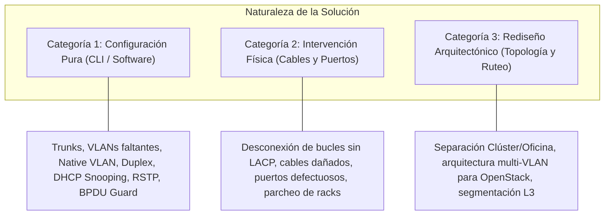
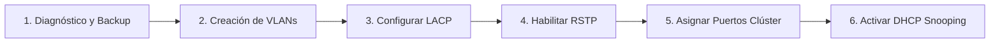

# Manual Pedagógico de Ingeniería de Redes: Conflictos en VLANs, Estrategias de Blindaje y Arquitectura para OpenStack

---

## 1. Resumen Ejecutivo

En redes conmutadas modernas no existen choques físicos de señal eléctrica; lo que comúnmente se denomina "colisión de VLANs" son **conflictos lógicos de configuración**: bucles de Capa 2 por falta de Spanning Tree, desajustes de encapsulación 802.1Q, colisiones ARP por IPs duplicadas o condiciones de carrera por servidores DHCP compitiendo en el mismo dominio de difusión. Aunque el blindaje de `dnsmasq` con `dhcp-ignore` protege temporalmente a la oficina, la solución definitiva requiere **aislamiento estructural mediante VLANs dedicadas**, agregación con **LACP**, protección perimetral con **DHCP Snooping + BPDU Guard** y un diseño multi-red para OpenStack Ironic, combinando configuración lógica con disciplina operativa de etiquetado y monitoreo.

---

## 2. Gran Matriz de Conflictos en Redes Conmutadas y VLANs

A continuación se desglosan los 10 problemas reales que simulan "colisiones" en una infraestructura de red:

| # | Problema | Causa Raíz Técnica | Síntoma Visible | Cómo Detectarlo | Procedimiento de Corrección | Riesgo si se Hace Mal |
|---|:---|:---|:---|:---|:---|:---|
| **1** | **Colisión Ethernet Clásica** | Dos nodos transmiten simultáneamente sobre el mismo medio compartido (*Half-Duplex*, Hub o cable dañado). | Velocidad extremadamente baja (< 1 Mbps), alta latencia, pérdida masiva de paquetes. | `ethtool -S <iface> \| grep coll` muestra `collisions > 0`. `show interfaces counters errors` muestra `Align-Err`. | Forzar *Full-Duplex* en ambos extremos o reemplazar el cable físico dañado. | Si se fuerza Full-Duplex en un solo extremo, se genera un *Duplex Mismatch* permanente. |
| **2** | **Bucle de Capa 2 (L2 Loop)** | Dos enlaces físicos conectan los mismos switches sin STP ni LACP activo. Tramas sin TTL rebotan en bucle infinito. | LEDs parpadeando frenéticamente al unísono, pérdida de SSH/consola, caída total de la red. | CPU del switch al 100%. `show spanning-tree detail` muestra *topology changes* incesantes. | Desconectar el segundo cable físico inmediatamente. Habilitar **RSTP** y agregar enlaces con **LACP**. | Desconectar el cable incorrecto puede aislar el switch por completo dejándolo inaccesible. |
| **3** | **VLAN Mismatch (Native VLAN Distinta)** | El Switch A tiene como VLAN Nativa la 1 y el Switch B tiene la VLAN 20 en el mismo enlace troncal 802.1Q. | Tráfico de una subred se "fuga" silenciosamente hacia otra. Respuestas de red cruzadas. | `%CDP-4-NATIVE_VLAN_MISMATCH` en logs. `show interfaces trunk` muestra nativas diferentes. | Estandarizar la misma VLAN nativa en ambos extremos del troncal (ej. `native vlan 999`). | Si se cambia la VLAN nativa sin sincronizar ambos extremos, se corta la gestión remota del switch. |
| **4** | **Trunk Mal Configurado** | Un extremo del cable está configurado como modo *Trunk* y el otro extremo como modo *Access*. | El extremo en modo Access descarta las tramas etiquetadas por considerarlas gigantes (*giants*) o inválidas. | `show interfaces status` o `show interfaces switchport`. Paquetes unicast no pasan de un switch a otro. | Configurar ambos extremos en el mismo modo (`switchport mode trunk` en ambos lados). | Si se cambia el puerto de acceso a trunk sin VLAN nativa adecuada, se pierde la IP de administración. |
| **5** | **VLAN Inexistente en Switch** | Se configura un puerto en la VLAN 100, pero la VLAN 100 nunca fue creada en la base de datos del switch (`vlan 100`). | La interfaz queda en estado inactivo (*down*) o el switch descarta todo el tráfico del puerto silenciosamente. | `show vlan brief` no muestra la VLAN 100 en la lista de VLANs activas del switch. | Crear explícitamente la VLAN: `vlan 100` seguido de `name CLUSTER_BAREMETAL`. | Riesgo nulo; crear una VLAN es una operación inocua y obligatoria. |
| **6** | **Puerto en VLAN Equivocada** | El cable del servidor se conectó a un puerto asignado a la VLAN de oficina (VLAN 10) en vez de la del clúster (VLAN 100). | El servidor toma IP de la oficina, no ve al nodo 306 y falla la instalación por PXE. | `show mac address-table vlan 10` muestra la MAC del servidor en la VLAN de usuarios. | Mover el puerto a la VLAN correspondiente: `switchport access vlan 100`. | Si el puerto pertenecía a una impresora o PC crítica de oficina, dicho equipo quedará desconectado. |
| **7** | **Dirección IP Duplicada** | Dos máquinas (o una PC estática y el DHCP) tienen configurada la misma dirección IP `10.0.1.111`. | Conexión intermitente. El comando `ping` responde con fluctuación de TTL o pérdida intermitente del 50%. | `arp-scan -I enp2s0 10.0.1.0/24` muestra dos MACs diferentes para la misma IP. Logs: `duplicate address`. | Identificar la máquina infractora por su MAC y cambiarle la IP a una disponible. | Ninguno. Corregir una IP duplicada restaura la estabilidad del servicio de inmediato. |
| **8** | **Dirección MAC Duplicada** | Dos máquinas virtuales clonadas o dos tarjetas de red tienen la misma dirección MAC de hardware. | La tabla CAM del switch conmuta constantemente de puerto (*MAC flapping*), degradando el rendimiento. | Logs del switch: `%SW_MATM-4-MACFLAP_NOTIF`. `bridge fdb show` en hipervisores Linux. | Regenerar la dirección MAC en el hypervisor o reemplazar la tarjeta de red física duplicada. | Si se apaga la máquina equivocada, se detiene un servicio en producción. |
| **9** | **Servidor DHCP Duplicado (Rogue DHCP)** | Dos servidores DHCP (Nodo 306 y Router de Oficina) responden peticiones en el mismo segmento de broadcast. | Clientes de oficina reciben IPs del clúster (sin internet); nodos del clúster reciben IPs de la oficina (sin PXE). | `tcpdump -i <iface> -n -e "port 67 or port 68"` muestra respuestas de dos IPs distintas. | 1. Segmentar en VLANs separadas.<br>2. Habilitar **DHCP Snooping** en los switches. | Si se activa DHCP Snooping sin declarar el puerto del DHCP oficial como `trusted`, nadie recibirá IP. |
| **10** | **VLAN No Permitida en Trunk (*Pruning Excesivo*)** | El troncal tiene configurado `allowed vlan 10,20`, pero se necesita pasar tráfico de la VLAN 100. | Tráfico local en cada switch funciona bien, pero los servidores no pueden hablar entre switches. | `show interfaces trunk` muestra en la sección *Vlans in spanning tree forwarding* que la VLAN 100 no está. | Agregar la VLAN al troncal: `switchport trunk allowed vlan add 100`. | Si se escribe `switchport trunk allowed vlan 100` (sin la palabra `add`), se borran las VLANs 10 y 20 del trunk. |

---

## 3. ¿Se Pueden Corregir Todos los Conflictos? Clasificación por Naturaleza de la Solución

No todos los problemas se resuelven con la misma herramienta ni con la misma intervención. Se clasifican en tres categorías operativas:



### 1. Categoría 1: Corrección Puramente Lógica (Solo Configuración)
* **Qué incluye**: Creación de VLANs faltantes, igualar la VLAN nativa en los troncales, ajustar la lista de VLANs permitidas (`allowed vlan add`), activar RSTP, configurar BPDU Guard, activar DHCP Snooping y corregir el archivo de configuración de `dnsmasq`.
* **Cómo se aplica**: Mediante consola SSH o cable serial de consola en los switches y servidores. No requiere tocar cables.
* **Ventaja**: Puede ejecutarse en minutos durante una ventana de mantenimiento.

### 2. Categoría 2: Corrección Física (Intervención en Rack)
* **Qué incluye**:
  * Desconectar cables que generan bucles accidentales cuando los switches no soportan LACP o cuando no hay acceso administrativo inmediato.
  * Cambiar de boca un cable de red mal conectado (de un puerto de oficina a un puerto del clúster).
  * Reemplazar cables de red categoría 5e/6 deteriorados que negocian en *Half-Duplex* o arrojan errores de CRC.
* **Cómo se aplica**: Con herramientas físicas en el rack: pinzas, tester de red, rotuladora de cables y linterna.

### 3. Categoría 3: Rediseño Arquitectónico (Ingeniería Estructural)
* **Qué incluye**:
  * Dejar de compartir el mismo segmento de difusión entre el laboratorio de pruebas y las PCs/celulares de los usuarios de oficina.
  * Crear una jerarquía formal de VLANs (Gestión, Aprovisionamiento, Cargas de trabajo, Almacenamiento).
  * Definir un esquema de enrutamiento Inter-VLAN (Capa 3) con listas de control de acceso (ACL) o firewall perimetral para que el clúster solo acceda a Internet pero la oficina no pueda invadir el entorno de despliegue.
* **Cómo se aplica**: Planificación formal, asignación de bloques CIDR y ejecución estructurada.

---

## 4. Estrategias de Blindaje de Red Explicadas a Fondo ("Bajo el Capó")

Para cada estrategia técnica, analizamos su analogía conceptual, funcionamiento interno, sintaxis genérica, riesgos y posición en la secuencia de aplicación:

---

### Estrategia 1: Aislamiento en VLAN Dedicada (802.1Q)

> **Analogía**: Construir un muro de hormigón entre dos habitaciones de un mismo edificio. Aunque las personas de ambas salas griten (emitan broadcast), el sonido no atraviesa el muro.

* **Problema que resuelve**: Elimina de raíz que el servidor DHCP del nodo 306 y el router de la oficina compitan por las mismas solicitudes de red.
* **Cómo funciona por dentro**:
  El switch añade una etiqueta (*tag*) de 4 bytes a la cabecera Ethernet según el estándar **IEEE 802.1Q**. Esta etiqueta contiene el **VLAN ID (VID)**. Cuando un equipo en la VLAN 100 envía una trama de broadcast (`ff:ff:ff:ff:ff:ff`), el procesador del switch consulta su matriz de puertos y **únicamente conmuta la trama a los puertos que pertenecen a la VLAN 100**. Los puertos de la VLAN de oficina (VLAN 10) ni siquiera se enteran de que el paquete existió.
* **Configuración Genérica (Switch)**:
  ```text
  Switch(config)# vlan 100
  Switch(config-vlan)# name BAREMETAL_CLUSTER
  Switch(config)# interface range GigabitEthernet0/15 - 24
  Switch(config-if-range)# switchport mode access
  Switch(config-if-range)# switchport access vlan 100
  ```
* **Riesgos si se configura mal**: Si mueves el puerto del nodo 306 a la VLAN 100 pero dejas los 8 servidores en la VLAN 1, los servidores quedarán incomunicados y no podrán arrancar por red.
* **Posición en el orden de aplicación**: **Paso 1** (La base de toda la solución).

---

### Estrategia 2: Rapid Spanning Tree Protocol (RSTP - IEEE 802.1w)

> **Analogía**: Un semáforo inteligente en un cruce circular que detecta si dos caminos van al mismo destino y bloquea preventivamente una barrera para que los coches no choquen entre sí.

* **Problema que resuelve**: Previene bucles físicos infinitos y tormentas de broadcast entre switches interconectados.
* **Cómo funciona por dentro**:
  Los switches intercambian tramas especiales llamadas **BPDUs (Bridge Protocol Data Units)** cada 2 segundos.
  1. Eligen un switch líder llamado **Root Bridge** (el switch con la menor prioridad configurada).
  2. Cada switch calcula la ruta más corta hacia el Root Bridge.
  3. Si existen múltiples caminos físicos entre dos switches, RSTP coloca los puertos redundantes en estado **Discarding/Alternate (Bloqueado)**. El enlace físico sigue conectado, pero el switch descarta cualquier trama de usuario entrante o saliente por ese puerto.
  4. Si el enlace principal se corta, RSTP detecta la pérdida de BPDUs y desbloquea el enlace de respaldo en **menos de 1 segundo (convergencia rápida)**.
* **Configuración Genérica (Switch Core)**:
  ```text
  Switch(config)# spanning-tree mode rapid-pvst
  Switch(config)# spanning-tree vlan 1-4094 priority 4096
  ```
* **Riesgos si se configura mal**: Si no configuras la prioridad del Root Bridge manualmente, un switch viejo o secundario con una MAC numéricamente inferior se autoproclamará raíz, desviando todo el tráfico de la empresa por un cuello de botella.
* **Posición en el orden de aplicación**: **Paso 2** (Seguridad del núcleo de red).

---

### Estrategia 3: Agregación de Enlaces LACP (IEEE 802.3ad / Port-Channels)

> **Analogía**: Unir dos carriles estrechos de una autopista derribando la línea intermedia para formar una sola pista ancha donde los coches pueden circular por ambos lados sin chocar.

* **Problema que resuelve**: Permite utilizar dos cables entre switches simultáneamente para sumar velocidad (2 Gbps) y tener redundancia sin que Spanning Tree bloquee uno de ellos ni se genere un bucle.
* **Cómo funciona por dentro**:
  Ambos extremos del cable ejecutan el protocolo **LACP (Link Aggregation Control Protocol)** intercambiando tramas *LACPDUs*. Ambos switches comprueban que los parámetros de velocidad, dúplex y VLANs coincidan exactamente. Al verificar la consistencia, el sistema operativo del switch abstrae ambos puertos físicos bajo una **única interfaz lógica virtual (`Port-channel 1`)**. Spanning Tree evalúa la interfaz virtual como un solo camino, por lo que **no bloquea ningún puerto**. El tráfico se distribuye entre ambos cables mediante un algoritmo hash (basado en IP de origen y destino).
* **Configuración Genérica (Ambos switches)**:
  ```text
  Switch(config)# interface range GigabitEthernet0/23 - 24
  Switch(config-if-range)# channel-group 1 mode active
  Switch(config-if-range)# exit
  Switch(config)# interface Port-channel 1
  Switch(config-if)# switchport mode trunk
  ```
* **Riesgos si se configura mal**: Si configuras un extremo en modo `mode on` (estático sin protocolo) y el otro extremo en `mode active` (LACP dinámico), los switches no negociarán y se generará un bucle de Capa 2 o la caída total del enlace troncal.
* **Posición en el orden de aplicación**: **Paso 3** (Interconexión física entre switches).

---

### Estrategia 4: BPDU Guard y PortFast (Protección en el Borde)

> **Analogía**: Un fusible eléctrico que salta inmediatamente si un inquilino enchufa un aparato no autorizado que amenaza con quemar la instalación del edificio.

* **Problema que resuelve**: Impide que un usuario, pasante o técnico conecte un switch doméstico o cree un puente de red en su escritorio y colapse la red corporativa.
* **Cómo funciona por dentro**:
  * **PortFast**: Hace que un puerto de switch pase de estado *Down* a *Forwarding* de inmediato (0 segundos en lugar de esperar los 30 segundos estándar de STP). Es obligatorio para servidores que arrancan por PXE para que reciban la oferta DHCP a tiempo.
  * **BPDU Guard**: Monitorea continuamente el puerto con PortFast. En un puerto conectado a un servidor o PC final **nunca deberían recibirse tramas BPDU**. Si alguien conecta un switch secundario que emite una sola BPDU, el switch anfitrión **apaga el puerto de inmediato** (estado `err-disabled`), aislando el problema antes de que afecte a los demás.
* **Configuración Genérica (Puertos de Servidores)**:
  ```text
  Switch(config)# interface range GigabitEthernet0/15 - 22
  Switch(config-if-range)# spanning-tree portfast
  Switch(config-if-range)# spanning-tree bpduguard enable
  ```
* **Riesgos si se configura mal**: **PELIGRO CRÍTICO**: Si habilitas BPDU Guard en el puerto que interconecta el Switch A con el Switch B (el enlace troncal), el puerto recibirá las BPDUs del otro switch y **se apagará de inmediato**, incomunicando ambos switches entre sí.
* **Posición en el orden de aplicación**: **Paso 4** (Protección perimetral de accesos).

---

### Estrategia 5: DHCP Snooping (Corta-fuegos de Capa 2 contra Servidores DHCP)

> **Analogía**: Un guardia en la puerta de un evento que inspecciona todas las credenciales de identificación y confisca los gafetes falsos emitidos por personas no autorizadas.

* **Problema que resuelve**: Evita que un servidor DHCP no autorizado (como el `dnsmasq` del nodo 306 antes de aislarlo, o un router Wi-Fi enchufado al revés) entregue direcciones IP erróneas a equipos de la oficina.
* **Cómo funciona por dentro**:
  El switch inspecciona las tramas de Capa 7 (DHCP) que cruzan sus puertos en los puertos UDP 67 y 68.
  * **Puertos Confiables (*Trusted*)**: Solo los puertos donde está el servidor DHCP oficial pueden emitir mensajes `DHCPOFFER` y `DHCPACK`.
  * **Puertos No Confiables (*Untrusted*)**: Puertos estándar de usuarios y servidores comunes. Si un nodo conectado a un puerto no confiable intenta emitir una respuesta DHCP (`DHCPOFFER`), el switch **descarta el paquete en hardware y registra una alerta**. Además, el switch construye una tabla dinámica llamada **DHCP Snooping Binding Database** que registra: `MAC + IP asignada + Lease time + VLAN + Puerto`.
* **Configuración Genérica (Switch)**:
  ```text
  Switch(config)# ip dhcp snooping
  Switch(config)# ip dhcp snooping vlan 10,100
  Switch(config)# interface GigabitEthernet0/1  ! Puerto del Router de Oficina
  Switch(config-if)# ip dhcp snooping trust
  Switch(config)# interface GigabitEthernet0/15 ! Puerto del Nodo 306 (DHCP del Clúster)
  Switch(config-if)# ip dhcp snooping trust
  ```
* **Riesgos si se configura mal**: Si activas `ip dhcp snooping` globalmente pero olvidas configurar el comando `ip dhcp snooping trust` en el puerto donde está conectado el servidor DHCP legítimo, **ninguna máquina en la red recibirá dirección IP**, dejando a toda la empresa sin red.
* **Posición en el orden de aplicación**: **Paso 5** (Seguridad de asignación de direcciones).

---

### Estrategia 6: Dynamic ARP Inspection (DAI)

> **Analogía**: Un control de pasaportes que cruza el documento de identidad de un pasajero con la base de datos oficial antes de permitirle pasar la aduana.

* **Problema que resuelve**: Previene ataques de suplantación de identidad (*ARP Spoofing/Poisoning*) y colisiones de IP donde una máquina maliciosa o mal configurada responde peticiones ARP de una IP que no le pertenece.
* **Cómo funciona por dentro**:
  DAI intercepta cada paquete ARP que transita por el switch. Compara la dirección IP y la dirección MAC declaradas en la cabecera ARP contra la base de datos de **DHCP Snooping**. Si los datos no coinciden exactamente con la asignación oficial registrada previamente, el paquete ARP **es descartado en el acto**.
* **Configuración Genérica**:
  ```text
  Switch(config)# ip arp inspection vlan 100
  ```
* **Riesgos si se configura mal**: Si en tu clúster tienes servidores con IPs estáticas configuradas a mano que no pasaron por DHCP, DAI no encontrará su registro en la base de datos y **bloqueará todas sus comunicaciones**. Para evitarlo, deben definirse listas estáticas de inspección (*ARP Access-Lists*).
* **Posición en el orden de aplicación**: **Paso 6** (Seguridad avanzada anti-suplantación).

---

### Estrategia 7: Storm Control (Válvula de Alivio de Presión en Hardware)

> **Analogía**: Una válvula de escape en una tubería de agua a presión que drena automáticamente el exceso de caudal para evitar que revienten las cañerías del edificio.

* **Problema que resuelve**: Si por cualquier motivo se produce un bucle temporal o un ataque de denegación de servicio por difusión, Storm Control contiene el impacto en el puerto de origen sin permitir que degrade al resto del switch.
* **Cómo funciona por dentro**:
  El ASIC del switch cuenta los paquetes de difusión (*broadcast*), multidifusión (*multicast*) y unidifusión desconocida (*unknown-unicast*) que entran por el puerto en ventanas de 1 segundo. Si el volumen supera el umbral configurado (por ejemplo, el 10% del ancho de banda del puerto), **el chip descarta todo el excedente y mantiene el puerto operativo con el tráfico legítimo**.
* **Configuración Genérica**:
  ```text
  Switch(config)# interface range GigabitEthernet0/1 - 24
  Switch(config-if-range)# storm-control broadcast level 10.00
  Switch(config-if-range)# storm-control action trap
  ```
* **Riesgos si se configura mal**: Si fijas un umbral absurdamente bajo (ej. `0.1%`), aplicaciones legítimas que utilizan multicast intensivo (como descubrimiento mDNS o protocolos de clúster tipo Corosync/VRRP) sufrirán descartes de paquetes.
* **Posición en el orden de aplicación**: **Paso 7** (Contención de contingencias).

---

### Estrategia 8: Troncales Seguros con Podado de VLANs y Native VLAN Inerte (999)

> **Analogía**: Un camión de mensajería blindado que solo acepta paquetes etiquetados con destinos autorizados y rechaza cualquier paquete sin membrete.

* **Problema que resuelve**: Evita *VLAN Hopping*, fugas accidentales entre subredes y consumo innecesario de ancho de banda por tráfico broadcast propagándose a switches donde esa VLAN no tiene ningún puerto activo.
* **Cómo funciona por dentro**:
  Por defecto, un puerto troncal acepta el paso de todas las VLANs (1 a 4094) y asigna el tráfico no etiquetado a la VLAN 1. Al restringir las VLANs permitidas (`allowed vlan`), el switch filtra en hardware las tramas que no corresponden a los switches interconectados. Al fijar la VLAN Nativa en `999` (una VLAN vacía sin interfaces ni servicios), cualquier trama no etiquetada que ingrese cae en un "agujero negro" y es descartada.
* **Configuración Genérica**:
  ```text
  Switch(config)# vlan 999
  Switch(config-vlan)# name DUMMY_NATIVE
  Switch(config)# interface Port-channel 1
  Switch(config-if)# switchport mode trunk
  Switch(config-if)# switchport trunk native vlan 999
  Switch(config-if)# switchport trunk allowed vlan 10,100
  ```
* **Riesgos si se configura mal**: Si al agregar una nueva VLAN ejecutas `switchport trunk allowed vlan 100` en lugar de `switchport trunk allowed vlan add 100`, **sobrescribirás la configuración previa**, eliminando la VLAN 10 de la oficina y provocando una caída total del servicio.
* **Posición en el orden de aplicación**: **Paso 8** (Endurecimiento de enlaces de transporte).

---

## 5. Factores Críticos que Influyen en la Solución Más Allá de los Comandos

Un ingeniero senior sabe que el 70% del éxito en redes no reside en los comandos del switch, sino en la **metodología operativa y disciplina de diseño**:

```
[ Métodos de Soporte a la Infraestructura ]
├── 1. Plan de Direccionamiento IP y Dimensionamiento de Subredes
├── 2. Rotulado y Documentación de Puertos Físicos
├── 3. Centralización de Logs (Servidor Syslog Remoto)
├── 4. Ventanas de Mantenimiento y Procedimientos con Rollback
└── 5. Protocolo de Pruebas "Antes y Después" (Pre & Post Flight)
```

1. **Diseño de Direccionamiento y Tamaño de Máscaras**:
   * No uses máscaras gigantescas (como `/16` con 65,534 hosts) para un clúster pequeño. Una subred `/24` (254 hosts) o `/27` (30 hosts) mantiene el dominio de broadcast acotado y manejable.
   * Mantén coherencia geométrica en el direccionamiento: por ejemplo, `10.VLAN.0.0/24` (VLAN 10 = `10.10.0.0/24`, VLAN 100 = `10.100.0.0/24`).

2. **Etiquetado Físico y Matriz de Parcheo**:
   * Documenta en una hoja de cálculo o repositorio Markdown qué equipo físico está conectado en cada boca de cada switch:
     * *Puerto Gi0/15 -> Nodo 306 (Controlador Bare-metal) [VLAN 100]*
     * *Puerto Gi0/16 -> Nodo 321 (Dell OptiPlex 3020M) [VLAN 100]*
   * Si alguien cambia un cable de puerto físicamente durante el mantenimiento, sabrás inmediatamente por qué falló.

3. **Logs Centralizados (Syslog Externo)**:
   * La memoria interna de logs de un switch suele almacenar solo entre 50 y 100 líneas. Si ocurre una tormenta de broadcast durante la noche, para la mañana siguiente los logs del origen de la falla ya se habrán sobrescrito.
   * Configura el switch para enviar sus registros a un servidor Syslog central (por ejemplo, en el nodo 306):
     ```text
     Switch(config)# logging host 10.0.1.30
     Switch(config)# logging trap warnings
     ```

4. **Ventanas de Mantenimiento y Mecanismos de Auto-Rollback**:
   * Nunca apliques cambios de VLANs o Spanning Tree en horario laboral pico.
   * Utiliza el mecanismo de seguridad de confirmación temporal antes de guardar cambios definitivos. En switches Cisco:
     ```text
     Switch# reload in 10
     ```
     *(Si cometes un error en el troncal y pierdes el acceso por SSH, el switch se reiniciará automáticamente a los 10 minutos recuperando la configuración previa sin necesidad de viajar físicamente al rack).* Si la configuración fue exitosa, cancelas el reinicio con `reload cancel` y guardas con `write memory`.

5. **Pruebas de Validación Antes y Después (*Pre/Post-flight Checks*)**:
   * Toma una captura de contadores de errores antes del cambio (`show interfaces counters errors > antes.txt`).
   * Aplica los cambios.
   * Vuelve a tomar los contadores tras 30 minutos (`despues.txt`) y calcula la diferencia (*diff*) para confirmar que los descartes no sigan creciendo.

---

## 6. Aplicación Práctica a tu Entorno: Aislamiento del Nodo 306 y las 8 MiniPCs

### ¿Cómo Aislamos el Laboratorio sin Tocar la Red de Oficina?

```mermaid
flowchart TD
    subgraph Topologia_Segmentada ["Topología Final Aislada"]
        direction TB
        ROUTER_OFI["Router Oficina (192.168.21.1)"] ---|Acceso VLAN 10| SW_CORE["Switch de Oficina (VLAN 10)"]
        SW_CORE ---|PCs y Celulares de Oficina| USERS["Red de Oficina (192.168.21.0/24)"]
        SW_CORE ===|Troncal LACP 2 Gbps (VLAN 10, 100)| SW_CLUSTER["Switch Clúster (Rack)"]
        SW_CLUSTER ---|Puerto 15 (Acceso VLAN 100)| N306["Nodo 306 (10.0.1.30)"]
        SW_CLUSTER ---|Puertos 16-24 (Acceso VLAN 100)| SERVERS["8 Servidores Clúster (10.0.1.111 - 10.0.1.118)"]
    end
```

### ¿Qué Cambia en `dnsmasq` Cuando ya Existe la VLAN Propia?

La gran pregunta técnica: **Si ya aislamos la red en la VLAN 100, ¿sigue siendo necesario `dhcp-ignore=tag:!known`?**

#### Respuesta Técnica: El Principio de "Defensa en Profundidad" (*Defense in Depth*)
1. **La VLAN 100 es la Barrera Perimetral**: Con la VLAN activa, el tráfico broadcast de las PCs y celulares de oficina físicamente **no puede ingresar** a la interfaz del nodo 306.
2. **`dhcp-ignore` es el Cerrojo Interno**: ¿Qué ocurre si un día se corta la energía, el switch se reinicia con la configuración de fábrica (perdiendo las VLANs), o un técnico conecta por error un cable de la oficina en el puerto del nodo 306?
   * Si quitaste `dhcp-ignore`, el nodo 306 entregará IPs `10.0.1.x` a todos los dispositivos de la empresa, **derribando la oficina de nuevo**.
   * Si mantienes `dhcp-ignore`, aunque el cable esté mezclado, `dnsmasq` verificará la MAC y **descartará la solicitud**, evitando el colapso.

#### La Configuración Definitiva y Elegante de `dnsmasq` (`/etc/dnsmasq.conf`):
Al operar en una VLAN dedicada, la configuración de `dnsmasq` se vuelve más limpia y robusta:

```ini
# 1. Enlace de interfaz estricto:
interface=enp2s0
bind-interfaces

# 2. Desactivar respuestas DNS en interfaces no deseadas:
listen-address=127.0.0.1,10.0.1.30

# 3. Rango Estático Exclusivo para el Clúster:
# Al no haber rango dinámico, NINGÚN equipo desconocido puede obtener IP
dhcp-range=10.0.1.0,static,255.255.255.0,24h

# 4. Declaración de Nodos del Clúster (por MAC fija):
dhcp-host=64:00:6a:2a:62:a4,10.0.1.111,minipc321,infinite
dhcp-host=64:00:6a:2a:62:42,10.0.1.112,minipc322,infinite
# ... resto de los 8 nodos

# 5. Ignorar activamente cualquier cliente desconocido (Doble capa de seguridad):
dhcp-ignore=tag:!known

# 6. Opciones de Red para el Clúster:
dhcp-option=option:router,10.0.1.30
dhcp-option=option:dns-server,10.0.1.30,8.8.8.8
dhcp-option=option:domain-name,lab.local

# 7. Servicios PXE / TFTP:
enable-tftp=enp2s0
tftp-root=/tftpboot
dhcp-match=set:efi-x86_64,option:client-arch,7
dhcp-match=set:efi-x86_64,option:client-arch,9
dhcp-boot=tag:efi-x86_64,ipxe.efi
```

---

## 7. Diseño de Red para OpenStack / Ironic / Bifrost en Producción

Para avanzar desde este laboratorio hacia un despliegue formal de **OpenStack Bare-Metal**, la red física debe estructurarse en **4 redes funcionales**:

```
[ ARQUITECTURA DE PRODUCCIÓN PARA OPENSTACK / IRONIC ]

                          +----------------------+
                          |   ROUTER PRINCIPAL   |
                          +----------------------+
                                     | (Troncal 802.1Q)
+------------------------------------+---------------------------------------+
|                       SWITCH TOPO-DE-RACK (TOR)                            |
+----------------------------------------------------------------------------+
     |                    |                      |                     |
 [VLAN 100]           [VLAN 200]             [VLAN 300]            [VLAN 400]
PROVISIONING          OUT-OF-BAND              TENANT               STORAGE
(Ironic / PXE)       (IPMI / BMC)        (Cargas Productivas)     (Ceph / Nexus)
- Subred:            - Subred:           - Subred:                - Subred:
  10.100.0.0/24        10.200.0.0/24       10.300.0.0/24            10.400.0.0/24
- Nodos PXE          - Módulos iDRAC     - Servidores K8s         - Nexus Sonatype
- dnsmasq / TFTP     - Encendido/Apagado - Tráfico Productivo     - Volúmenes Cinder
- DHCP Efímero       - No tiene Internet - Acceso a Oficina       - Tráfico masivo
```

### Funciones de Cada Red:
1. **VLAN 100 - Provisioning (Aprovisionamiento)**:
   * Red efímera. Cuando Ironic enciende una miniPC para instalar el SO, el puerto del switch se asigna temporalmente a la VLAN 100.
   * La máquina arranca por PXE, carga el kernel *Ironic Python Agent (IPA)*, formatea el disco y descarga la imagen del SO desde Glance/Nexus.
2. **VLAN 200 - Management / Out-of-Band (BMC / IPMI)**:
   * Conecta los puertos de gestión remota de hardware de los servidores. Permite que Bifrost envíe comandos de encendido/reinicio por hardware sin depender de Wake-on-LAN.
3. **VLAN 300 - Tenant / Data (Producción)**:
   * Una vez completada la instalación, Ironic comanda al switch mediante SNMP o API para **mover el puerto del servidor de la VLAN 100 a la VLAN 300**.
   * En la VLAN 300, el servidor se une al clúster de Kubernetes (RKE2) y recibe su IP definitiva de producción.
4. **VLAN 400 - Storage (Almacenamiento)**:
   * Red de alto rendimiento (MTU 9000 / Jumbo Frames) para tráfico masivo de repositorios Nexus, imágenes de Glance y almacenamiento de bloques.

---

## 8. Verificación y Validación Continua: Cómo Garantizar que el Problema no Vuelve

Para certificar que la red es 100% estable y nunca más colisionará con la oficina:

### 1. Prueba de Verificación de Fuga de Broadcast
Desde tu laptop de oficina (ej. IP `192.168.21.38`):
```bash
# Inyectar una petición DHCP de prueba simulando un cliente nuevo:
sudo dhcping -c 192.168.21.38 -s 10.0.1.30 -h 00:11:22:33:44:55
```
* **Resultado Esperado**: `Timeout` o `No response from server`. El nodo 306 **no debe responder** a ningún host situado en la red de oficina.

### 2. Monitor de Eventos en Tiempo Real con `tcpdump` en el Nodo 306
```bash
sudo tcpdump -i enp2s0 -nn -e "port 67 or port 68"
```
* **Salida Esperada durante el Booteo del Nodo 321**:
  ```text
  14:02:10.123 IP 0.0.0.0.68 > 255.255.255.255.67: BOOTP/DHCP, Request from 64:00:6a:2a:62:a4
  14:02:10.124 IP 10.0.1.30.67 > 10.0.1.111.68: BOOTP/DHCP, Reply, Length 300
  ```
  *(Únicamente deben aparecer transacciones del nodo 321 hacia el 306; cero tramas provenientes de IPs `192.168.21.x`)*.

### 3. Métricas y Alertas Automatizadas en Prometheus
Configurar en `/etc/prometheus/alert_rules.yml`:
```yaml
groups:
  - name: ClusterNetworkAudit
    rules:
      - alert: RogueDHCPOfferDetected
        expr: increase(node_network_receive_packets_total{device="enp2s0"}[1m]) > 5000
        for: 30s
        labels:
          severity: warning
        annotations:
          summary: "Posible tráfico broadcast anómalo en la interfaz del clúster"
```

---

## 9. Ejemplos Prácticos de Configuración

### 9.1 Configuración de un Switch Genérico Administrable
```text
! 1. Creación de VLANs
vlan 10
 name OFICINA_DATOS
vlan 100
 name CLUSTER_BAREMETAL
vlan 999
 name DUMMY_NATIVE
exit

! 2. Configuración de RSTP y Prioridad Raíz
spanning-tree mode rapid-pvst
spanning-tree vlan 1-4094 priority 4096

! 3. Agregación de Enlaces (LACP) hacia el segundo switch
interface range GigabitEthernet0/23 - 24
 description ENLACE_TRONCAL_HACIA_SWITCH_2
 channel-group 1 mode active
exit

interface Port-channel 1
 switchport mode trunk
 switchport trunk native vlan 999
 switchport trunk allowed vlan 10,100
exit

! 4. Puerto del Router de Oficina (VLAN 10)
interface GigabitEthernet0/1
 description ROUTER_OFICINA
 switchport mode access
 switchport access vlan 10
 ip dhcp snooping trust
exit

! 5. Puerto del Nodo Controlador 306 (VLAN 100)
interface GigabitEthernet0/15
 description CONTROLADOR_N306
 switchport mode access
 switchport access vlan 100
 spanning-tree portfast
 spanning-tree bpduguard enable
 ip dhcp snooping trust
exit

! 6. Puertos de las 8 MiniPCs (VLAN 100)
interface range GigabitEthernet0/16 - 23
 description MINIPCS_BAREMETAL
 switchport mode access
 switchport access vlan 100
 spanning-tree portfast
 spanning-tree bpduguard enable
 storm-control broadcast level 10.00
exit

! 7. Activación Global de DHCP Snooping
ip dhcp snooping
ip dhcp snooping vlan 10,100
```

---

### 9.2 Equivalente en Servidor Linux (Bridge con VLAN Filtering)
Si el switch fuera un servidor Linux actuando como conmutador por software (Open vSwitch o Linux Bridge):

```bash
# 1. Crear el puente con filtrado de VLAN habilitado
sudo ip link add name br0 type bridge vlan_filtering 1

# 2. Agregar interfaces físicas
sudo ip link set enp2s0 master br0
sudo ip link set enp3s0 master br0

# 3. Configurar enp2s0 como puerto de acceso en VLAN 100
sudo bridge vlan del dev enp2s0 vid 1
sudo bridge vlan add dev enp2s0 vid 100 pvid untagged

# 4. Configurar enp3s0 como enlace troncal para VLAN 10 y 100
sudo bridge vlan del dev enp3s0 vid 1
sudo bridge vlan add dev enp3s0 vid 10
sudo bridge vlan add dev enp3s0 vid 100

# 5. Activar la interfaz del puente y subinterfaz de gestión en el host
sudo ip link set br0 up
sudo ip link add link br0 name br0.100 type vlan id 100
sudo ip addr add 10.0.1.30/24 dev br0.100
sudo ip link set br0.100 up
```

---

## 10. Plan de Implementación Paso a Paso en Orden Seguro

Para evitar caídas de red durante la ejecución:



1. **Fase 1: Diagnóstico y Respaldo (Sin impacto)**:
   * Guardar la configuración actual de los switches: `copy running-config tftp:` o copiar texto de consola.
   * Programar reinicio de seguridad automático: `reload in 15`.
2. **Fase 2: Creación de VLANs en Ambos Switches**:
   * Crear la VLAN 100 y VLAN 999 en el Switch 1 y en el Switch 2.
3. **Fase 3: Configurar Agregación LACP en Enlaces Inter-Switch**:
   * Agrupar los cables redundantes en el `Port-channel 1` con modo `active`.
4. **Fase 4: Habilitar RSTP**:
   * Fijar prioridad raíz `4096` en el switch principal.
5. **Fase 5: Mover los Puertos del Laboratorio a la VLAN 100**:
   * Reconfigurar los puertos 15 a 24 hacia la VLAN 100.
   * Habilitar `portfast` y `bpduguard` en esos puertos.
6. **Fase 6: Habilitar DHCP Snooping**:
   * Declarar el puerto del router de oficina y el puerto del nodo 306 como `trusted`. Activar el snooping globalmente.
7. **Fase 7: Confirmación y Cancelación del Rollback**:
   * Probar acceso a Internet en las PCs de oficina.
   * Probar arranque PXE en la miniPC 321.
   * Si todo opera con normalidad, cancelar el reinicio de seguridad y guardar:
     ```text
     Switch# reload cancel
     Switch# write memory
     ```

---

## 11. Errores Comunes que Debes Evitar

1. **Olvidar la palabra `add` al editar un troncal**:
   * ❌ `switchport trunk allowed vlan 100` -> **Borrador catastrófico**: elimina todas las demás VLANs y deja a la oficina sin red.
   * ✔️ `switchport trunk allowed vlan add 100` -> Agrega la nueva VLAN de forma segura.
2. **Habilitar BPDU Guard en un puerto entre switches**:
   * El puerto recibirá BPDUs legítimas del otro switch y se auto-bloqueará en estado `err-disabled`, desconectando un switch del otro.
3. **Activar DHCP Snooping sin puertos `trusted`**:
   * Nadie en la empresa recibirá IP por DHCP porque el switch bloqueará todas las ofertas.
4. **Crear puertos en una VLAN que no existe**:
   * Asignar `switchport access vlan 100` sin haber ejecutado previamente `vlan 100`. El puerto quedará inactivo.
5. **Diferente VLAN Nativa en extremos del troncal**:
   * Genera bucles ocultos entre VLANs y advertencias continuas en los logs.
6. **Desconectar cables al azar en una tormenta de broadcast**:
   * Provoca desconexiones involuntarias de servidores productivos. Siempre audita con `show mac address-table` antes de desconectar.

---

## 12. Mini Glosario de Conceptos Fundamentales

* **STP (Spanning Tree Protocol - 802.1D)**: Protocolo que previene bucles de Capa 2 apagando enlaces redundantes. Converge lento (30-50 segundos).
* **RSTP (Rapid STP - 802.1w)**: Versión moderna de Spanning Tree con convergencia ultrarrápida (< 1 segundo).
* **BPDU (Bridge Protocol Data Unit)**: Paquetes de control que los switches intercambian continuamente para calcular la topología y detectar bucles.
* **BPDU Guard**: Mecanismo de seguridad que apaga automáticamente un puerto si recibe una BPDU (protege puertos de servidores y usuarios).
* **LACP (Link Aggregation Control Protocol - 802.3ad)**: Protocolo que une varios enlaces físicos en un único canal lógico para duplicar el ancho de banda y brindar redundancia.
* **Native VLAN (VLAN Nativa)**: En un enlace troncal 802.1Q, es la única VLAN cuyo tráfico viaja sin etiqueta de 4 bytes.
* **Trunk (Troncal)**: Enlace entre switches configurado para transportar tráfico de múltiples VLANs etiquetadas.
* **DHCP Snooping**: Función de seguridad del switch que descarta respuestas DHCP emitidas desde puertos no autorizados (*untrusted*).
* **DAI (Dynamic ARP Inspection)**: Función que intercepta y valida paquetes ARP contra la base de datos de DHCP Snooping para evitar suplantaciones de IP y MAC.
* **Storm Control**: Filtro en hardware que limita el porcentaje de tráfico broadcast/multicast que puede ingresar por una interfaz antes de descartarlo.

---

## 13. Conclusión Simple

> **Las "colisiones de red" hoy no son fallas eléctricas, sino desajustes de configuración y falta de fronteras lógicas.**  
> 
> Aplicar `dhcp-ignore` en `dnsmasq` fue un excelente parche de emergencia que salvó a la oficina de ser interferida por el laboratorio. Sin embargo, en una red profesional, el switch debe ser el guardián de las fronteras:  
> 1. Las **VLANs** separan a los vecinos.  
> 2. **DHCP Snooping** impide que los vecinos se confundan de administrador.  
> 3. **RSTP y LACP** aseguran que los caminos entre edificios nunca se conviertan en laberintos circulares.  
> 
> Siguiendo esta guía, tu infraestructura de laboratorio estará completamente protegida, y tendrás una base lista y sólida para desplegar OpenStack, Bifrost y Kubernetes con total confianza.

---

## 14. Preguntas de Verificación Final

Para darte la sintaxis exacta adaptada a tu hardware si decides aplicar estos pasos en los switches:

1. **¿Qué marca y modelo exacto son los dos switches físicos?** *(Ejemplo: Cisco Catalyst 2960/3560, HP 2530/Aruba 2930F, Dell PowerConnect, Huawei S5700 o Mikrotik)*.
2. **¿Los dos switches están conectados actualmente por un solo cable o por dos cables físicos?**
3. **¿Tienes acceso al usuario `admin` o `enable` (vía consola serial o SSH) para ingresar al modo de configuración de ambos switches?**
