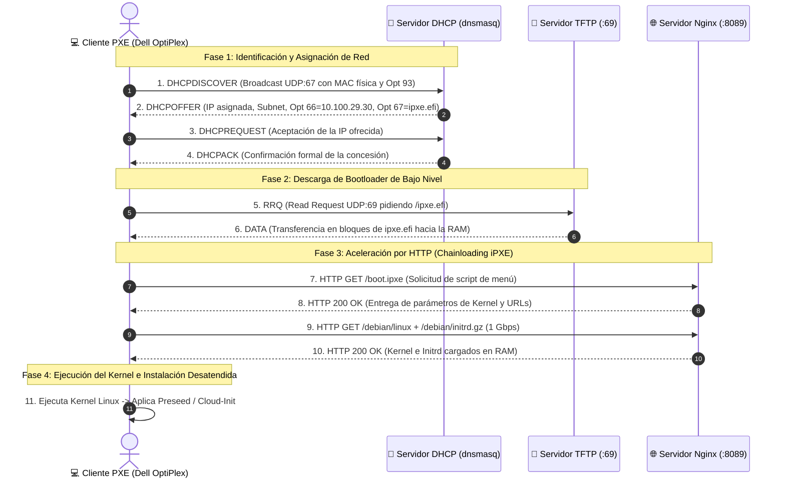

# 2. Arranque e Instalación por Red: Configuración de Entrada por Red e Implementación de PXE / iPXE

> **Área**: Infraestructura Bare-Metal, Redes y Automatización de Despliegue  
> **Sistema Operativo Destino**: Debian GNU/Linux 13 (Trixie)  
> **Hardware de los Nodos Clientes**: Dell OptiPlex 3020M Micro Desktop PCs (NIC Realtek Gigabit Ethernet, 128 GB SSD)  
> **Servidor PXE / Controlador**: Nodo 306 (`pxe-controller` | IP: `10.100.29.30` en interfaz `enp2s0`)  
> **Subred Privada L2 Aislada**: `10.100.29.0/24`  

---

## 📋 Tabla de Contenidos

1. [Resumen Ejecutivo y Objetivos Técnicos](#1-resumen-ejecutivo-y-objetivos-técnicos)
2. [Fundamentos e Investigación Teórica de PXE (Preboot Execution Environment)](#2-fundamentos-e-investigación-teórica-de-pxe-preboot-execution-environment)
   - 2.1 [¿Qué es PXE y cuál es su Estándar?](#21-qué-es-pxe-y-cuál-es-su-estándar)
   - 2.2 [Pila de Protocolos y Flujo de Señalización de Red](#22-pila-de-protocolos-y-flujo-de-señalización-de-red)
   - 2.3 [Opciones DHCP Cruciales en el Arranque por Red](#23-opciones-dhcp-cruciales-en-el-arranque-por-red)
   - 2.4 [Comparativa: BIOS Legacy PXE vs UEFI PXE vs UEFI HTTPBoot](#24-comparativa-bios-legacy-pxe-vs-uefi-pxe-vs-uefi-httpboot)
   - 2.5 [Por qué se utiliza Chainloading hacia iPXE y HTTP](#25-por-qué-se-utiliza-chainloading-hacia-ipxe-y-http)
3. [Configuración de Entrada por Red en los Nodos Físicos (Dell OptiPlex 3020M)](#3-configuración-de-entrada-por-red-en-los-nodos-físicos-dell-optiplex-3020m)
   - 3.1 [Parámetros Obligatorios en el BIOS Setup (F2)](#31-parámetros-obligatorios-en-el-bios-setup-f2)
   - 3.2 [Secuencia de Arranque y Menú de Entrada Temporal (F12)](#32-secuencia-de-arranque-y-menú-de-entrada-temporal-f12)
   - 3.3 [Control de Energía y Arranque Remoto (Wake-on-LAN)](#33-control-de-energía-y-arranque-remoto-wake-on-lan)
4. [Implementación Práctica de la Infraestructura PXE en el Nodo 306](#4-implementación-práctica-de-la-infraestructura-pxe-en-el-nodo-306)
   - 4.1 [Arquitectura del Servidor de Arranque Unificado](#41-arquitectura-del-servidor-de-arranque-unificado)
   - 4.2 [Configuración Blindada de `dnsmasq` (`/etc/dnsmasq.conf`)](#42-configuración-blindada-de-dnsmasq-etcdnsmasqconf)
   - 4.3 [Despliegue del Bootloader iPXE y Menús de Arranque (`boot.ipxe`)](#43-despliegue-del-bootloader-ipxe-y-menús-de-arranque-bootipxe)
   - 4.4 [Configuración del Servidor HTTP de Imágenes y Kernels (Nginx :8089)](#44-configuración-del-servidor-http-de-imágenes-y-kernels-nginx-8089)
5. [Estrategias de Instalación Desatendida del Sistema Operativo](#5-estrategias-de-instalación-desatendida-del-sistema-operativo)
   - 5.1 [Método 1: Instalador Oficial Debian con Preseed (`preseed.cfg`)](#51-método-1-instalador-oficial-debian-con-preseed-preseedcfg)
   - 5.2 [Método 2: Provisión Inmutable con Cloud-Init y NoCloud HTTP](#52-método-2-provisión-inmutable-con-cloud-init-y-nocloud-http)
   - 5.3 [Método 3: Despliegue Bare-Metal de Imágenes QCOW2 vía IPA / Ironic](#53-método-3-despliegue-bare-metal-de-imágenes-qcow2-vía-ipa--ironic)
6. [Seguridad y Blindaje Contra Servidores DHCP No Autorizados (Anti-Rogue DHCP)](#6-seguridad-y-blindaje-contra-servidores-dhcp-no-autorizados-anti-rogue-dhcp)
7. [Matriz de Pruebas, Verificación y Diagnóstico de Errores](#7-matriz-de-pruebas-verificación-y-diagnóstico-de-errores)
   - 7.1 [Checklist de Validación del Servicio](#71-checklist-de-validación-del-servicio)
   - 7.2 [Diagnóstico con Captura de Paquetes (`tcpdump`)](#72-diagnóstico-con-captura-de-paquetes-tcpdump)
   - 7.3 [Guía de Resolución de Códigos de Error Típicos de PXE](#73-guía-de-resolución-de-códigos-de-error-típicos-de-pxe)
8. [Automatización en el Repositorio de Infraestructura](#8-automatización-en-el-repositorio-de-infraestructura)

---

## 1. Resumen Ejecutivo y Objetivos Técnicos

El objetivo central de este componente es posibilitar el aprovisionamiento de metal desnudo (**Bare-Metal Zero-Touch Provisioning**) en la flota física de mini PCs **Dell OptiPlex 3020M**.  

En lugar de instalar manualmente el sistema operativo mediante memorias USB interactivas (lo cual requiere monitor, teclado, presencia física frente a cada chasis e introduce inconsistencias humanas), la tecnología **PXE (Preboot Execution Environment)** permite:
1. Encender el servidor físico vacío o nuevo.
2. Hacer que la tarjeta de red (NIC) obtenga su identidad de red (dirección IP fija según su dirección MAC física) de forma automática.
3. Descargar por red el gestor de arranque (*bootloader*), el kernel de Linux y el ramdisk inicial en la memoria RAM.
4. Ejecutar un instalador automatizado o volcar una imagen de disco dorada inmutable en el SSD de 128 GB.
5. Reiniciar el nodo directamente en su sistema operativo productivo Debian 13 (Trixie), listo para unirse al clúster de Kubernetes.

```text
+---------------------------------------------------------------------------------------------------------+
|                                    FLUJO DE ENTRADA POR RED ZERO-TOUCH                                  |
|                                                                                                         |
|   [ Dell OptiPlex ]                [ Nodo 306: dnsmasq ]           [ Nodo 306: Nginx ]   [ SSD Local ]  |
|      (Cliente)                      (DHCP + TFTP Server)              (HTTP :8089)         (128 GB)     |
|          |                                   |                              |                 |         |
|   1. Power ON (F12 / WoL)                    |                              |                 |         |
|          |                                   |                              |                 |         |
|   2. DHCP Discover ------------------------> |                              |                 |         |
|   3. DHCPOFFER (IP + Opt 66/67) <----------- |                              |                 |         |
|          |                                   |                              |                 |         |
|   4. TFTP Read Request (ipxe.efi) ---------> |                              |                 |         |
|   5. TFTP Data (ipxe.efi transfer) <-------- |                              |                 |         |
|          |                                                                  |                 |         |
|   6. iPXE ejecuta en RAM y hace HTTP GET (/boot.ipxe) --------------------> |                 |         |
|   7. HTTP 200 OK (Script con URLs de Kernel, Initrd, Cloud-Init) <--------- |                 |         |
|          |                                                                  |                 |         |
|   8. Carga Kernel Linux + Initrd a 1 Gbps vía HTTP -----------------------> |                 |         |
|          |                                                                                    |         |
|   9. Ejecución de Instalador Desatendido / Volcado de Bloques ------------------------------> | Formato |
|  10. Auto-Reboot a Disco Local -------------------------------------------------------------> | Debian13|
+---------------------------------------------------------------------------------------------------------+
```

---

## 2. Fundamentos e Investigación Teórica de PXE (Preboot Execution Environment)

### 2.1 ¿Qué es PXE y cuál es su Estándar?

**PXE** es un estándar de la industria informático introducido originalmente en 1999 por **Intel** como parte de la especificación *Wired for Management (WfM)* versión 2.0. Define un conjunto estandarizado de servicios basados en software embebidos en el chip de memoria Flash o ROM de la tarjeta de red (*Option ROM* o firmware UEFI) que permiten a una computadora arrancar un sistema operativo a través de una interfaz de red independiente de los dispositivos de almacenamiento masivo locales (discos duros o SSDs) e independiente del sistema operativo que se instalará.

Un cliente PXE consta de:
* **Pila de red de bajo nivel**: Implementa protocolos UDP/IP básicos dentro del firmware antes de que exista un kernel cargado.
* **Módulo UNDI (*Universal Network Device Interface*)**: Una capa de abstracción de hardware que permite al código PXE comunicarse con la controladora Ethernet sin requerir un controlador específico del sistema operativo.
* **Módulo TFTP / DHCP**: Clientes de transferencia de archivos y resolución de configuración.

### 2.2 Pila de Protocolos y Flujo de Señalización de Red

El proceso de arranque por red opera como una carrera de relevos coordinada entre cuatro protocolos principales:



### 2.3 Opciones DHCP Cruciales en el Arranque por Red

El protocolo DHCP estándar (RFC 2131) utiliza campos de opciones (RFC 2132) que transportan la información que la ROM de la NIC necesita:

| Código de Opción | Nombre Técnico | Propósito en el Arranque PXE | Valor en este Despliegue |
| :---: | :--- | :--- | :--- |
| **Opción 54** | `Server Identifier` | Dirección IP del servidor DHCP que emite la oferta. | `10.100.29.30` |
| **Opción 60** | `Vendor Class Identifier` | Debe contener la cadena exacta `PXEClient` para indicar compatibilidad de cliente. | `PXEClient` |
| **Opción 66** | `TFTP Server Name` / `next-server` | Dirección IP o FQDN del servidor TFTP donde reside el primer binario de arranque. | `10.100.29.30` |
| **Opción 67** | `Bootfile-Name` | Nombre de la ruta del archivo binario ejecutable que el cliente debe solicitar por TFTP. | `ipxe.efi` (UEFI) o `undionly.kpxe` (BIOS) |
| **Opción 93** | `Client System Architecture` | Enviada por el cliente para informar su arquitectura de CPU y modo de firmware (RFC 4578). | `00:07` (x64 UEFI) |

### 2.4 Comparativa: BIOS Legacy PXE vs UEFI PXE vs UEFI HTTPBoot

| Parámetro | BIOS Legacy PXE | UEFI PXE Boot (Estándar Implementado) | UEFI HTTPBoot Nativo |
| :--- | :--- | :--- | :--- |
| **Identificador Opción 93** | `00:00` (Intel x86) | `00:07` o `00:09` (EFI x86_64) | `00:10` (HTTP Client x86_64) |
| **Binario Inicial de Carga** | `undionly.kpxe` o `pxelinux.0` | `ipxe.efi` o `grubnetx64.efi` | Archivo `.efi` obtenido directamente vía HTTP |
| **Esquema de Particionado** | MBR (Máximo 2 TB por volumen) | **GPT** (GUID Partition Table, ilimitado) | GPT nativo |
| **Secure Boot** | No compatible | Compatible con firmado Microsoft / Shim | Totalmente integrado |
| **Manejo de Memoria** | Modo real (límite de 640 KB base) | Modo protegido/largo de 64 bits directo | Modo de 64 bits con acceso a toda la RAM |
| **Velocidad de Interfaz** | Lenta (interrupciones BIOS INT 13h) | Directa mediante controladores EFI de la NIC | Directa mediante pila TCP nativa |

### 2.5 Por qué se utiliza Chainloading hacia iPXE y HTTP

El protocolo TFTP tradicional opera sobre UDP sin confirmación de ventana (*lock-step*): el cliente envía una petición de bloque de 512 bytes, el servidor responde con el bloque, y el servidor se detiene esperando el `ACK` del cliente antes de enviar el siguiente bloque. En redes modernas, esto limita la velocidad de transferencia a un rango de **2 a 5 MB/s**, requiriendo varios minutos para transferir una imagen kernel/initramfs moderna de 200 MB.

Para resolver esto, la arquitectura implementa **Chainloading** (*carga en cadena*):
1. La NIC por hardware descarga un binario mínimo y rápido por TFTP: **`ipxe.efi`** (~1 MB, tarda < 1 segundo).
2. `ipxe.efi` se ejecuta en la RAM, reemplaza el firmware de la NIC por su propio controlador de red de alto rendimiento y reabre la interfaz.
3. iPXE ejecuta una llamada nativa **HTTP** utilizando TCP con ventanas deslizantes (*sliding window*) de 64 KB hacia Nginx en el puerto `:8089`.
4. El kernel (`linux`) y el `initrd.gz` se transfieren a **velocidad máxima de cable de 1 Gbps (110+ MB/s)**, cargando en 2 segundos en lugar de 3 minutos.

---

## 3. Configuración de Entrada por Red en los Nodos Físicos (Dell OptiPlex 3020M)

Para que los equipos cliente ejecuten el arranque por red en lugar de intentar iniciar un disco duro vacío o un sistema previo, es indispensable configurar el firmware de hardware.

### 3.1 Parámetros Obligatorios en el BIOS Setup (F2)

1. **Encendido e Ingreso al Setup**:
   - Conectar teclado USB y pantalla al mini PC Dell OptiPlex 3020M.
   - Encender el equipo y presionar repetidamente la tecla **`F2`** hasta que aparezca la pantalla azul/gris de **Dell BIOS Setup**.
2. **Configuración de la Tarjeta de Red (`System Configuration`)**:
   - Navegar a: `System Configuration` ➔ `Integrated NIC`.
   - Seleccionar obligatoriamente: **`Enabled w/PXE`** (esto energiza la ROM PXE de la controladora Realtek integrada).
   - *Nota*: La opción `Enabled` sin PXE deshabilita la capacidad de arranque por red.
3. **Modo de Arranque UEFI (`Boot Sequence`)**:
   - Navegar a: `General` ➔ `Boot Sequence`.
   - `Boot List Option`: Seleccionar **`UEFI`** (Desmarcar `Legacy`).
   - En la lista de arranque UEFI, asegurarse de que **`Onboard NIC IPv4`** esté habilitada y visible.
4. **Desactivación de Secure Boot (`Secure Boot`)**:
   - Navegar a: `Secure Boot` ➔ `Secure Boot Enable`.
   - Seleccionar: **`Disabled`**.
   - *Justificación*: Permite ejecutar kernels customizados, ramdisks de rescate e instaladores sin requerir firma criptográfica con claves de fábrica de Microsoft.
5. **Controlador SATA (`System Configuration`)**:
   - Navegar a: `System Configuration` ➔ `SATA Operation`.
   - Seleccionar: **`AHCI`** (Nunca `RAID On`, ya que en Linux bloquea el reconocimiento directo del SSD por el driver `ahci`).
6. **Guardar y Salir**:
   - Presionar `Apply` y luego `Exit`.

```text
+-----------------------------------------------------------------------------+
|              PANTALLA DE CONFIGURACIÓN BIOS DELL OPTIPLEX 3020M             |
|                                                                             |
|  [ General ]                                                                |
|    Boot Sequence .............: UEFI [X]   Legacy [ ]                       |
|                                                                             |
|  [ System Configuration ]                                                   |
|    Integrated NIC ............: Enabled w/PXE  <--- [CRÍTICO OBLIGATORIO]  |
|    SATA Operation ............: AHCI           <--- [REQUERIDO PARA SSD]    |
|                                                                             |
|  [ Secure Boot ]                                                            |
|    Secure Boot Enable ........: Disabled       <--- [PERMITE iPXE / KERNEL] |
|                                                                             |
|  [ Power Management ]                                                       |
|    Wake-on-LAN ...............: LAN Only       <--- [ARRANQUE REMOTO]       |
|    AC Recovery ...............: Power On       <--- [AUTOENCENDIDO AL PLUG] |
+-----------------------------------------------------------------------------+
```

### 3.2 Secuencia de Arranque y Menú de Entrada Temporal (F12)

Para disparar el arranque de red durante la fase de instalación desatendida sin alterar el orden permanente de los discos del BIOS:
1. Encender el equipo.
2. Presionar repetidamente la tecla **`F12`** durante el inicio del sistema hasta que en la esquina superior derecha se lea: `Preparing One-Time Boot Menu...`.
3. En la sección **`UEFI BOOT`**, seleccionar con las flechas:
   ```text
   ➔ UEFI: Realtek GBE Ethernet Controller (IPv4)
   ```
4. Presionar `ENTER`. La tarjeta de red inicializará el stack DHCP de inmediato.

### 3.3 Control de Energía y Arranque Remoto (Wake-on-LAN)

Para evitar tener que presionar físicamente el botón de encendido en los 8 mini PCs durante un despliegue masivo:
1. En el BIOS (`Power Management` ➔ `Wake-on-LAN`), configurar: **`LAN Only`**.
2. En `Power Management` ➔ `AC Recovery`, configurar: **`Power On`** (así los equipos se encienden solos cuando se energiza la regleta o PDU del rack).
3. Desde el Nodo 306 o la laptop de administración, se envían *Magic Packets* utilizando la dirección MAC de cada nodo registrada en `config/nodes.csv`:
   ```bash
   # Despertar remotamente un nodo físico
   wakeonlan 64:00:6a:2a:5f:f9   # Nodo 269 (cp-01)
   wakeonlan 64:00:6a:2a:62:a4   # Nodo 321 (worker-01)
   ```

---

## 4. Implementación Práctica de la Infraestructura PXE en el Nodo 306

El servidor de arranque está centralizado en el **Nodo 306 (`10.100.29.30`)**, el cual actúa de forma dual como servidor DHCP, servidor TFTP y servidor HTTP para toda la subred privada.

### 4.1 Arquitectura del Servidor de Arranque Unificado

Se utiliza **`dnsmasq`** como daemon integrado de DHCP y TFTP debido a su ligereza, soporte nativo de inspección de arquitectura de clientes (Opción 93) y su capacidad para vincularse de forma exclusiva a una única interfaz de red sin interferir con la red corporativa.

Los binarios e imágenes residen en el sistema de archivos del Nodo 306:
* `/tftpboot/`: Contiene los bootloaders de bajo nivel (`ipxe.efi`, `undionly.kpxe`).
* `/httpboot/`: Raíz del servidor web Nginx (puerto `:8089`):
  * `/httpboot/boot.ipxe`: Script dinámico de iPXE.
  * `/httpboot/debian/`: Kernel oficial de Debian 13 (`linux`) e `initrd.gz`.
  * `/httpboot/preseed/`: Archivos de configuración de instalación desatendida.
  * `/httpboot/cloud-init/`: Metadatos NoCloud (`user-data`, `meta-data`, `network-config`).

### 4.2 Configuración Blindada de `dnsmasq` (`/etc/dnsmasq.conf`)

El archivo `/etc/dnsmasq.conf` en el Nodo 306 implementa la lógica completa de entrega de bootloaders según la arquitectura detectada del cliente:

```ini
# ==============================================================================
# CONFIGURACIÓN MAESTRA DE DNSMASQ (NODO 306 - PXE CONTROLLER)
# ==============================================================================

# 1. AMARRE ESTRICTO DE INTERFAZ FÍSICA Y SEGURIDAD ANTI-ROGUE
interface=enp2s0
bind-interfaces
except-interface=lo
except-interface=wlp3s0

# 2. PUERTA DE ENLACE Y DNS ENTREGADOS A LOS CLIENTES
dhcp-option=3,10.100.29.30
dhcp-option=6,192.168.26.120

# 3. RANGO DINÁMICO EFÍMERO (Para inspección y nodos no registrados)
dhcp-range=10.100.29.50,10.100.29.99,255.255.255.0,1h

# 4. RESERVAS ESTÁTICAS DE IP POR DIRECCIÓN MAC (Desde config/nodes.csv)
dhcp-host=64:00:6a:2a:60:62,10.100.29.10,bastion,infinite
dhcp-host=64:00:6a:2a:5f:99,10.100.29.20,nexus-repo,infinite
dhcp-host=64:00:6a:2a:62:42,10.100.29.30,pxe-controller,infinite
dhcp-host=64:00:6a:2a:5f:f9,10.100.29.101,k8s-cp-01,infinite
dhcp-host=64:00:6a:2a:60:63,10.100.29.102,k8s-cp-02,infinite
dhcp-host=64:00:6a:2a:2c:75,10.100.29.103,k8s-cp-03,infinite
dhcp-host=64:00:6a:2a:62:a4,10.100.29.111,k8s-worker-01,infinite
dhcp-host=64:00:6a:2a:2f:cb,10.100.29.112,k8s-worker-02,infinite

# 5. SERVIDOR TFTP INTEGRADO
enable-tftp
tftp-root=/tftpboot

# 6. FILTRADO POR ARQUITECTURA CLIENTE (DHCP Opción 93)
# Tag para cliente BIOS x86 tradicional
dhcp-match=set:bios,option:client-arch,0
# Tag para cliente UEFI de 64 bits (Dell OptiPlex)
dhcp-match=set:efi64,option:client-arch,7
dhcp-match=set:efi64,option:client-arch,9
# Tag para cuando el cliente ya ejecutó iPXE
dhcp-userclass=set:ipxe,iPXE

# 7. LÓGICA DE ENTREGA DE BOOTLOADER (CHAINLOADING)
# Paso 1: Si es cliente BIOS y no tiene iPXE -> entregar undionly.kpxe por TFTP
dhcp-boot=tag:bios,tag:!ipxe,undionly.kpxe,10.100.29.30

# Paso 2: Si es cliente UEFI x64 y no tiene iPXE -> entregar ipxe.efi por TFTP
dhcp-boot=tag:efi64,tag:!ipxe,ipxe.efi,10.100.29.30

# Paso 3: Si iPXE ya tomó el control -> saltar directamente al script HTTP
dhcp-boot=tag:ipxe,http://10.100.29.30:8089/boot.ipxe
```

### 4.3 Despliegue del Bootloader iPXE y Menús de Arranque (`boot.ipxe`)

Cuando el binario `ipxe.efi` arranca en el cliente, descarga el script `/httpboot/boot.ipxe` servido por Nginx. Este script define el menú de inicio y los parámetros de línea de comando del kernel de Linux:

```ini
#!ipxe
# ==============================================================================
# SCRIPT DE ARRANQUE MAESTRO iPXE - INFRAESTRUCTURA BARE-METAL EDGE
# ==============================================================================

set server_ip 10.100.29.30
set http_port 8089
set base_url http://${server_ip}:${http_port}

# Configuración visual de la consola
colour --basic 2 7
cpair --foreground 7 --background 4 2

# Menú de selección con temporizador de 5 segundos
menu Plataforma de Aprovisionamiento Bare-Metal Edge (Debian 13)
item --gap --             ------------------ INSTALADORES AUTOMATIZADOS ------------------
item debian-auto          Instalacion Desatendida Debian 13 (Trixie Netinst + Preseed)
item cloud-init-boot      Arranque Bare-Metal con Cloud-Init / NoCloud HTTP
item --gap --             ------------------ HERRAMIENTAS Y RESCATE ---------------------
item local-boot           Arrancar desde el SSD local (Default tras instalar)
item shell                Consola de depuracion interactiva iPXE
choose --timeout 5000 --default debian-auto selected || goto debian-auto
goto ${selected}

:debian-auto
echo Iniciando descarga de Kernel e Initrd de Debian 13 a 1 Gbps...
kernel ${base_url}/debian/linux auto=true priority=critical net.ifnames=0 biosdevname=0 preseed/url=${base_url}/preseed/preseed.cfg interface=auto DEBIAN_FRONTEND=text locale=es_BO.UTF-8 keymap=es hostname=unassigned-node domain=lab.local initrd=initrd.gz
initrd ${base_url}/debian/initrd.gz
boot

:cloud-init-boot
echo Cargando imagen dorada con inicializacion Cloud-Init NoCloud...
kernel ${base_url}/debian/linux ds=nocloud-net;s=${base_url}/cloud-init/${mac:hexhyp}/ console=tty0 console=ttyS0,115200n8 initrd=initrd.gz
initrd ${base_url}/debian/initrd.gz
boot

:local-boot
echo Saltando a disco local UEFI...
exit 1

:shell
echo Entrando al interprete de comandos de iPXE...
shell
```

### 4.4 Configuración del Servidor HTTP de Imágenes y Kernels (Nginx :8089)

Nginx provee transferencias concurrentes de alta velocidad sin sobrecargar memoria RAM:

```nginx
# /etc/nginx/sites-available/httpboot
server {
    listen 8089 default_server;
    listen [::]:8089 default_server;
    server_name _;

    root /httpboot;
    autoindex on;
    autoindex_exact_size off;
    autoindex_localtime on;

    # Optimización de transferencias masivas a 1 Gbps
    sendfile on;
    tcp_nopush on;
    tcp_nodelay on;
    keepalive_timeout 65;

    # Tipos MIME para artefactos de arranque
    types {
        text/plain                       ipxe cfg txt;
        application/octet-stream         iso img qcow2;
        application/x-gzip               gz;
    }

    location / {
        try_files $uri $uri/ =404;
    }
}
```

---

## 5. Estrategias de Instalación Desatendida del Sistema Operativo

Existen tres formas en las que un servidor que ingresa por red instala su sistema operativo sin intervención de un operador humano:

### 5.1 Método 1: Instalador Oficial Debian con Preseed (`preseed.cfg`)

El instalador estándar de Debian soporta **preseed**, un archivo de respuestas que contesta anticipadamente a todas las preguntas de `debconf`:

```ini
# /httpboot/preseed/preseed.cfg (Extracto Clave)

# 1. Configuración Regional e Idioma
d-i debian-installer/locale string es_BO.UTF-8
d-i keyboard-configuration/xkb-keymap select es

# 2. Espejo de Repositorios (Consumiendo la Caché Local de Nexus)
d-i mirror/country string manual
d-i mirror/http/hostname string 10.100.29.20:8081
d-i mirror/http/directory string /repository/debian-proxy/
d-i mirror/http/proxy string

# 3. Particionamiento Automático del SSD de 128 GB (GPT / UEFI)
d-i partman-auto/disk string /dev/sda
d-i partman-auto/method string regular
d-i partman-auto/expert_recipe string                         \
      boot-root ::                                            \
              512 512 512 fat32                               \
                      $primary{ } $bootable{ }                \
                      method{ efi } format{ }                 \
              .                                               \
              4096 4096 4096 linux-swap                       \
                      method{ swap } format{ }                \
              .                                               \
              10000 100000 -1 ext4                            \
                      method{ format } format{ }              \
                      use_filesystem{ } filesystem{ ext4 }    \
                      mountpoint{ / }                         \
              .
d-i partman-partitioning/confirm_write_new_label boolean true
d-i partman/choose_partition select finish
d-i partman/confirm boolean true
d-i partman/confirm_nooverwrite boolean true

# 4. Creación de Cuenta de Usuario Administrador
d-i passwd/root-login boolean false
d-i passwd/user-fullname string Administrador Debian
d-i passwd/username string debian
d-i passwd/user-password password 321
d-i passwd/user-password-again password 321

# 5. Inyección de Llaves SSH y Configuración Final (Late Command)
d-i preseed/late_command string \
    in-target mkdir -p /home/debian/.ssh; \
    in-target sh -c "echo 'ssh-ed25519 AAAAC3NzaC1lZDI1NTE5AAAAICc13Zt/jG/yV6z5oWc4wNqR+Z3tW/y9V7w8X7Y6Z5aB' > /home/debian/.ssh/authorized_keys"; \
    in-target chown -R debian:debian /home/debian/.ssh; \
    in-target chmod 700 /home/debian/.ssh; \
    in-target chmod 600 /home/debian/.ssh/authorized_keys; \
    in-target sh -c "echo 'debian ALL=(ALL) NOPASSWD:ALL' > /etc/sudoers.d/99-debian"; \
    in-target chmod 440 /etc/sudoers.d/99-debian

# 6. Reinicio Automático sin Expulsar Medios Físicos
d-i finish-install/reboot_in_progress note
```

### 5.2 Método 2: Provisión Inmutable con Cloud-Init y NoCloud HTTP

El enfoque estándar de nube moderna consiste en iniciar un kernel genérico con soporte de **Cloud-Init** que consulta un endpoint HTTP dinámico basado en la dirección MAC del cliente:

* Endpoint HTTP servido por Nginx:
  ```text
  http://10.100.29.30:8089/cloud-init/<MAC-NORMALIZADA>/
  ├── meta-data
  ├── user-data
  └── network-config
  ```
* **Ventajas frente a Preseed**:
  - Tiempo de arranque inferior a 45 segundos.
  - La configuración de red, llaves SSH, módulos del kernel para Kubernetes (`overlay`, `br_netfilter`) y parámetros sysctl se inyectan en formato YAML declarativo estándar.
  - Implementado mediante la Fase 7 (`scripts/07-cloud-init.sh`).

### 5.3 Método 3: Despliegue Bare-Metal de Imágenes QCOW2 vía IPA / Ironic

Utilizado para despliegues masivos a ultra-alta velocidad:
1. El cliente arranca en memoria RAM el ramdisk de **Ironic Python Agent (IPA)**.
2. IPA recibe la orden vía API REST de Ironic (`:6385`).
3. IPA descarga por streaming la imagen comprimida `debian-13.qcow2` desde Nginx y escribe los bloques crudos directamente sobre `/dev/sda` utilizando `qemu-img` o `dd`.
4. El nodo se apaga o reinicia con el sistema operativo completamente instalado en menos de **90 segundos**.

---

## 6. Seguridad y Blindaje Contra Servidores DHCP No Autorizados (Anti-Rogue DHCP)

> [!CAUTION]
> **Riesgo Crítico**: Si el servidor DHCP del clúster responde a una computadora de la oficina corporativa, le asignará una IP en la subred `10.100.29.0/24` y una puerta de enlace inválida, provocando la caída de conectividad de esa estación de trabajo y disparando una alerta de seguridad de red en la empresa.

Para garantizar el aislamiento total:

1. **Aislamiento Físico L2 (Regla de Oro)**:
   - El switch de 8/16 puertos donde se conectan los 8 mini PCs **está completamente aislado físicamente**.
   - **CERO cables de subida (uplink)** hacia las rosetas RJ45 de las paredes o switches del edificio.
2. **Amarre de Interfaz Física en el Kernel (`bind-interfaces`)**:
   - `dnsmasq` se configura con `interface=enp2s0` y `bind-interfaces`. Esto le indica al kernel que descarte cualquier paquete de difusión DHCP que no haya ingresado exclusivamente por el puerto de red cableado privado.
3. **Exclusión de la Interfaz Wi-Fi**:
   - Se declara explícitamente `except-interface=wlp3s0` para que `dnsmasq` jamás escuche peticiones procedentes del adaptador Wi-Fi de la oficina.
4. **Verificación Periódica con `tcpdump`**:
   - Validar que no existan respuestas DHCP en el adaptador Wi-Fi del Nodo 306:
     ```bash
     sudo tcpdump -i wlp3s0 -n "port 67 or port 68"
     # El comando DEBE permanecer completamente silencioso respecto a IP 10.100.29.30
     ```

---

## 7. Matriz de Pruebas, Verificación y Diagnóstico de Errores

### 7.1 Checklist de Validación del Servicio

Antes de encender los clientes, verificar en el Nodo 306 que los servicios requeridos estén escuchando:

```bash
# 1. Verificar puertos en escucha:
#    UDP 67 (DHCP) | UDP 69 (TFTP) | TCP 8089 (HTTP)
sudo ss -tulpn | grep -E ':(67|69|8089)'

# 2. Probar descarga TFTP de ipxe.efi de forma local:
tftp 127.0.0.1 -c get ipxe.efi /tmp/test-ipxe.efi
ls -lh /tmp/test-ipxe.efi
rm -f /tmp/test-ipxe.efi

# 3. Probar descarga HTTP del script iPXE:
curl -sI http://10.100.29.30:8089/boot.ipxe | grep "HTTP/1.1 200 OK"

# 4. Probar descarga HTTP del kernel Linux:
curl -sI http://10.100.29.30:8089/debian/linux | grep "HTTP/1.1 200 OK"
```

### 7.2 Diagnóstico con Captura de Paquetes (`tcpdump`)

Para observar la conversación completa en tiempo real mientras un mini PC arranca por red:

```bash
# Monitorear la negociación completa de DHCP, TFTP y HTTP en el switch privado:
sudo tcpdump -i enp2s0 -n -e "port 67 or port 68 or port 69 or port 8089"
```

*Traza esperada en la consola*:
```text
14:15:02.102 MAC 64:00:6a:2a:5f:f9 > Broadcast, DHCP, length 300: DHCPDISCOVER
14:15:02.103 MAC 64:00:6a:2a:62:42 > MAC 64:00:6a:2a:5f:f9, DHCPOFFER 10.100.29.101
14:15:02.105 MAC 64:00:6a:2a:5f:f9 > Broadcast, DHCP, length 300: DHCPREQUEST
14:15:02.106 MAC 64:00:6a:2a:62:42 > MAC 64:00:6a:2a:5f:f9, DHCPACK 10.100.29.101
14:15:02.109 MAC 64:00:6a:2a:5f:f9 > 10.100.29.30, TFTP, length 37: RRQ "ipxe.efi"
14:15:02.112 10.100.29.30 > 10.100.29.101, TFTP, length 516: DATA block 1 ...
14:15:02.650 10.100.29.101 > 10.100.29.30, TCP, length 64: HTTP GET /boot.ipxe
14:15:02.652 10.100.29.30 > 10.100.29.101, TCP, length 1420: HTTP/1.1 200 OK
```

### 7.3 Guía de Resolución de Códigos de Error Típicos de PXE

| Código de Error en Pantalla | Causa Raíz Probable | Solución de Ingeniería |
| :--- | :--- | :--- |
| **`PXE-E51: No DHCP or proxyDHCP offers were received`** | El cable de red está desconectado, el switch está apagado, o `dnsmasq` no está corriendo en la interfaz adecuada. | Verificar el led de enlace físico (Link LED) en la tarjeta de red del mini PC. Ejecutar `sudo systemctl restart dnsmasq` en el Nodo 306. |
| **`PXE-E53: No boot filename received`** | El servidor DHCP respondió con una IP pero omitió la Opción 67 (`bootfile-name`), o la MAC no fue reconocida. | Asegurar que la directiva `dhcp-boot` esté presente y activa en `/etc/dnsmasq.conf`. Verificar que la MAC del cliente esté en `nodes.csv`. |
| **`PXE-E32: TFTP open timeout`** | El cliente no puede comunicarse por UDP en el puerto 69 con el servidor TFTP, o el cortafuegos bloquea el tráfico. | Verificar en Nodo 306: `sudo iptables -L -n -v` y comprobar que el puerto 69/UDP esté abierto en `enp2s0`. |
| **`PXE-T01: File not found` (TFTP)** | El archivo solicitado (ej. `ipxe.efi`) no existe en el directorio `/tftpboot/`. | Ejecutar `ls -la /tftpboot/ipxe.efi` y comprobar permisos de lectura (`chmod 644 /tftpboot/*`). |
| **`iPXE: Connection timed out (http://...)`** | El servicio Nginx no está corriendo en el puerto `:8089` o la IP del script `boot.ipxe` es incorrecta. | Comprobar Nginx: `sudo systemctl status nginx` y probar con `curl -I http://10.100.29.30:8089/boot.ipxe`. |
| **`Kernel panic - not syncing: VFS: Unable to mount root fs`** | El archivo `initrd.gz` se descargó corrupto o la memoria RAM del mini PC tiene módulos defectuosos. | Verificar la suma de verificación `sha256sum /httpboot/debian/initrd.gz` contra la imagen original del repositorio de Debian. |

---

## 8. Automatización en el Repositorio de Infraestructura

Consulta el procedimiento correspondiente antes de configurar un controlador.

- [Debian Installer con iPXE y preseed](../../network/ipxe/debian-netboot/README.md).
- [OpenStack e Ironic para desplegar una imagen de disco](../../GUIA_OPENSTACK.md).
- [Generación de imágenes y metadatos Cloud-Init](../../cloud-init/README.md).
