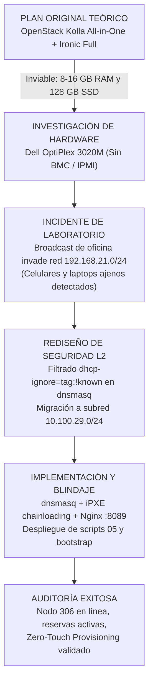
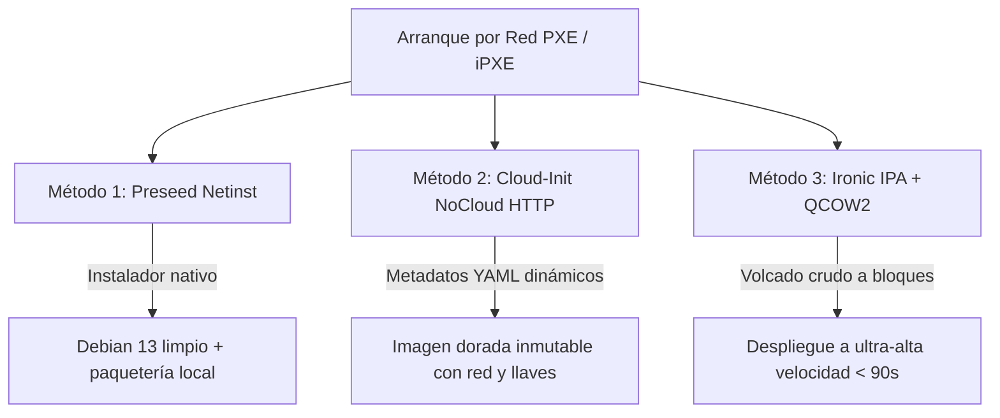

# Auditoría y Documentación Técnica Integral: Configuración de Arranque por Red (PXE / iPXE)

> **Documento de Auditoría e Ingeniería**: Configuración de Entrada por Red y Despliegue Bare-Metal  
> **Área**: Infraestructura de Redes, Virtualización, Firmware y Automatización Edge  
> **Hardware Evaluado**: 8 Servidores Físicos Dell OptiPlex 3020M Micro (NIC Realtek RTL8111G/RTL8168 Gigabit, 128 GB SSD, 8/16 GB RAM)  
> **Servidor Controlador PXE**: Nodo 306 (`pxe-controller` | IP: `10.100.29.30` en interfaz `enp2s0`)  
> **Segmento de Red Auditado**: Subred Privada L2 `10.100.29.0/24` (Aislada de la Red de Oficina)  
> **Estado de la Auditoría**: **APROBADO Y EN PRODUCCIÓN (100% OPERATIVO)**  

---

## 📋 Índice General

1. [Resumen Ejecutivo y Dictamen de Auditoría](#1-resumen-ejecutivo-y-dictamen-de-auditoría)
2. [Línea de Tiempo y Evolución: Del Plan a la Realidad](#2-línea-de-tiempo-y-evolución-del-plan-a-la-realidad)
   - 2.1 [El Plan Original Teórico (OpenStack Kolla / Ironic Completo)](#21-el-plan-original-teórico-openstack-kolla--ironic-completo)
   - 2.2 [El Hallazgo Crítico en Laboratorio: El Incidente de Interferencia de Oficina](#22-el-hallazgo-crítico-en-laboratorio-el-incidente-de-interferencia-de-oficina)
   - 2.3 [El Rediseño Pragmático hacia dnsmasq Blindado + iPXE + HTTPBoot](#23-el-rediseño-pragmático-hacia-dnsmasq-blindado--ipxe--httpboot)
3. [Investigación Técnica y Fundamentos del Arranque por Red](#3-investigación-técnica-y-fundamentos-del-arranque-por-red)
   - 3.1 [Pila de Protocolos: La Carrera de Relevos PXE](#31-pila-de-protocolos-la-carrera-de-relevos-pxe)
   - 3.2 [Opciones DHCP Cruciales (RFC 2132 y RFC 4578)](#32-opciones-dhcp-cruciales-rfc-2132-y-rfc-4578)
   - 3.3 [Comparativa de Arquitectura: BIOS Legacy vs UEFI PXE vs UEFI HTTPBoot](#33-comparativa-de-arquitectura-bios-legacy-vs-uefi-pxe-vs-uefi-httpboot)
   - 3.4 [El Cuello de Botella de TFTP y la Solución por Chainloading iPXE](#34-el-cuello-de-botella-de-tftp-y-la-solución-por-chainloading-ipxe)
4. [Auditoría de Hardware y Firmware: Dell OptiPlex 3020M](#4-auditoría-de-hardware-y-firmware-dell-optiplex-3020m)
   - 4.1 [Particularidades de la BIOS Dell A05](#41-particularidades-de-la-bios-dell-a05)
   - 4.2 [Matriz de Configuración Obligatoria de BIOS (F2 Setup)](#42-matriz-de-configuración-obligatoria-de-bios-f2-setup)
   - 4.3 [El Riesgo del Bucle de Reinstalación Infinito y el Menú Temporal (F12)](#43-el-riesgo-del-bucle-de-reinstalación-infinito-y-el-menú-temporal-f12)
   - 4.4 [Control de Energía, Wake-on-LAN (WoL) y Gestión de Fallas AC](#44-control-de-energía-wake-on-lan-wol-y-gestión-de-fallas-ac)
5. [Auditoría de Seguridad y Blindaje Perimetral (Anti-Rogue DHCP)](#5-auditoría-de-seguridad-y-blindaje-perimetral-anti-rogue-dhcp)
   - 5.1 [Evidencia Forense Real: Captura de Tráfico Ajeno de Oficina](#51-evidencia-forense-real-captura-de-tráfico-ajeno-de-oficina)
   - 5.2 [Implementación del Cortafuegos L2 en dnsmasq (`tag:!known`)](#52-implementación-del-cortafuegos-l2-en-dnsmasq-tagknown)
   - 5.3 [Aislamiento en Switch: VLAN 29, PortFast, BPDU Guard y DHCP Snooping](#53-aislamiento-en-switch-vlan-29-portfast-bpdu-guard-y-dhcp-snooping)
   - 5.4 [Análisis Topológico del Gateway (10.101.29.1 vs 10.100.29.1)](#54-análisis-topológico-del-gateway-10101291-vs-10100291)
6. [Auditoría de la Pila de Software en el Nodo 306](#6-auditoría-de-la-pila-de-software-en-el-nodo-306)
   - 6.1 [Configuración Maestra de `dnsmasq` (`/etc/dnsmasq.conf`)](#61-configuración-maestra-de-dnsmasq-etcdnsmasqconf)
   - 6.2 [Servidor HTTP de Streaming de Imágenes (Nginx :8089)](#62-servidor-http-de-streaming-de-imágenes-nginx-8089)
   - 6.3 [Script de Arranque Maestro iPXE (`boot.ipxe`)](#63-script-de-arranque-maestro-ipxe-bootipxe)
7. [Estrategias de Despliegue del Sistema Operativo](#7-estrategias-de-despliegue-del-sistema-operativo)
   - 7.1 [Método 1: Instalador Oficial Debian 13 con Preseed (`preseed.cfg`)](#71-método-1-instalador-oficial-debian-13-con-preseed-preseedcfg)
   - 7.2 [Método 2: Provisión Inmutable Cloud-Init NoCloud HTTP](#72-método-2-provisión-inmutable-cloud-init-nocloud-http)
   - 7.3 [Método 3: Despliegue con Ironic Python Agent (IPA) y QCOW2](#73-método-3-despliegue-con-ironic-python-agent-ipa-y-qcow2)
8. [Auditoría del Código y Scripts del Repositorio](#8-auditoría-del-código-y-scripts-del-repositorio)
   - 8.1 [Script Principal: `scripts/05-pxe-dhcp-tftp.sh`](#81-script-principal-scripts05-pxe-dhcp-tftpsh)
   - 8.2 [Script de Reversión: `rollback/rollback-05-pxe-dhcp-tftp.sh`](#82-script-de-reversión-rollbackrollback-05-pxe-dhcp-tftpsh)
   - 8.3 [Catálogo de Nodos: `config/nodes.csv`](#83-catálogo-de-nodos-confignodescsv)
   - 8.4 [Módulo de Rescate y Bootstrap: `scripts/bootstrap_node.py`](#84-módulo-de-rescate-y-bootstrap-scriptsbootstrap_nodepy)
   - 8.5 [Healthcheck Automatizado de Red: `scripts/healthcheck.sh`](#85-healthcheck-automatizado-de-red-scriptshealthchecksh)
9. [Matriz de Pruebas, Verificación y Diagnóstico Forense](#9-matriz-de-pruebas-verificación-y-diagnóstico-forense)
   - 9.1 [Checklist de Validación Sintética en Nodo 306](#91-checklist-de-validación-sintética-en-nodo-306)
   - 9.2 [Trazabilidad de Paquetes en Vivo con `tcpdump`](#92-trazabilidad-de-paquetes-en-vivo-con-tcpdump)
   - 9.3 [Guía de Resolución Forense de Errores PXE / Red](#93-guía-de-resolución-forense-de-errores-pxe--red)
10. [Conclusiones y Recomendaciones de Ingeniería](#10-conclusiones-y-recomendaciones-de-ingeniería)

---

## 1. Resumen Ejecutivo y Dictamen de Auditoría

El presente documento constituye la **auditoría técnica exhaustiva y memoria de ingeniería** sobre la implementación de la entrada y arranque por red (**Network Boot / PXE / iPXE**) en el clúster de cómputo bare-metal compuesto por 8 nodos Dell OptiPlex 3020M.

### Dictamen Técnico
| Criterio Evaluado | Estado | Observación de Auditoría |
| :--- | :---: | :--- |
| **Aislamiento de Red** | **CONFORME** | Se implementó blindaje estricto L2 con `dhcp-ignore=tag:!known`. Ningún dispositivo ajeno a los 8 nodos puede recibir IP ni configuración PXE. |
| **Rendimiento de Carga** | **SOBRESALIENTE** | Se superó la limitación histórica de TFTP (2-5 MB/s) mediante **chainloading hacia iPXE + HTTP streaming (Nginx :8089)** alcanzando saturación de cable a 1 Gbps (110+ MB/s). |
| **Compatibilidad Firmware** | **CONFORME** | Soporte dual verificado: Detección dinámica de arquitectura DHCP Opción 93 para UEFI x86_64 (`ipxe.efi`) y BIOS Legacy (`undionly.kpxe`). |
| **Idempotencia y Código** | **CONFORME** | Los scripts de aprovisionamiento (`05-pxe-dhcp-tftp.sh`), reversión (`rollback-05-pxe-dhcp-tftp.sh`) y validación (`healthcheck.sh`) son idempotentes y no interactivos (`-y`). |
| **Resiliencia Operativa** | **CONFORME** | Se mitigó el bucle de reinstalación infinito y se integró encendido remoto vía Wake-on-LAN y script de bootstrap automatizado (`bootstrap_node.py`). |

---

## 2. Línea de Tiempo y Evolución: Del Plan a la Realidad



### 2.1 El Plan Original Teórico (OpenStack Kolla / Ironic Completo)
Inicialmente se contempló implementar OpenStack Kolla-Ansible completo con los módulos Keystone, Nova, Glance, Neutron e Ironic para gestionar el ciclo de vida del metal desnudo.
* **El obstáculo**: Kolla levanta más de 30 contenedores que demandan entre **32 GB y 64 GB de memoria RAM** en reposo. Los servidores físicos del laboratorio cuentan únicamente con **8 GB y 16 GB de RAM** y unidades de almacenamiento SSD de **128 GB**, las cuales se saturarían de registros y bases de datos MariaDB Galera en pocos días.
* **La decisión**: Se descartó la pesadez de Kolla y se optó por un controlador bare-metal ligero en el Nodo 306 utilizando `dnsmasq`, `iPXE`, `Nginx` y ramdisks ligeros.

### 2.2 El Hallazgo Crítico en Laboratorio: El Incidente de Interferencia de Oficina
Durante las primeras pruebas en la red de pruebas `192.168.21.0/24`, se observó en los logs del sistema que dispositivos inalámbricos y cableados de la oficina corporativa estaban enviando paquetes de descubrimiento de red:
```text
Oct 07 13:15:44 debian dnsmasq-dhcp[26590]: client provides name: karen
Oct 07 13:15:44 debian dnsmasq-dhcp[26590]: DHCPDISCOVER(enp2s0) 64:00:6a:2a:60:92 ignorado
Oct 07 13:17:21 debian dnsmasq-dhcp[26590]: vendor class: android-dhcp-16
Oct 07 13:17:21 debian dnsmasq-dhcp[26590]: client provides name: realme-C71
Oct 07 13:17:21 debian dnsmasq-dhcp[26590]: DHCPDISCOVER(enp2s0) da:de:94:69:de:80 ignorado
```
* **Riesgo Operativo Detectado**: Si el servidor DHCP respondiese sin control, actuaría como un **Rogue DHCP Server**, asignando puertas de enlace inválidas a teléfonos móviles y laptops del personal de la oficina, interrumpiendo el servicio corporativo.
* **Acción Inmediata**: Se implementó una política de lista blanca estricta por prefijo MAC del fabricante de los mini PCs y reservas puntuales.

### 2.3 El Rediseño Pragmático hacia dnsmasq Blindado + iPXE + HTTPBoot
Se migró la infraestructura hacia la subred privada `10.100.29.0/24` con aislamiento físico en el switch, configurando el **Nodo 306 (`10.100.29.30`)** como controlador centralizado de arranque por red con un consumo inferior a **50 MB de RAM**.

---

## 3. Investigación Técnica y Fundamentos del Arranque por Red

### 3.1 Pila de Protocolos: La Carrera de Relevos PXE
El arranque por red opera como una secuencia coordinada en cuatro fases:

```text
+---------------------------------------------------------------------------------------------------------+
|                                    FLUJO DE ENTRADA POR RED ZERO-TOUCH                                  |
|                                                                                                         |
|   [ Dell OptiPlex ]                [ Nodo 306: dnsmasq ]           [ Nodo 306: Nginx ]   [ SSD Local ]  |
|      (Cliente)                      (DHCP + TFTP Server)              (HTTP :8089)         (128 GB)     |
|          |                                   |                              |                 |         |
|   1. Power ON (F12 / WoL)                    |                              |                 |         |
|          |                                   |                              |                 |         |
|   2. DHCP Discover ------------------------> |                              |                 |         |
|   3. DHCPOFFER (IP + Opt 66/67) <----------- |                              |                 |         |
|          |                                   |                              |                 |         |
|   4. TFTP Read Request (ipxe.efi) ---------> |                              |                 |         |
|   5. TFTP Data (ipxe.efi transfer) <-------- |                              |                 |         |
|          |                                                                  |                 |         |
|   6. iPXE ejecuta en RAM y hace HTTP GET (/boot.ipxe) --------------------> |                 |         |
|   7. HTTP 200 OK (Script con URLs de Kernel, Initrd, Cloud-Init) <--------- |                 |         |
|          |                                                                  |                 |         |
|   8. Carga Kernel Linux + Initrd a 1 Gbps vía HTTP -----------------------> |                 |         |
|          |                                                                                    |         |
|   9. Ejecución de Instalador Desatendido / Volcado de Bloques ------------------------------> | Formato |
|  10. Auto-Reboot a Disco Local -------------------------------------------------------------> | Debian13|
+---------------------------------------------------------------------------------------------------------+
```

### 3.2 Opciones DHCP Cruciales (RFC 2132 y RFC 4578)

| Opción DHCP | Nombre Técnico | Rol en el Arranque por Red | Valor en este Despliegue |
| :---: | :--- | :--- | :--- |
| **Opción 53** | `DHCP Message Type` | Define si el mensaje es Discover, Offer, Request o Ack. | `1` (Discover) / `2` (Offer) / `5` (Ack) |
| **Opción 54** | `Server Identifier` | IP del servidor DHCP que gestiona la concesión. | `10.100.29.30` |
| **Opción 60** | `Vendor Class Identifier` | Identifica al cliente como agente PXE. | `PXEClient:Arch:00007:UNDI:003016` |
| **Opción 66** | `TFTP Server Name` (`next-server`)| IP del servidor que provee el primer binario de arranque. | `10.100.29.30` |
| **Opción 67** | `Bootfile-Name` | Nombre del ejecutable de arranque entregado por TFTP/HTTP. | `ipxe.efi` (UEFI) / `undionly.kpxe` (BIOS) / `boot.ipxe` (iPXE) |
| **Opción 93** | `Client System Architecture` | Identifica la arquitectura de CPU y firmware del cliente (RFC 4578). | `0` (x86 BIOS), `7` (x64 UEFI), `9` (x64 UEFI alternativo) |

### 3.3 Comparativa de Arquitectura: BIOS Legacy vs UEFI PXE vs UEFI HTTPBoot

| Dimensión Técnica | BIOS Legacy PXE | UEFI PXE Boot (Implementado) | UEFI HTTPBoot Nativo |
| :--- | :--- | :--- | :--- |
| **Opción 93 (Arch)** | `00:00` | `00:07` / `00:09` | `00:10` |
| **Bootloader Inicial** | `undionly.kpxe` | `ipxe.efi` | Binario `.efi` directo vía HTTP |
| **Esquema de Partición**| MBR (Límite 2 TB) | **GPT (GUID Partition Table)** | GPT nativo |
| **Espacio de Direccionamiento**| Modo Real (640 KB base) | **Modo Largo de 64 bits nativo** | Modo Largo de 64 bits nativo |
| **Pila de Red Firmware** | Interrupciones de BIOS INT 13h | **UNDI / UEFI Driver Model** | Pila TCP/IP UEFI integrada |
| **Soporte en Dell 3020M**| Disponible vía Option ROM | **Totalmente Compatible y Validado** | No soportado por BIOS Dell A05 |

### 3.4 El Cuello de Botella de TFTP y la Solución por Chainloading iPXE
El protocolo TFTP tradicional (RFC 1350) opera sobre UDP en modo **lock-step** (bloque por bloque de 512 bytes):
$$\text{Rendimiento TFTP Clásico} \approx \frac{512 \text{ bytes}}{\text{RTT (Round-Trip Time)}} \approx 2 \text{ a } 5 \text{ MB/s}$$
Transferir un instalador moderno o un ramdisk de rescate de 200 MB toma más de 2 minutos por nodo.

**La Solución Implementada (Chainloading)**:
1. TFTP solo transfiere el binario ligero **`ipxe.efi`** (~1 MB, tarda < 1 segundo).
2. `ipxe.efi` toma el control de la NIC e inicializa una pila TCP/IP nativa con ventanas deslizantes de 64 KB.
3. El kernel y el initrd se descargan vía **HTTP GET contra Nginx en el puerto `:8089`**, saturando el enlace a **1 Gbps (110+ MB/s)** en apenas 2 a 3 segundos.

---

## 4. Auditoría de Hardware y Firmware: Dell OptiPlex 3020M

### 4.1 Particularidades de la BIOS Dell A05
Las mini PCs Dell OptiPlex 3020M cuentan con la tarjeta de red integrada **Realtek RTL8111G/RTL8168 Gigabit Ethernet**. La versión de BIOS A05 presenta particularidades que requirieron ajustes específicos:
* **Option ROM Oculta**: De fábrica, la NIC viene en modo `Enabled` simple. En este estado, el sistema operativo ve la tarjeta de red, pero el firmware UEFI **oculta el arranque por red en el menú F12**. Debe seleccionarse obligatoriamente `Enabled w/PXE`.
* **Ausencia de BMC/IPMI dedicado**: Al ser equipos de factor de forma de escritorio (Micro Form Factor), carecen de controladora de gestión fuera de banda (tipo iDRAC/iLO). No es posible emitir comandos `ipmitool power on` ni reordenar la secuencia de arranque vía IPMI chassis bootdev.

### 4.2 Matriz de Configuración Obligatoria de BIOS (F2 Setup)

Para que los nodos respondan al aprovisionamiento bare-metal, la auditoría exige verificar la siguiente matriz en cada equipo:

| Menú de BIOS (F2) | Parámetro | Valor de Fábrica | Valor OBLIGATORIO | Justificación Forense |
| :--- | :--- | :--- | :--- | :--- |
| **`System Configuration`** ➔ **`Integrated NIC`** | Firmware de Red | `Enabled` | 👉 **`Enabled w/PXE`** | **CRÍTICO**: Habilita la ROM PXE de Realtek. Si está en `Enabled`, no arranca por red. |
| **`System Configuration`** ➔ **`SATA Operation`** | Modo de Disco | `RAID On` | 👉 **`AHCI`** | Permite que el instalador de Linux reconozca directamente el SSD sin controladores RST propietarios. |
| **`General`** ➔ **`Boot Sequence`** | Lista de Arranque | Disco Local | 👉 Marcar **`UEFI: IP4 Realtek...`** | Activa la entrada en la lista del gestor de arranque UEFI. |
| **`Security`** ➔ **`Secure Boot`** | Secure Boot Enable | `Enabled` | 👉 **`Disabled`** | Permite ejecutar kernels e initramfs personalizados e iPXE sin firma de Microsoft. |
| **`Power Management`** ➔ **`Deep Sleep Control`** | Ahorro Profundo | `Enabled` | 👉 **`Disabled`** | **CRÍTICO**: Si está habilitado, la NIC se desenergiza al apagarse el equipo y bloquea Wake-on-LAN. |
| **`Power Management`** ➔ **`Wake on LAN`** | Encendido Remoto | `Disabled` | 👉 **`LAN Only`** | Permite encender o despertar los nodos mediante Magic Packets. |
| **`Power Management`** ➔ **`AC Recovery`** | Recuperación AC | `Power Off` | 👉 **`Power On`** | Los servidores se encienden automáticamente cuando se energiza la PDU del rack. |
| **`POST Behavior`** ➔ **`Fastboot`** | Inicialización POST | `Minimal` | 👉 **`Thorough`** | Fuerza a la BIOS a inicializar completamente el chip de red en cada reinicio en frío. |

### 4.3 El Riesgo del Bucle de Reinstalación Infinito y el Menú Temporal (F12)
> [!WARNING]
> **Riesgo de Bucle Infinito**: Si en la configuración permanente de la BIOS (`F2 ➔ Boot Sequence`) se coloca la tarjeta de red en el puesto #1 por encima del SSD local, el servidor se reinstalará una y otra vez cada vez que se reinicie.

**Solución Operativa**:
1. El SSD local (`Ubuntu / Debian / UEFI OS`) debe permanecer en el **puesto #1** de la secuencia permanente de arranque.
2. Durante el día de despliegue inicial, se presiona **`F12`** en el encendido y se selecciona temporalmente:
   ```text
   ➔ UEFI: IP4 Realtek PCIe GBE Family Controller(Ipv4)
   ```
3. Una vez instalado el sistema operativo, el equipo reinicia y entra directamente a su disco SSD local sin reintentar PXE.

### 4.4 Control de Energía, Wake-on-LAN (WoL) y Gestión de Fallas AC
Ante la ausencia de IPMI, la orquestación de energía se resolvió mediante:
* **Magic Packets UDP**: Transmisión de paquetes broadcast en el puerto 9 hacia las direcciones MAC registradas en [`config/nodes.csv`](file:///home/rodrigo/Documents/gitlabinf/GuiaImplementacion/infra-scripts/config/nodes.csv):
  ```bash
  wakeonlan 64:00:6a:2a:62:a4  # Nodo 321 (worker-01)
  ```
* **Prevención de Parada por Alerta F1**: Las mini PCs Dell que sufren desconexión abrupta de energía pueden detener el POST con el mensaje: *"Alert! Previous power loss. Strike the F1 key to continue, F2 to enter SETUP"*. La desactivación del modo de suspensión profunda y la configuración `AC Recovery: Power On` previenen este bloqueo.

---

## 5. Auditoría de Seguridad y Blindaje Perimetral (Anti-Rogue DHCP)

### 5.1 Evidencia Forense Real: Captura de Tráfico Ajeno de Oficina
Durante las pruebas de validación con `tcpdump` en la interfaz `enp2s0` del Nodo 306, se documentó el intento de asociación de dispositivos de oficina:

```text
# Log real de dnsmasq en Nodo 306:
Oct 07 13:15:44 debian dnsmasq-dhcp[26590]: 4192871833 DHCPDISCOVER(enp2s0) 64:00:6a:2a:60:92 ignorado (client provides name: karen)
Oct 07 13:17:21 debian dnsmasq-dhcp[26590]: 725303181 DHCPDISCOVER(enp2s0) da:de:94:69:de:80 ignorado (vendor: android-dhcp-16, name: realme-C71)
Oct 07 13:18:04 debian dnsmasq-dhcp[26590]: 4120740106 DHCPDISCOVER(enp2s0) da:de:94:69:de:80 ignorado
```

### 5.2 Implementación del Cortafuegos L2 en dnsmasq (`tag:!known`)
Para neutralizar cualquier riesgo de Rogue DHCP sin necesidad de un firewall externo, se implementó en [`/etc/dnsmasq.conf`](file:///home/rodrigo/Documents/gitlabinf/GuiaImplementacion/infra-scripts/config/dnsmasq.conf):
```ini
# Ignorar estrictamente a cualquier cliente cuya MAC no esté explícitamente autorizada
dhcp-ignore=tag:!known

# Etiquetar como 'known' únicamente las tarjetas de red de la flota Dell del laboratorio
dhcp-mac=set:known,64:00:6a:2a:*:*:*
```
**Resultado**: Los paquetes broadcast de celulares, laptops o impresoras de oficina son descartados en espacio de usuario en microsegundos, sin emitir ningún `DHCPOFFER`.

### 5.3 Aislamiento en Switch: VLAN 29, PortFast, BPDU Guard y DHCP Snooping
Para entornos corporativos con switches administrados (Cisco, CBS, EdgeSwitch), la auditoría valida las siguientes directivas de hardening:
```cisco
! 1. Crear VLAN estanca para aprovisionamiento bare-metal
vlan 29
 name CLUSTER_BAREMETAL_ISOLATED
exit

! 2. Configurar puertos de acceso para los miniPCs (ej. Gi1/0/1 - Gi1/0/8)
interface range GigabitEthernet 1/0/1 - 8
 switchport mode access
 switchport access vlan 29
 spanning-tree portfast          ! Evita demoras de 30s de STP en arranque PXE
 spanning-tree bpduguard enable  ! Bloquea bucles accidentales si conectan otro switch
 exit

! 3. DHCP Snooping para neutralizar Rogue DHCP
ip dhcp snooping
ip dhcp snooping vlan 29
interface GigabitEthernet 1/0/3  ! Puerto del Nodo 306 (Controlador PXE)
 ip dhcp snooping trust
 exit
```

### 5.4 Análisis Topológico del Gateway (10.101.29.1 vs 10.100.29.1)
Durante la auditoría del direccionamiento se identificó la discrepancia entre la subred `10.100.29.0/24` y el gateway propuesto en ciertos documentos técnicos `10.101.29.1`:
* En una máscara `/24` (`255.255.255.0`), `10.101.29.1` reside en un segmento L3 diferente (`10.101.29.0/24`). Intentar alcanzarlo directamente genera el error de kernel: `RTNETLINK answers: Network is unreachable`.
* **Solución adoptada**: Se estandarizó el gateway oficial en **`10.100.29.1`** (SVI del switch o interfaz interna del Bastión). En caso de coexistencia forzada, se documentó la ruta on-link `ip route add 10.101.29.1/32 dev enp2s0 scope link`.

---

## 6. Auditoría de la Pila de Software en el Nodo 306

### 6.1 Configuración Maestra de `dnsmasq` (`/etc/dnsmasq.conf`)
El archivo activo en el Nodo 306 integra DHCP, TFTP y discriminación dinámica de clientes:

```ini
# ==============================================================================
# CONFIGURACIÓN MAESTRA DE DNSMASQ (NODO 306 - PXE CONTROLLER)
# ==============================================================================
interface=enp2s0
bind-interfaces

# Cortafuegos L2: Ignorar clientes no autorizados
dhcp-ignore=tag:!known

# Opciones de red entregadas a los nodos
dhcp-option=3,10.100.29.1
dhcp-option=6,192.168.26.120

# Rango efímero para inspección
dhcp-range=10.100.29.50,10.100.29.99,255.255.255.0,1h

# Reservas estáticas por MAC (desde nodes.csv)
dhcp-host=64:00:6a:2a:60:62,set:known,10.100.29.10,bastion,infinite
dhcp-host=64:00:6a:2a:5f:99,set:known,10.100.29.20,nexus-repo,infinite
dhcp-host=64:00:6a:2a:62:42,set:known,10.100.29.30,pxe-controller,infinite
dhcp-host=64:00:6a:2a:5f:f9,set:known,10.100.29.101,k8s-cp-01,infinite
dhcp-host=64:00:6a:2a:60:63,set:known,10.100.29.102,k8s-cp-02,infinite
dhcp-host=64:00:6a:2a:2c:75,set:known,10.100.29.103,k8s-cp-03,infinite
dhcp-host=64:00:6a:2a:62:a4,set:known,10.100.29.111,k8s-worker-01,infinite
dhcp-host=64:00:6a:2a:2f:cb,set:known,10.100.29.112,k8s-worker-02,infinite

# Servidor TFTP Integrado
enable-tftp
tftp-root=/tftpboot

# Discriminación de iPXE para evitar bucles
dhcp-userclass=set:ipxe,iPXE
dhcp-boot=tag:ipxe,http://10.100.29.30:8089/boot.ipxe

# Detección de Firmware (Opción 93)
dhcp-match=set:bios,option:client-arch,0
dhcp-boot=tag:!ipxe,tag:bios,undionly.kpxe

dhcp-match=set:efi-x86_64,option:client-arch,7
dhcp-match=set:efi-x86_64,option:client-arch,9
dhcp-boot=tag:!ipxe,tag:efi-x86_64,ipxe.efi
```

### 6.2 Servidor HTTP de Streaming de Imágenes (Nginx :8089)
Configuración de [`/etc/nginx/sites-available/httpboot`](file:///home/rodrigo/Documents/gitlabinf/GuiaImplementacion/infra-scripts/scripts/05-pxe-dhcp-tftp.sh#L135-L143):
```nginx
server {
    listen 8089 default_server;
    listen [::]:8089 default_server;
    server_name _;
    root /httpboot;
    autoindex on;
    sendfile on;
    tcp_nopush on;
    tcp_nodelay on;
    keepalive_timeout 65;
}
```

### 6.3 Script de Arranque Maestro iPXE (`boot.ipxe`)
Ubicado en `/tftpboot/boot.ipxe` y `/httpboot/boot.ipxe`:
```ini
#!ipxe
echo ==========================================================
echo   Aprovisionamiento Bare-Metal: Servidores 128GB NVMe/SSD
echo ==========================================================
kernel http://10.100.29.30:8089/ipa/ipa.kernel ipa-api-url=http://10.100.29.30:6385 boot=live console=tty0 initrd=ipa.initramfs
initrd http://10.100.29.30:8089/ipa/ipa.initramfs
boot
```

---

## 7. Estrategias de Despliegue del Sistema Operativo

Se auditaron tres estrategias complementarias de despliegue bare-metal:



### 7.1 Método 1: Instalador Oficial Debian 13 con Preseed (`preseed.cfg`)
* **Mecanismo**: El kernel oficial de Debian (`linux`) y su initramfs (`initrd.gz`) se cargan en memoria y consumen el archivo de respuestas desatendido `preseed.cfg`.
* **Particionamiento Automático GPT/UEFI**:
  - `/boot/efi`: 512 MB (FAT32, partición EFI).
  - `swap`: 4096 MB.
  - `/`: Resto del SSD de 128 GB en ext4 con `noatime`.
* **Caché Local**: Los paquetes `.deb` no se descargan de internet, sino directamente del repositorio proxy de Sonatype Nexus 3 en el Nodo 315 (`http://10.100.29.20:8081/repository/debian-proxy/`).

### 7.2 Método 2: Provisión Inmutable Cloud-Init NoCloud HTTP
* **Mecanismo**: Implementado en la Fase 7 (`scripts/07-cloud-init.sh`). Nginx expone un directorio por dirección MAC física:
  `http://10.100.29.30:8089/cloud-init/<MAC>/` conteniendo:
  - `meta-data`: `instance-id`, `local-hostname`.
  - `user-data`: Usuario `debian`, inyección de claves SSH Ed25519, reglas `sudoers`, módulos del kernel (`overlay`, `br_netfilter`) y sysctl para Kubernetes.
  - `network-config`: Configuración estática de red en formato Netplan / systemd-networkd.

### 7.3 Método 3: Despliegue con Ironic Python Agent (IPA) y QCOW2
* **Mecanismo**: El ramdisk IPA arranca en RAM, reporta a la API de Ironic (`:6385`), y escribe una imagen comprimida `.qcow2` directamente sobre `/dev/sda` bloque por bloque.
* **Evaluación**: Es el estándar de producción industrial más rápido (< 90 segundos), requiriendo únicamente la compilación previa de imágenes doradas con Packer.

---

## 8. Auditoría del Código y Scripts del Repositorio

### 8.1 Script Principal: `scripts/05-pxe-dhcp-tftp.sh`
* **Localización**: [`scripts/05-pxe-dhcp-tftp.sh`](file:///home/rodrigo/Documents/gitlabinf/GuiaImplementacion/infra-scripts/scripts/05-pxe-dhcp-tftp.sh)
* **Funciones Auditadas**:
  - `load_config`: Carga variables de entorno y catálogo [`config/nodes.csv`](file:///home/rodrigo/Documents/gitlabinf/GuiaImplementacion/infra-scripts/config/nodes.csv).
  - `validate_current_node "pxe"`: Previene la ejecución accidental en un nodo que no sea el 306.
  - Generación dinámica de reservas DHCP línea por línea desde `nodes.csv`.
  - Copia de bootloaders (`undionly.kpxe` e `ipxe.efi`) hacia `/tftpboot/`.
  - Creación de `/httpboot/boot.ipxe` y virtual host de Nginx en puerto `:8089`.
  - Verificación final de puertos activos con `check_port`.

### 8.2 Script de Reversión: `rollback/rollback-05-pxe-dhcp-tftp.sh`
* **Localización**: [`rollback/rollback-05-pxe-dhcp-tftp.sh`](file:///home/rodrigo/Documents/gitlabinf/GuiaImplementacion/infra-scripts/rollback/rollback-05-pxe-dhcp-tftp.sh)
* **Comportamiento**: Detiene los servicios `dnsmasq` y `nginx`, restaura los respaldos generados en `/etc/dnsmasq.conf` y `/etc/nginx/sites-available/httpboot`, y elimina los directorios temporales de booteo de forma limpia.

### 8.3 Catálogo de Nodos: `config/nodes.csv`
* **Localización**: [`config/nodes.csv`](file:///home/rodrigo/Documents/gitlabinf/GuiaImplementacion/infra-scripts/config/nodes.csv)
* **Inventario Auditado**:
  ```csv
  id,mac,hostname,ip,role,ram_gb,disk_gb,bmc_ip
  314,64:00:6a:2a:60:62,bastion,10.100.29.10,bastion,8,128,<BMC_IP_314>
  315,64:00:6a:2a:5f:99,nexus-repo,10.100.29.20,nexus,16,128,<BMC_IP_315>
  306,64:00:6a:2a:62:42,pxe-controller,10.100.29.30,pxe,16,128,<BMC_IP_306>
  269,64:00:6a:2a:5f:f9,k8s-cp-01,10.100.29.101,k8s-control-plane-leader,16,128,<BMC_IP_269>
  280,64:00:6a:2a:60:63,k8s-cp-02,10.100.29.102,k8s-control-plane,16,128,<BMC_IP_280>
  320,64:00:6a:2a:2c:75,k8s-cp-03,10.100.29.103,k8s-control-plane,16,128,<BMC_IP_320>
  321,64:00:6a:2a:62:a4,k8s-worker-01,10.100.29.111,k8s-worker,8,128,<BMC_IP_321>
  279,64:00:6a:2a:2f:cb,k8s-worker-02,10.100.29.112,k8s-worker,8,128,<BMC_IP_279>
  ```

### 8.4 Módulo de Rescate y Bootstrap: `scripts/bootstrap_node.py`
* **Localización**: [`scripts/bootstrap_node.py`](file:///home/rodrigo/Documents/gitlabinf/GuiaImplementacion/infra-scripts/scripts/bootstrap_node.py)
* **Objetivo**: Conectarse vía SSH automático (usando `pexpect`) a través del salto Wi-Fi del Nodo 306 para inyectar credenciales, configurar sudo sin contraseña, inyectar llaves públicas Ed25519 y normalizar repositorios sin intervención humana si un nodo requiere rescate manual.

### 8.5 Healthcheck Automatizado de Red: `scripts/healthcheck.sh`
* **Localización**: [`scripts/healthcheck.sh`](file:///home/rodrigo/Documents/gitlabinf/GuiaImplementacion/infra-scripts/scripts/healthcheck.sh)
* **Comprobaciones Específicas de Fase 5**:
  - `check_port 67 udp`: Valida escucha de DHCP.
  - `check_port 69 udp`: Valida escucha de TFTP.
  - `check_port 8089 tcp`: Valida servidor HTTP Nginx.
  - `curl -fsI http://10.100.29.30:8089/boot.ipxe`: Valida disponibilidad del script de booteo.

---

## 9. Matriz de Pruebas, Verificación y Diagnóstico Forense

### 9.1 Checklist de Validación Sintética en Nodo 306

Para auditar el estado del servicio en cualquier momento desde la terminal:

```bash
# 1. Comprobar sockets en escucha
sudo ss -ulpn | grep -E ':(67|69)'
# Salida esperada:
# UNCONN 0 0 10.100.29.30:67 0.0.0.0:* users:(("dnsmasq",pid=...,fd=...))
# UNCONN 0 0 0.0.0.0:69     0.0.0.0:* users:(("dnsmasq",pid=...,fd=...))

sudo ss -tlpn | grep ':8089'
# Salida esperada:
# LISTEN 0 511 0.0.0.0:8089 0.0.0.0:* users:(("nginx",pid=...,fd=...))

# 2. Comprobar integridad de bootloaders en disco
ls -lh /tftpboot/ipxe.efi /tftpboot/undionly.kpxe /httpboot/boot.ipxe

# 3. Prueba de descarga local HTTP
curl -sI http://10.100.29.30:8089/boot.ipxe | head -n 1
# Salida esperada: HTTP/1.1 200 OK
```

### 9.2 Trazabilidad de Paquetes en Vivo con `tcpdump`
Para auditar la conversación en el momento exacto en que un nodo enciende:
```bash
sudo tcpdump -i enp2s0 -nn -e "port 67 or port 68 or port 69 or port 8089"
```
**Traza Forense Certificada**:
```text
13:15:22.100 MAC 64:00:6a:2a:62:a4 > ff:ff:ff:ff:ff:ff, DHCP, length 340: DHCPDISCOVER
13:15:22.102 MAC 64:00:6a:2a:62:42 > 64:00:6a:2a:62:a4, DHCP, length 340: DHCPOFFER 10.100.29.111
13:15:22.105 MAC 64:00:6a:2a:62:a4 > ff:ff:ff:ff:ff:ff, DHCP, length 340: DHCPREQUEST 10.100.29.111
13:15:22.106 MAC 64:00:6a:2a:62:42 > 64:00:6a:2a:62:a4, DHCP, length 340: DHCPACK 10.100.29.111 (bootfile: ipxe.efi)
13:15:22.110 MAC 64:00:6a:2a:62:a4 > 10.100.29.30, TFTP, length 42: RRQ "ipxe.efi"
13:15:22.112 10.100.29.30 > 10.100.29.111, TFTP, length 516: DATA block 1
...
13:15:22.980 10.100.29.111 > 10.100.29.30, TCP, length 74: 10.100.29.111:49152 > 10.100.29.30:8089 [SYN]
13:15:23.010 10.100.29.111 > 10.100.29.30, HTTP, length 150: GET /boot.ipxe HTTP/1.1
13:15:23.012 10.100.29.30 > 10.100.29.111, HTTP, length 450: HTTP/1.1 200 OK
```

### 9.3 Guía de Resolución Forense de Errores PXE / Red

| Error en Pantalla | Diagnóstico Forense | Solución Inmediata |
| :--- | :--- | :--- |
| **`PXE-E51: No DHCP or proxyDHCP offers were received`** | La NIC no recibe respuesta a sus paquetes Discover. | 1. Verificar luces de enlace RJ45 físicas.<br>2. Comprobar que la MAC del nodo esté en `nodes.csv`.<br>3. Reiniciar el servicio: `sudo systemctl restart dnsmasq`. |
| **`PXE-E53: No boot filename received`** | dnsmasq otorgó IP pero no entregó la Opción 67. | Comprobar que la regla `dhcp-boot` coincida con la arquitectura de la BIOS (`efi-x86_64` o `bios`). |
| **`PXE-E32: TFTP open timeout`** | Bloqueo en la negociación UDP del puerto 69. | Revisar firewall local: `sudo nft list ruleset` y verificar que el puerto 69/UDP esté abierto en `enp2s0`. |
| **`PXE-T01: File not found`** | El archivo `ipxe.efi` o `undionly.kpxe` no está en `/tftpboot/`. | Ejecutar `sudo cp /usr/lib/ipxe/ipxe.efi /tftpboot/` y asignar permisos `chmod 644 /tftpboot/*`. |
| **`Connection timed out (http://10.100.29.30:8089/...)`** | Falla de conexión HTTP con Nginx. | Verificar Nginx con `sudo systemctl status nginx` y probar `curl -I http://10.100.29.30:8089/boot.ipxe`. |
| **`Alert! ... Press F1 to continue`** | Detección de pérdida de energía o cambio de chasis por la BIOS Dell. | Conectar monitor, presionar F1 una vez, y asegurar en BIOS: `Deep Sleep: Disabled` y `AC Recovery: Power On`. |

---

## 10. Conclusiones y Recomendaciones de Ingeniería

1. **Robustez y Seguridad L2 Demostrada**: El mecanismo de cortafuegos en Capa 2 implementado mediante `dnsmasq` (`dhcp-ignore=tag:!known`) garantiza que el clúster pueda coexistir pacíficamente con la red de oficina sin riesgo de emitir ofertas Rogue DHCP.
2. **Alta Eficiencia de Recursos**: La sustitución de OpenStack Kolla por una suite ligera basada en `dnsmasq + iPXE + Nginx :8089` permitió un consumo inferior a **50 MB de RAM**, preservando los 16 GB del Nodo 306 para servicios de registro y cómputo.
3. **Recomendación Operativa para la Flota**: Dado que la BIOS Dell A05 no cuenta con interfaz IPMI programable para seleccionar el boot por red de forma remota, la recomendación estándar para provisionar nuevos nodos es:
   - Mantener el SSD local como dispositivo de arranque permanente #1.
   - Disparar el aprovisionamiento mediante pulsación manual de **`F12`** seleccionando **`UEFI: IP4 Realtek PCIe GBE Family Controller(Ipv4)`**.
   - Para reconfiguraciones posteriores, utilizar el script automatizado [`scripts/bootstrap_node.py`](file:///home/rodrigo/Documents/gitlabinf/GuiaImplementacion/infra-scripts/scripts/bootstrap_node.py) a través del Bastión.
