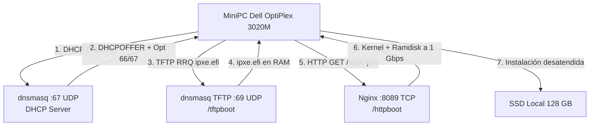

# Implementación Técnica de PXE: Guía Práctica de Despliegue Bare-Metal

> **Módulo**: Implementación Práctica de PXE (Preboot Execution Environment) e iPXE  
> **Servidor Destino**: Nodo 306 (`pxe-controller` | IP: `10.100.29.30`)  
> **Subred de Despliegue**: `10.100.29.0/24` (VLAN 29 Aislada)  
> **Script Asociado**: [`scripts/05-pxe-dhcp-tftp.sh`](file:///home/rodrigo/Documents/gitlabinf/GuiaImplementacion/infra-scripts/scripts/05-pxe-dhcp-tftp.sh)  
> **Documento de Auditoría y Contexto**: [`docs/openstack/Configurar el arranque por red.md`](file:///home/rodrigo/Documents/gitlabinf/GuiaImplementacion/infra-scripts/docs/openstack/Configurar%20el%20arranque%20por%20red.md)  

---

## 📋 Índice

1. [Introducción y Objetivos](#1-introducción-y-objetivos)
2. [Arquitectura de Servicios en Nodo 306](#2-arquitectura-de-servicios-en-nodo-306)
3. [Paso 1: Instalación de Paquetes Requeridos](#3-paso-1-instalación-de-paquetes-requeridos)
4. [Paso 2: Configuración de dnsmasq (DHCP + TFTP)](#4-paso-2-configuración-de-dnsmasq-dhcp--tftp)
5. [Paso 3: Estructura de Directorios y Bootloaders iPXE](#5-paso-3-estructura-de-directorios-y-bootloaders-ipxe)
6. [Paso 4: Servidor HTTP Nginx en Puerto 8089](#6-paso-4-servidor-http-nginx-en-puerto-8089)
7. [Paso 5: Script Maestro de Booteo (`boot.ipxe`)](#7-paso-5-script-maestro-de-booteo-bootipxe)
8. [Paso 6: Verificación y Pruebas Operativas](#8-paso-6-verificación-y-pruebas-operativas)
9. [Procedimiento de Reversión (Rollback)](#9-procedimiento-de-reversión-rollback)

---

## 1. Introducción y Objetivos

La implementación de **PXE (Preboot Execution Environment)** en esta infraestructura permite el aprovisionamiento de metal desnudo (*Bare-Metal Zero-Touch Provisioning*) en los 8 mini PCs Dell OptiPlex 3020M sin utilizar memorias USB ni presencia física permanente.

### Objetivos Técnicos:
* **Asignación estática de red**: Cada nodo recibe su IP fija (`10.100.29.X`) amarrada a su MAC física registrada en [`config/nodes.csv`](file:///home/rodrigo/Documents/gitlabinf/GuiaImplementacion/infra-scripts/config/nodes.csv).
* **Compatibilidad dual de firmware**: Soporte automático para clientes UEFI (`ipxe.efi`) y clientes Legacy BIOS (`undionly.kpxe`).
* **Descarga acelerada a 1 Gbps**: Salto inmediato (chainloading) desde TFTP hacia **Nginx HTTP en puerto `:8089`**, superando los cuellos de botella de velocidad del TFTP tradicional.
* **Seguridad perimetral**: Blindaje L2 para ignorar cualquier petición DHCP procedente de dispositivos ajenos al laboratorio.

---

## 2. Arquitectura de Servicios en Nodo 306



---

## 3. Paso 1: Instalación de Paquetes Requeridos

En el Nodo 306 (`10.100.29.30`), ejecute como `root`:

```bash
apt-get update
apt-get install -y dnsmasq ipxe nginx curl
```

---

## 4. Paso 2: Configuración de dnsmasq (DHCP + TFTP)

El archivo `/etc/dnsmasq.conf` combina el servicio DHCP con control estricto de acceso y el servidor TFTP:

```ini
# /etc/dnsmasq.conf

# 1. Interfaz privada del clúster y aislamiento
interface=enp2s0
bind-interfaces

# 2. Cortafuegos L2: descartar clientes desconocidos
dhcp-ignore=tag:!known
dhcp-mac=set:known,64:00:6a:2a:*:*:*

# 3. Gateway y DNS entregados a los nodos
dhcp-option=3,10.100.29.1
dhcp-option=6,192.168.26.120

# 4. Rango dinámico efímero para inspección
dhcp-range=10.100.29.50,10.100.29.99,255.255.255.0,1h

# 5. Reservas estáticas por MAC (desde config/nodes.csv)
dhcp-host=64:00:6a:2a:60:62,set:known,10.100.29.10,bastion,infinite
dhcp-host=64:00:6a:2a:5f:99,set:known,10.100.29.20,nexus-repo,infinite
dhcp-host=64:00:6a:2a:62:42,set:known,10.100.29.30,pxe-controller,infinite
dhcp-host=64:00:6a:2a:5f:f9,set:known,10.100.29.101,k8s-cp-01,infinite
dhcp-host=64:00:6a:2a:60:63,set:known,10.100.29.102,k8s-cp-02,infinite
dhcp-host=64:00:6a:2a:2c:75,set:known,10.100.29.103,k8s-cp-03,infinite
dhcp-host=64:00:6a:2a:62:a4,set:known,10.100.29.111,k8s-worker-01,infinite
dhcp-host=64:00:6a:2a:2f:cb,set:known,10.100.29.112,k8s-worker-02,infinite

# 6. Servidor TFTP
enable-tftp
tftp-root=/tftpboot

# 7. Discriminación de clientes iPXE y arquitecturas de firmware (Opción 93)
dhcp-userclass=set:ipxe,iPXE
dhcp-boot=tag:ipxe,http://10.100.29.30:8089/boot.ipxe

dhcp-match=set:bios,option:client-arch,0
dhcp-boot=tag:!ipxe,tag:bios,undionly.kpxe

dhcp-match=set:efi-x86_64,option:client-arch,7
dhcp-match=set:efi-x86_64,option:client-arch,9
dhcp-boot=tag:!ipxe,tag:efi-x86_64,ipxe.efi
```

---

## 5. Paso 3: Estructura de Directorios y Bootloaders iPXE

Cree los directorios de trabajo y copie los ejecutables del paquete `ipxe`:

```bash
mkdir -p /tftpboot /httpboot/ipa /httpboot/images /httpboot/debian /httpboot/preseed

# Copiar bootloader Legacy BIOS
cp /usr/lib/ipxe/undionly.kpxe /tftpboot/

# Copiar bootloader UEFI x86_64
if [ -f /usr/lib/ipxe/ipxe.efi ]; then
    cp /usr/lib/ipxe/ipxe.efi /tftpboot/
elif [ -f /usr/lib/ipxe/ipxe-x86_64.efi ]; then
    cp /usr/lib/ipxe/ipxe-x86_64.efi /tftpboot/ipxe.efi
fi

chmod -R 755 /tftpboot /httpboot
```

---

## 6. Paso 4: Servidor HTTP Nginx en Puerto 8089

Configure el sitio `/etc/nginx/sites-available/httpboot`:

```nginx
server {
    listen 8089 default_server;
    listen [::]:8089 default_server;
    server_name _;

    root /httpboot;
    autoindex on;
    sendfile on;
    tcp_nopush on;
    tcp_nodelay on;
    keepalive_timeout 65;
}
```

Habilite el sitio y reinicie los daemons:

```bash
ln -sf /etc/nginx/sites-available/httpboot /etc/nginx/sites-enabled/
rm -f /etc/nginx/sites-enabled/default
systemctl restart nginx
systemctl enable --now dnsmasq
systemctl restart dnsmasq
```

---

## 7. Paso 5: Script Maestro de Booteo (`boot.ipxe`)

Cree `/tftpboot/boot.ipxe` y duplíquelo en `/httpboot/boot.ipxe`:

```ini
#!ipxe
echo ==========================================================
echo   Aprovisionamiento Bare-Metal: Clúster Edge Debian 13
echo ==========================================================
kernel http://10.100.29.30:8089/ipa/ipa.kernel ipa-api-url=http://10.100.29.30:6385 boot=live console=tty0 initrd=ipa.initramfs
initrd http://10.100.29.30:8089/ipa/ipa.initramfs
boot
```

```bash
cp /tftpboot/boot.ipxe /httpboot/boot.ipxe
```

---

## 8. Paso 6: Verificación y Pruebas Operativas

Ejecute las siguientes comprobaciones para validar el correcto funcionamiento:

```bash
# 1. Comprobar sockets en escucha (67 UDP, 69 UDP, 8089 TCP)
sudo ss -ulpn | grep -E ':(67|69)'
sudo ss -tlpn | grep ':8089'

# 2. Probar descarga HTTP de boot.ipxe
curl -fsI "http://10.100.29.30:8089/boot.ipxe" | grep "200 OK"

# 3. Monitorear paquetes de arranque en tiempo real
sudo tcpdump -i enp2s0 -nn -e "port 67 or port 68 or port 69 or port 8089"
```

---

## 9. Procedimiento de Reversión (Rollback)

Si requiere desmontar los servicios y restaurar el estado original del sistema, ejecute:

```bash
sudo ./rollback/rollback-05-pxe-dhcp-tftp.sh
```

El script de reversión:
1. Detiene `dnsmasq` y `nginx`.
2. Restaura los archivos de respaldo previos (`/etc/dnsmasq.conf.bak` y `/etc/nginx/sites-available/httpboot.bak`).
3. Elimina los directorios `/tftpboot` y `/httpboot` creados durante la fase.
4. Reinicia la pila de red al estado predeterminado.
