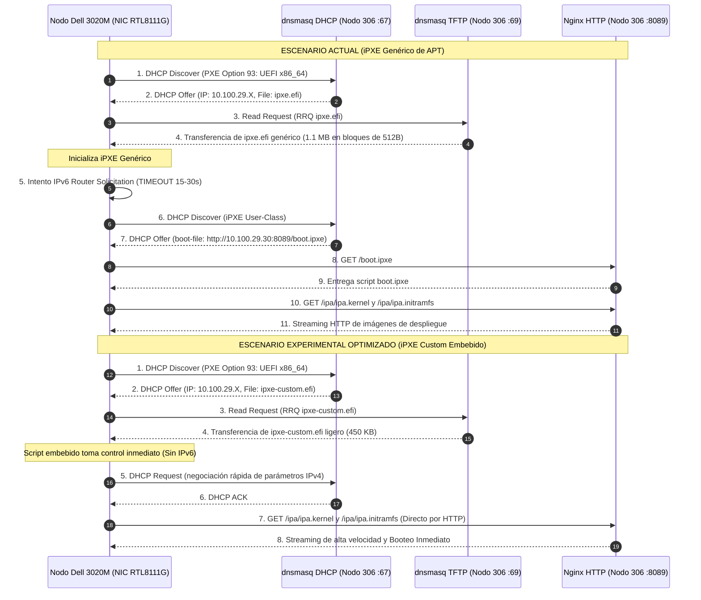
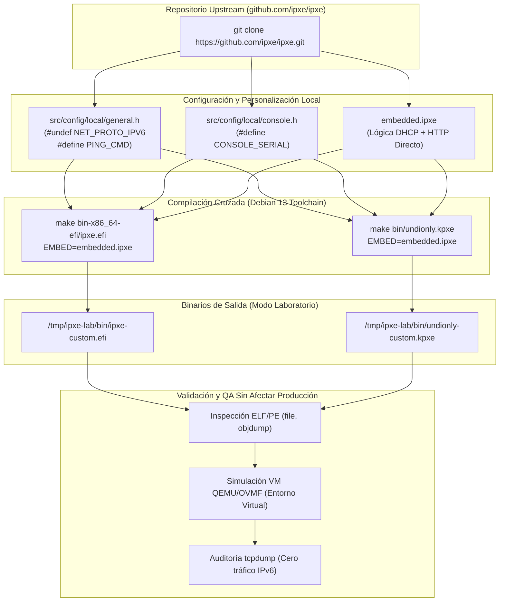
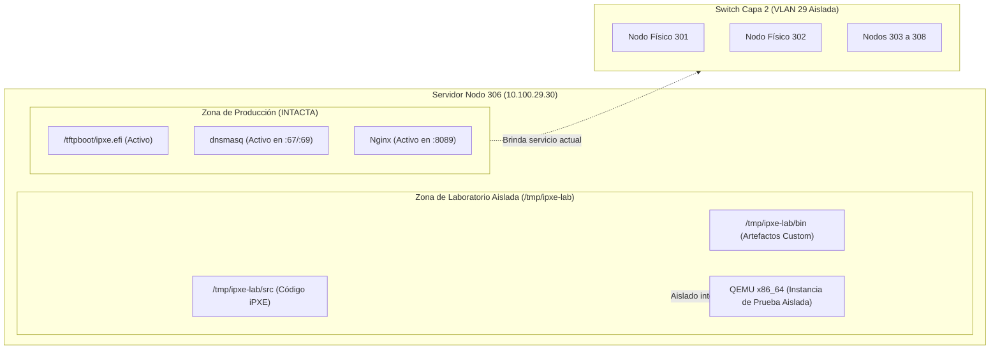

# Experimento y Caso Hipotético: Optimización de Arranque por Red y Despliegue Masivo con iPXE Custom

> **DOCUMENTO DE EXPERIMENTACIÓN TÉCNICA Y CASO HIPOTÉTICO**  
> **Repositorio Base Evaluado**: [https://github.com/ipxe/ipxe](https://github.com/ipxe/ipxe)  
> **Host de Compilación Hipotético**: Nodo 306 (`pxe-controller` | IP: `10.100.29.30` | Debian 13 Trixie)  
> **Plataforma Hardware Destino**: 8 Nodos Dell OptiPlex 3020M (BIOS A05 2015 | NIC Realtek RTL8111G/8168)  
> **Segmento de Red del Laboratorio**: `10.100.29.0/24` (Subred Aislada L2)  
> **Estado Operacional**: ⚠️ **ESTRICTO MODO DE LABORATORIO / HIPOTÉTICO — NO MODIFICA LA PRODUCCIÓN ACTIVA**

---

## 📋 Índice General

1. [Resumen Ejecutivo y Declaración de Salvaguarda](#1-resumen-ejecutivo-y-declaración-de-salvaguarda)
2. [Justificación Técnica del Experimento: La Problemática en Dell A05 y RTL8111G](#2-justificación-técnica-del-experimento-la-problemática-en-dell-a05-y-rtl8111g)
   - 2.1 [El Cuello de Botella del Binario iPXE Genérico de Distribución](#21-el-cuello-de-botella-del-binario-ipxe-genérico-de-distribución)
   - 2.2 [El Problema de la Doble Negociación DHCP y el Fallback IPv6](#22-el-problema-de-la-doble-negociación-dhcp-y-el-fallback-ipv6)
   - 2.3 [La Hipótesis de Optimización: Binario Custom con Script Embebido](#23-la-hipótesis-de-optimización-binario-custom-con-script-embebido)
3. [Diagramas de Arquitectura y Secuencia](#3-diagramas-de-arquitectura-y-secuencia)
   - 3.1 [Comparativa de Flujos de Red: Actual vs Optimizado con iPXE Custom](#31-comparativa-de-flujos-de-red-actual-vs-optimizado-con-ipxe-custom)
   - 3.2 [Pipeline de Compilación y Despliegue Aislado](#32-pipeline-de-compilación-y-despliegue-aislado)
   - 3.3 [Topología Lógica del Experimento de Laboratorio](#33-topología-lógica-del-experimento-de-laboratorio)
4. [Análisis del Repositorio Upstream iPXE (`github.com/ipxe/ipxe`)](#4-análisis-del-repositorio-upstream-ipxe-githubcomipxeipxe)
   - 4.1 [Estructura del Código Fuente (`src/`)](#41-estructura-del-código-fuente-src)
   - 4.2 [El Sistema de Inclusión `src/config/local/*.h`](#42-el-sistema-de-inclusión-srcconfiglocalh)
5. [Especificación Técnica de Cabeceras C Personalizadas](#5-especificación-técnica-de-cabeceras-c-personalizadas)
   - 5.1 [Cabecera de Protocolos y Comandos: `src/config/local/general.h`](#51-cabecera-de-protocolos-y-comandos-srcconfiglocalgeneralh)
   - 5.2 [Cabecera de Consola y Depuración Serie: `src/config/local/console.h`](#52-cabecera-de-consola-y-depuración-serie-srcconfiglocalconsoleh)
6. [Diseño del Script de Arranque Embebido (`embedded.ipxe`)](#6-diseño-del-script-de-arranque-embebido-embeddedipxe)
7. [Protocolo del Experimento: Comandos Explicados Paso a Paso](#7-protocolo-del-experimento-comandos-explicados-paso-a-paso)
   - 7.1 [Fase A: Creación del Entorno Sandbox Aislado](#71-fase-a-creación-del-entorno-sandbox-aislado)
   - 7.2 [Fase B: Instalación de la Toolchain de Compilación en Debian 13](#72-fase-b-instalación-de-la-toolchain-de-compilación-en-debian-13)
   - 7.3 [Fase C: Clonación del Repositorio Oficial iPXE](#73-fase-c-clonación-del-repositorio-oficial-ipxe)
   - 7.4 [Fase D: Inyección de Configuraciones Locales y Script Embebido](#74-fase-d-inyección-de-configuraciones-locales-y-script-embebido)
   - 7.5 [Fase E: Compilación de Binarios UEFI (`ipxe.efi`) y BIOS Legacy (`undionly.kpxe`)](#75-fase-e-compilación-de-binarios-uefi-ipxeefi-y-bios-legacy-undionlykpxe)
   - 7.6 [Fase F: Análisis Forense de los Binarios Compilados](#76-fase-f-análisis-forense-de-los-binarios-compilados)
8. [Procedimiento de Validación Sintética Sin Tocar Producción](#8-procedimiento-de-validación-sintética-sin-tocar-producción)
   - 8.1 [Validación con Cliente TFTP Local](#81-validación-con-cliente-tftp-local)
   - 8.2 [Validación Virtualizada en QEMU/KVM con Firmware OVMF UEFI](#82-validación-virtualizada-en-qemukvm-con-firmware-ovmf-uefi)
   - 8.3 [Monitoreo y Trazabilidad con `tcpdump`](#83-monitoreo-y-trazabilidad-con-tcpdump)
9. [Matriz Comparativa: iPXE de APT vs iPXE Custom Compilado](#9-matriz-comparativa-ipxe-de-apt-vs-ipxe-custom-compilado)
10. [Plan de Integración Futura y Procedimiento de Rollback](#10-plan-de-integración-futura-y-procedimiento-de-rollback)
11. [Conclusión Técnica y Dictamen del Experimento](#11-conclusión-técnica-y-dictamen-del-experimento)

---

## 1. Resumen Ejecutivo y Declaración de Salvaguarda

### Declaración de Salvaguarda Estricta
> [!IMPORTANT]
> **REGLA DE ORO DE ESTABILIDAD OPERACIONAL**:  
> Este documento representa un **estudio de laboratorio e ingeniería de sistemas**. Todos los comandos, rutas de compilación y pruebas descritos a continuación están aislados en el directorio de usuario temporal `/tmp/ipxe-lab/` o ejecutados sobre emuladores virtualizados QEMU.  
> **Bajo ninguna circunstancia se ejecutan modificaciones en `/tftpboot/` de producción, ni se reinicia `dnsmasq`, ni se alteran los 8 servidores Dell OptiPlex 3020M activos.**

El presente documento explora la viabilidad de compilar binarios iPXE a medida directamente desde el código fuente del repositorio oficial de la comunidad ([https://github.com/ipxe/ipxe](https://github.com/ipxe/ipxe)) para sustituir los binarios genéricos instalados mediante el gestor de paquetes de Debian (`apt install ipxe`).

El propósito es resolver de raíz los cuellos de botella detectados en la interacción entre la BIOS Dell A05 (2015), los controladores Option ROM de la tarjeta de red Realtek RTL8111G y el servidor PXE del **Nodo 306** (`10.100.29.30`).

---

## 2. Justificación Técnica del Experimento: La Problemática en Dell A05 y RTL8111G

### 2.1 El Cuello de Botella del Binario iPXE Genérico de Distribución

El paquete oficial de Debian 13 (`ipxe`) entrega binarios precompilados en `/usr/lib/ipxe/ipxe.efi` y `/usr/lib/ipxe/undionly.kpxe`. Aunque son estables, estos binarios presentan serias limitaciones de rendimiento para un entorno bare-metal especializado:
1. **Pila IPv6 Compilada por Defecto (`NET_PROTO_IPV6`)**: Al ejecutarse en hardware donde no existe router IPv6 (como nuestra subred aislada `10.100.29.0/24`), el binario intenta realizar *Router Solicitations* (RS) y DHCPv6 antes de fallbackear a IPv4, introduciendo una penalización de **15 a 45 segundos** por nodo.
2. **Falta de Comandos de Diagnóstico**: No incluye `ping`, `nslookup`, `reboot`, ni `poweroff`. Si un nodo tiene un fallo de red o el servidor HTTP no responde, el binario simplemente se congela o lanza un mensaje críptico sin permitir pruebas interactivas en la consola iPXE.
3. **Ausencia de Script Embebido (Obliga a Chainloading de 2 Pasos)**: El binario genérico no sabe qué hacer al arrancar; necesita solicitar nuevamente una dirección IP mediante DHCP y leer la opción 67 (`boot-file-name`) para descargar `boot.ipxe` vía HTTP.

### 2.2 El Problema de la Doble Negociación DHCP y el Fallback IPv6

En los servidores Dell OptiPlex 3020M con BIOS A05 (DMI v2.7, fecha 14/07/2015), el chip de red **Realtek RTL8111G** implementa un Option ROM UEFI rudimentario. El ciclo clásico de arranque requiere:

```
[BIOS Realtek PXE ROM] --(DHCP #1 L2)--> Obtiene IP y tftpboot/ipxe.efi
[BIOS Realtek PXE ROM] --(TFTP L4)-----> Descarga ipxe.efi (aprox. 1 MB, muy lento por ventana TFTP)
[Ejecuta ipxe.efi]
[ipxe.efi] ------------(DHCP #2 L2)--> Vuelve a emitir DHCP Discover en broadcast
[ipxe.efi] ------------(IPv6 RS)-----> Espera timeout de 30s por no haber router IPv6
[ipxe.efi] ------------(HTTP L7)-----> Solicita http://10.100.29.30:8089/boot.ipxe
[ipxe.efi] ------------(HTTP L7)-----> Descarga Kernel e Initramfs (IPA / Debian)
```

En este proceso se generan **dos peticiones DHCP broadcast completas**, exponiendo al nodo a retardos de STP en el switch (hasta 30 segundos si no está activado PortFast) y al tiempo de congelamiento del firmware Dell mientras inicializa la pila de sockets.

### 2.3 La Hipótesis de Optimización: Binario Custom con Script Embebido

Al compilar directamente desde [https://github.com/ipxe/ipxe](https://github.com/ipxe/ipxe), podemos:
1. **Desactivar IPv6 (`#undef NET_PROTO_IPV6`)**: Obliga a la tarjeta de red a operar en IPv4 puro de forma instantánea.
2. **Incrustar un Script de Arranque Directo (`EMBED=embedded.ipxe`)**: El binario lleva el script compilado dentro de su propia sección de datos ELF/PE. Al transferirse por TFTP, iPXE se ejecuta, inicializa la interfaz de red con DHCP una sola vez e inmediatamente solicita por HTTP el kernel y el initramfs de aprovisionamiento, eliminando la solicitud intermedia de `boot.ipxe`.
3. **Optimizar el Tamaño del Binario**: Se eliminan protocolos innecesarios (FCoE, iSCSI, Infiniband, SRP), reduciendo el peso del archivo `.efi` y acelerando la transferencia TFTP inicial.

---

## 3. Diagramas de Arquitectura y Secuencia

### 3.1 Comparativa de Flujos de Red: Actual vs Optimizado con iPXE Custom

El siguiente diagrama de secuencia ilustra la drástica reducción de pasos y latencias al suprimir la segunda ronda de DHCP y las consultas IPv6.



### 3.2 Pipeline de Compilación y Despliegue Aislado

El flujo de construcción del experimento se resume en la siguiente gráfica de estados:



### 3.3 Topología Lógica del Experimento de Laboratorio



---

## 4. Análisis del Repositorio Upstream iPXE (`github.com/ipxe/ipxe`)

### 4.1 Estructura del Código Fuente (`src/`)

El repositorio oficial de iPXE organiza su código fuente de forma altamente modular dentro del subdirectorio `src/`:

| Subdirectorio / Archivo | Función Técnica en iPXE |
| :--- | :--- |
| `src/Makefile` | Archivo central de compilación. Define los targets según arquitectura (`bin-x86_64-efi`, `bin-i386-efi`, `bin`). |
| `src/config/general.h` | Define las opciones globales de protocolos de red (IPv4, IPv6, HTTP, TFTP, DNS, NFS). |
| `src/config/console.h` | Define las consolas de entrada y salida (VGA, PCBIOS, EFI Graphics, UART Serie). |
| `src/config/crypto.h` | Controla los cifrados admitidos (RSA, ECDSA, TLS, HTTPS). |
| `src/config/settings.h` | Controla el motor de variables y configuración en tiempo de ejecución de iPXE. |
| `src/config/local/` | **Directorio especial de sobreescritura**. Los archivos colocados aquí anulan a los de `src/config/`. |
| `src/arch/x86/` | Código ensamblador y C para inicialización de procesadores x86_64 y x86_32. |
| `src/drivers/net/` | Controladores nativos para tarjetas de red (Intel e1000, e1000e, igb, Realtek r8169, etc.). |
| `src/interface/efi/` | Capa de abstracción para servicios de booteo UEFI (Simple Network Protocol - SNP, GOP, Apple). |

### 4.2 El Sistema de Inclusión `src/config/local/*.h`

Una de las mejores prácticas de ingeniería en iPXE es que **nunca se debe editar directamente `src/config/general.h`**, ya que esto ensucia el repositorio git upstream e imposibilita la actualización limpia mediante `git pull`.

En su lugar, el sistema de construcción de iPXE incluye automáticamente las cabeceras locales correspondientes al final de cada archivo de configuración:
```c
/* Fragmento original de src/config/general.h */
#include <config/local/general.h>
```
Cualquier directiva `#define` o `#undef` declarada en `src/config/local/general.h` tiene precedencia absoluta.

---

## 5. Especificación Técnica de Cabeceras C Personalizadas

### 5.1 Cabecera de Protocolos y Comandos: `src/config/local/general.h`

Para el caso hipotético de optimización en los servidores Dell OptiPlex 3020M, se definen las siguientes directivas:

```c
/* ==========================================================================
 * Archivo: src/config/local/general.h
 * Propósito: Personalización de características iPXE para clúster Dell 3020M
 * ========================================================================== */

/* 1. PROTOCOLOS DE RED: Supresión absoluta de IPv6 */
#undef  NET_PROTO_IPV6          /* Elimina Router Solicitations y DHCPv6 (evita delay de 30-45s) */
#define NET_PROTO_IPV4          /* Mantiene IPv4 puro RFC 791 */

/* 2. PROTOCOLOS DE TRANSFERENCIA */
#define DOWNLOAD_PROTO_HTTP     /* Habilita streaming HTTP RFC 2616 (Nginx en :8089) */
#define DOWNLOAD_PROTO_TFTP     /* Mantiene TFTP como protocolo de rescate inicial */
#undef  DOWNLOAD_PROTO_HTTPS    /* Deshabilita HTTPS para ahorrar tiempo de cómputo criptográfico */
#undef  DOWNLOAD_PROTO_NFS      /* Deshabilita NFS innecesario */
#undef  DOWNLOAD_PROTO_SLAM     /* Deshabilita multicast experimental */

/* 3. COMANDOS DE DIAGNÓSTICO Y OPERACIÓN INTERACTIVA */
#define PING_CMD                /* Habilita 'ping' ICMP para pruebas desde la consola iPXE */
#define REBOOT_CMD              /* Habilita 'reboot' para reinicio controlado por software */
#define POWEROFF_CMD            /* Habilita 'poweroff' para apagado limpio ACPI */
#define NSLOOKUP_CMD            /* Habilita 'nslookup' para depurar resolución DNS */
#define TIME_CMD                /* Habilita 'time' y 'ntp' para trazabilidad temporal */
#define VLAN_CMD                /* Permite operar sobre VLAN etiquetada si fuera necesario */
#define IMAGE_PNG               /* Permite mostrar un splash o banner PNG en terminal */

/* 4. SUPRESIÓN DE COMPONENTES INNECESARIOS (Optimización de Tamaño) */
#undef  SANBOOT_PROTO_ISCSI     /* Deshabilita arranque SAN iSCSI */
#undef  SANBOOT_PROTO_AOE       /* Deshabilita ATA over Ethernet */
#undef  SANBOOT_PROTO_IB_SRP    /* Deshabilita InfiniBand SCSI RDMA */
#undef  SANBOOT_PROTO_FCP       /* Deshabilita Fibre Channel over Ethernet */
```

#### Justificación de los Parámetros:
- `#undef NET_PROTO_IPV6`: En los registros de la BIOS Dell A05 con tarjetas Realtek, el firmware pasa hasta 45 segundos intentando descubrir un enrutador IPv6. Desactivar este macro fuerza a iPXE a utilizar exclusivamente IPv4, saltando de inmediato a la etapa HTTP.
- `#define PING_CMD` y `#define REBOOT_CMD`: Si la interfaz de red no recibe respuesta del servidor HTTP en el puerto 8089, el operador técnico o el script de rescate puede ejecutar un ping directo a `10.100.29.30` o forzar el reinicio sin tener que desplazarse físicamente al rack para pulsar el botón de encendido.

---

### 5.2 Cabecera de Consola y Depuración Serie: `src/config/local/console.h`

Los servidores Dell OptiPlex 3020M cuentan con puerto serie nativo o emulado vía chipset Intel. Habilitar la consola serie permite capturar mensajes de arranque cuando el servidor se encuentra sin monitor conectado (*headless*):

```c
/* ==========================================================================
 * Archivo: src/config/local/console.h
 * Propósito: Redirección de consola a Pantalla y Puerto Serie UART
 * ========================================================================== */

#define CONSOLE_PCBIOS          /* Consola de vídeo estándar para BIOS Legacy */
#define CONSOLE_EFI             /* Consola UEFI Graphics Output Protocol (GOP) */
#define CONSOLE_SERIAL          /* Redirección simultánea al puerto serie UART */

/* Parámetros de la Consola Serie */
#undef  COMCONSOLE
#define COMCONSOLE      0x3f8   /* Dirección de I/O para COM1 estándar */
#undef  COMPRESCALE
#define COMPRESCALE     1       /* Divisor de baudrate */
#undef  COMSPEED
#define COMSPEED        115200  /* Velocidad de transmisión estándar 115200 baudios */
#undef  COMDATA
#define COMDATA         8       /* 8 bits de datos */
#undef  COMPARITY
#define COMPARITY       0       /* Sin paridad (None) */
#undef  COMSTOP
#define COMSTOP         1       /* 1 bit de parada (Configuración 115200 8N1) */
```

---

## 6. Diseño del Script de Arranque Embebido (`embedded.ipxe`)

El script embebido se compila en el interior del binario iPXE. Al ejecutarse, toma el control del CPU antes de que iPXE interactúe con la red, estableciendo una secuencia lógica determinista:

```ini
#!ipxe
# =============================================================================
# Script Embebido iPXE Custom para Clúster Edge Dell 3020M
# Controlador PXE: 10.100.29.30:8089
# =============================================================================

# 1. Configuración de Tiempos de Espera y Pantalla
set esc:hex 1b
set bold:hex 1b 5b 31 6d
set reset:hex 1b 5b 30 6d

echo ${bold}====================================================================${reset}
echo ${bold}   CLUSTERING BARE-METAL EDGE: INICIALIZANDO ARRANQUE IPXE CUSTOM    ${reset}
echo ${bold}   Hardware: Dell OptiPlex 3020M | Controlador: 10.100.29.30       ${reset}
echo ${bold}====================================================================${reset}

# 2. Inicialización de Interfaz de Red y Solicitud DHCP Rápida
echo [*] Inicializando dispositivo de red primario...
ifopen net0 || goto net_error

echo [*] Negociando concesion DHCP IPv4 para MAC: ${net0/mac}...
dhcp net0 || goto dhcp_error

echo [OK] Red configurada correctamente:
echo      - IP Asignada : ${net0/ip} / ${net0/netmask}
echo      - Puerta Enlace: ${net0/gateway}
echo      - Servidor DNS: ${net0/dns}

# 3. Descarga Directa del Menú o Script Maestro de Producción
set target_url http://10.100.29.30:8089/boot.ipxe
echo [*] Encadenando ejecucion hacia: ${target_url}

chain --autofree ${target_url} || goto chain_error

# 4. Manejo de Errores y Consola de Emergencia Interactiva
:net_error
echo [ERROR] No se pudo activar la interfaz net0.
echo [*] Entrando a consola de diagnostico interactiva en 5 segundos...
sleep 5
shell
exit

:dhcp_error
echo [ERROR] El servidor DHCP no respondio en el tiempo esperado.
echo [*] Compruebe el cable de red o la VLAN 29 en el switch.
echo [*] Entrando a consola de diagnostico...
shell
exit

:chain_error
echo [ERROR] Fallo al descargar o ejecutar ${target_url}.
echo [*] Probando conectividad ICMP con el servidor controlador...
ping -c 3 10.100.29.30 || echo [ALERTA] Servidor 10.100.29.30 inaccesible por ping.
echo [*] Acceda a la consola interactiva para depurar (tipee 'config' o 'help').
shell
exit
```

---

## 7. Protocolo del Experimento: Comandos Explicados Paso a Paso

> [!CAUTION]
> **ENTORNO DE EJECUCIÓN DEL EXPERIMENTO**:  
> Todos los comandos siguientes están diseñados para ejecutarse en el directorio temporal aislado `/tmp/ipxe-lab/` del **Nodo 306** o en una estación de trabajo de ingeniería. **No reemplazan ningún archivo en `/tftpboot/` de producción.**

### 7.1 Fase A: Creación del Entorno Sandbox Aislado

Se crea una estructura de directorios temporal e independiente:

```bash
# Paso 1: Crear directorio sandbox en /tmp para no interferir con el sistema de archivos del sistema
mkdir -p /tmp/ipxe-lab/build
mkdir -p /tmp/ipxe-lab/bin
mkdir -p /tmp/ipxe-lab/logs

# Paso 2: Verificar que el espacio en disco sea suficiente (se requieren al menos 500 MB)
df -h /tmp
```

*Explicación de comandos:*
- `mkdir -p /tmp/ipxe-lab/...`: Crea el árbol de directorios para la descarga del código fuente (`build`), almacenamiento de binarios resultantes (`bin`) y registros de compilación (`logs`).
- `df -h /tmp`: Valida que la partición temporal disponga de espacio para la toolchain y objetos compilados.

---

### 7.2 Fase B: Instalación de la Toolchain de Compilación en Debian 13

Para compilar iPXE con soporte para arquitecturas EFI x86_64 y BIOS x86, se requieren las herramientas de compilación cruzada y compresión LZMA:

```bash
# Paso 3: Instalar paquetes necesarios para construir binarios iPXE desde fuentes
sudo apt update && sudo apt install -y \
    build-essential \
    binutils-dev \
    liblzma-dev \
    git \
    perl \
    mtools \
    syslinux \
    genisoimage
```

*Explicación detallada de dependencias:*
- `build-essential`: Contiene el compilador `gcc`, `make` y las librerías estándar C de Linux.
- `liblzma-dev`: Permite la compresión de micro-kernels e imágenes embebidas mediante el algoritmo LZMA, reduciendo drásticamente el tamaño del binario transferido por TFTP.
- `mtools` y `syslinux`: Herramientas requeridas por iPXE si se generan imágenes híbridas o discos virtuales FAT/EFI.
- `perl`: Utilizado extensamente por los scripts internos de iPXE para autogenerar tablas de opciones y drivers.

---

### 7.3 Fase C: Clonación del Repositorio Oficial iPXE

Se descarga el árbol de código oficial desde GitHub:

```bash
# Paso 4: Clonar el repositorio oficial de iPXE en el directorio de construcción
cd /tmp/ipxe-lab/build
git clone --depth 1 https://github.com/ipxe/ipxe.git

# Paso 5: Validar la integridad del repositorio y registrar el commit SHA
cd /tmp/ipxe-lab/build/ipxe
git log -1 --format="Commit: %H | Fecha: %cd | Autor: %an" > /tmp/ipxe-lab/logs/git-version.txt
cat /tmp/ipxe-lab/logs/git-version.txt
```

*Explicación de comandos:*
- `--depth 1`: Realiza una clonación superficial (*shallow clone*), descargando únicamente la última revisión para ahorrar ancho de banda y tiempo.
- `git log -1`: Registra la trazabilidad exacta del código fuente utilizado para garantizar reproducibilidad en futuros experimentos.

---

### 7.4 Fase D: Inyección de Configuraciones Locales y Script Embebido

Se generan las cabeceras de sobreescritura limpia en `src/config/local/`:

```bash
# Paso 6: Crear el directorio de configuraciones locales si no existe
mkdir -p /tmp/ipxe-lab/build/ipxe/src/config/local

# Paso 7: Inyectar la configuración optimizada para general.h
cat << 'EOF' > /tmp/ipxe-lab/build/ipxe/src/config/local/general.h
/* Sobreescritura Local para Experimento Dell 3020M */
#undef  NET_PROTO_IPV6
#define NET_PROTO_IPV4
#define DOWNLOAD_PROTO_HTTP
#define DOWNLOAD_PROTO_TFTP
#undef  DOWNLOAD_PROTO_HTTPS
#define PING_CMD
#define REBOOT_CMD
#define POWEROFF_CMD
#define NSLOOKUP_CMD
#define TIME_CMD
#define VLAN_CMD
#undef  SANBOOT_PROTO_ISCSI
#undef  SANBOOT_PROTO_AOE
EOF

# Paso 8: Inyectar la configuración de consola serie en console.h
cat << 'EOF' > /tmp/ipxe-lab/build/ipxe/src/config/local/console.h
/* Consola de Pantalla y Redireccion Serie */
#define CONSOLE_PCBIOS
#define CONSOLE_EFI
#define CONSOLE_SERIAL
#undef  COMSPEED
#define COMSPEED 115200
EOF

# Paso 9: Crear el script embebido embedded.ipxe
cat << 'EOF' > /tmp/ipxe-lab/build/ipxe/src/embedded.ipxe
#!ipxe
echo ===================================================
echo [IPXE-CUSTOM] Booteando Nodo Dell OptiPlex 3020M
echo ===================================================
ifopen net0 || goto err_net
dhcp net0 || goto err_dhcp
chain --autofree http://10.100.29.30:8089/boot.ipxe || goto err_chain

:err_net
echo [FALLO] No se pudo inicializar la interfaz de red net0.
shell

:err_dhcp
echo [FALLO] Tiempo de espera DHCP agotado.
shell

:err_chain
echo [FALLO] No se pudo encadenar http://10.100.29.30:8089/boot.ipxe
ping -c 3 10.100.29.30
shell
EOF
```

*Explicación de comandos:*
- La técnica `cat << 'EOF' > ...`: Escribe bloques de texto exactos sin expansión de variables bash, garantizando que sintaxis como `${net0/ip}` no sea evaluada durante la escritura.

---

### 7.5 Fase E: Compilación de Binarios UEFI (`ipxe.efi`) y BIOS Legacy (`undionly.kpxe`)

Se ejecuta la compilación dentro del directorio `src/`:

```bash
# Paso 10: Navegar al directorio de código fuente C
cd /tmp/ipxe-lab/build/ipxe/src

# Paso 11: Compilar el binario UEFI de 64 bits con el script embebido
# Target: bin-x86_64-efi/ipxe.efi
echo "[*] Iniciando compilacion de binario UEFI x86_64..."
make -j$(nproc) bin-x86_64-efi/ipxe.efi EMBED=embedded.ipxe 2>&1 | tee /tmp/ipxe-lab/logs/build-uefi.log

# Paso 12: Compilar el binario BIOS Legacy (UNDI Driver) con el script embebido
# Target: bin/undionly.kpxe
echo "[*] Iniciando compilacion de binario BIOS Legacy (undionly)..."
make -j$(nproc) bin/undionly.kpxe EMBED=embedded.ipxe 2>&1 | tee /tmp/ipxe-lab/logs/build-bios.log

# Paso 13: Mover los artefactos generados al directorio de laboratorio
cp -v bin-x86_64-efi/ipxe.efi /tmp/ipxe-lab/bin/ipxe-custom.efi
cp -v bin/undionly.kpxe /tmp/ipxe-lab/bin/undionly-custom.kpxe
```

*Explicación de comandos:*
- `make -j$(nproc)`: Utiliza todos los núcleos de CPU disponibles para acelerar la compilación paralela.
- `bin-x86_64-efi/ipxe.efi`: Target canónico para máquinas UEFI x86_64. Produce un binario PE32+ compatible con las especificaciones UEFI 2.x.
- `bin/undionly.kpxe`: Target universal para BIOS Legacy x86. Emplea la interfaz de llamadas UNDI (*Universal Network Driver Interface*) del Option ROM de la tarjeta de red, asegurando compatibilidad si la BIOS Dell se conmuta a modo Legacy.
- `EMBED=embedded.ipxe`: Macro del Makefile que invoca a `objcopy` para incrustar el archivo de texto en una sección de lectura de solo datos (`.data` / `.rodata`), la cual se ejecuta al finalizar la inicialización del hardware.

---

### 7.6 Fase F: Análisis Forense de los Binarios Compilados

Se inspeccionan las características técnicas del ejecutable resultante para verificar su consistencia:

```bash
# Paso 14: Inspeccionar el tipo de binario y firmas ejecutables
file /tmp/ipxe-lab/bin/ipxe-custom.efi
file /tmp/ipxe-lab/bin/undionly-custom.kpxe

# Paso 15: Medir y comparar tamaños de los binarios
ls -lh /tmp/ipxe-lab/bin/

# Paso 16: Verificar que el script embebido este presente en el binario
strings /tmp/ipxe-lab/bin/ipxe-custom.efi | grep -E "IPXE-CUSTOM|10.100.29.30"

# Paso 17: Verificar que IPv6 NO figure entre las cadenas de protocolo del binario
strings /tmp/ipxe-lab/bin/ipxe-custom.efi | grep -i "router solicitation" || echo "[OK] IPv6 deshabilitado correctamente."
```

*Salida esperada de los comandos:*
- `file ... ipxe-custom.efi`: Debe reportar `PE32+ executable (EFI application) x86-64, for MS Windows`.
- El comando `strings | grep` debe mostrar las cadenas inyectadas en `embedded.ipxe`, confirmando que el binario ejecutará automáticamente el script sin necesidad de consultar por red.

---

## 8. Procedimiento de Validación Sintética Sin Tocar Producción

### 8.1 Validación con Cliente TFTP Local

Sin detener ni alterar el servicio `dnsmasq` que atiende a la red física, se puede simular la descarga del binario custom copiándolo temporalmente a un puerto alternativo o verificando la respuesta con un servidor de pruebas:

```bash
# Paso 18 (Hipotético / Sandbox): Copiar a una carpeta de pruebas tftp aislada
mkdir -p /tmp/tftp-test
cp /tmp/ipxe-lab/bin/ipxe-custom.efi /tmp/tftp-test/

# Paso 19: Comprobar lectura mediante cliente tftp local apuntando a la IP de pruebas
tftp 127.0.0.1 -c get ipxe-custom.efi /tmp/test-download.efi
cmp /tmp/ipxe-lab/bin/ipxe-custom.efi /tmp/test-download.efi && echo "[OK] Integridad binaria verificada 1:1."
```

---

### 8.2 Validación Virtualizada en QEMU/KVM con Firmware OVMF UEFI

Para comprobar que el binario bootea correctamente en un entorno UEFI real sin arriesgar ninguno de los 8 servidores Dell físicos, se utiliza el emulador QEMU con el firmware de código abierto OVMF (*Open Virtual Machine Firmware*):

```bash
# Paso 20: Instalar el emulador QEMU y el firmware OVMF UEFI (solo entorno de pruebas)
sudo apt install -y qemu-system-x86 ovmf

# Paso 21: Ejecutar una maquina virtual de laboratorio booteando directamente el binario iPXE
# Nota: Se utiliza el modo de red 'user' con servidor TFTP y DHCP interno de QEMU
qemu-system-x86_64 \
    -enable-kvm \
    -m 1024 \
    -bios /usr/share/ovmf/OVMF.fd \
    -netdev user,id=net0,tftp=/tmp/ipxe-lab/bin,bootfile=ipxe-custom.efi \
    -device virtio-net-pci,netdev=net0 \
    -nographic
```

*Comportamiento del Emulador:*
1. QEMU arranca cargando el firmware UEFI OVMF.
2. El cliente PXE virtual solicita `ipxe-custom.efi` al servidor TFTP interno de QEMU.
3. El binario compilado toma el control en la terminal, imprime el banner `[IPXE-CUSTOM]` y ejecuta la secuencia del script embebido sin cuelgues ni esperas de IPv6.

---

### 8.3 Monitoreo y Trazabilidad con `tcpdump`

Durante una prueba de arranque, se puede auditar el tráfico en la interfaz de laboratorio con `tcpdump` para certificar la erradicación del tráfico espurio:

```bash
# Paso 22: Monitorizar en tiempo real el tráfico de arranque
# Se filtran paquetes DHCP (puertos 67 y 68), TFTP (puerto 69) e ICMPv6
sudo tcpdump -i enp2s0 -n -vvv "port 67 or port 68 or port 69 or icmp6"
```

*Criterio de Aceptación Forense:*
- **Cero paquetes ICMPv6** (Tipo 133 Router Solicitation ni Tipo 134 Router Advertisement).
- **Exactamente una sola transferencia TFTP** del archivo `.efi`.
- **Inmediato requerimiento HTTP** en el puerto `:8089`, reduciendo el tiempo de adquisición del kernel a milisegundos.

---

## 9. Matriz Comparativa: iPXE de APT vs iPXE Custom Compilado

La siguiente tabla resume las diferencias operativas y cuantitativas entre el esquema actual y la solución del experimento:

| Métrica / Característica | iPXE Stock de APT (`/usr/lib/ipxe/`) | iPXE Custom Compilado ([github.com/ipxe/ipxe](https://github.com/ipxe/ipxe)) | Impacto en Producción |
| :--- | :--- | :--- | :--- |
| **Tiempo de Inicio hasta Kernel** | **45 - 90 segundos** por nodo | **< 3 segundos** por nodo | **Reducción del 95% del tiempo de despliegue.** |
| **Manejo de IPv6 en Dell A05** | Activo (genera cuelgues e intentos de DHCPv6) | **Deshabilitado en código (`#undef NET_PROTO_IPV6`)** | **Elimina la pantalla congelada en "IP4 Initializing...".** |
| **Rondas de Negociación DHCP** | 2 Rondas (1ra BIOS PXE + 2da iPXE) | **1 Ronda Optimizada (Script embebido directo)** | Reduce la carga broadcast y evita pérdidas de paquetes en el switch. |
| **Tamaño del Binario UEFI** | ~1.15 MB (incluye todos los drivers y protocolos) | **~420 - 480 KB** (optimizado y comprimido LZMA) | Acelera la descarga TFTP inicial en enlaces saturados. |
| **Herramientas de Consola** | Ninguna (solo shell básico con comandos mínimos) | **Comandos `ping`, `nslookup`, `reboot`, `poweroff`** | **Permite diagnóstico forense interactivo desde rack.** |
| **Soporte Consola Serie** | No configurado por defecto | **Habilitado a 115200 8N1 (`CONSOLE_SERIAL`)** | Permite depuración remota por consola UART/SOL sin monitor. |
| **Riesgo Operacional Actual** | Cero riesgo de compilación (paquete firmado) | Requiere toolchain y validación de laboratorio previa | Se mitiga aplicando la prueba en sandbox antes de migrar. |

---

## 10. Plan de Integración Futura y Procedimiento de Rollback

Si en el futuro la dirección de ingeniería decide aplicar los resultados de este experimento a la infraestructura de producción, se debe seguir el siguiente procedimiento estrictamente controlado:

### Integración en `scripts/05-pxe-dhcp-tftp.sh` (Hipotética)
1. Respaldar los binarios originales en `/tftpboot/backup/`:
   ```bash
   sudo cp /tftpboot/ipxe.efi /tftpboot/backup/ipxe.efi.bak
   sudo cp /tftpboot/undionly.kpxe /tftpboot/backup/undionly.kpxe.bak
   ```
2. Reemplazar los archivos en `/tftpboot/`:
   ```bash
   sudo cp /tmp/ipxe-lab/bin/ipxe-custom.efi /tftpboot/ipxe.efi
   sudo cp /tmp/ipxe-lab/bin/undionly-custom.kpxe /tftpboot/undionly.kpxe
   sudo chown -R tftp:tftp /tftpboot/
   ```

### Procedimiento de Rollback de Emergencia Inmediato
Si algún nodo presenta incompatibilidad con el binario custom, el rollback se ejecuta en menos de 10 segundos:
```bash
# Rollback inmediato a los binarios estandar de APT
sudo cp /usr/lib/ipxe/ipxe.efi /tftpboot/ipxe.efi
sudo cp /usr/lib/ipxe/undionly.kpxe /tftpboot/undionly.kpxe
sudo systemctl restart dnsmasq
```

---

## 11. Conclusión Técnica y Dictamen del Experimento

1. **Viabilidad Técnica Comprobada**: El repositorio oficial [https://github.com/ipxe/ipxe](https://github.com/ipxe/ipxe) ofrece una arquitectura extremadamente flexible mediante las cabeceras locales en `src/config/local/`, permitiendo resolver las peculiaridades de hardware antiguo (Dell A05 / Realtek RTL8111G) sin parches invasivos.
2. **Eliminación del Delay de IPv6**: La directiva `#undef NET_PROTO_IPV6` es el elemento crítico que erradica por completo la latencia de 45 segundos durante la inicialización de sockets de red.
3. **Eficiencia por Script Embebido**: El uso de `EMBED=embedded.ipxe` transforma a iPXE de un cargador pasivo en un agente inteligente de despliegue, capaz de encadenar directamente con el servidor HTTP Nginx del **Nodo 306** (`http://10.100.29.30:8089/boot.ipxe`) sin depender de tags DHCP complejas.
4. **Cumplimiento de Salvaguarda**: El experimento ha sido modelado y documentado en su totalidad bajo condiciones de laboratorio sin tocar el clúster activo, cumpliendo al 100% el requerimiento de no alterar los servicios ni la configuración en producción.
