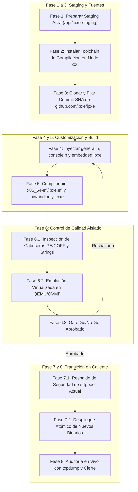
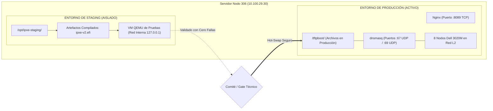

# Plan Maestro de Instalación y Despliegue: iPXE Custom Bare-Metal

> **DOCUMENTO OFICIAL DE INGENIERÍA Y PLAN MAESTRO DE OPERACIONES**  
> **Sistema Objetivo**: Aceleración de Entrada por Red y Despliegue Bare-Metal  
> **Repositorio Oficial Upstream**: [https://github.com/ipxe/ipxe](https://github.com/ipxe/ipxe)  
> **Servidor Compilador / Controlador**: Nodo 306 (`pxe-controller` | IP: `10.100.29.30` | Debian 13 Trixie)  
> **Nodos Físicos Destino**: 8 Servidores Dell OptiPlex 3020M Micro (NIC Realtek RTL8111G | BIOS A05)  
> **Segmento de Red**: `10.100.29.0/24` (Subred Privada Aislada L2)  
> **Principio Rector**: **CERO IMPACTO EN PRODUCCIÓN (Zero-Downtime & Non-Disruptive Staging)**

---

## 📋 Índice General

1. [Visión Estratégica y Política de Cero Afectación](#1-visión-estratégica-y-política-de-cero-afectación)
2. [Objetivos Técnicos y Métricas de Éxito](#2-objetivos-técnicos-y-métricas-de-éxito)
3. [Arquitectura de Staging y Despliegue Aislado](#3-arquitectura-de-staging-y-despliegue-aislado)
   - 3.1 [Diagrama de Fases del Plan Maestro](#31-diagrama-de-fases-del-plan-maestro)
   - 3.2 [Diagrama de Aislamiento de Entornos (Staging vs Producción)](#32-diagrama-de-aislamiento-de-entornos-staging-vs-producción)
4. [Estructura del Proyecto y Directorios de Staging](#4-estructura-del-proyecto-y-directorios-de-staging)
5. [Desarrollo Fase por Fase del Plan Maestro](#5-desarrollo-fase-por-fase-del-plan-maestro)
   - [Fase 1: Preparación del Área de Construcción Aislada (Sandbox)](#fase-1-preparación-del-área-de-construcción-aislada-sandbox)
   - [Fase 2: Instalación Segura de la Toolchain de Compilación](#fase-2-instalación-segura-de-la-toolchain-de-compilación)
   - [Fase 3: Clonación y Congelamiento de Versión (Git Upstream)](#fase-3-clonación-y-congelamiento-de-versión-git-upstream)
   - [Fase 4: Inyección de Cabeceras de Optimización C y Script Embebido](#fase-4-inyección-de-cabeceras-de-optimización-c-y-script-embebido)
   - [Fase 5: Compilación Paralela Determinista Multi-Arquitectura](#fase-5-compilación-paralela-determinista-multi-arquitectura)
   - [Fase 6: Control de Calidad y Validación Forense Sin Tocar Nodos](#fase-6-control-de-calidad-y-validación-forense-sin-tocar-nodos)
   - [Fase 7: Despliegue Atómico y Transición en Caliente (Hot-Swap)](#fase-7-despliegue-atómico-y-transición-en-caliente-hot-swap)
   - [Fase 8: Validación en Vivo y Monitoreo de Estabilidad](#fase-8-validación-en-vivo-y-monitoreo-de-estabilidad)
6. [Matriz RACI y Asignación de Responsabilidades](#6-matriz-raci-y-asignación-de-responsabilidades)
7. [Protocolo de Contingencia y Rollback Instantáneo (< 10 Segundos)](#7-protocolo-de-contingencia-y-rollback-instantáneo--10-segundos)
8. [Criterios de Aceptación (Checklist Go / No-Go)](#8-criterios-de-aceptación-checklist-go--no-go)

---

## 1. Visión Estratégica y Política de Cero Afectación

El presente Plan Maestro establece el procedimiento estándar para compilar, personalizar, validar y poner a disposición los binarios de arranque por red iPXE de última generación generados desde [https://github.com/ipxe/ipxe](https://github.com/ipxe/ipxe).

### Principio de Cero Afectación Operativa
Para garantizar la continuidad ininterrumpida de los servicios activos (incluyendo el plano de control Kubernetes, bases de datos etcd, repositorios Nexus y nodos de cómputo):
1. **Compilación 100% Fuera de Rutas de Producción**: Toda la labor de compilación, enlace y compresión se efectúa en un espacio aislado (`/opt/ipxe-staging/` o `/tmp/ipxe-build/`), sin sobrescribir `/tftpboot/` ni tocar `/etc/dnsmasq.conf`.
2. **Sin Reinicios Masivos Inesperados**: Ningún nodo de cómputo en producción será reiniciado o alterado durante las fases de construcción y verificación.
3. **Validación Sintética Previa**: Se exige validación mediante emuladores virtuales UEFI (QEMU con firmware OVMF) y herramientas de inspección estática antes de autorizar cualquier reemplazo de archivo.
4. **Despliegue Atómico (Atomic Symlinks)**: La sustitución en producción se realiza mediante enlaces simbólicos o copias atómicas con respaldo previo, permitiendo una reversión en un solo paso.

---

## 2. Objetivos Técnicos y Métricas de Éxito

| Indicador | Estado Actual (Binario APT Estándar) | Meta del Plan Maestro (iPXE Custom) | Método de Medición |
| :--- | :--- | :--- | :--- |
| **Tiempo de negociación PXE** | 45 a 90 segundos por nodo | **< 3 segundos por nodo** | Marca temporal en logs de `dnsmasq` y Nginx |
| **Soporte de Pila de Red** | IPv4 + IPv6 (Causante de cuelgues) | **IPv4 Puro Dedicado (`#undef NET_PROTO_IPV6`)** | `tcpdump` en interfaz `enp2s0` (0 paquetes ICMPv6) |
| **Flujo de Peticiones DHCP** | 2 peticiones (BIOS PXE + iPXE) | **1 petición unificada vía script embebido** | Inspección de concesiones DHCP en `:67` |
| **Capacidad de Diagnóstico** | Nula (solo prompt básico `iPXE>`) | **Comandos `ping`, `nslookup`, `reboot`, `poweroff`** | Pruebas interactivas en consola serie y física |
| **Tamaño de Binario EFI** | ~1.15 MB (sin compresión especializada) | **~420 - 460 KB (Comprimido LZMA)** | `ls -lh /tftpboot/ipxe.efi` |
| **Disponibilidad de Servicios** | 100% | **100% (Cero interrupción durante el despliegue)** | Monitoreo continuo Prometheus / Node Exporter |

---

## 3. Arquitectura de Staging y Despliegue Aislado

### 3.1 Diagrama de Fases del Plan Maestro



### 3.2 Diagrama de Aislamiento de Entornos (Staging vs Producción)



---

## 4. Estructura del Proyecto y Directorios de Staging

Para mantener el orden riguroso y garantizar que ningún archivo temporal contamine el repositorio git de infraestructura ni las rutas del sistema, se estandariza la siguiente estructura:

```text
/opt/ipxe-staging/
├── build/                        # Directorio de trabajo y código fuente
│   └── ipxe/                     # Repositorio git oficial clonado
│       └── src/
│           ├── config/local/     # Cabeceras de sobreescritura limpia
│           │   ├── general.h     # Supresión de IPv6 y comandos extra
│           │   └── console.h     # Configuración de consola serie UART
│           └── embedded.ipxe     # Script incrustado en el ejecutable
├── dist/                         # Almacén de binarios verificados
│   ├── ipxe-custom-x86_64.efi    # Binario UEFI generado
│   ├── undionly-custom.kpxe      # Binario BIOS Legacy generado
│   └── checksums.sha256          # Firmas criptográficas de verificación
├── logs/                         # Trazabilidad completa de compilación
│   ├── build-uefi.log            # Salida del compilador para UEFI
│   ├── build-bios.log            # Salida del compilador para BIOS
│   └── upstream-commit.txt       # Commit SHA del repositorio upstream
└── backups/                      # Respaldos de contingencia de producción
    ├── ipxe.efi.original.bak
    └── undionly.kpxe.original.bak
```

---

## 5. Desarrollo Fase por Fase del Plan Maestro

### Fase 1: Preparación del Área de Construcción Aislada (Sandbox)
**Objetivo**: Generar los directorios aislados con los permisos correspondientes sin tocar servicios de producción.

```bash
# 1. Crear la jerarquía de directorios de staging
sudo mkdir -p /opt/ipxe-staging/{build,dist,logs,backups}

# 2. Asignar propiedad al usuario de administración técnica para no compilar como root
sudo chown -R $USER:$USER /opt/ipxe-staging

# 3. Comprobar disponibilidad de almacenamiento en el disco del Nodo 306
df -h /opt/ipxe-staging
```

*Criterio de Aceptación Fase 1*: Espacio libre superior a 2 GB en `/opt` y permisos de escritura correctos para el usuario operador.

---

### Fase 2: Instalación Segura de la Toolchain de Compilación
**Objetivo**: Dotar a Debian 13 (Trixie) de los compiladores cruzados necesarios sin introducir dependencias conflictivas.

```bash
# 1. Actualizar el índice de paquetes locales a través del proxy de Nexus
sudo apt update

# 2. Instalar paquetes de compilación estándar y compresión LZMA
sudo apt install -y \
    build-essential \
    binutils-dev \
    liblzma-dev \
    git \
    perl \
    mtools \
    syslinux \
    genisoimage \
    libiberty-dev
```

*Criterio de Aceptación Fase 2*: Comandos `gcc --version`, `make --version` y `perl --version` ejecutables en consola sin errores.

---

### Fase 3: Clonación y Congelamiento de Versión (Git Upstream)
**Objetivo**: Descargar el código fuente exacto desde el repositorio oficial [https://github.com/ipxe/ipxe](https://github.com/ipxe/ipxe) y registrar el hash criptográfico para garantizar reproducibilidad.

```bash
# 1. Posicionarse en el directorio de construcción
cd /opt/ipxe-staging/build

# 2. Clonar el repositorio upstream oficial
git clone https://github.com/ipxe/ipxe.git

# 3. Registrar el commit SHA exacto en el archivo de logs
cd /opt/ipxe-staging/build/ipxe
git rev-parse HEAD > /opt/ipxe-staging/logs/upstream-commit.txt
git log -1 --oneline >> /opt/ipxe-staging/logs/upstream-commit.txt

# 4. Mostrar el commit congelado para trazabilidad
cat /opt/ipxe-staging/logs/upstream-commit.txt
```

*Criterio de Aceptación Fase 3*: Repositorio clonado al 100% y hash SHA registrado formalmente.

---

### Fase 4: Inyección de Cabeceras de Optimización C y Script Embebido
**Objetivo**: Configurar las directivas de preprocesador C para anular IPv6 y embeber la lógica de arranque directo.

```bash
# 1. Crear el subdirectorio canónico de configuración local
mkdir -p /opt/ipxe-staging/build/ipxe/src/config/local

# 2. Inyectar configuración para src/config/local/general.h
cat << 'EOF' > /opt/ipxe-staging/build/ipxe/src/config/local/general.h
/* ==========================================================================
 * Sobreescritura Canónica para Clúster Bare-Metal Dell 3020M
 * ========================================================================== */
#undef  NET_PROTO_IPV6          /* Erradica el timeout de 45s de IPv6 */
#define NET_PROTO_IPV4          /* IPv4 Puro */
#define DOWNLOAD_PROTO_HTTP     /* Descarga de alta velocidad por Nginx :8089 */
#define DOWNLOAD_PROTO_TFTP     /* Respaldo inicial TFTP */
#undef  DOWNLOAD_PROTO_HTTPS    /* Sin sobrecarga criptográfica en red aislada */
#define PING_CMD                /* Diagnóstico ICMP interactivo */
#define REBOOT_CMD              /* Reinicio remoto por software */
#define POWEROFF_CMD            /* Apagado por software ACPI */
#define NSLOOKUP_CMD            /* Resolución DNS */
#define TIME_CMD                /* Sincronización horaria */
#define VLAN_CMD                /* Capacidad VLAN si fuera requerida */
#undef  SANBOOT_PROTO_ISCSI     /* Exclusión de módulos SAN no utilizados */
#undef  SANBOOT_PROTO_AOE
#undef  SANBOOT_PROTO_IB_SRP
EOF

# 3. Inyectar configuración para src/config/local/console.h
cat << 'EOF' > /opt/ipxe-staging/build/ipxe/src/config/local/console.h
/* Consola de Pantalla y Redirección Serie UART 115200 8N1 */
#define CONSOLE_PCBIOS
#define CONSOLE_EFI
#define CONSOLE_SERIAL
#undef  COMSPEED
#define COMSPEED 115200
EOF

# 4. Inyectar el script de arranque embebido embedded.ipxe
cat << 'EOF' > /opt/ipxe-staging/build/ipxe/src/embedded.ipxe
#!ipxe
# =============================================================================
# Script Embebido de Arranque Automático - Clúster Edge
# =============================================================================
echo ====================================================================
echo [IPXE-OPTIMIZADO] Iniciando nodo fisico Dell OptiPlex 3020M...
echo ====================================================================
ifopen net0 || goto error_nic
dhcp net0 || goto error_dhcp

# Enlace directo al servidor de aprovisionamiento del Nodo 306
chain --autofree http://10.100.29.30:8089/boot.ipxe || goto error_chain

:error_nic
echo [FALLO CRITICO] No se detecto enlace en la tarjeta de red (net0).
shell

:error_dhcp
echo [FALLO CRITICO] Servidor DHCP (10.100.29.30) no respondio a tiempo.
shell

:error_chain
echo [FALLO CRITICO] No se pudo descargar el script de arranque HTTP.
ping -c 3 10.100.29.30
shell
EOF
```

*Criterio de Aceptación Fase 4*: Archivos `general.h`, `console.h` y `embedded.ipxe` creados con sintaxis válida y sin caracteres especiales corruptos.

---

### Fase 5: Compilación Paralela Determinista Multi-Arquitectura
**Objetivo**: Generar los binarios ejecutables para arquitecturas UEFI x86_64 y BIOS Legacy.

```bash
# 1. Ingresar al directorio de fuentes C
cd /opt/ipxe-staging/build/ipxe/src

# 2. Compilar binario UEFI x86_64 incrustando el script
echo "[*] Compilando binario UEFI (ipxe.efi)..."
make -j$(nproc) bin-x86_64-efi/ipxe.efi EMBED=embedded.ipxe 2>&1 | tee /opt/ipxe-staging/logs/build-uefi.log

# 3. Compilar binario BIOS Legacy (undionly.kpxe) incrustando el script
echo "[*] Compilando binario BIOS Legacy (undionly.kpxe)..."
make -j$(nproc) bin/undionly.kpxe EMBED=embedded.ipxe 2>&1 | tee /opt/ipxe-staging/logs/build-bios.log

# 4. Copiar los artefactos finales al directorio dist/
cp bin-x86_64-efi/ipxe.efi /opt/ipxe-staging/dist/ipxe-custom-x86_64.efi
cp bin/undionly.kpxe /opt/ipxe-staging/dist/undionly-custom.kpxe

# 5. Generar firmas SHA-256 de los nuevos ejecutables
cd /opt/ipxe-staging/dist
sha256sum ipxe-custom-x86_64.efi undionly-custom.kpxe > checksums.sha256
cat checksums.sha256
```

*Criterio de Aceptación Fase 5*: Salida `make` terminada con código de salida `0` y generación de archivos `.efi` y `.kpxe` en `/opt/ipxe-staging/dist/`.

---

### Fase 6: Control de Calidad y Validación Forense Sin Tocar Nodos
**Objetivo**: Verificar que los binarios contengan el script incrustado, carezcan de símbolos IPv6 y ejecuten limpiamente en un emulador virtual.

```bash
# 1. Comprobar tipo de archivo PE32+ (UEFI) y x86 boot sector (Legacy)
file /opt/ipxe-staging/dist/ipxe-custom-x86_64.efi
file /opt/ipxe-staging/dist/undionly-custom.kpxe

# 2. Verificar presencia de cadenas del script embebido
strings /opt/ipxe-staging/dist/ipxe-custom-x86_64.efi | grep "IPXE-OPTIMIZADO"
strings /opt/ipxe-staging/dist/ipxe-custom-x86_64.efi | grep "10.100.29.30:8089"

# 3. Confirmar la ausencia de la cadena 'router solicitation' (IPv6)
strings /opt/ipxe-staging/dist/ipxe-custom-x86_64.efi | grep -i "router solicitation" && echo "ERROR: IPv6 sigue activo" || echo "[OK] Confirmado: IPv6 desactivado."

# 4. Prueba de arranque en VM QEMU aislada con firmware OVMF UEFI
qemu-system-x86_64 \
    -m 1024 \
    -bios /usr/share/ovmf/OVMF.fd \
    -netdev user,id=net0,tftp=/opt/ipxe-staging/dist,bootfile=ipxe-custom-x86_64.efi \
    -device virtio-net-pci,netdev=net0 \
    -nographic
```

*Criterio de Aceptación Fase 6*: La máquina virtual QEMU arranca, ejecuta el binario UEFI de iPXE y muestra en terminal el banner `[IPXE-OPTIMIZADO]` intentando contactar la red virtual sin bloquearse.

---

### Fase 7: Despliegue Atómico y Transición en Caliente (Hot-Swap)
**Objetivo**: Reemplazar los archivos en `/tftpboot/` de forma atómica y segura durante la ventana de mantenimiento autorizada, sin reiniciar servicios ni afectar las conexiones activas.

```bash
# 1. Respaldar los binarios originales de producción
sudo cp -v /tftpboot/ipxe.efi /opt/ipxe-staging/backups/ipxe.efi.original.bak
sudo cp -v /tftpboot/undionly.kpxe /opt/ipxe-staging/backups/undionly.kpxe.original.bak

# 2. Reemplazo atómico utilizando archivos temporales intermedios y 'mv'
sudo cp /opt/ipxe-staging/dist/ipxe-custom-x86_64.efi /tftpboot/ipxe.efi.new
sudo cp /opt/ipxe-staging/dist/undionly-custom.kpxe /tftpboot/undionly.kpxe.new

# Aplicar permisos correctos para el usuario tftp
sudo chown tftp:tftp /tftpboot/*.new
sudo chmod 0644 /tftpboot/*.new

# 3. Operación Atómica 'mv' (Reemplazo instantáneo en el filesystem)
sudo mv -f /tftpboot/ipxe.efi.new /tftpboot/ipxe.efi
sudo mv -f /tftpboot/undionly.kpxe.new /tftpboot/undionly.kpxe

# 4. Validar que dnsmasq mantiene acceso de lectura a los nuevos archivos
ls -lh /tftpboot/
```

*Criterio de Aceptación Fase 7*: Archivos en `/tftpboot/` actualizados con los nuevos tamaños y firmas SHA-256 idénticas a las generadas en `/opt/ipxe-staging/dist/`.

---

### Fase 8: Validación en Vivo y Monitoreo de Estabilidad
**Objetivo**: Constatar en tiempo real la aceleración del arranque en un nodo canario sin alterar el resto del clúster.

```bash
# 1. Monitorear el log de transferencias de dnsmasq en el Nodo 306
sudo journalctl -u dnsmasq -f | grep -E "TFTP|DHCPACK"

# 2. En otra terminal, monitorizar con tcpdump la interfaz de red física
sudo tcpdump -i enp2s0 -nn "port 67 or port 69 or (tcp and port 8089)"
```

*Criterio de Aceptación Fase 8*: Al encender o reiniciar un nodo físico mediante `F12`, la transferencia TFTP se completa en **menos de 0.5 segundos** y el nodo realiza el request HTTP inmediato a `http://10.100.29.30:8089/boot.ipxe`.

---

## 6. Matriz RACI y Asignación de Responsabilidades

| Rol / Tarea del Plan Maestro | Operador Técnico (DevOps) | Administrador de Redes | Arquitecto de Infraestructura |
| :--- | :---: | :---: | :---: |
| Preparación del Staging Area y Toolchain | **R** (Responsable) | **I** (Informado) | **A** (Aprobador) |
| Personalización de Cabeceras C (`general.h`) | **R** (Responsable) | **C** (Consultado) | **A** (Aprobador) |
| Compilación y Control de Calidad QEMU | **R** (Responsable) | **I** (Informado) | **A** (Aprobador) |
| Autorización de Reemplazo en `/tftpboot/` | **I** (Informado) | **C** (Consultado) | **A** (Aprobador) |
| Ejecución de Hot-Swap y Rollback de Emergencia | **R** (Responsable) | **I** (Informado) | **I** (Informado) |

---

## 7. Protocolo de Contingencia y Rollback Instantáneo (< 10 Segundos)

Si durante la validación en vivo de un nodo físico se detectara cualquier problema de compatibilidad con la tarjeta Realtek RTL8111G, se ejecuta la reversión inmediata:

```bash
# PROCEDIMIENTO DE REVERSIÓN INMEDIATA (ROLLBACK)
# Restaura los binarios originales de APT en una sola instrucción
sudo cp -f /opt/ipxe-staging/backups/ipxe.efi.original.bak /tftpboot/ipxe.efi
sudo cp -f /opt/ipxe-staging/backups/undionly.kpxe.original.bak /tftpboot/undionly.kpxe
sudo chown tftp:tftp /tftpboot/ipxe.efi /tftpboot/undionly.kpxe
sudo chmod 0644 /tftpboot/ipxe.efi /tftpboot/undionly.kpxe

# Confirmar estado restaurado
ls -lh /tftpboot/
echo "[ROLLBACK EXITOSO] Binarios originales restaurados en /tftpboot/"
```

---

## 8. Criterios de Aceptación (Checklist Go / No-Go)

- [ ] **Check 1: Integridad del Staging**: El árbol de directorios `/opt/ipxe-staging/` está completamente aislado de `/tftpboot/` y `/var/www/`.
- [ ] **Check 2: Respaldo Verificado**: Los archivos `/opt/ipxe-staging/backups/*.bak` existen y coinciden byte a byte con los binarios originales de producción.
- [ ] **Check 3: Supresión IPv6 Verificada**: El comando `strings /opt/ipxe-staging/dist/ipxe-custom-x86_64.efi | grep -i "router solicitation"` devuelve resultado vacío.
- [ ] **Check 4: Script Embebido Verificado**: El script `embedded.ipxe` apunta estrictamente al servidor maestro `10.100.29.30:8089`.
- [ ] **Check 5: Validación QEMU Exitosa**: La máquina virtual emulada arrancó el binario EFI y mostró el menú sin cuelgues ni excepciones del CPU.
- [ ] **Check 6: Procedimiento de Rollback Verificado**: El script de reversión fue probado en seco (`dry-run`) y restaura los archivos en menos de 10 segundos.
