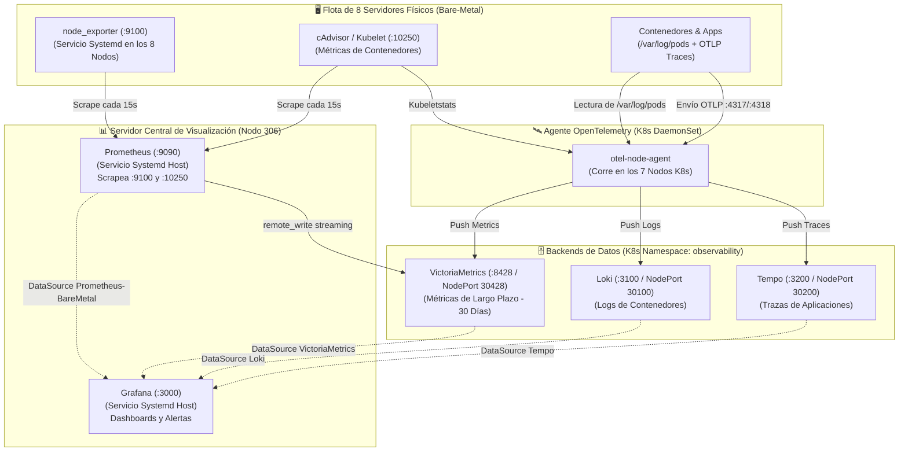

# 🗺️ Mapa Integral de Instalación y Archivos del Stack de Monitoreo
## Dónde está instalado cada componente, qué archivos lo controlan y cómo fluyen los datos

> **Fecha de Actualización:** 26 de Octubre de 2026  
> **Ámbito:** Clúster Bare-Metal de 8 Servidores Físicos Dell OptiPlex (Debian 13) + Kubernetes RKE2

---

## 1. Arquitectura General: ¿Cómo está repartido el Monitoreo?

El sistema de observabilidad tiene una **arquitectura híbrida de 2 niveles**:

1. **Nivel Bare-Metal / Host (Servicios del Sistema en Nodo 306)**:
   * **Prometheus** y **Grafana** corren directamente sobre el sistema operativo base del **Nodo 306** (`pxe-controller`) gestionados por `systemd`.
   * **Node Exporter** corre como servicio `systemd` en **los 8 servidores físicos**.
   * *¿Por qué?* Para que el monitoreo de hardware siga funcionando incluso si Kubernetes o la red de pods están caídos o en mantenimiento.

2. **Nivel Kubernetes (Namespace `observability`)**:
   * **VictoriaMetrics**, **Loki**, **Tempo** y el agente **OpenTelemetry** (`otel-node-agent`) corren como Pods contenerizados dentro de Kubernetes.
   * *¿Por qué?* Aprovechan el almacenamiento persistente (`local-path-provisioner`), balanceo interno de servicios y recolección distribuida de logs y trazas de pods.

---

## 2. Diagrama de Flujo de Datos



---

## 3. Tabla Maestra de Componentes, Archivos y Ubicaciones

A continuación se detalla **en qué archivo del repositorio está el código** y **dónde reside en el servidor**:

| Componente | Tipo de Despliegue | Archivo en Repositorio (Código Fuente) | Archivo en el Servidor (Producción) | Puerto / Endpoint |
| :--- | :--- | :--- | :--- | :--- |
| **Prometheus** | Servicio Systemd (Host) | `ansible/roles/monitoring/templates/prometheus.yml.j2`<br>`ansible/playbooks/40-observability/01_monitoring.yml` | `/etc/prometheus/prometheus.yml`<br>`/etc/systemd/system/prometheus.service` | `http://10.100.29.30:9090`<br>`http://192.168.29.25:9090` |
| **Grafana** | Servicio Systemd (Host) | `kubernetes/observability/grafana/`<br>`ansible/roles/monitoring/` | `/etc/grafana/grafana.ini`<br>`/etc/systemd/system/grafana-server.service` | `http://10.100.29.30:3000`<br>`http://192.168.29.25:3000` |
| **Grafana DataSources** | Configuración YAML | `kubernetes/observability/grafana/datasources/datasources.yaml` | `/etc/grafana/provisioning/datasources/datasources.yaml` | Carga automática en Grafana |
| **Grafana Dashboards** | JSON declarativo | `kubernetes/observability/grafana/dashboards/flota_baremetal_overview.json` | `/etc/grafana/provisioning/dashboards/dashboards.yaml`<br>`/var/lib/grafana/dashboards/*.json` | Auto-recarga cada 10 segundos |
| **OpenTelemetry (Agente)** | K8s DaemonSet | `kubernetes/observability/agents/node_telemetry_agent.yaml` | Objeto K8s `daemonset/otel-node-agent` en namespace `observability` | `:4317` gRPC<br>`:4318` HTTP |
| **VictoriaMetrics** | K8s StatefulSet | `kubernetes/observability/backends/01_backends.yaml` | Objeto K8s `statefulset/victoriametrics` en namespace `observability` | `:8428` (ClusterIP)<br>`:30428` (NodePort) |
| **Loki (Logs)** | K8s StatefulSet | `kubernetes/observability/backends/01_backends.yaml` | Objeto K8s `statefulset/loki` en namespace `observability` | `:3100` (ClusterIP)<br>`:30100` (NodePort) |
| **Tempo (Trazas)** | K8s StatefulSet | `kubernetes/observability/backends/01_backends.yaml` | Objeto K8s `statefulset/tempo` en namespace `observability` | `:3200` (ClusterIP)<br>`:30200` (NodePort) |
| **Node Exporter** | Servicio Systemd (Host) | `ansible/roles/monitoring/tasks/main.yml` | `/etc/systemd/system/node_exporter.service` (en los 8 nodos) | `http://<IP-NODO>:9100/metrics` |
| **Alertas K8s y Host** | Reglas Prometheus | `kubernetes/observability/alerting/rules/alerts_k8s.yaml`<br>`ansible/roles/monitoring/files/alerts_observability.yml` | `/etc/prometheus/alerts_observability.yml` | Evaluadas cada 15 segundos |

---

## 4. Detalle de los Archivos Clave

### A. Dónde se configura Prometheus
* **Archivo de plantilla:** `ansible/roles/monitoring/templates/prometheus.yml.j2`
* **Archivo en el servidor:** `/etc/prometheus/prometheus.yml` (en el Nodo 306).
* **Qué contiene:**
  1. `global`: Intervalos de scraping (`15s`).
  2. `job: baremetal-nodes`: Lista estática de los 8 servidores físicos (`10.100.29.10` a `.112`) en el puerto `:9100`.
  3. `job: kubernetes-cadvisor`: Scraping seguro con token al puerto `:10250` de los 7 nodos K8s.
  4. `job: kubernetes-apiserver`: Métricas del API Server en `:6443`.
  5. `remote_write`: Envía una réplica de todas las métricas en tiempo real a VictoriaMetrics (`http://10.100.29.30:30428/api/v1/write`).

### B. Dónde se configuran los Dashboards de Grafana
* **En el repositorio:** `kubernetes/observability/grafana/dashboards/`
  * `flota_baremetal_overview.json`: Estado físico de los servidores (CPU, RAM, Discos, Almacenamiento Total, Tráfico de Red).
  * `k8s_containers_overview.json`: Consumo por Pods, reinicios y estado de contenedores.
  * `node_exporter_full.json`: Vista profunda del hardware (IOPS de disco, syscalls, interfaces).
  * `observability_stack_k8s.json`: Salud interna de VictoriaMetrics, Loki y Tempo.
* **En el servidor:** `/var/lib/grafana/dashboards/`
* **Mecanismo de auto-actualización:**
  El archivo `/etc/grafana/provisioning/dashboards/dashboards.yaml` le indica a Grafana:
  ```yaml
  apiVersion: 1
  providers:
    - name: 'Flota Bare-Metal'
      folder: 'Flota Bare-Metal'
      type: file
      updateIntervalSeconds: 10
      options:
        path: /var/lib/grafana/dashboards
  ```
  *Cualquier cambio que guardes en el archivo JSON se refleja automáticamente en la pantalla de Grafana a los 10 segundos.*

### C. Dónde está OpenTelemetry (¿Operador o DaemonSet?)
* **Archivo aplicado:** `kubernetes/observability/agents/node_telemetry_agent.yaml`
* **Cómo funciona:**
  * No utiliza el Operador ni requiere `cert-manager`.
  * Se aplica como un `DaemonSet` nativo que levanta exactamente 1 pod por nodo físico (`otel-node-agent-*`).
  * Monta `/var/log/pods` como volumen de solo lectura para extraer los logs en tiempo real y enviarlos a Loki (`:3100`).
  * Realiza consultas a `kubeletstats` (`https://127.0.0.1:10250`) para métricas de contenedores.
  * Expone los puertos estándar OTLP `:4317` (gRPC) y `:4318` (HTTP) para recibir trazas de las aplicaciones.

### D. Dónde están los Backends de Almacenamiento
* **Archivo de despliegue:** `kubernetes/observability/backends/01_backends.yaml`
* **Cómo funciona:**
  * Despliega en Kubernetes el namespace `observability`.
  * Utiliza el StorageClass `local-path` de RKE2:
    * VictoriaMetrics almacena en el nodo con más disco (`worker-05 / .101`).
    * Loki almacena en `worker-02 / .103`.
    * Tempo almacena en `worker-03 / .111`.
  * Expone puertos fijos mediante `NodePort`:
    * VictoriaMetrics: `NodePort 30428`
    * Loki: `NodePort 30100`
    * Tempo: `NodePort 30200`

---

## 5. Guía Práctica: ¿Cómo modificar o agregar una métrica?

Si quieres agregar un nuevo panel a Grafana (por ejemplo, para monitorear una nueva métrica):

### Paso 1: Diseñar la consulta PromQL
Prueba tu consulta en la consola web de Prometheus (`http://192.168.29.25:9090`):
```promql
# Ejemplo: Almacenamiento total de la flota en GB
sum(node_filesystem_size_bytes{job="baremetal-nodes",fstype=~"ext4|xfs|btrfs",mountpoint="/"}) / 1024 / 1024 / 1024
```

### Paso 2: Agregar el panel al archivo JSON
Edita `kubernetes/observability/grafana/dashboards/flota_baremetal_overview.json` y agrega un nuevo objeto panel dentro del arreglo `"panels": [ ... ]`:
```json
{
  "id": 9,
  "title": "Almacenamiento Total Instalado",
  "type": "stat",
  "gridPos": { "h": 4, "w": 4, "x": 16, "y": 1 },
  "datasource": { "type": "prometheus", "uid": "Prometheus-BareMetal" },
  "targets": [
    {
      "expr": "sum(node_filesystem_size_bytes{job=\"baremetal-nodes\",fstype=~\"ext4|xfs|btrfs\",mountpoint=\"/\"})",
      "legendFormat": "Total Disco"
    }
  ],
  "fieldConfig": {
    "defaults": {
      "color": { "fixedColor": "purple", "mode": "fixed" },
      "unit": "bytes"
    }
  }
}
```

### Paso 3: Copiar al servidor
Copia el archivo actualizado a la carpeta provisionada de Grafana en el Nodo 306:
```bash
scp -i ansible/keys/cluster_key \
  kubernetes/observability/grafana/dashboards/flota_baremetal_overview.json \
  n306@192.168.29.25:/tmp/flota_baremetal_overview.json

ssh -i ansible/keys/cluster_key n306@192.168.29.25 \
  "sudo cp /tmp/flota_baremetal_overview.json /var/lib/grafana/dashboards/flota_baremetal_overview.json && sudo chown grafana:grafana /var/lib/grafana/dashboards/flota_baremetal_overview.json"
```
*En 10 segundos el panel aparecerá automáticamente en Grafana.*

---

## 6. Comandos de Verificación Rápida

| Qué quieres verificar | Comando exacto |
| :--- | :--- |
| **Salud de Prometheus** | `curl -s http://192.168.29.25:9090/-/ready` |
| **Targets activos de Prometheus** | `curl -s http://192.168.29.25:9090/api/v1/targets \| jq '.data.activeTargets[].labels.instance'` |
| **Salud de Grafana** | `curl -s http://192.168.29.25:3000/api/health` |
| **Pods de observabilidad en K8s** | `kubectl get pods -n observability -o wide` |
| **Logs de un agente OTel** | `kubectl logs -n observability -l app=otel-node-agent --tail=20` |
| **Salud de VictoriaMetrics** | `curl -s http://10.100.29.30:30428/health` |
| **Abrir túneles hacia tu Laptop** | `./scripts/client/tunnels.sh` |
