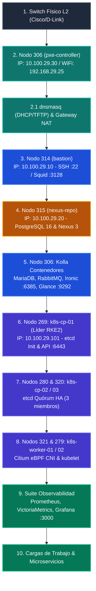
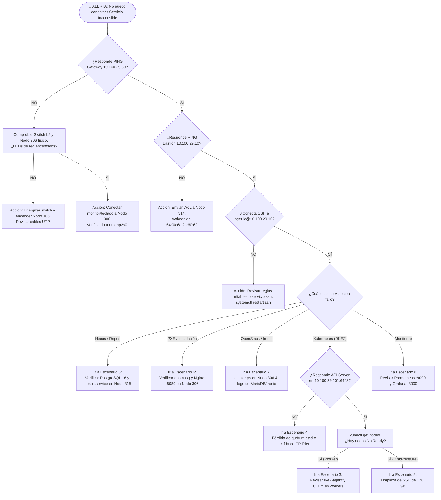

# Manual de Recuperación y Rearranque de Infraestructura (SRE Runbook)

> **Flota Física**: 8 Servidores Dell OptiPlex 3020M (Debian 13 Trixie, 128 GB SSD)  
> **Red**: Subred aislada `10.100.29.0/24` | Gateway: `10.100.29.30` | VIP OpenStack: `10.100.29.5`  
> **Nivel de Criticidad**: Tier 1 (Producción / Bare-Metal Edge)  
> **Última Actualización**: Octubre 2026 | **Autor**: Staff SRE Team  

---

## 📋 Índice General

- [0. Tarjeta Rápida (Runsheet 3 a.m.): Apagón Total en 10 Pasos](#0-tarjeta-rápida-runsheet-3-am-apagón-total-en-10-pasos)
- [1. Capítulos Transversales de Arquitectura Operativa](#1-capítulos-transversales-de-arquitectura-operativa)
  - [1.1. Orden de Arranque Global Justificado (Secuencia y Dependencias Técnicas)](#11-orden-de-arranque-global-justificado-secuencia-y-dependencias-técnicas)
  - [1.2. Diagrama del Orden de Arranque](#12-diagrama-del-orden-de-arranque)
  - [1.3. Matriz de Dependencias de Servicios](#13-matriz-de-dependencias-de-servicios)
  - [1.4. Tabla Canónica de Puertos, Interfaces y Servicios Críticos](#14-tabla-canónica-de-puertos-interfaces-y-servicios-críticos)
  - [1.5. Árbol de Decisión de Diagnóstico de Incidentes](#15-árbol-de-decisión-de-diagnóstico-de-incidentes)
  - [1.6. Checklist de Verificación Post-Arranque por Capas](#16-checklist-de-verificación-post-arranque-por-capas)
  - [1.7. Matriz de Errores Comunes, Causas Raíz y Solución Inmediata](#17-matriz-de-errores-comunes-causas-raíz-y-solución-inmediata)
  - [1.8. Directorio de Contactos y Escalamiento Técnico](#18-directorio-de-contactos-y-escalamiento-técnico)
- [2. Escenarios Operativos de Caída y Recuperación](#2-escenarios-operativos-de-caída-y-recuperación)
  - [Escenario 1: Apagón Total del Laboratorio (Blackout de los 8 Nodos)](#escenario-1-apagón-total-del-laboratorio)
  - [Escenario 2: Caída Aislada del Bastión (Nodo 314)](#escenario-2-caída-aislada-del-bastión)
  - [Escenario 3: Caída de un Nodo Worker de Kubernetes (Nodo 321 / 279)](#escenario-3-caída-de-un-nodo-worker)
  - [Escenario 4: Caída de Control-Plane y Pérdida de Quórum etcd](#escenario-4-caída-de-control-plane-y-pérdida-de-quórum-etcd)
  - [Escenario 5: Nexus no Responde o PostgreSQL Corrupto (Nodo 315)](#escenario-5-nexus-no-responde-o-postgresql-corrupto)
  - [Escenario 6: Fallo en Cadena PXE/dnsmasq/HTTPBoot (Nodo 306)](#escenario-6-fallo-en-cadena-pxednsmasqhttpboot)
  - [Escenario 7: Servicios OpenStack Ironic/Glance Caídos tras Reinicio](#escenario-7-servicios-openstack-ironicglance-caídos)
  - [Escenario 8: Stack de Observabilidad Caído](#escenario-8-stack-de-observabilidad-caído)
  - [Escenario 9: Saturación Crítica de Disco (Límite 128 GB SSD)](#escenario-9-saturación-crítica-de-disco)
  - [Escenario 10: Partición de Red o Fallo en Puerto de Switch](#escenario-10-partición-de-red-o-fallo-en-puerto-de-switch)
  - [Escenario 11: Restauración Integral de Desastre desde Backup](#escenario-11-restauración-integral-de-desastre-desde-backup)
- [3. Matriz de Brechas y Mejoras Detectadas](#3-matriz-de-brechas-y-mejoras-detectadas)

---

# 0. Tarjeta Rápida (Runsheet 3 a.m.): Apagón Total en 10 Pasos

> [!CRITICAL]
> **OBJETIVO**: Devolver la flota de 8 nodos y todas las cargas de trabajo a estado `HEALTHY` en menos de **25 minutos**. Siga la secuencia estrictamente. No invierta el orden de los pasos.

| Paso | Capa | Acción Operativa | Host Ejecución | Comando Exacto | Criterio de Éxito |
| :---: | :--- | :--- | :--- | :--- | :--- |
| **1** | **Eléctrica/L2** | Encender switch físico de laboratorio y verificar luces de enlace. | Físico | Inspección visual de LEDs frontales | Todos los puertos activos en verde (1 Gbps) |
| **2** | **Acceso/PXE** | Encender Nodo 306 (`pxe-controller`). Punto de enlace WiFi/LAN. | Físico / Botón | Pulsar botón frontal Dell OptiPlex | Ping responde en `192.168.29.25` y `10.100.29.30` |
| **3** | **Enrutamiento** | Levantar servicios base de red en Nodo 306 (DHCP, TFTP, Gateway). | `# en: pxe-controller` | `sudo systemctl restart dnsmasq nginx` | `systemctl is-active dnsmasq nginx` -> `active` |
| **4** | **Bastión** | Encender Nodo 314 (`bastion`) vía WoL o botón y validar SSH. | `# en: pxe-controller` | `wakeonlan 64:00:6a:2a:60:62 && sleep 20` | `ssh -o ConnectTimeout=3 aget-ic@10.100.29.10 "uptime"` |
| **5** | **Repositorios** | Encender Nodo 315 (`nexus-repo`) y arrancar PostgreSQL + Nexus. | `# en: pxe-controller` | `wakeonlan 64:00:6a:2a:5f:99 && sleep 30` | `curl -sI http://10.100.29.20:8081 \| head -n 1` -> `HTTP/1.1 200` |
| **6** | **OpenStack** | Reactivar contenedores Kolla-Ansible en Nodo 306. | `# en: pxe-controller` | `sudo docker start $(sudo docker ps -a -q)` | `sudo docker ps --filter "status=running" \| wc -l` >= 9 |
| **7** | **K8s Leader** | Encender Nodo 269 (`k8s-cp-01`) y validar líder de etcd. | `# en: pxe-controller` | `wakeonlan 64:00:6a:2a:5f:f9 && sleep 45` | `ssh debian@10.100.29.101 "sudo systemctl is-active rke2-server"` -> `active` |
| **8** | **K8s CP HA** | Encender Nodos 280 y 320 (`k8s-cp-02` y `k8s-cp-03`). | `# en: pxe-controller` | `wakeonlan 64:00:6a:2a:60:63 && wakeonlan 64:00:6a:2a:2c:75` | `ssh debian@10.100.29.101 "sudo /var/lib/rancher/rke2/bin/kubectl --kubeconfig /etc/rancher/rke2/rke2.yaml get nodes"` -> 3 CP `Ready` |
| **9** | **K8s Workers**| Encender Nodos 321 y 279 (`k8s-worker-01` y `02`). | `# en: pxe-controller` | `wakeonlan 64:00:6a:2a:62:a4 && wakeonlan 64:00:6a:2a:2f:cb` | Total 5 nodos en clúster K8s en estado `Ready` |
| **10**| **Validación** | Ejecutar diagnóstico global de salud y abrir túneles. | `# en: laptop` | `make health` (o `./scripts/diagnostics/healthcheck.sh`) | 14/14 comprobaciones en verde (`HEALTHY`) |

---

# 1. Capítulos Transversales de Arquitectura Operativa

## 1.1. Orden de Arranque Global Justificado (Secuencia y Dependencias Técnicas)

El orden de encendido y arranque de servicios responde a una cadena estricta de dependencias de infraestructura:

```
[Switch Físico L2] 
       ↓
[Nodo 306: Gateway L3 + DHCP dnsmasq] 
       ↓
[Nodo 314: Bastión SSH + Squid] 
       ↓
[Nodo 315: PostgreSQL 16 + Nexus 3 OSS] 
       ↓
[Nodo 306: Kolla-Ansible (MariaDB → RabbitMQ → Ironic/Glance)] 
       ↓
[Nodo 269: K8s RKE2 Leader (etcd init)] 
       ↓
[Nodos 280 y 320: K8s Control Plane 02 y 03 (etcd join)] 
       ↓
[Nodos 321 y 279: K8s Workers (Cilium eBPF agent)] 
       ↓
[Suite de Observabilidad (Prometheus, VictoriaMetrics, Grafana)] 
       ↓
[Cargas de Trabajo / Microservicios]
```

### Justificación Técnica de la Secuencia:
1. **Switch L2**: Sin plano de enlace Ethernet activo, el broadcast de red, la negociación de velocidad (1 Gbps) y los paquetes mágicos Wake-on-LAN (WoL) son descartados.
2. **Nodo 306 (Gateway L3 + dnsmasq)**: Actúa como router de salida hacia la red corporativa y provee las reservas estáticas de IP por MAC mediante dnsmasq. Si un nodo arranca sin dnsmasq en línea, solicitará DHCP indefinidamente o tomará una IP fuera de rango.
3. **Nodo 314 (Bastión SSH + Squid)**: Establece el perímetro de seguridad. Los demás nodos y la orquestación de Ansible requieren conectarse mediante ProxyJump (`aget-ic@10.100.29.10`) y enviar tráfico saliente a través del proxy Squid (`:3128`).
4. **Nodo 315 (Nexus 3 + PostgreSQL)**: Los nodos de Kubernetes (RKE2) y OpenStack están configurados de forma inmutable para consumir binarios, paquetes APT e imágenes de contenedor (`10.100.29.20:8082` / `:8083`). Si se arrancan los nodos de cómputo sin Nexus, los pods entrarán en `ImagePullBackOff` y fallarán las dependencias de arranque.
5. **OpenStack Ironic Standalone (Kolla en Nodo 306)**: Provee control sobre el hardware bare-metal e inspección de estado de energía. Requiere que MariaDB y RabbitMQ estén estables antes de responder peticiones en el puerto `6385`.
6. **RKE2 Leader (Nodo 269)**: El nodo líder inicializa el cluster etcd embebido (`:2379` / `:2380`) y el API Server (`:6443`). Si los nodos secundarios (280 y 320) arrancan en simultáneo sin el líder listo, no podrán unirse (`etcd cluster join failed`).
7. **RKE2 Secondary CPs (Nodos 280 y 320)**: Establecen el quórum de 3 miembros de etcd tolerante a la caída de 1 nodo.
8. **RKE2 Workers (Nodos 321 y 279)**: Se registran en el API Server y Cilium compila los programas eBPF en el kernel de Debian 13 para la red de pods.
9. **Observabilidad y Aplicaciones**: Se reactivan al final una vez que el clúster dispone de cómputo y red estables para no saturar los discos SSD de 128 GB durante el arranque.

---

## 1.2. Diagrama del Orden de Arranque



---

## 1.3. Matriz de Dependencias de Servicios

| Servicio | Nodo Anfitrión | Depende Directamente De | Comando de Verificación |
| :--- | :--- | :--- | :--- |
| **dnsmasq** | `nodo-306` (pxe-controller) | Switch L2, Interfaz `enp2s0` UP | `sudo systemctl status dnsmasq` |
| **nftables (NAT)** | `nodo-306` (pxe-controller) | Kernel routing `net.ipv4.ip_forward=1` | `sudo nft list table ip nat` |
| **Squid Proxy** | `nodo-314` (bastion) | Enlace WAN y Gateway `10.100.29.30` | `curl -x http://10.100.29.10:3128 -I http://deb.debian.org` |
| **PostgreSQL 16** | `nodo-315` (nexus-repo) | Disco `/var/lib/postgresql` montado | `sudo -u postgres pg_isready -p 5432` |
| **Nexus 3 OSS** | `nodo-315` (nexus-repo) | PostgreSQL 16 activo, JVM Heap 4 GB | `curl -sI http://10.100.29.20:8081/service/rest/v1/status` |
| **MariaDB Kolla** | `nodo-306` (pxe-controller) | Docker daemon, almacenamiento local | `sudo docker exec mariadb mysqladmin ping -u root` |
| **Ironic API** | `nodo-306` (pxe-controller) | MariaDB, RabbitMQ, VIP `10.100.29.5` | `curl -sI http://10.100.29.5:6385/v1` |
| **RKE2 Leader** | `nodo-269` (k8s-cp-01) | Nexus Docker Registry (`:8082`), Gateway | `sudo systemctl status rke2-server` |
| **RKE2 Joiners**| `nodo-280`, `nodo-320` | RKE2 Leader `:9345` y `:6443` | `/var/lib/rancher/rke2/bin/crictl info` |
| **Cilium eBPF** | Todos los nodos K8s | Kernel Linux 6.12+ con soporte eBPF | `cilium status --wait` (o pods en kube-system) |
| **Prometheus** | `nodo-306` / K8s | Node Exporters (`:9100`) en cada nodo | `curl -s http://10.100.29.30:9090/-/ready` |
| **Grafana** | `nodo-306` | Prometheus / VictoriaMetrics `:8428` | `curl -sI http://10.100.29.30:3000/api/health` |

---

## 1.4. Tabla Canónica de Puertos, Interfaces y Servicios Críticos

| Puerto | Protocolo | Servicio | Host | Interfaz | Propósito Operativo |
| :---: | :---: | :--- | :--- | :--- | :--- |
| **22** | TCP | SSH Server | Todos los nodos | `enp2s0` | Administración remota vía clave Ed25519 |
| **69** | UDP | TFTP (dnsmasq) | `10.100.29.30` | `enp2s0` | Transferencia de binarios iPXE (`undionly.kpxe`, `ipxe.efi`) |
| **53** | UDP/TCP | DNS (dnsmasq) | `10.100.29.30` | `enp2s0` | Resolución DNS local (`lab.local`) |
| **67/68** | UDP | DHCP Server | `10.100.29.30` | `enp2s0` | Concesión estática de IPs por dirección MAC |
| **3128** | TCP | Squid Proxy | `10.100.29.10` | `enp2s0` | Proxy HTTP/HTTPS para salida a Internet controlada |
| **5432** | TCP | PostgreSQL 16 | `10.100.29.20` | `enp2s0` | Base de datos relacional para metadatos de Nexus 3 |
| **8081** | TCP | Nexus 3 Web/APT| `10.100.29.20` | `enp2s0` | Consola web y mirror de repositorios Debian APT |
| **8082** | TCP | Nexus Docker Grp| `10.100.29.20` | `enp2s0` | Endpoint de descarga (Pull) de imágenes de contenedor |
| **8083** | TCP | Nexus Docker Hst| `10.100.29.20` | `enp2s0` | Endpoint de subida (Push) de imágenes de contenedor |
| **8089** | TCP | Nginx HTTPBoot | `10.100.29.30` | `enp2s0` | Descarga acelerada HTTP de Kernel, initrd e imágenes QCOW2 |
| **6385** | TCP | Ironic API | `10.100.29.5` | `enp2s0` (VIP) | API de aprovisionamiento bare-metal OpenStack |
| **9292** | TCP | Glance API | `10.100.29.5` | `enp2s0` (VIP) | Catálogo y streaming de imágenes del sistema operativo |
| **6443** | TCP | K8s API Server | `10.100.29.101-103`| `enp2s0` | API principal de Kubernetes (RKE2) |
| **9345** | TCP | RKE2 Supervisor| `10.100.29.101-103`| `enp2s0` | Registro y sincronización de nodos control-plane |
| **2379/80**| TCP | etcd Client/Peer| `10.100.29.101-103`| `enp2s0` | Base distribuida de estado del clúster K8s |
| **9100** | TCP | Node Exporter | Todos los nodos | `enp2s0` | Métricas de sistema operativo (CPU, RAM, Disco, Red) |
| **9090** | TCP | Prometheus | `10.100.29.30` | `enp2s0` | Servidor TSDB de recolección y alertas |
| **3000** | TCP | Grafana | `10.100.29.30` | `enp2s0` | Paneles de visualización y monitoreo unificado |

---

## 1.5. Árbol de Decisión de Diagnóstico de Incidentes



---

## 1.6. Checklist de Verificación Post-Arranque por Capas

Ejecute estas comprobaciones desde la estación de trabajo (Laptop) o desde el Bastión:

### Capa 1: Conectividad y Red Física (ICMP)
```bash
# en: laptop (o bastión)
for ip in 10.100.29.10 10.100.29.20 10.100.29.30 10.100.29.101 10.100.29.102 10.100.29.103 10.100.29.111 10.100.29.112; do
  if ping -c 1 -W 1 $ip >/dev/null 2>&1; then
    echo -e "[\033[0;32mONLINE\033[0m] Nodo IP: $ip"
  else
    echo -e "[\033[0;31mOFFLINE\033[0m] Nodo IP: $ip"
  fi
done
```
*Resultado esperado*: Los 8 nodos físicos reportan `ONLINE`.

### Capa 2: Servicios Base del Bastión y Salida a Internet
```bash
# en: bastión (nodo-314)
systemctl is-active ssh squid chrony nftables
curl -s -x http://10.100.29.10:3128 -I http://deb.debian.org | head -n 1
```
*Resultado esperado*: Todos los servicios en `active` y retorno `HTTP/1.1 200 OK`.

### Capa 3: Repositorio Nexus y Base PostgreSQL
```bash
# en: pxe-controller (nodo-306)
curl -sI http://10.100.29.20:8081/service/rest/v1/status | head -n 1
curl -sI http://10.100.29.20:8082/v2/ | head -n 1
```
*Resultado esperado*: `HTTP/1.1 200 OK` en puerto 8081 y `HTTP/1.1 401 Unauthorized` (solicitando auth) en 8082.

### Capa 4: OpenStack Ironic Standalone
```bash
# en: pxe-controller (nodo-306)
sudo docker exec kolla_toolbox openstack --os-auth-url http://10.100.29.5:5000/v3 \
  --os-project-name admin --os-username admin --os-password $(cat /etc/kolla/passwords.yml | grep keystone_admin_password | awk '{print $2}') \
  baremetal node list
```
*Resultado esperado*: Listado de nodos aprovisionables en estado `available` o `active`.

### Capa 5: Clúster Kubernetes RKE2 y Cilium eBPF
```bash
# en: k8s-cp-01 (nodo-269)
sudo /var/lib/rancher/rke2/bin/kubectl --kubeconfig /etc/rancher/rke2/rke2.yaml get nodes -o wide
sudo /var/lib/rancher/rke2/bin/kubectl --kubeconfig /etc/rancher/rke2/rke2.yaml get pods -A | grep -v -E 'Running|Completed'
```
*Resultado esperado*: 8 nodos (o los 5 nodos K8s: 3 CP + 2 Workers) en estado `Ready`, y ningún pod en error o crashloop.

### Capa 6: Suite de Observabilidad
```bash
# en: pxe-controller (nodo-306)
curl -s http://localhost:9090/-/ready
curl -s http://localhost:3000/api/health
```
*Resultado esperado*: `Prometheus is Ready.` y `{"commit":"...","database":"ok","version":"..."}`.

---

## 1.7. Matriz de Errores Comunes, Causas Raíz y Solución Inmediata

| Síntoma de Error | Causa Raíz Probable | Solución Operativa Inmediata |
| :--- | :--- | :--- |
| `etcd cluster join failed: context deadline exceeded` | El nodo líder (`10.100.29.101`) aún no ha iniciado etcd o el puerto `2380` está filtrado. | En `nodo-269`: `sudo systemctl restart rke2-server`. Esperar 60 segundos antes de reiniciar los secundarios. |
| `ImagePullBackOff` o `x509: certificate signed by unknown authority` | El registro local Nexus (`:8082`) está caído o `registries.yaml` de containerd no lo tiene configurado como `http`. | En `nodo-315`: `sudo systemctl restart nexus`. En el nodo K8s: verificar `/etc/rancher/rke2/registries.yaml`. |
| `No space left on device` durante despliegue de pods | Disco SSD de 128 GB saturado por logs de containerd o imágenes sin usar. | Ejecutar limpieza inmediata: `sudo crictl rmi --prune` y vaciar journals: `sudo journalctl --vacuum-size=500M`. |
| Nodo en bucle PXE reiniciando continuamente | dnsmasq no detecta lease estático o la imagen IPA no responde en TFTP. | En `nodo-306`: `sudo systemctl restart dnsmasq`. Verificar que la MAC esté en `/etc/dnsmasq.d/nodes.conf`. |
| `ERROR: Kolla MariaDB cluster lost quorum` tras apagón | MariaDB apagado abruptamente con marcas de transacción desalineadas. | En `nodo-306`: regenerar bootstrap ejecutando `sudo docker start mariadb` con `wsrep_cluster_bootstrap` en su config. |
| `nftables: Connection refused on port 3128` | El servicio Squid se cayó o la interfaz WAN perdió su dirección IP. | En `nodo-314`: `sudo systemctl restart squid` y verificar con `ip a show enp2s0`. |
| `ssh: connect to host 10.100.29.X port 22: No route to host` | Fallo de enlace ARP o enrutamiento L3 en el Gateway (`10.100.29.30`). | En `nodo-306`: verificar `ip route` e `ip nei`. Asegurar `sysctl net.ipv4.ip_forward=1`. |

---

## 1.8. Directorio de Contactos y Escalamiento Técnico

Utilice esta plantilla para documentar al personal responsable durante guardias y emergencias operativas:

| Rol de Guardia | Nombre / Identificador | Canal Primario | Canal Secundario | Nivel de Escalamiento |
| :--- | :--- | :--- | :--- | :--- |
| **SRE Primario (On-Call)** | `[NOMBRE_DE_GUARDIA]` | Tel / Slack: `@sre-oncall` | Correo de Emergencia | Nivel 1 (0 a 15 min) |
| **SRE Secundario / Backup** | `[NOMBRE_BACKUP]` | Tel / Slack: `@sre-lead` | Correo de Emergencia | Nivel 2 (15 a 30 min) |
| **Administrador de Redes** | `[RESPONSABLE_RED]` | Tel: `+XX-XXXXXXXX` | Slack: `@netops` | Nivel 2 (Fallo L2/Switch) |
| **Administrador de Datacenter** | `[SOPORTE_SITIO]` | Tel Presencial | Acceso Rack Físico | Nivel 3 (Fallo Hardware/UPS) |
| **Lead Architect / DevOps** | `[TECH_LEAD]` | Tel / Slack: `@techlead` | Celular directo | Nivel 3 (Decisión DR) |

---

# 2. Escenarios Operativos de Caída y Recuperación

## Escenario 1: Apagón Total del Laboratorio (Blackout de los 8 Nodos)

- **Síntomas**: 
  - Todos los hosts inaccesibles vía SSH y ping.
  - Alertas masivas de `InstanceDown` en Prometheus (si la estación de alerta externa está activa).
  - Túneles SSH desconectados y dashboards de Grafana/Horizon inalcanzables.
- **Impacto**: 
  - Caída del 100% de los servicios: Kubernetes HA, OpenStack Ironic, Nexus 3, base de datos y observabilidad.
- **Prerrequisitos**: 
  - Acceso físico al rack de servidores Dell OptiPlex 3020M o laptop conectada al switch/WiFi de gestión (`192.168.29.0/24`).
  - Llave SSH privada `id_ed25519`.

### Pasos de Recuperación:

#### Paso 1: Restablecimiento Eléctrico y Enlace Físico L2
Inspeccionar físicamente el switch Ethernet del clúster y la regleta de alimentación eléctrica (PDU/UPS).
```bash
# en: físico / consola local
# Comprobar que el switch enciende y que los LEDs de los puertos 1 al 8 parpadean en verde.
```
- *Resultado Esperado*: Enlaces Ethernet a 1 Gbps activos.
- *Si Falla*: Verificar cable de poder de la PDU o reemplazar el cable de enlace maestro.

#### Paso 2: Encendido y Arranque del Nodo 306 (Controlador de Red y PXE)
Pulsar el botón de encendido frontal del chasis Dell OptiPlex del Nodo 306 (`pxe-controller`).
```bash
# en: laptop (vía red WiFi de gestión)
ping -c 3 192.168.29.25
ssh -i ~/.ssh/id_ed25519 n306@192.168.29.25 "ip a show enp2s0"
```
- *Resultado Esperado*: El nodo responde por WiFi y la interfaz Ethernet privada `enp2s0` tiene asignada la IP `10.100.29.30/24`.
- *Si Falla*: Si no levanta la interfaz, ejecutar en consola local: `sudo ip link set enp2s0 up && sudo ip addr add 10.100.29.30/24 dev enp2s0`.

#### Paso 3: Reactivación de Enrutamiento y DHCP/TFTP (dnsmasq)
Asegurar que el enrutamiento IP de salida y el servicio de nombres estén operativos.
```bash
# en: pxe-controller (nodo-306)
sudo sysctl -w net.ipv4.ip_forward=1
sudo systemctl restart dnsmasq nginx
sudo systemctl is-active dnsmasq nginx
```
- *Resultado Esperado*: Ambos servicios en estado `active`.
- *Si Falla*: Verificar colisión de puertos en el log: `sudo journalctl -u dnsmasq -n 30 --no-pager`.

#### Paso 4: Encendido y Validación del Bastión (Nodo 314)
Enviar paquete Wake-on-LAN al Bastión y verificar conectividad SSH.
```bash
# en: pxe-controller (nodo-306)
wakeonlan 64:00:6a:2a:60:62
sleep 25
ssh -o StrictHostKeyChecking=no aget-ic@10.100.29.10 "sudo systemctl restart squid && sudo systemctl is-active ssh squid"
```
- *Resultado Esperado*: Salida `active` para ambos servicios.
- *Si Falla*: Pulsar manualmente el botón de encendido del chasis del Nodo 314.

#### Paso 5: Encendido de Nexus y Arranque de PostgreSQL (Nodo 315)
Encender el servidor de paquetes para que los contenedores puedan resolver dependencias.
```bash
# en: pxe-controller (nodo-306)
wakeonlan 64:00:6a:2a:5f:99
sleep 30
ssh -o StrictHostKeyChecking=no io@10.100.29.20 "sudo systemctl start postgresql && sudo systemctl start nexus"
# Esperar 45 segundos para calentamiento de JVM:
sleep 45
curl -sI http://10.100.29.20:8081/service/rest/v1/status | head -n 1
```
- *Resultado Esperado*: Retorno `HTTP/1.1 200 OK`.
- *Si Falla*: Verificar si PostgreSQL inició correctamente: `ssh io@10.100.29.20 "sudo systemctl status postgresql"`.

#### Paso 6: Reactivación del Stack OpenStack Kolla-Ansible
Reactivar los contenedores de control en el Nodo 306.
```bash
# en: pxe-controller (nodo-306)
sudo docker start $(sudo docker ps -a -q)
sleep 15
sudo docker ps --format "table {{.Names}}\t{{.Status}}"
```
- *Resultado Esperado*: Contenedores `mariadb`, `rabbitmq`, `ironic_api`, `ironic_conductor`, `glance_api` y `kolla_toolbox` en estado `Up`.
- *Si Falla*: Si MariaDB reporta error de quórum WSREP, ejecutar recovery: `sudo docker exec mariadb wsrep_recover` o arrancar con `--wsrep-new-cluster`.

#### Paso 7: Encendido Secuencial de Kubernetes RKE2 (Líder + CPs)
Encender primero el líder (`k8s-cp-01`, Nodo 269) para restaurar el cluster etcd.
```bash
# en: pxe-controller (nodo-306)
# 7.1 Encender líder:
wakeonlan 64:00:6a:2a:5f:f9
sleep 40
ssh debian@10.100.29.101 "sudo systemctl start rke2-server"
sleep 20

# 7.2 Encender secundarios (Nodos 280 y 320):
wakeonlan 64:00:6a:2a:60:63
wakeonlan 64:00:6a:2a:2c:75
sleep 40
ssh debian@10.100.29.102 "sudo systemctl start rke2-server"
ssh debian@10.100.29.103 "sudo systemctl start rke2-server"
```
- *Resultado Esperado*: Los 3 nodos de control reportan `Ready` en `kubectl get nodes`.
- *Si Falla*: Ver [Escenario 4](#escenario-4-caída-de-control-plane-y-pérdida-de-quórum-etcd).

#### Paso 8: Encendido de Workers y CNI Cilium eBPF
Encender los nodos de cómputo (Nodos 321 y 279).
```bash
# en: pxe-controller (nodo-306)
wakeonlan 64:00:6a:2a:62:a4
wakeonlan 64:00:6a:2a:2f:cb
sleep 40
ssh debian@10.100.29.111 "sudo systemctl start rke2-agent"
ssh debian@10.100.29.112 "sudo systemctl start rke2-agent"
```
- *Resultado Esperado*: Clúster K8s completo con 5 nodos operativos.

#### Paso 9: Reactivación de la Pila de Observabilidad
Reiniciar los servicios de métricas en el host central.
```bash
# en: pxe-controller (nodo-306)
sudo systemctl restart prometheus grafana-server
sudo systemctl is-active prometheus grafana-server
```
- *Resultado Esperado*: Ambos servicios en `active`.

#### Paso 10: Validación Integral de la Flota
Ejecutar el diagnóstico global para certificar la salud de la infraestructura.
```bash
# en: laptop (o bastión)
make health
```
- *Resultado Esperado*: Tabla de auditoría en consola mostrando 8/8 nodos en verde y servicios clave con estado `OK`.

- **Verificación Final**:
  ```bash
  # en: k8s-cp-01 (nodo-269)
  sudo /var/lib/rancher/rke2/bin/kubectl --kubeconfig /etc/rancher/rke2/rke2.yaml get nodes -o wide
  ```
- **Rollback / Escalamiento**: Si algún nodo no enciende tras 2 intentos de WoL, acudir presencialmente al rack para encendido manual. Si un SSD se corrompió tras el corte eléctrico, aislar el nodo y consultar [Escenario 11](#escenario-11-restauración-integral-de-desastre-desde-backup).
- **Tiempo Estimado**: 18 a 25 minutos.

---

## Escenario 2: Caída Aislada del Bastión (Nodo 314)

- **Síntomas**:
  - Imposibilidad de conectar por SSH a los nodos del clúster mediante ProxyJump (`aget-ic@10.100.29.10`).
  - Bloqueo en descargas HTTP/HTTPS hacia Internet desde los demás nodos (Squid `:3128` no responde).
  - Ping a `10.100.29.10` devuelve `Destination Host Unreachable` o `Request timed out`.
- **Impacto**:
  - Pérdida del acceso de administración remoto desde la red corporativa/oficina.
  - La red interna del clúster (`10.100.29.0/24`) y las aplicaciones en ejecución **continúan funcionando** con normalidad.
- **Prerrequisitos**:
  - Acceso directo vía WiFi o red de contingencia hacia el Nodo 306 (`192.168.29.25`, usuario `n306`).
  - Clave SSH privada local.

### Pasos de Recuperación:

#### Paso 1: Ingreso por Canal de Respaldo (Nodo 306)
Conectar directamente al Nodo 306 a través de su interfaz WiFi/Auxiliar para evitar el Bastión caído.
```bash
# en: laptop
ssh -i ~/.ssh/id_ed25519 n306@192.168.29.25
```
- *Resultado Esperado*: Prompt de shell interactivo en `pxe-controller`.
- *Si Falla*: Verificar que la laptop esté en la misma subred inalámbrica `192.168.29.0/24`.

#### Paso 2: Diagnóstico de Estado Físico del Nodo 314
Comprobar si el nodo responde en la red privada Ethernet.
```bash
# en: pxe-controller (nodo-306)
ping -c 2 -W 1 10.100.29.10
```
- *Resultado Esperado*: Respuesta ICMP con 0% packet loss.
- *Si Falla (Nodo Apagado)*: Enviar paquete Wake-on-LAN:
  ```bash
  # en: pxe-controller (nodo-306)
  wakeonlan 64:00:6a:2a:60:62
  sleep 25
  ping -c 2 10.100.29.10
  ```
  Si sigue sin responder, verificar botón físico y fuente de poder del chasis 314.

#### Paso 3: Conexión SSH al Bastión desde la LAN Interna
Ingresar al Bastión desde el segmento privado `10.100.29.30`.
```bash
# en: pxe-controller (nodo-306)
ssh -o StrictHostKeyChecking=no aget-ic@10.100.29.10
```
- *Resultado Esperado*: Acceso a `aget-ic@bastion:~$`.
- *Si Falla*: Si rechaza la conexión por puerto 22, conectar un monitor físico y teclado en el laboratorio para revisar el servicio SSH.

#### Paso 4: Diagnóstico y Reactivación de Servicios en el Bastión
Validar el estado del daemon SSH, proxy Squid y reglas de firewall nftables.
```bash
# en: bastión (nodo-314)
sudo systemctl status ssh squid nftables --no-pager
```
Si algún servicio está caído, reiniciar en orden:
```bash
# en: bastión (nodo-314)
sudo systemctl restart ssh
sudo systemctl restart squid
sudo systemctl restart nftables
```
- *Resultado Esperado*: Todos los servicios reportan estado `active (running)`.

#### Paso 5: Verificación de Reglas nftables y Proxy Squid
Asegurar que nftables no esté descartando el tráfico proveniente de la subred de administración.
```bash
# en: bastión (nodo-314)
sudo nft list ruleset | grep -E '3128|22'
curl -x http://127.0.0.1:3128 -I http://deb.debian.org | head -n 1
```
- *Resultado Esperado*: Reglas presentes permitiendo el puerto 22 y 3128, y respuesta `HTTP/1.1 200 OK`.

- **Verificación Final**:
  Desde la laptop del operador, validar el salto ProxyJump normal:
  ```bash
  # en: laptop
  ssh -o ProxyJump=aget-ic@10.100.29.10 debian@10.100.29.101 "hostname"
  ```
- **Rollback / Contingencia**: Si el chasis físico del Nodo 314 sufrió fallo de placa madre o SSD, habilitar temporalmente el Nodo 306 como ProxyJump de emergencia actualizando en la laptop:
  `export ANSIBLE_SSH_COMMON_ARGS="-o ProxyJump=n306@192.168.29.25"`.
- **Tiempo Estimado**: 5 a 10 minutos.

---

## Escenario 3: Caída de un Nodo Worker de Kubernetes (Nodo 321 / 279)

- **Síntomas**:
  - Alerta en Alertmanager: `KubeNodeNotReady` (severidad crítica tras 3 minutos).
  - En `kubectl get nodes`, el nodo `k8s-worker-01` (`10.100.29.111`) o `k8s-worker-02` (`10.100.29.112`) aparece con estado `NotReady`.
  - Pods en estado `Unknown`, `NodeLost` o `Terminating`.
- **Impacto**:
  - Reducción del cómputo disponible del clúster (cada worker aporta 8 GB RAM).
  - Los Deployments replican sus pods en el worker restante.
  - El plano de control RKE2 y etcd permanecen 100% operativos.
- **Prerrequisitos**:
  - Acceso SSH al cluster o acceso a `kubectl` en `k8s-cp-01` (`10.100.29.101`).

### Pasos de Recuperación:

#### Paso 1: Identificación y Aislamiento del Nodo Afectado
Verificar el estado del clúster y consultar los eventos del nodo degradado.
```bash
# en: k8s-cp-01 (nodo-269)
sudo /var/lib/rancher/rke2/bin/kubectl --kubeconfig /etc/rancher/rke2/rke2.yaml get nodes -o wide
sudo /var/lib/rancher/rke2/bin/kubectl --kubeconfig /etc/rancher/rke2/rke2.yaml describe node k8s-worker-01 | grep -A 5 Conditions:
```
- *Resultado Esperado*: Confirmar si la condición es `Ready=False` por `KubeletNotReady` o caída de red.

#### Paso 2: Verificación de Conectividad de Red y Encendido Físico
Comprobar si el host responde a nivel de kernel/ICMP.
```bash
# en: k8s-cp-01 (nodo-269)
ping -c 2 -W 1 10.100.29.111
```
- *Si no responde (Nodo Apagado)*: Enviar paquete Wake-on-LAN desde el Nodo 306:
  ```bash
  # en: pxe-controller (nodo-306)
  # MAC worker-01: 64:00:6a:2a:62:a4 | MAC worker-02: 64:00:6a:2a:2f:cb
  wakeonlan 64:00:6a:2a:62:a4
  sleep 30
  ping -c 2 10.100.29.111
  ```

#### Paso 3: Diagnóstico del Agente RKE2 en el Worker
Si el host responde por SSH, inspeccionar el servicio `rke2-agent`.
```bash
# en: k8s-worker-01 (nodo-321)
ssh debian@10.100.29.111
sudo systemctl status rke2-agent --no-pager
```
- *Si el servicio está detenido o en error*:
  ```bash
  # en: k8s-worker-01 (nodo-321)
  sudo journalctl -u rke2-agent -n 40 --no-pager
  sudo systemctl restart rke2-agent
  ```

#### Paso 4: Inspección de Presión de Disco (Mitigación SSD 128 GB)
Comprobar si el nodo fue marcado con `DiskPressure` por saturación del almacenamiento local.
```bash
# en: k8s-worker-01 (nodo-321)
df -h / /var/lib/rancher/rke2
```
- *Si el disco supera el 85% de uso*: Ejecutar limpieza agresiva inmediata de containerd y logs de sistema:
  ```bash
  # en: k8s-worker-01 (nodo-321)
  sudo /var/lib/rancher/rke2/bin/crictl --runtime-endpoint unix:///run/k3s/containerd/containerd.sock rmi --prune
  sudo journalctl --vacuum-size=300M
  sudo systemctl restart rke2-agent
  ```

#### Paso 5: Validación del Agente de Red Cilium eBPF
Verificar que el pod local de Cilium se encuentre en ejecución y comunicándose con el kernel.
```bash
# en: k8s-cp-01 (nodo-269)
sudo /var/lib/rancher/rke2/bin/kubectl --kubeconfig /etc/rancher/rke2/rke2.yaml get pods -n kube-system -l k8s-app=cilium --field-selector spec.nodeName=k8s-worker-01
```
- *Resultado Esperado*: Pod de Cilium en estado `Running` con `1/1` containers listos.
- *Si Falla*: Reiniciar el pod para forzar la recarga de los mapas eBPF:
  ```bash
  # en: k8s-cp-01 (nodo-269)
  sudo /var/lib/rancher/rke2/bin/kubectl --kubeconfig /etc/rancher/rke2/rke2.yaml delete pod -n kube-system -l k8s-app=cilium --field-selector spec.nodeName=k8s-worker-01
  ```

- **Verificación Final**:
  ```bash
  # en: k8s-cp-01 (nodo-269)
  sudo /var/lib/rancher/rke2/bin/kubectl --kubeconfig /etc/rancher/rke2/rke2.yaml get nodes
  ```
  El nodo debe figurar con `STATUS: Ready`.
- **Rollback / Escalamiento**:
  Si el hardware o SSD del worker se dañó de manera definitiva:
  1. ⚠️ **Drenar el nodo de forma segura**:
     ```bash
     # en: k8s-cp-01 (nodo-269)
     sudo /var/lib/rancher/rke2/bin/kubectl --kubeconfig /etc/rancher/rke2/rke2.yaml drain k8s-worker-01 --ignore-daemonsets --delete-emptydir-data --force
     sudo /var/lib/rancher/rke2/bin/kubectl --kubeconfig /etc/rancher/rke2/rke2.yaml delete node k8s-worker-01
     ```
  2. Sustituir disco físico o máquina y re-aprovisionar con OpenStack Ironic:
     ```bash
     # en: laptop (o nodo-306)
     ./scripts/ops/disaster-recovery.sh --reprovision k8s-worker-01
     ```
- **Tiempo Estimado**: 7 a 15 minutos (reinicio de servicios) o 30 minutos (re-aprovisionamiento completo con Ironic).

---

## Escenario 4: Caída de Control-Plane y Pérdida de Quórum etcd

- **Síntomas**:
  - `kubectl` arroja errores: `Error from server: etcdserver: leader changed` o `context deadline exceeded`.
  - En pérdida total de quórum (2 de 3 CPs caídos): `kubectl get nodes` falla con `Unable to connect to the server: dial tcp 10.100.29.101:6443: connect: connection refused`.
  - `systemctl status rke2-server` muestra bucles de reinicio continuo (`CrashLoopBackOff` en etcd).
- **Impacto**:
  - **1 nodo CP caído**: El clúster tolera la pérdida (quórum 2 de 3). Cargas de trabajo y API Server continúan funcionando.
  - **2 o más nodos CP caídos**: Pérdida total de quórum. La API de Kubernetes queda bloqueada para lecturas/escrituras. Los pods existentes continúan ejecutándose pero el clúster no puede auto-repararse ni desplegar nada nuevo.
- **Prerrequisitos**:
  - Acceso SSH directo a los nodos CP (`10.100.29.101`, `10.100.29.102`, `10.100.29.103`).
  - Permisos de `sudo` en `debian`.

### Pasos de Recuperación:

### CASO A: Caída de 1 solo Nodo Control-Plane (ej. `k8s-cp-02` en Nodo 280)

#### Paso 1: Intentar Reactivación Limpia del Nodo
Intentar encenderlo vía WoL y reiniciar el servicio de control.
```bash
# en: pxe-controller (nodo-306)
wakeonlan 64:00:6a:2a:60:63
sleep 30
ssh debian@10.100.29.102 "sudo systemctl restart rke2-server"
```
- *Resultado Esperado*: El servicio reconecta a etcd y el nodo pasa a `Ready`.

#### Paso 2: Si el Hardware Murió: Expulsar Miembro Caído de etcd (Self-Healing)
⚠️ **ACCIÓN DESTRUCTIVA**: Si el nodo físico no encenderá más, expulsarlo para devolver la estabilidad al quórum restante.
```bash
# en: k8s-cp-01 (nodo-269, líder)
# Identificar el ID del miembro etcd caído:
sudo ETCDCTL_API=3 /var/lib/rancher/rke2/bin/crictl exec $(sudo /var/lib/rancher/rke2/bin/crictl ps --name etcd -q) \
  etcdctl --cacert /var/lib/rancher/rke2/server/tls/etcd/server-ca.crt \
          --cert /var/lib/rancher/rke2/server/tls/etcd/server-client.crt \
          --key /var/lib/rancher/rke2/server/tls/etcd/server-client.key \
          member list

# Expulsar al miembro caído usando el script automatizado del repositorio:
# en: pxe-controller (nodo-306) o laptop
./scripts/ops/disaster-recovery.sh --heal-etcd k8s-cp-02
```
- *Resultado Esperado*: Salida confirmando: `Miembro etcd eliminado exitosamente del clúster`.

---

### CASO B: Pérdida Total de Quórum (2 de 3 Nodos Caídos o Corrupción de etcd)

#### Paso 1: Detener Servicios RKE2 en Nodos Secundarios
```bash
# en: k8s-cp-02 (nodo-280) y k8s-cp-03 (nodo-320)
ssh debian@10.100.29.102 "sudo systemctl stop rke2-server" || true
ssh debian@10.100.29.103 "sudo systemctl stop rke2-server" || true
```

#### Paso 2: Ejecutar Reset de Clúster en el Nodo Líder (Nodo 269)
⚠️ **ACCIÓN CRÍTICA**: Forzar a etcd a asumir que el Nodo 269 es el único miembro superviviente para recuperar el liderazgo.
```bash
# en: k8s-cp-01 (nodo-269)
sudo systemctl stop rke2-server

# Ejecutar reseteo de clúster forzado:
sudo /usr/local/bin/rke2 server --cluster-reset
```
- *Resultado Esperado*: Mensaje final en consola: `Managed etcd cluster membership has been reset, restart without --cluster-reset flag now`.

#### Paso 3: Reiniciar RKE2 Server en el Nodo Líder
```bash
# en: k8s-cp-01 (nodo-269)
sudo systemctl start rke2-server
sleep 20
sudo /var/lib/rancher/rke2/bin/kubectl --kubeconfig /etc/rancher/rke2/rke2.yaml get nodes
```
- *Resultado Esperado*: El API Server vuelve a responder y `k8s-cp-01` figura como `Ready`.

#### Paso 4: Reincorporar los Nodos Secundarios (Clean Join)
⚠️ **ACCIÓN DESTRUCTIVA LOCAL**: Purgar la base etcd antigua desincronizada en los nodos 280 y 320 antes de reincorporarlos.
```bash
# en: k8s-cp-02 (nodo-280) y k8s-cp-03 (nodo-320)
# Purgar datos viejos en nodo-280:
ssh debian@10.100.29.102 "sudo rm -rf /var/lib/rancher/rke2/server/db/etcd && sudo systemctl start rke2-server"

# Esperar 30 segundos y reincorporar nodo-320:
sleep 30
ssh debian@10.100.29.103 "sudo rm -rf /var/lib/rancher/rke2/server/db/etcd && sudo systemctl start rke2-server"
```

- **Verificación Final**:
  ```bash
  # en: k8s-cp-01 (nodo-269)
  sudo /var/lib/rancher/rke2/bin/kubectl --kubeconfig /etc/rancher/rke2/rke2.yaml get nodes -l node-role.kubernetes.io/control-plane
  ```
  Los 3 nodos de control deben figurar como `Ready`.
- **Rollback / Escalamiento**: Si el reset falla por corrupción física irremediable de los datos en disco, restaurar desde el último snapshot de etcd (ver [Escenario 11](#escenario-11-restauración-integral-de-desastre-desde-backup)).
- **Tiempo Estimado**: 10 a 20 minutos.

---

## Escenario 5: Nexus no Responde o PostgreSQL Corrupto (Nodo 315)

- **Síntomas**:
  - `curl -sI http://10.100.29.20:8081` devuelve `Connection refused` o `HTTP 502 Bad Gateway`.
  - Los pods de Kubernetes entran en `ImagePullBackOff` o `ErrImagePull` al no poder descargar imágenes desde `10.100.29.20:8082`.
  - Fallos en `apt update` en cualquier nodo: `Could not connect to 10.100.29.20:8081`.
- **Impacto**:
  - Inoperatividad total de despliegues nuevos y re-arranque de contenedores.
  - Bloqueo en aprovisionamiento de imágenes Kolla y paquetes de sistema.
- **Prerrequisitos**:
  - Acceso SSH al Nodo 315 (`10.100.29.20`, usuario `io`).
  - Acceso a respaldos en `backups/dr_*/nexus_postgres.sql` (si hay corrupción severa).

### Pasos de Recuperación:

#### Paso 1: Diagnóstico de Estado de Servicios en Nodo 315
```bash
# en: nexus-repo (nodo-315)
sudo systemctl status postgresql nexus --no-pager
```
- *Resultado Esperado*: Ambos servicios en `active (running)`.

#### Paso 2: Recuperación de la Base de Datos PostgreSQL 16
Si `postgresql` está caído o arrojando errores de arranque:
```bash
# en: nexus-repo (nodo-315)
# 2.1 Inspeccionar logs del motor de base de datos:
sudo journalctl -u postgresql -n 40 --no-pager

# 2.2 Comprobar si el disco de 128 GB está lleno:
df -h /var/lib/postgresql

# 2.3 Intentar arranque limpio:
sudo systemctl restart postgresql
sudo -u postgres pg_isready -h localhost -p 5432
```
- *Resultado Esperado*: `localhost:5432 - accepting connections`.

#### Paso 3: Reparación ante Corrupción de WAL en PostgreSQL
⚠️ **SOLO SI POSTGRESQL NO ARRANCA POR CORRUPCIÓN DE WAL**:
```bash
# en: nexus-repo (nodo-315)
# Forzar reseteo de WAL únicamente tras fallo de arranque catastrófico:
sudo systemctl stop postgresql
sudo -u postgres /usr/lib/postgresql/16/bin/pg_resetwal -f /var/lib/postgresql/16/main
sudo systemctl start postgresql
```

#### Paso 4: Diagnóstico y Reactivación de Sonatype Nexus 3
Validar memoria Java y logs de la aplicación.
```bash
# en: nexus-repo (nodo-315)
# 4.1 Comprobar consumo de memoria JVM:
free -m
# Nexus tiene asignados 4096 MB de Heap en /opt/sonatype/nexus/bin/nexus.vmoptions

# 4.2 Inspeccionar logs de arranque de Nexus:
sudo tail -n 50 /opt/sonatype/sonatype-work/nexus3/log/nexus.log

# 4.3 Reiniciar servicio:
sudo systemctl restart nexus
```
*Nota*: Nexus tarda entre 45 y 90 segundos en inicializar todos los plugins OSGi y abrir el puerto 8081.

#### Paso 5: Verificación de Blobs y Cuotas de Almacenamiento
Asegurar que los blob stores locales no superen el límite de 60 GB parametrizado en [`nexus/blobstores.yml`](file:///home/rodrigo/Documents/gitlabinf/GuiaImplementacion/infra-scripts/nexus/blobstores.yml).
```bash
# en: nexus-repo (nodo-315)
du -sh /opt/sonatype/sonatype-work/nexus3/blobs/*
```
- *Si supera la cuota*: Ejecutar la política de limpieza de imágenes huérfanas mediante API REST:
  ```bash
  # en: nexus-repo (nodo-315)
  curl -u admin:$(cat /opt/sonatype/sonatype-work/nexus3/admin.password 2>/dev/null || echo "AdminSecret2026!") \
    -X POST "http://localhost:8081/service/rest/v1/tasks/run?name=Compact%20blob%20store" || true
  ```

- **Verificación Final**:
  ```bash
  # en: bastión (nodo-314)
  curl -sI http://10.100.29.20:8081/service/rest/v1/status | grep "HTTP/1.1 200"
  curl -sI http://10.100.29.20:8082/v2/ | grep -E "HTTP/1.1 200|HTTP/1.1 401"
  ```
- **Rollback / Escalamiento**: Si la base PostgreSQL está dañada irrecuperablemente, recrear la base y restaurar el dump:
  `sudo -u postgres dropdb nexus && sudo -u postgres createdb -O nexus nexus && sudo -u postgres psql nexus < /var/backups/nexus_postgres.sql`.
- **Tiempo Estimado**: 8 a 15 minutos.

---

## Escenario 6: Fallo en Cadena PXE/dnsmasq/HTTPBoot (Nodo 306)

- **Síntomas**:
  - Servidores en proceso de instalación quedan atascados en `PXE-E53: No boot filename received` o `TFTP timeout`.
  - Al arrancar por red, los equipos entran en bucle reiniciándose continuamente.
  - Alertas de logs: `dnsmasq-dhcp: no address available` o `failed to load ipxe.efi`.
- **Impacto**:
  - Imposibilidad de aprovisionar o reinstalar nodos físicos bare-metal mediante OpenStack Ironic o iPXE.
  - Los nodos ya instalados que bootean desde disco local **no se ven afectados**, a menos que reinicien y dependan de una concesión de IP por DHCP.
- **Prerrequisitos**:
  - Acceso SSH al Nodo 306 (`10.100.29.30` o `192.168.29.25`, usuario `n306`).
  - Archivo de inventario de MACs [`inventory/nodes.csv`](file:///home/rodrigo/Documents/gitlabinf/GuiaImplementacion/infra-scripts/inventory/nodes.csv).

### Pasos de Recuperación:

#### Paso 1: Diagnóstico del Daemon dnsmasq y Nginx
Comprobar si los servicios encargados de DHCP, TFTP y HTTPBoot están activos.
```bash
# en: pxe-controller (nodo-306)
sudo systemctl status dnsmasq nginx --no-pager
```
- *Si dnsmasq falló*: Inspeccionar si otro servicio ocupó los puertos 67 (DHCP) o 69 (TFTP):
  ```bash
  # en: pxe-controller (nodo-306)
  sudo ss -tulpn | grep -E ':67|:69|:8089'
  ```

#### Paso 2: Detección y Contención de Rogue DHCP en la Red
⚠️ **CAUSA COMÚN**: Si hay otro servidor DHCP en la red (ej. router de oficina conectado por error al switch del laboratorio), los nodos recibirán IPs inválidas.
```bash
# en: pxe-controller (nodo-306)
# Escuchar solicitudes DHCP para detectar servidores falsos:
sudo tcpdump -i enp2s0 -n -v "port 67 or port 68" -c 10
```
- *Acción*: Si se detecta un servidor DHCP con una IP distinta a `10.100.29.30`, desconectar inmediatamente el cable físico infractor del switch L2 (ver runbook [`docs/runbooks/blindaje_red_oficina.md`](file:///home/rodrigo/Documents/gitlabinf/GuiaImplementacion/infra-scripts/docs/runbooks/blindaje_red_oficina.md)).

#### Paso 3: Validación del Archivo de Reservas Estáticas por MAC
Asegurar que la sintaxis de [`network/dnsmasq/dnsmasq.conf`](file:///home/rodrigo/Documents/gitlabinf/GuiaImplementacion/infra-scripts/network/dnsmasq/dnsmasq.conf) sea correcta y contenga a todos los nodos.
```bash
# en: pxe-controller (nodo-306)
# Comprobar sintaxis de dnsmasq:
sudo dnsmasq --test
```
- *Resultado Esperado*: `dnsmasq: syntax check OK`.
- *Si reporta error*: Restaurar la plantilla validada desde Ansible:
  ```bash
  # en: pxe-controller (nodo-306)
  sudo cp /home/n306/infra-scripts/network/dnsmasq/dnsmasq.conf /etc/dnsmasq.conf
  sudo systemctl restart dnsmasq
  ```

#### Paso 4: Limpieza de Concesiones DHCP Caducadas
Si el pool DHCP está saturado o atascado con leases inválidos:
```bash
# en: pxe-controller (nodo-306)
sudo systemctl stop dnsmasq
sudo rm -f /var/lib/misc/dnsmasq.leases
sudo systemctl start dnsmasq
```

#### Paso 5: Validación del Árbol TFTP y Nginx HTTPBoot
Verificar la presencia de los binarios del kernel de inspección IPA y cargadores iPXE.
```bash
# en: pxe-controller (nodo-306)
# 5.1 Verificar binarios iPXE en TFTP:
ls -lh /srv/tftp/undionly.kpxe /srv/tftp/ipxe.efi 2>/dev/null || ls -lh /tftpboot/

# 5.2 Verificar imágenes y kernels en HTTPBoot (puerto 8089):
curl -sI http://10.100.29.30:8089/ironic-agent.kernel | head -n 1
curl -sI http://10.100.29.30:8089/ironic-agent.initramfs | head -n 1
```
- *Resultado Esperado*: Retorno `HTTP/1.1 200 OK` para ambos binarios.
- *Si no existen*: Ejecutar el descargador determinista de imágenes IPA:
  ```bash
  # en: pxe-controller (nodo-306)
  ./artifacts/download_ipa.sh
  sudo cp -r artifacts/openstack/* /var/www/html/ipxe/
  ```

- **Verificación Final**:
  Reiniciar un nodo en modo PXE (ej. `k8s-worker-02`) y monitorear la concesión de IP y transferencia del kernel:
  ```bash
  # en: pxe-controller (nodo-306)
  sudo journalctl -u dnsmasq -f
  ```
  Debe observarse la secuencia: `DHCPDISCOVER` -> `DHCPOFFER` -> `sent /srv/tftp/ipxe.efi` -> `HTTP GET /ironic-agent.kernel 200 OK`.
- **Rollback / Escalamiento**: Si los binarios iPXE están corruptos, recompilar utilizando [`network/ipxe/compilar-ipxe-custom.sh`](file:///home/rodrigo/Documents/gitlabinf/GuiaImplementacion/infra-scripts/network/ipxe/compilar-ipxe-custom.sh).
- **Tiempo Estimado**: 5 a 12 minutos.

---

## Escenario 7: Servicios OpenStack Ironic/Glance Caídos tras Reinicio

- **Síntomas**:
  - Comandos OpenStack fallan con: `Failed to discover available identity versions when contacting http://10.100.29.5:5000/v3` o `503 Service Unavailable`.
  - En `sudo docker ps -a`, múltiples contenedores Kolla figuran en estado `Exited (1)` o `Restarting`.
  - El aprovisionamiento bare-metal se detiene y las operaciones de encendido/apagado vía IPMI o Ironic no responden.
- **Impacto**:
  - Imposibilidad de inspeccionar, reinstalar o cambiar el estado de los nodos físicos Dell OptiPlex.
  - Los nodos ya instalados que están corriendo Kubernetes **no sufren caída inmediata**, pero pierden la capacidad de auto-recuperación física.
- **Prerrequisitos**:
  - Acceso SSH al Nodo 306 (`10.100.29.30`, usuario `n306`).
  - Permisos de `sudo` para interactuar con el daemon de Docker.

### Pasos de Recuperación:

#### Paso 1: Auditoría de Contenedores Kolla
Inspeccionar el estado general de los contenedores de OpenStack.
```bash
# en: pxe-controller (nodo-306)
sudo docker ps -a --format "table {{.Names}}\t{{.Status}}\t{{.RunningFor}}"
```
- *Resultado Esperado*: Identificar qué contenedor específico falló (usualmente `mariadb` o `rabbitmq`).

#### Paso 2: Reactivación de la Capa de Datos (MariaDB y RabbitMQ)
OpenStack Ironic y Glance dependen estrictamente de que la base de datos y la cola de mensajes estén listas antes de iniciar.
```bash
# en: pxe-controller (nodo-306)
# 2.1 Iniciar motor de base de datos y cola:
sudo docker start mariadb rabbitmq
sleep 10

# 2.2 Validar que MariaDB acepte conexiones:
sudo docker exec mariadb mysqladmin -u root -p$(grep database_password /etc/kolla/passwords.yml | awk '{print $2}') ping
```
- *Resultado Esperado*: `mysqld is alive`.
- *Si MariaDB no arranca por corrupción de tabla InnoDB*: Inspeccionar el log en tiempo real:
  ```bash
  # en: pxe-controller (nodo-306)
  sudo docker logs mariadb --tail 40
  ```

#### Paso 3: Reactivación de Contenedores de Control (Ironic y Glance)
Una vez validada la base de datos, levantar los daemons de cómputo físico e imágenes.
```bash
# en: pxe-controller (nodo-306)
sudo docker start glance_api ironic_api ironic_conductor ironic_inspector ironic_tftp ironic_http kolla_toolbox
sleep 15
```
- *Resultado Esperado*: Todos los contenedores en estado `Up`.

#### Paso 4: Comprobación de la VIP de OpenStack (10.100.29.5)
Asegurar que la dirección IP virtual (VIP) esté enlazada a la interfaz Ethernet `enp2s0`.
```bash
# en: pxe-controller (nodo-306)
ip addr show dev enp2s0 | grep "10.100.29.5"
```
- *Si no está asignada*: Asignarla temporalmente de forma manual o reiniciar el contenedor `keepalived` (si aplica):
  ```bash
  # en: pxe-controller (nodo-306)
  sudo ip addr add 10.100.29.5/24 dev enp2s0 label enp2s0:vip || true
  ```

#### Paso 5: Prueba de Conectividad con la API de Ironic
```bash
# en: pxe-controller (nodo-306)
curl -sI http://10.100.29.5:6385/v1 | head -n 1
```
- *Resultado Esperado*: Retorno `HTTP/1.1 200 OK` o `HTTP/1.1 401 Unauthorized`.

- **Verificación Final**:
  Consultar el estado del inventario físico mediante el CLI oficial en `kolla_toolbox`:
  ```bash
  # en: pxe-controller (nodo-306)
  sudo docker exec kolla_toolbox openstack --os-auth-url http://10.100.29.5:5000/v3 \
    --os-project-name admin --os-username admin \
    --os-password $(grep keystone_admin_password /etc/kolla/passwords.yml | awk '{print $2}') \
    baremetal node list
  ```
  Debe mostrarse la lista de servidores Dell OptiPlex registrados en estado `available` o `active`.
- **Rollback / Escalamiento**: Si los contenedores sufren inconsistencias irresolubles en su esquema, re-desplegar la configuración declarativa mediante el playbook del repositorio:
  `ansible-playbook -i inventory/lab/hosts.yml ansible/playbooks/20-services/03_ironic_deploy.yml`.
- **Tiempo Estimado**: 5 a 10 minutos.

---

## Escenario 8: Stack de Observabilidad Caído

- **Síntomas**:
  - Paneles de Grafana (`http://10.100.29.30:3000`) inaccesibles o mostrando `HTTP 502 Bad Gateway`.
  - Prometheus (`:9090`) o VictoriaMetrics (`:8428`) no responden a consultas PromQL.
  - El DaemonSet de telemetría de nodos (`node_telemetry_agent`) o Node Exporter no remite métricas.
  - Alertas silenciosas o ausencia de datos en paneles históricos.
- **Impacto**:
  - Pérdida de visibilidad operativa (ceguera en métricas de CPU, RAM, disco y red).
  - Las aplicaciones y el clúster Kubernetes **continúan funcionando**, pero el equipo de SRE queda sin alertas ante degradaciones.
- **Prerrequisitos**:
  - Acceso SSH al Nodo 306 (`10.100.29.30`) y al clúster K8s (`k8s-cp-01`).

### Pasos de Recuperación:

#### Paso 1: Diagnóstico de la Pila Central en Nodo 306
Verificar los daemons de monitoreo del sistema base en el Nodo 306.
```bash
# en: pxe-controller (nodo-306)
sudo systemctl status prometheus grafana-server --no-pager
```
Si están caídos, reiniciar y consultar logs:
```bash
# en: pxe-controller (nodo-306)
sudo systemctl restart prometheus grafana-server
sudo journalctl -u prometheus -n 30 --no-pager
```
- *Resultado Esperado*: Estado `active (running)` para ambos.

#### Paso 2: Validación del Firewall nftables (Puertos de Métricas)
Asegurar que las reglas de [`network/firewall/apply-nftables-observability.sh`](file:///home/rodrigo/Documents/gitlabinf/GuiaImplementacion/infra-scripts/network/firewall/apply-nftables-observability.sh) no estén bloqueando el scrapeo de métricas en los puertos 9100, 9090 o 3000.
```bash
# en: pxe-controller (nodo-306)
sudo nft list ruleset | grep -E '9100|9090|3000|8428'
```
- *Si no hay reglas*: Reaplicar el script de seguridad de observabilidad:
  ```bash
  # en: pxe-controller (nodo-306)
  sudo ./network/firewall/apply-nftables-observability.sh
  ```

#### Paso 3: Diagnóstico de Componentes en Kubernetes (Namespace observability)
Verificar los componentes declarativos desplegados en Kubernetes (VictoriaMetrics, OTel Collector).
```bash
# en: k8s-cp-01 (nodo-269)
sudo /var/lib/rancher/rke2/bin/kubectl --kubeconfig /etc/rancher/rke2/rke2.yaml get pods -n observability -o wide
```
- *Si algún pod está en `CrashLoopBackOff` o `Error`*:
  ```bash
  # en: k8s-cp-01 (nodo-269)
  # Inspeccionar logs:
  sudo /var/lib/rancher/rke2/bin/kubectl --kubeconfig /etc/rancher/rke2/rke2.yaml logs -n observability -l app=victoriametrics --tail 40
  
  # Forzar recreación de pods:
  sudo /var/lib/rancher/rke2/bin/kubectl --kubeconfig /etc/rancher/rke2/rke2.yaml delete pod -n observability --all
  ```

#### Paso 4: Verificación del DaemonSet de Agentes en Nodos
Asegurar que cada uno de los 8 nodos físicos esté ejecutando su colector de telemetría local.
```bash
# en: k8s-cp-01 (nodo-269)
sudo /var/lib/rancher/rke2/bin/kubectl --kubeconfig /etc/rancher/rke2/rke2.yaml get ds -n observability
```
- *Resultado Esperado*: `DESIRED == CURRENT == READY` coincidiendo con la cantidad de nodos.

- **Verificación Final**:
  Comprobar que Prometheus tiene targets activos (UP) y que la API de salud de Grafana responde:
  ```bash
  # en: pxe-controller (nodo-306)
  curl -s http://localhost:9090/api/v1/targets | grep -o '"health":"up"' | wc -l
  curl -s http://localhost:3000/api/health
  ```
  Debe retornar al menos 5 o más targets en `up`, y Grafana devolver `"database":"ok"`.
- **Rollback / Escalamiento**: Reaplicar los manifiestos declarativos limpios desde el repositorio:
  `kubectl apply -k kubernetes/observability/`.
- **Tiempo Estimado**: 5 a 10 minutos.

---

## Escenario 9: Saturación Crítica de Disco (Límite 128 GB SSD)

- **Síntomas**:
  - En Kubernetes: Nodo en estado `NotReady` con condición `DiskPressure=True`.
  - Pods terminados abruptamente con razón `Evicted`.
  - Errores de sistema en terminal: `No space left on device` o `cannot create temporary file`.
  - Nexus pasa a modo `READ-ONLY` y rechaza subida de artefactos o imágenes Docker.
- **Impacto**:
  - Detención de escrituras en bases de datos (PostgreSQL, MariaDB, etcd).
  - Imposibilidad de iniciar nuevos contenedores containerd o Docker.
- **Prerrequisitos**:
  - Acceso SSH al nodo saturado.
  - Conocer las ubicaciones críticas de logs y datos según el rol del nodo.

### Pasos de Recuperación:

#### Paso 1: Identificación del Host y Partición Afectada
Consultar el espacio disponible en disco en toda la partición raíz `/`.
```bash
# en: nodo afectado (ej. k8s-worker-01 o nexus-repo)
df -h / /var /opt
```
- *Criterio de Alerta*: Si el uso supera el **85%**, intervenir de inmediato. Si supera el **95%**, el nodo entrará en bloqueo inminente.

#### Paso 2: Análisis de Directorios con Mayor Consumo
Localizar las carpetas responsables del crecimiento anómalo.
```bash
# en: nodo afectado
sudo du -xh / --max-depth=2 2>/dev/null | sort -hr | head -n 12
```

---

### Procedimientos de Limpieza según el Rol del Servidor:

#### Caso A: Nodos de Kubernetes (RKE2 CPs o Workers)
El almacenamiento se satura comúnmente por imágenes de containerd en desuso y journals de systemd.
```bash
# en: nodo k8s afectado
# 1. Purgar imágenes de contenedor huérfanas:
sudo /var/lib/rancher/rke2/bin/crictl --runtime-endpoint unix:///run/k3s/containerd/containerd.sock rmi --prune

# 2. Purgar contenedores detenidos o en error:
sudo /var/lib/rancher/rke2/bin/crictl rm $(sudo /var/lib/rancher/rke2/bin/crictl ps -a -q --state Exited) 2>/dev/null || true

# 3. Vaciar logs de systemd manteniendo únicamente los últimos 200 MB:
sudo journalctl --vacuum-size=200M

# 4. Limpiar caché de paquetes APT:
sudo apt-get clean && sudo rm -rf /var/lib/apt/lists/*
```

#### Caso B: Nodo Nexus 3 OSS (Nodo 315)
El crecimiento excesivo se debe a los blob stores de imágenes Docker y paquetes Debian.
```bash
# en: nexus-repo (nodo-315)
# 1. Inspeccionar tamaño real de los blobs:
du -sh /opt/sonatype/sonatype-work/nexus3/blobs/*

# 2. Vaciar logs rotados antiguos de Nexus:
sudo find /opt/sonatype/sonatype-work/nexus3/log/ -name "*.gz" -type f -delete

# 3. Limpiar logs y archivos WAL antiguos de PostgreSQL:
sudo journalctl --vacuum-size=200M
```
*Acción correctiva*: En la UI de Nexus (`http://10.100.29.20:8081`), navegar a **Administration -> System -> Tasks** y forzar la ejecución de:
`Docker - Delete unused manifests and tags` y `Admin - Compact blob store`.

#### Caso C: Nodo 306 (Kolla Docker y Glance)
```bash
# en: pxe-controller (nodo-306)
# 1. Purgar imágenes y volúmenes temporales de Docker:
sudo docker system prune -f --volumes=false

# 2. Inspeccionar caché de imágenes de Glance:
sudo ls -lh /var/lib/docker/volumes/glance/
```

---

#### Paso 3: Validación de Liberación de Espacio y Desmarque de DiskPressure
```bash
# en: nodo afectado
df -h /
```
- *Resultado Esperado*: Uso de disco por debajo del **70%**.
- *Si es un nodo de Kubernetes*: Verificar que la condición `DiskPressure` haya desaparecido:
  ```bash
  # en: k8s-cp-01 (nodo-269)
  sudo /var/lib/rancher/rke2/bin/kubectl --kubeconfig /etc/rancher/rke2/rke2.yaml describe node <nodo> | grep -A 4 DiskPressure
  ```
  Debe mostrar: `DiskPressure False`.

- **Verificación Final**:
  Ejecutar el healthcheck general para constatar que los pods expulsados se reprogramaron correctamente:
  ```bash
  # en: laptop
  make health
  ```
- **Rollback / Medidas Estructurales**: Si el espacio continúa llenándose periódicamente, ajustar las políticas automáticas de retención de logs y cuotas descritas en el [`ADR 0003: Mitigación de Almacenamiento 128 GB`](file:///home/rodrigo/Documents/gitlabinf/GuiaImplementacion/infra-scripts/docs/adr/0003-mitigacion-disco-128gb.md).
- **Tiempo Estimado**: 5 a 10 minutos.

---

## Escenario 10: Pérdida de Red o de un Puerto de Switch

- **Síntomas**:
  - Un servidor físico específico deja de responder repentinamente a ping y SSH.
  - En el switch físico del laboratorio, el LED de enlace del puerto correspondiente está apagado o en color ámbar.
  - En el sistema operativo: `ethtool enp2s0` reporta `Link detected: no` o la velocidad se degrada a `10 Mb/s` o `100 Mb/s` (falla de auto-negociación).
  - En Kubernetes: El nodo entra en `NodeNotReady` y el pod de Cilium eBPF reporta pérdida de conectividad BPF.
- **Impacto**:
  - **Si es un Worker**: Evacuación de pods hacia el worker restante.
  - **Si es un Control Plane**: Pérdida de 1 voto en el quórum etcd.
  - **Si es el Nodo 306 (Gateway)**: Aislamiento completo de la red privada `10.100.29.0/24` respecto a la salida externa.
- **Prerrequisitos**:
  - Acceso físico presencial al switch y al cableado de red del laboratorio.
  - Conexión de consola o monitor directo al chasis del equipo afectado.

### Pasos de Recuperación:

#### Paso 1: Inspección Física del Puerto y Cableado UTP
```bash
# en: físico / rack
# 1. Comprobar que el conector RJ-45 esté firmemente trabado en el puerto del Dell OptiPlex y en el switch.
# 2. Verificar si el cable presenta dobleces extremos, pinzamientos o daño mecánico.
```

#### Paso 2: Diagnóstico de la Interfaz Ethernet en el Nodo Afectado
Desde la consola local o monitor del equipo:
```bash
# en: nodo afectado
# 2.1 Verificar estado administrativo y de portadora (carrier):
cat /sys/class/net/enp2s0/carrier 2>/dev/null || echo "Sin portadora (cable desconectado o puerto apagado)"

# 2.2 Consultar diagnóstico detallado con ethtool:
sudo ethtool enp2s0 | grep -E 'Speed|Duplex|Link detected|Auto-negotiation'
```
- *Resultado Esperado*: `Speed: 1000Mb/s`, `Duplex: Full`, `Link detected: yes`.

#### Paso 3: Reinicio Forzado de la Interfaz de Red y Auto-Negociación
Si el driver Ethernet (`e1000e` o `r8169`) quedó bloqueado en el kernel:
```bash
# en: nodo afectado
sudo ip link set enp2s0 down
sleep 2
sudo ip link set enp2s0 up
sleep 3
# Forzar auto-negociación a 1 Gbps Full Duplex:
sudo ethtool -s enp2s0 autoneg on speed 1000 duplex full
```

#### Paso 4: Comprobación de Enlace ARP y Gateway
```bash
# en: nodo afectado
# Purgar tabla ARP local y probar conectividad con el Gateway:
sudo ip neigh flush all
ping -c 3 10.100.29.30
```
- *Resultado Esperado*: Respuestas con RTT < 0.5 ms.

#### Paso 5: Cambio a Puerto de Respaldo en el Switch (Fallo de Puerto Físico)
⚠️ **ACCIÓN DE HARDWARE**: Si el puerto del switch está dañado eléctricamente:
1. Desconectar el cable del puerto actual y conectarlo a un puerto libre disponible en el switch del laboratorio (ej. puertos 9 al 16).
2. Dado que el switch opera como **L2 plano no administrado** y las reservas estáticas de IP se basan exclusivamente en la **dirección MAC** en dnsmasq, no se requiere reconfigurar VLANs.
3. El nodo recuperará su misma IP automáticamente en menos de 10 segundos.

- **Verificación Final**:
  Desde el Bastión (`10.100.29.10`), comprobar el RTT y ausencia de pérdida de paquetes:
  ```bash
  # en: bastión (nodo-314)
  ping -c 20 -i 0.2 <IP_NODO_AFECTADO>
  ```
  Debe reportar `0% packet loss` y RTT promedio estable (< 1 ms).
- **Rollback / Escalamiento**: Si tras cambiar de cable y puerto el link continúa en `Link detected: no`, la tarjeta de red integrada del Dell OptiPlex sufrió daño físico. Instalar una tarjeta de red PCIe/USB-Gigabit de contingencia o sustituir la unidad completa re-aprovisionando con Ironic.
- **Tiempo Estimado**: 5 a 15 minutos.

---

## Escenario 11: Restauración Integral de Desastre desde Backup

- **Síntomas**:
  - Pérdida catastrófica de múltiples nodos o corrupción irreparable simultánea en etcd, PostgreSQL (Nexus) y MariaDB (OpenStack).
  - Imposibilidad de levantar el clúster tras reseteos de software.
- **Impacto**:
  - **DESASTRE TOTAL**: La infraestructura requiere un arranque en frío (Cold Start) partiendo desde los respaldos resguardados en `backups/dr_*`.
- **Prerrequisitos**:
  - Directorio de respaldos accesible (`backups/dr_YYYYMMDD/` o almacenamiento secundario).
  - Llave SSH del clúster e inventario [`inventory/nodes.csv`](file:///home/rodrigo/Documents/gitlabinf/GuiaImplementacion/infra-scripts/inventory/nodes.csv).

---

### Procedimiento Maestro de Restauración por Capas:

```
ORDEN OBLIGATORIO DE RESTAURACIÓN DESDE BACKUP:
  [1. Base PostgreSQL Nexus] 
             ↓
  [2. MariaDB y Configs Kolla Ironic] 
             ↓
  [3. Snapshot etcd RKE2 en Nodo Líder] 
             ↓
  [4. Reincorporación de Nodos Secundarios] 
             ↓
  [5. Re-despliegue de Aplicaciones K8s]
```

#### Fase 1: Restauración de Sonatype Nexus 3 (Base PostgreSQL)
```bash
# en: nexus-repo (nodo-315)
# 1.1 Detener el servicio Nexus:
sudo systemctl stop nexus

# 1.2 Recrear la base de datos limpia en PostgreSQL 16:
sudo -u postgres dropdb --if-exists nexus
sudo -u postgres createdb -O nexus nexus

# 1.3 Restaurar el volcado SQL más reciente:
BACKUP_SQL=$(ls -t /home/io/backups/nexus_postgres_*.sql.gz 2>/dev/null | head -n 1 || ls -t backups/dr_*/nexus_postgres.sql | head -n 1)
echo "Restaurando volcado: ${BACKUP_SQL}"
zcat "${BACKUP_SQL}" 2>/dev/null | sudo -u postgres psql nexus || sudo -u postgres psql nexus < "${BACKUP_SQL}"

# 1.4 Iniciar servicio y validar API:
sudo systemctl start nexus
sleep 60
curl -sI http://localhost:8081/service/rest/v1/status | grep "HTTP/1.1 200"
```

#### Fase 2: Restauración de OpenStack Kolla-Ansible (MariaDB)
```bash
# en: pxe-controller (nodo-306)
# 2.1 Detener contenedores dependientes:
sudo docker stop ironic_api ironic_conductor glance_api || true

# 2.2 Restaurar dump de base de datos en el contenedor MariaDB:
BACKUP_DB=$(ls -t backups/dr_*/mariadb_openstack.sql.gz 2>/dev/null | head -n 1)
zcat "${BACKUP_DB}" | sudo docker exec -i mariadb mysql -u root -p$(grep database_password /etc/kolla/passwords.yml | awk '{print $2}')

# 2.3 Reiniciar stack completo de OpenStack:
sudo docker restart mariadb rabbitmq
sleep 10
sudo docker start glance_api ironic_api ironic_conductor ironic_inspector ironic_tftp ironic_http
```

#### Fase 3: Restauración del Snapshot de etcd en Kubernetes (RKE2)
⚠️ **ACCIÓN DESTRUCTIVA DE ESTADO K8S**: Este paso sobrescribe la base etcd actual con el snapshot de respaldo.

```bash
# 3.1 Detener RKE2 en los 3 nodos de control plane:
# en: k8s-cp-02 (nodo-280) y k8s-cp-03 (nodo-320)
sudo systemctl stop rke2-server

# en: k8s-cp-01 (nodo-269, líder)
sudo systemctl stop rke2-server

# 3.2 Ubicar el snapshot de etcd más reciente:
SNAPSHOT_FILE=$(sudo ls -t /var/lib/rancher/rke2/server/db/snapshots/rke2-etcd-snapshot-* 2>/dev/null | head -n 1)
echo "Restaurando snapshot etcd: ${SNAPSHOT_FILE}"

# 3.3 Ejecutar restauración con cluster-reset en el nodo líder:
sudo /usr/local/bin/rke2 server \
  --cluster-reset \
  --cluster-reset-restore-path="${SNAPSHOT_FILE}"
```
- *Resultado Esperado*: Mensaje final: `Managed etcd cluster membership has been reset, restart without --cluster-reset flag now`.

#### Fase 4: Reinicio y Reincorporación del Clúster Kubernetes
```bash
# 4.1 Arrancar el líder (nodo-269):
# en: k8s-cp-01 (nodo-269)
sudo systemctl start rke2-server
sleep 25
sudo /var/lib/rancher/rke2/bin/kubectl --kubeconfig /etc/rancher/rke2/rke2.yaml get nodes

# 4.2 Purgar directorios desfasados de etcd en nodos secundarios y arrancarlos:
# en: k8s-cp-02 (nodo-280)
sudo rm -rf /var/lib/rancher/rke2/server/db/etcd
sudo systemctl start rke2-server

# en: k8s-cp-03 (nodo-320)
sleep 20
sudo rm -rf /var/lib/rancher/rke2/server/db/etcd
sudo systemctl start rke2-server

# 4.3 Reiniciar agentes en los workers (Nodos 321 y 279):
# en: k8s-worker-01 y k8s-worker-02
sudo systemctl restart rke2-agent
```

#### Fase 5: Re-sincronización de Cargas de Trabajo y Observabilidad
```bash
# en: laptop (o bastión)
# Aplicar manifiestos base mediante Kustomize:
kubectl apply -k kubernetes/base/
kubectl apply -k kubernetes/observability/

# Ejecutar validación completa post-recuperación:
make health
```

- **Verificación Final**:
  ```bash
  # en: k8s-cp-01 (nodo-269)
  sudo /var/lib/rancher/rke2/bin/kubectl --kubeconfig /etc/rancher/rke2/rke2.yaml get pods -A
  ```
  Todos los pods del clúster deben figurar en estado `Running` o `Completed`.
- **Tiempo Estimado de Recuperación Total**: 30 a 45 minutos.

---

# 3. Matriz de Brechas y Mejoras Detectadas

Durante la auditoría exhaustiva del código fuente, playbooks y scripts del repositorio [`infra-scripts`](file:///home/rodrigo/Documents/gitlabinf/GuiaImplementacion/infra-scripts), se detectaron las siguientes brechas operativas y oportunidades de mejora para el equipo de SRE:

| ID | Área / Archivo | Brecha Detectada | Riesgo Operativo | Solución / Recomendación SRE |
| :---: | :--- | :--- | :--- | :--- |
| **GAP-01** | `scripts/ops/levantar-todo.sh` | Rutas desactualizadas a playbooks antiguos (`ansible/inventory/hosts.yml`, `03_bastion.yml`, `07_kubernetes_ha.yml`) e IP hardcodeada `192.168.29.25`. | Fallo inmediato si un operador ejecuta este script directamente en una emergencia. | **Urgente**: Actualizar las rutas internas hacia `ansible/playbooks/10-base/`, `20-services/`, `30-platform/` y usar `inventory/lab/hosts.yml` (o invocar `make deploy`). |
| **GAP-02** | `scripts/ops/disaster-recovery.sh` | Referencias cruzadas hacia `ansible/inventory/hosts.yml` que fue reubicado en la reestructuración a `inventory/lab/hosts.yml`. | La función `resolve_node_info()` puede fallar al no encontrar el inventario en la ruta antigua. | **Urgente**: Actualizar la variable `hosts_file="${REPO_DIR}/inventory/lab/hosts.yml"`. |
| **GAP-03** | `ansible/playbooks/90-operations/` | Los respaldos de etcd y PostgreSQL son bajo demanda manual; no existe un temporizador (systemd timer o cron) configurado en el código. | Si ocurre un apagón abrupto sin backups recientes, la pérdida de datos dependerá del último respaldo manual. | **Media**: Implementar un playbook que programe un cron job diario rotativo en los nodos 315 y 269 guardando en `backups/`. |
| **GAP-04** | `network/dnsmasq/` | No hay monitoreo activo de detección de Rogue DHCP (otro servidor DHCP conectado por error a la red de pruebas). | Bucle de booteo o asignación de IPs erróneas a servidores físicos durante arranques PXE. | **Media**: Desplegar un DaemonSet o cron en el Nodo 306 que ejecute `dhcpdump` o alerte vía Prometheus si detecta ofertas de otra IP. |
| **GAP-05** | `kubernetes/observability/` | Falta una alerta de tipo *Watchdog / DeadMan's Switch* en Alertmanager para constatar que el propio Prometheus y Grafana no se hayan caído silenciosamente. | Ceguera operativa si se detiene el colector de métricas. | **Baja**: Añadir una regla de alerta siempre activa (`vector(1)`) apuntando a un servicio externo o notificación local. |

---
