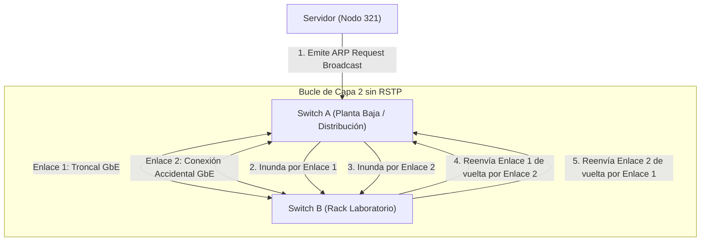
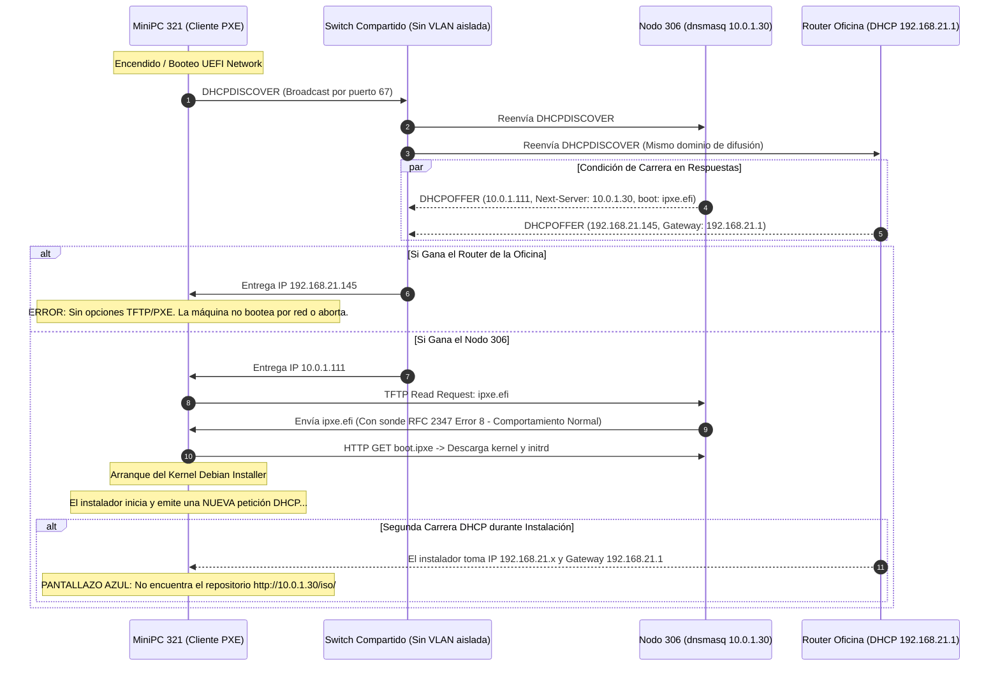

# Guía Maestra y Manual de Ingeniería de Redes e Infraestructura
## Diagnóstico Forense, Mitigación de Bucles L2, Blindaje DHCP/PXE y Arquitectura para OpenStack / Kubernetes

---

## 1. Resumen Ejecutivo

En infraestructuras de telecomunicaciones y centros de datos modernos, la ausencia de un campo **TTL (Time to Live)** en las tramas Ethernet de Capa 2 provoca que cualquier bucle físico no gestionado derive en una **tormenta de broadcast** y en la desestabilización de las tablas de conmutación (*MAC flapping*), saturando el plano de control (CPU 100%) y descartando tráfico crítico. En redes conmutadas modernas que operan en *Full-Duplex*, no existen colisiones físicas de señal eléctrica; los fallos reportados como "choques de paquetes" corresponden a **bucles lógicos, colisiones de direcciones IP/MAC (conflictos ARP) o desajustes de VLANs**. Para garantizar la coexistencia pacífica entre el entorno de laboratorio (PXE/dnsmasq del nodo 306) y la red de oficina, es imprescindible aislar el clúster en una **VLAN dedicada de aprovisionamiento**, habilitar **DHCP Snooping** y **BPDU Guard** en los switches, y pasar parámetros estáticos al kernel en el arranque por red, asegurando una base sólida para OpenStack Ironic, Bifrost y Kubernetes.

---

## 2. Anatomía Detallada de Fallas en Capa 2 y Redes Conmutadas

### A.1 ¿Qué ocurre exactamente cuando dos switches se conectan en bucle o por múltiples enlaces?

Para comprender el colapso de una red de Capa 2, es necesario analizar cómo interactúan el hardware de conmutación y los protocolos fundamentales de red.

#### 1. La Carencia de TTL en la Trama Ethernet (802.3)
A nivel de **Capa 3 (IP)**, todo paquete IP incluye en su cabecera un campo llamado **TTL (Time to Live)** con un valor inicial típico de 64, 128 o 255. Cada router que reenvía el paquete decrementa este valor en 1. Si el TTL llega a 0, el router descarta el paquete y emite un mensaje ICMP *Time Exceeded*.
En contraste, **en la Capa 2 (Ethernet), la trama NO tiene TTL ni contador de saltos**. Si una trama entra en un camino circular cerrado (un bucle físico entre dos switches o puertos interconectados), **la trama vivirá y circulará infinitamente** a menos que se interrumpa físicamente el enlace o se reinicie el switch.



#### 2. Tormenta de Broadcast (*Broadcast Storm*)
Cuando un dispositivo de red necesita averiguar qué dirección MAC corresponde a una dirección IP (por ejemplo, `10.0.1.111`), emite una trama **ARP Request** con dirección MAC de destino `ff:ff:ff:ff:ff:ff` (difusión masiva).
* El Switch A recibe la trama en el puerto del servidor y, por regla de Ethernet, **la reenvía por todos los puertos activos de esa VLAN**, excepto por el que la recibió.
* La trama viaja por el Enlace 1 y por el Enlace 2 hacia el Switch B.
* El Switch B recibe la trama del Enlace 1 y la reenvía por todos sus puertos, incluido el Enlace 2. A su vez, recibe la trama del Enlace 2 y la reenvía por el Enlace 1.
* Ambas tramas regresan al Switch A, que repite el ciclo duplicando la cantidad de copias.
* **Resultado**: En cuestión de **milisegundos**, una única petición ARP genera cientos de miles de tramas duplicadas. El ancho de banda del enlace (1 Gbps = 1,488,000 tramas/segundo) se satura al 100% de tráfico inútil.

#### 3. Inestabilidad de la Tabla CAM y *MAC Flapping*
Los switches aprenden en qué puerto se encuentra cada dispositivo observando la dirección MAC de origen (*Source MAC*) de cada trama entrante y guardándola en su memoria de alta velocidad denominada **CAM (Content Addressable Memory)**.
* Cuando ocurre un bucle, la trama del Nodo 321 (`64:00:6a:2a:62:a4`) entra al Switch A por el puerto `Gi0/5` (donde está físicamente conectado). El switch asocia: `64:00:6a:2a:62:a4 -> Gi0/5`.
* Una fracción de milisegundo después, la copia reflejada por el bucle llega desde el Switch B a través del puerto `Gi0/1`. El Switch A actualiza su tabla: `64:00:6a:2a:62:a4 -> Gi0/1`.
* Inmediatamente, la segunda copia llega por el puerto `Gi0/2`. El Switch A vuelve a actualizar: `64:00:6a:2a:62:a4 -> Gi0/2`.
* Este fenómeno se llama **MAC Flapping** o *CAM Thrashing*. La tabla cambia de puerto miles de veces por segundo. Como el switch nunca tiene certeza de dónde está realmente el nodo, entra en **Unknown Unicast Flooding**, reenviando incluso las tramas dirigidas a una sola máquina por todos los puertos del switch.

#### 4. Saturación del Plano de Control (*Control Plane CPU 100%*)
En un switch moderno existen dos planos de operación:
1. **Plano de Datos (*Data Plane*)**: Realizado en hardware por chips especializados (**ASIC**). Reenvía tramas ya conocidas a velocidad de cable (*wire-speed*).
2. **Plano de Control (*Control Plane*)**: Gestionado por el procesador (CPU) del switch. Atiende protocolos de gestión (SSH, Telnet, SNMP), protocolos de enrutamiento y tramas que requieren análisis (STP BPDUs, ARP, IGMP).

Durante una tormenta de broadcast, millones de tramas de difusión deben ser enviadas a la CPU para que determine si corresponden a peticiones para el switch. La CPU se satura al **99% - 100%**, provocando:
* Pérdida total de acceso por consola o SSH (el switch parece "muerto" o no responde a comandos).
* Descarte de paquetes *Keepalive* y BPDUs, haciendo que otros protocolos de red consideren los enlaces caídos.
* Descarte por desbordamiento de colas (*tail drop* / *buffer exhaustion*) de todo el tráfico legítimo de servidores y usuarios.

---

### A.2 Desmitificación: ¿Existen "Colisiones" en una Red Moderna?

Es habitual en la jerga cotidiana escuchar que "hay colisión de paquetes" cuando la red se ralentiza o pierde conectividad. Técnicamente, es imprescindible distinguir los conceptos:

| Fenómeno | Capa OSI | Causa Raíz | Mecanismo Físico / Lógico | ¿Ocurre en Redes Modernas? |
| :--- | :--- | :--- | :--- | :--- |
| **Colisión Ethernet Clásica** | Capa 1 (Física) | Medio compartido (*Half-Duplex*, Hubs, coaxial 10BASE2/T). | Dos tarjetas transmiten a la vez; las señales de voltaje se suman físicamente en el cable. Detectado por CSMA/CD. | **NO**. En switches con enlaces *Full-Duplex* los canales de transmisión (Tx) y recepción (Rx) son físicamente independientes. |
| **Duplex Mismatch** | Capa 1 / 2 | Un extremo en *Half-Duplex* y el otro en *Full-Duplex*. | El extremo Half cree que hay colisión cada vez que recibe datos mientras transmite; genera tramas inválidas (*runts* y CRC). | **SÍ**, cuando la auto-negociación falla o un puerto se fuerza manualmente sin sincronizar el otro extremo. |
| **Bucle de Capa 2 (L2 Loop)** | Capa 2 (Enlace) | Topología circular física sin STP ni LACP activo. | Inundación masiva y perpetua de tramas broadcast/multicast por carencia de TTL. | **SÍ**, es el fallo más destructivo en redes de campus y laboratorios. |
| **Fuga de VLAN (*VLAN Leaking / Mismatch*)** | Capa 2 (802.1Q) | Configuración asimétrica de la *Native VLAN* en un enlace troncal. | Tramas sin etiquetar de la VLAN 10 cruzan el enlace y son asignadas silenciosamente a la VLAN 20 en el otro switch. | **SÍ**, muy común cuando switches de distintas marcas o con configuraciones antiguas se conectan entre sí. |
| **Conflicto de IP (IP Duplicada)** | Capa 3 (Red) | Dos interfaces configuradas con la misma dirección IP. | Ambas tarjetas responden a las peticiones ARP (*ARP Reply*). Los routers y clientes cambian su tabla ARP según el último paquete recibido. | **SÍ**, provoca desconexiones aleatorias en SSH, sesiones web rotas y pérdida de paquetes en ráfagas. |
| **Conflicto de MAC (MAC Duplicada)** | Capa 2 (Enlace) | Dos dispositivos comparten la misma dirección MAC (clonación accidental de VMs o contenedores). | La tabla CAM del switch conmuta constantemente de puerto, generando *MAC Flapping* idéntico al de un bucle. | **SÍ**, ocurre en clonación de plantillas de virtualización sin regenerar la dirección de hardware. |

---

### A.3 Anatomía del Fallo Real en el Laboratorio: La "Condición de Carrera" en PXE y el Pantallazo Azul

En el escenario específico con el **Nodo 306** (controlador) y el **Nodo 321** (miniPC cliente Dell OptiPlex 3020M):



#### ¿Por qué ocurría el mensaje `dnsmasq-tftp: error 8 User aborted the transfer`?
1. **El protocolo TFTP clásico (RFC 1350)** transfiere archivos en bloques fijos de 512 bytes sin opciones.
2. **Las extensiones TFTP modernas (RFC 2347 y RFC 2348)** permiten al cliente UEFI solicitar el tamaño total del archivo mediante la opción `tsize` antes de reservarlo en RAM.
3. El firmware UEFI de Dell envía un primer paquete solicitando información de `tsize`. Una vez que el servidor responde con el tamaño exacto del binario, el cliente UEFI **cierra deliberadamente esa primera conexión preliminar enviando un código de error 8 ("User aborted the transfer")**.
4. Acto seguido, abre inmediatamente la sesión definitiva y descarga el archivo completo (`ipxe.efi`).
5. **Conclusión**: El Error 8 **no es un fallo de red**, sino un paso estándar de negociación del firmware UEFI de Dell OptiPlex.

#### ¿Por qué aparecía el "Pantallazo Azul" con un cuadro de entrada abajo?
1. **Falta de automatización en el kernel**: El instalador de Debian (*Debian Installer*) detectó que faltaban parámetros mandatorios de localización (idioma, teclado, país) o no pudo cargar el archivo `preseed.cfg`. Cuando esto ocurre, despliega su pantalla interactiva en modo texto azul (`newt/curses`) preguntando *"Select a language"*.
2. **Desincronización de Versiones Kernel-ISO**: El instalador arrancaba con un kernel Debian 13 (6.12), pero el repositorio montado en Nginx contenía paquetes de otra distribución (Debian 14 Forky o repositorio incompleto). Al buscar los paquetes del kernel para instalarlos en el disco duro (`linux-image-*`), la suma de verificación fallaba y el instalador se detenía en un shell de recuperación.
3. **Pérdida de la ruta al servidor HTTP**: Durante la fase de red del instalador, si el DHCP del router de oficina respondía antes que el nodo 306, la máquina cliente recibía una IP del rango `192.168.21.0/24` con gateway `192.168.21.1`. Al intentar conectar con `http://10.0.1.30/iso/dists/trixie/`, la petición salía hacia el router de oficina, el cual no conocía la ruta hacia `10.0.1.30` y descartaba los paquetes, congelando la instalación.

---

## 3. Guía de Diagnóstico Forense y Retroactivo

Cuando una red experimentó caídas o degradación en el pasado, los contadores de hardware y los registros del sistema operativo conservan la evidencia forense.

### B.1 Diagnóstico en Servidores Linux (Nodo 306 y Nodos del Clúster)

#### 1. Inspección de contadores de enlace con `ip -s link`
Ejecutar:
```bash
ip -s link show enp2s0
```
**Salida de ejemplo:**
```text
2: enp2s0: <BROADCAST,MULTICAST,UP,LOWER_UP> mtu 1500 qdisc fq_codel state UP mode DEFAULT group default qlen 1000
    link/ether 64:00:6a:2a:62:42 brd ff:ff:ff:ff:ff:ff
    RX:  bytes packets errors dropped missed mcast   
    1849204918 2490192      0    1482      0 12049   
    TX:  bytes packets errors dropped carrier collsns 
     849201940 1820491      0       0       0       0 
```
* **Desglose de campos críticos**:
  * `RX dropped`: Tramas descartadas por el sistema operativo antes de ser procesadas por el stack de red. Suele deberse a falta de memoria en el búfer de recepción (*ring buffer*) provocada por una tormenta de broadcast que sobrepasa la capacidad de atención del kernel.
  * `RX missed`: Tramas que la propia tarjeta de red descartó en hardware porque el chip físico no tuvo tiempo de transferirlas a la memoria RAM del sistema.
  * `TX collsns`: Colisiones registradas al transmitir. **Debe ser estrictamente 0**. Si es superior a 0, la interfaz está negociando en *Half-Duplex* o el cable de red tiene un hilo dañado.
  * `carrier`: Errores de señalización física (cable desconectado, falsos contactos o problemas eléctricos en el puerto).

#### 2. Estadísticas avanzadas del chip de red con `ethtool -S`
`ethtool` consulta directamente los registros del controlador del chip de red (ej. Realtek RTL8111/8168 o Intel I219):
```bash
ethtool -S enp2s0 | grep -E "(drop|error|crc|broadcast|multicast|collision|missed)"
```
**Salida esperada:**
```text
     rx_broadcast_packets: 1948201
     rx_multicast_packets: 48201
     rx_unicast_packets: 493012
     rx_crc_errors: 0
     rx_frame_errors: 0
     rx_missed_errors: 320
     collisions: 0
```
* **Interpretación forense**:
  * Si `rx_broadcast_packets` es varias veces mayor que `rx_unicast_packets`, la interfaz estuvo inmersa en un dominio saturado de difusión o en un bucle de Capa 2.
  * Si `rx_crc_errors` > 0, existen interferencias electromagnéticas, cable UTP mal crimpado (categoría deficiente o distancia superior a 100 metros) o un *duplex mismatch*.

#### 3. Auditoría de eventos del Kernel con `dmesg` y `journalctl`
```bash
dmesg -T | grep -E -i "(link is down|link is up|promiscuous|carrier|duplex|watchdog)"
```
* Si observas líneas como:
  ```text
  [Wed Oct  7 10:15:02 2026] r8169 0000:02:00.0 enp2s0: Link is Down
  [Wed Oct  7 10:15:05 2026] r8169 0000:02:00.0 enp2s0: Link is Up - 100Mbps/Half
  ```
  Esto delata que la tarjeta cayó a **100Mbps Half-Duplex** (probablemente por falla en los pares 4-5 o 7-8 del cable de red), lo cual genera colisiones y bloqueos inmediatos.

#### 4. Captura Forense en Tiempo Real con `tcpdump`
```bash
# 1. Medir tasa de tramas broadcast (si supera 200 paquetes/segundo, hay tormenta):
sudo tcpdump -i enp2s0 -nn -c 200 "ether broadcast"

# 2. Auditar solicitudes y respuestas DHCP para verificar si hay otro DHCP activo:
sudo tcpdump -i enp2s0 -nn -e "port 67 or port 68" -v

# 3. Detectar paquetes Spanning Tree (BPDUs) en la interfaz:
sudo tcpdump -i enp2s0 -nn -e "ether dst 01:80:c2:00:00:00"
```

---

### B.2 Diagnóstico en los Switches de Red

A continuación se detalla la tabla de comandos equivalentes para auditoría forense según el fabricante de tus switches:

| Función de Diagnóstico | Cisco IOS / Catalyst / Nexus | HP ProCurve / Aruba AOS-S | Dell EMC (OS6 / OS9) | Huawei VRP | Mikrotik RouterOS |
| :--- | :--- | :--- | :--- | :--- | :--- |
| **Estado de Spanning Tree** | `show spanning-tree detail` | `show spanning-tree detail` | `show spanning-tree detail` | `display stp` | `/interface bridge print` |
| **Cambios de Topología STP** | `show spanning-tree detail \| inc change` | `show spanning-tree root-history` | `show spanning-tree summary` | `display stp history` | `/log print where topics~"stp"` |
| **Detección de MAC Flapping** | `show mac address-table notification mac-move` | `show mac-address-table` | `show mac-address-table notification` | `display mac-address flapping` | `/log print where message~"moved"` |
| **Errores de Interfaz / CRC** | `show interfaces counters errors` | `show interfaces status` | `show interfaces counters errors` | `display interface counters error` | `/interface ethernet print stats` |
| **Troncales y Native VLAN** | `show interfaces trunk` | `show vlans` | `show interfaces switchport` | `display port vlan` | `/interface bridge vlan print` |
| **Registro de Eventos (Logs)** | `show logging \| inc FLAP\|LOOP\|STP` | `show log -r` | `show logging \| grep FLAP` | `display logbuffer` | `/log print` |

#### Análisis de Salidas Críticas en Switches:

##### 1. Detección de Inestabilidad STP (`show spanning-tree detail`)
```text
Switch# show spanning-tree detail | include is exec|from|occurrence
 VLAN0010 is executing the rstp protocol
  Number of topology changes 2841 last change occurred 00:01:14 ago
  from GigabitEthernet0/1
```
* **Diagnóstico**: Si el contador `Number of topology changes` es de varios cientos o miles y el último cambio ocurrió hace pocos segundos o minutos, **la red está reconvergiendo constantemente**. Un cable en mal estado, una máquina encendiéndose sin *PortFast* o un bucle físico están forzando a todos los switches a vaciar sus tablas CAM de manera recurrente.

##### 2. Confirmación Irrefutable de Bucle / MAC Flap (`show logging`)
```text
Switch# show logging | include MACFLAP
%SW_MATM-4-MACFLAP_NOTIF: Host 6400.6a2a.62a4 in vlan 10 is flapping between port Gi0/1 and port Gi0/2
```
* **Diagnóstico**: La dirección física `64:00:6a:2a:62:a4` está siendo vista alternadamente entre dos interfaces a gran velocidad. Esto confirma un bucle físico entre `Gi0/1` y `Gi0/2`, o que ambos enlaces interconectan dos switches sin agregación LACP.

##### 3. Desbordamiento de Búfer en Interfaces (`show interfaces counters errors`)
```text
Port        Align-Err    FCS-Err   Xmit-Err    Rcv-Err UnderSize OutDiscards
Gi0/1               0          0          0          0         0       12948
Gi0/2               0          0          0          0         0       14201
```
* **Diagnóstico**: `OutDiscards` elevado indica que la interfaz no pudo transmitir todas las tramas que llegaron a su cola porque el enlace estaba saturado al 100%, descartando paquetes legítimos (*tail drop*).

---

## 4. Ingeniería de Prevención, Corrección y Blindaje

Para transformar una infraestructura vulnerable en un entorno de alta disponibilidad, se deben aplicar las siguientes medidas en capas:

### C.1 Spanning Tree Robusto: RSTP (802.1w) o MSTP (802.1s)

* **Nunca usar 802.1D clásico**: Su tiempo de convergencia oscila entre 30 y 50 segundos. Si un enlace falla, los servidores perderán conectividad casi un minuto. **RSTP** converge en **menos de 1 segundo**.
* **Fijar la Raíz Manualmente (*Root Bridge Election*)**:
  Por defecto, los switches tienen una prioridad de 32768. Si se conecta un switch nuevo o más antiguo con una dirección MAC menor, este se autoproclamará Switch Raíz, alterando toda la topología de la empresa.
  * En el Switch Principal (Core/Distribución):
    ```text
    Switch-Core(config)# spanning-tree mode rapid-pvst
    Switch-Core(config)# spanning-tree vlan 1-4094 priority 4096
    ```
  * En el Switch Secundario (Acceso/Respaldo):
    ```text
    Switch-Acceso(config)# spanning-tree mode rapid-pvst
    Switch-Acceso(config)# spanning-tree vlan 1-4094 priority 8192
    ```

#### Protecciones Avanzadas de STP:
1. **BPDU Guard (Obligatorio en Puertos de Servidores y Clientes)**:
   * Evita que un usuario o pasante conecte un switch secundario o cree un bucle con un cable de red en su escritorio.
   * Si el puerto recibe una sola BPDU, el switch **apaga inmediatamente el puerto** y lo coloca en estado `err-disabled`:
     ```text
     Switch(config)# interface range GigabitEthernet0/5 - 20
     Switch(config-if-range)# spanning-tree portfast
     Switch(config-if-range)# spanning-tree bpduguard enable
     ```
2. **Root Guard (En Puertos hacia Switches No Controlados)**:
   * Evita que un switch subordinado intente convertirse en el Root Bridge de la red. Si recibe una BPDU superior, bloquea el puerto temporalmente en estado `root-inconsistent` hasta que deje de recibirla.

---

### C.2 Agregación de Enlaces con LACP (IEEE 802.3ad / Port-Channels)

Si se colocan dos cables entre el Switch A y el Switch B para redundancia o para obtener 2 Gbps de ancho de banda, **NUNCA deben dejarse como enlaces individuales independientes**:
* Si STP está activo, bloqueará uno de los cables y solo funcionará 1 Gbps.
* Si STP no está activo o falla, se provocará una tormenta de broadcast inmediata.

**Solución correcta: Configurar LACP en ambos switches:**
```text
! En el Switch A:
SwitchA(config)# interface range GigabitEthernet0/23 - 24
SwitchA(config-if-range)# channel-group 1 mode active
SwitchA(config-if-range)# exit
SwitchA(config)# interface Port-channel 1
SwitchA(config-if)# switchport mode trunk
SwitchA(config-if)# switchport trunk allowed vlan 10,100

! En el Switch B:
SwitchB(config)# interface range GigabitEthernet0/23 - 24
SwitchB(config-if-range)# channel-group 1 mode active
SwitchB(config-if-range)# exit
SwitchB(config)# interface Port-channel 1
SwitchB(config-if)# switchport mode trunk
SwitchB(config-if)# switchport trunk allowed vlan 10,100
```
* **Mecanismo**: Mediante el protocolo **LACP (Link Aggregation Control Protocol)**, ambos switches negocian el intercambio de tramas LACPDU. Si ambos cables están sanos, los unen en una **única interfaz lógica (`Port-channel 1`)**. STP ve un solo enlace lógico; no hay bucle y el ancho de banda se suma a 2 Gbps.

---

### C.3 Control de Tormentas en Hardware (*Storm Control*)

Storm Control opera a nivel de silicio (ASIC) monitoreando el tráfico entrante en cada interfaz. Si el volumen de difusión sobrepasa el umbral definido, **el switch descarta el exceso automáticamente**, impidiendo que la tormenta se propague a los demás equipos.

```text
Switch(config)# interface range GigabitEthernet0/1 - 24
Switch(config-if-range)# storm-control broadcast level 10.00
Switch(config-if-range)# storm-control multicast level 15.00
Switch(config-if-range)# storm-control action trap
```
* Si el tráfico broadcast supera el 10% del ancho de banda de la interfaz, el switch descarta los paquetes adicionales y envía una alerta SNMP al centro de monitoreo.

---

### C.4 Diseño Riguroso de VLANs y Trunks

1. **Podado de VLANs (*VLAN Pruning / Allowed List*)**:
   * Nunca permitir que el trunk transporte todas las VLANs (`vlan all`).
   * Configurar de forma explícita únicamente las VLANs necesarias:
     ```text
     Switch(config-if)# switchport trunk allowed vlan 10,100
     ```
2. **Mitigación de Vulnerabilidades de VLAN Nativa**:
   * Por defecto, la VLAN nativa es la VLAN 1 (utilizada para tráfico de gestión y control).
   * Para evitar ataques de *VLAN Hopping* y fugas accidentales de tráfico sin etiquetar, se debe cambiar la VLAN nativa a una VLAN nula (*dummy*) que no tenga puertos asignados:
     ```text
     Switch(config)# vlan 999
     Switch(config-vlan)# name VLAN_NATIVA_DUMMY
     Switch(config)# interface Port-channel 1
     Switch(config-if)# switchport trunk native vlan 999
     ```

---

### C.5 Blindaje DHCP y Aislamiento del Laboratorio (*DHCP Snooping*)

Para eliminar de raíz el problema donde el servidor `dnsmasq` del laboratorio interactúa con la red de oficina:

```mermaid
flowchart LR
    subgraph Dominio_Seguro [Switch de Acceso con DHCP Snooping]
        direction TB
        P_ROUTER["Puerto 1 (Router Oficina)"] ---|TRUSTED| ROFI["Router Oficina (192.168.21.1)"]
        P_USER["Puertos 2-10 (Usuarios Oficina)"] ---|UNTRUSTED| USERS["PCs y Celulares de Oficina"]
        P_N306["Puerto 15 (Nodo 306)"] ---|TRUSTED (Solo VLAN 100)| NODO306["Servidor dnsmasq PXE"]
        P_MINI["Puertos 16-24 (MiniPCs Clúster)"] ---|UNTRUSTED (VLAN 100)| MINIPCS["Nodos Clúster (321, 314, etc.)"]
    end
```

#### 1. Segmentación en VLAN 100 (Clúster Bare-Metal)
* Asignar los puertos de los 8 servidores y la interfaz de red del nodo 306 a la **VLAN 100**:
  ```text
  Switch(config)# vlan 100
  Switch(config-vlan)# name CLUSTER_BAREMETAL
  Switch(config)# interface range GigabitEthernet0/15 - 24
  Switch(config-if-range)# switchport mode access
  Switch(config-if-range)# switchport access vlan 100
  ```
* Al estar aislados en la VLAN 100, **el broadcast de DHCP del nodo 306 nunca saldrá a los puertos de la oficina (VLAN 10 o VLAN 1)**.

#### 2. Activación de DHCP Snooping
DHCP Snooping crea un firewall de Capa 2 contra servidores DHCP no autorizados:
* **Puertos Confiables (*Trusted*)**: Solo se permite la emisión de paquetes `DHCPOFFER` y `DHCPACK`.
* **Puertos No Confiables (*Untrusted*)**: Si por estos puertos entra una oferta DHCP, el switch **la descarta en el acto y bloquea el puerto**.

```text
Switch(config)# ip dhcp snooping
Switch(config)# ip dhcp snooping vlan 10,100
Switch(config)# interface GigabitEthernet0/1  ! Puerto del Router de Oficina
Switch(config-if)# ip dhcp snooping trust
Switch(config)# interface GigabitEthernet0/15 ! Puerto del Nodo 306 (Solo en VLAN 100)
Switch(config-if)# ip dhcp snooping trust
```

#### 3. Blindaje Definitivo en la Configuración de `dnsmasq` (`/etc/dnsmasq.conf`)
En el Nodo 306, asegurar que el archivo de configuración contenga las siguientes directivas estrictas:
```ini
# Escuchar estrictamente en la interfaz física del clúster:
interface=enp2s0
bind-interfaces

# Desactivar cualquier asignación dinámica abierta:
dhcp-range=10.0.1.0,static

# Ignorar a cualquier cliente que no esté en la lista blanca de MACs:
dhcp-ignore=tag:!known

# Cargar la tabla de asignaciones estáticas del clúster:
dhcp-hostsfile=/home/rodrigo/Documents/gitlabinf/GuiaImplementacion/infra-scripts/config/dnsmasq_hosts.conf

# Opciones PXE restringidas a clientes del clúster:
enable-tftp=enp2s0
tftp-root=/tftpboot
dhcp-match=set:efi-x86_64,option:client-arch,7
dhcp-match=set:efi-x86_64,option:client-arch,9
dhcp-boot=tag:efi-x86_64,ipxe.efi
```

---

### C.6 Monitoreo Proactivo con Prometheus y Grafana

1. **SNMP Exporter** (Sondeo directo a los switches):
   * Métrica `dot1dStpTopChanges`: Detecta cambios de topología en Spanning Tree.
   * Métrica `ifInBroadcastPkts` / `ifInUcastPkts`: Calcula el ratio de tramas broadcast sobre unicast.
   * Métrica `ifOutDiscards`: Alerta si hay saturación de buffers.

2. **Regla de Alerta de Prometheus (`/etc/prometheus/alert_rules.yml`)**:
   ```yaml
   groups:
     - name: NetworkHealthAlerts
       rules:
         - alert: BroadcastStormDetected
           expr: rate(ifInBroadcastPkts[1m]) / (rate(ifInUcastPkts[1m]) + 1) > 0.25
           for: 30s
           labels:
             severity: critical
           annotations:
             summary: "Tormenta de broadcast detectada en la interfaz {{ $labels.instance }}"
             description: "El tráfico broadcast supera el 25% del tráfico total. Posible bucle de Capa 2."

         - alert: SpanningTreeTopologyFlap
           expr: increase(dot1dStpTopChanges[5m]) > 5
           for: 1m
           labels:
             severity: warning
           annotations:
             summary: "Inestabilidad en Spanning Tree en switch {{ $labels.instance }}"
             description: "Se registraron más de 5 cambios de topología en los últimos 5 minutos."
   ```

---

## 5. Arquitectura de Red para OpenStack / Ironic / Bifrost en Producción

### D.1 Segmentación Multi-VLAN Recomendada

Para un despliegue profesional de **OpenStack Ironic** o **Bifrost** donde se aprovisionan servidores físicos (*bare-metal*), la arquitectura debe estructurarse en **tres VLANs independientes**:

```
+-----------------------------------------------------------------------------------+
|                        ROUTER DE BORDE / FIREWALL                                 |
+-----------------------------------------------------------------------------------+
                                   | (Trunk 802.1Q)
+-----------------------------------------------------------------------------------+
|                       SWITCH DE DISTRIBUCIÓN / TOR                                |
+-----------------------------------------------------------------------------------+
         |                                |                               |
    [VLAN 100]                       [VLAN 200]                      [VLAN 300]
  Aprovisionamiento              Gestión Out-of-Band               Red de Cargas
   (PXE / Ironic)                   (IPMI / BMC)                (Kubernetes / VMs)
   - Nodo 306                       - iDRAC/BMC N321                 - k8s-master
   - Nodos Clúster (PXE)            - iDRAC/BMC N314                 - k8s-worker-01
   - DHCP Ironic/dnsmasq            - Acceso Restringido             - Acceso Oficina
```

1. **VLAN 100 - Red de Aprovisionamiento (*Provisioning Network*)**:
   * Ámbito estrictamente aislado. Aquí operan los servicios DHCP, TFTP y HTTP de Ironic/Bifrost.
   * Las interfaces de red primarias de los servidores arrancan por PXE en esta red.
   * Una vez completada la instalación del sistema operativo, el agente de Ironic o Ansible reconfigura el puerto del switch del nodo hacia la VLAN 300.
2. **VLAN 200 - Red Out-of-Band (IPMI / BMC)**:
   * Dedicada a los módulos de gestión remota de hardware de los servidores (Dell iDRAC, HP iLO o interfaces IPMI).
   * Permite a OpenStack Ironic encender, apagar o reiniciar los servidores físicamente mediante comandos IPMI/Redfish sin depender de *Wake-on-LAN*.
3. **VLAN 300 - Red de Cargas de Trabajo (*Data / Tenant Network*)**:
   * Red productiva donde operan las aplicaciones, los clústeres de Kubernetes (RKE2) y el tráfico de los usuarios.

---

### D.2 Parámetros del Kernel para Instalación Desatendida Inmune a Conflictos

Para evitar que el instalador de Debian vuelva a detenerse en una pantalla interactiva o sufra condiciones de carrera con el DHCP de oficina, los scripts de arranque iPXE (`/tftpboot/autoexec.ipxe` y `/httpboot/boot.ipxe`) deben configured con **parámetros estáticos explícitos de kernel**:

```text
#!ipxe
kernel http://10.0.1.30/debian/linux initrd=initrd.gz \
    auto=true \
    priority=critical \
    locale=en_US.UTF-8 \
    keymap=es \
    file=/preseed.cfg \
    ip=10.0.1.111::10.0.1.30:255.255.255.0:k8s-worker-01:enp2s0:none:8.8.8.8 \
    netcfg/choose_interface=auto \
    netcfg/link_wait_timeout=15 \
    hw-detect/load_media=false \
    nomodeset \
    --- quiet
initrd http://10.0.1.30/debian/initrd.gz
boot
```

#### Desglose Detallado de Parámetros:
* `auto=true`: Activa el modo totalmente automatizado del instalador de Debian.
* `priority=critical`: Suprime todas las preguntas ordinarias; el instalador solo se detendrá si ocurre un error fatal insalvable.
* `locale=en_US.UTF-8 keymap=es`: Satisface de antemano las preguntas de idioma y teclado, **eliminando el pantallazo azul inicial**.
* `file=/preseed.cfg`: Indica al instalador que lea el archivo de preconfiguración inyectado dentro de la memoria RAM del `initrd.gz`.
* `ip=10.0.1.111::10.0.1.30:255.255.255.0:k8s-worker-01:enp2s0:none:8.8.8.8`: **Fija la red a nivel de kernel**.
  * `10.0.1.111`: IP del cliente.
  * `::`: Servidor NFS (vacío).
  * `10.0.1.30`: Puerta de enlace (Nodo 306).
  * `255.255.255.0`: Máscara de subred.
  * `k8s-worker-01`: Hostname.
  * `enp2s0`: Interfaz física.
  * `none`: Sin auto-configuración DHCP posterior.
  * `8.8.8.8`: Servidor DNS.
  * **Efecto clave**: El instalador **no emite ninguna petición DHCP secundaria**, neutralizando cualquier interferencia del router de la oficina.
* `hw-detect/load_media=false`: Evita que el instalador intente buscar medios de instalación físicos (discos CD-ROM o unidades USB).
* `nomodeset`: Evita bloqueos gráficos en pantallas de servidores o miniPCs con tarjetas Intel HD Graphics antiguas durante la carga del kernel.

---

## 6. Matriz Integral de Resolución Rápida de Problemas

| Problema | Síntoma Visible | Causa Raíz Técnica | Comando de Detección | Procedimiento de Corrección |
| :--- | :--- | :--- | :--- | :--- |
| **Bucle L2 (Loop)** | LEDs de todos los puertos parpadean sincrónicamente; SSH y ping congelados. | Dos cables conectando switches sin LACP ni STP. | Switch: `show spanning-tree detail` muestra *topology changes* incesantes. CPU 100%. | 1. Desconectar físicamente el segundo cable.<br>2. Habilitar RSTP.<br>3. Configurar Port-Channel LACP. |
| **MAC Flapping** | Conexiones SSH se cortan cada 5-10 segundos; pérdida de paquetes en ráfagas. | Dos caminos hacia una misma MAC o dos máquinas con MAC clonada. | Switch: `%SW_MATM-4-MACFLAP_NOTIF`.<br>Linux: `bridge fdb show \| grep -i flap`. | 1. Ubicar los dos puertos indicados en el log.<br>2. Eliminar el puente circular o regenerar la MAC duplicada. |
| **Rogue DHCP Server** | Clientes reciben IP inesperada; pierden internet o apuntan a un gateway falso. | Servidor DHCP no autorizado o sin aislar respondiendo en la VLAN. | Linux: `tcpdump -i any -nn -e "port 67 or port 68"`.<br>Ver `DHCPOFFER` de IP extraña. | 1. Habilitar **DHCP Snooping** en el switch.<br>2. Declarar solo el puerto oficial como `trusted`.<br>3. En `dnsmasq`: `dhcp-ignore=tag:!known`. |
| **Pantallazo Azul en Instalación PXE** | La máquina muestra pantalla azul de Debian Installer y no avanza. | Parámetros interactivos sin responder, fallo en repositorio o gateway equivocado. | Revisar `access.log` de Nginx en el nodo 306. Si no hay peticiones HTTP tras cargar el initrd, no hay ruta. | 1. Pasar `locale`, `keymap` y `priority=critical` en `boot.ipxe`.<br>2. Fijar parámetro `ip=...` estático en el kernel. |
| **Native VLAN Mismatch** | Tráfico de una subred aparece en otra; advertencias continuas en consola. | Extremos del trunk con diferente VLAN nativa (ej. SW1 Nativa 1 vs SW2 Nativa 99). | Switch: `%CDP-4-NATIVE_VLAN_MISMATCH` o `show interfaces trunk`. | Igualar la Native VLAN en ambos extremos: `switchport trunk native vlan 999`. |
| **Duplex Mismatch** | Conexión operativa pero extremadamente lenta (< 2 Mbps); alta tasa de errores. | Un extremo configurado en `100/Half` y el otro en `Auto` o `100/Full`. | Switch: `show interfaces counters errors` muestra `Align-Err` y `FCS-Err`. Linux: `ethtool enp2s0`. | Fijar ambos lados en `Auto` o forzar ambos en `1000/Full`. |

---

## 7. Checklist Operativo Paso a Paso

Ordenado por velocidad y profundidad de diagnóstico:

### Nivel 1: Verificación Inmediata en el Nodo Controlador (0 - 2 minutos)
- [ ] **1.1 Estado del Enlace Físico**:
  ```bash
  cat /sys/class/net/enp2s0/carrier && cat /sys/class/net/enp2s0/speed
  ```
  *(Debe devolver `1` y `1000`; si devuelve 100, hay problemas con el cable físico).*
- [ ] **1.2 Detección de Descartes por Saturación de Búfer**:
  ```bash
  ip -s link show enp2s0
  ```
  *(Verificar que los contadores `dropped` y `missed` no aumenten de forma continua).*
- [ ] **1.3 Tasa de Tramas de Difusión (Tormentas)**:
  ```bash
  sudo tcpdump -i enp2s0 -nn -c 50 "ether broadcast"
  ```
  *(Si los 50 paquetes se capturan en menos de 0.1 segundos con ARPs repetidos, hay un bucle activo).*

### Nivel 2: Verificación de Servicios y DHCP (2 - 5 minutos)
- [ ] **2.1 Puertos de Servicios Locales**:
  ```bash
  sudo ss -tulpn | grep -E ':(67|68|69|80|8089)\b'
  ```
  *(Confirmar que dnsmasq escucha en UDP 67 y 69, y Nginx en TCP 80 y 8089).*
- [ ] **2.2 Detección de Fugas DHCP hacia Equipos Ajenos**:
  ```bash
  sudo journalctl -u dnsmasq --since "15 minutes ago" | grep -i "DHCPOFFER"
  ```
  *(Verificar que no aparezcan nombres de máquinas o MACs de celulares de oficina).*
- [ ] **2.3 Disponibilidad del Repositorio de Instalación HTTP**:
  ```bash
  curl -I http://10.0.1.30/iso/dists/trixie/Release
  ```
  *(Debe retornar `HTTP/1.1 200 OK`).*

### Nivel 3: Diagnóstico en los Switches Físicos (5 - 15 minutos)
- [ ] **3.1 Estado de Spanning Tree y Cambios de Topología**:
  ```text
  show spanning-tree summary
  show spanning-tree detail | include changes
  ```
  *(Verificar que el modo sea RSTP y que `Topology Changes` no esté incrementándose).*
- [ ] **3.2 Búsqueda de MAC Flapping en Logs de Conmutación**:
  ```text
  show logging | include MACFLAP|FLAP|LOOP
  ```
- [ ] **3.3 Validación de Troncales y Agregación**:
  ```text
  show interfaces trunk
  show etherchannel summary
  ```
  *(Confirmar que los enlaces redundantes estén agregados en un Port-Channel LACP con protocolo `LACP` activo).*

---

## 8. Plan de Acción Recomendado

```mermaid
flowchart LR
    subgraph Fase1 ["Fase 1: Hoy (Inmediato)"]
        direction TB
        A1["Blindaje dnsmasq: dhcp-ignore=tag:!known"]
        A2["IP estática en parámetros de kernel (autoexec.ipxe)"]
        A3["Inspección física: Eliminar cables redundantes sueltos"]
    end
    subgraph Fase2 ["Fase 2: Esta Semana"]
        direction TB
        B1["Crear VLAN 100 exclusiva para el clúster"]
        B2["Habilitar RSTP y LACP entre switches"]
        B3["Activar DHCP Snooping y BPDU Guard"]
    end
    subgraph Fase3 ["Fase 3: A Futuro"]
        direction TB
        C1["Despliegue OpenStack Ironic / Bifrost"]
        C2["Monitoreo SNMP + Prometheus + Grafana"]
        C3["Automatización de switches con Ansible"]
    end
    Fase1 --> Fase2 --> Fase3
```



### Acciones para HOY (Inmediato - Desbloqueo Operativo)
1. **Garantizar Aislamiento de dnsmasq**:
   * Mantener en `/etc/dnsmasq.conf`: `dhcp-ignore=tag:!known` y `bind-interfaces`.
2. **Eliminar la Condición de Carrera en PXE**:
   * En `/tftpboot/autoexec.ipxe`, pasar el argumento estático `ip=10.0.1.111::10.0.1.30:255.255.255.0:...` para que el instalador de la miniPC 321 no realice peticiones DHCP a la oficina.
3. **Verificación Física de Switches**:
   * Asegurar que solo exista **un único cable UTP** conectando ambos switches hasta que se configure formalmente LACP.

### Acciones para ESTA SEMANA (Estabilización de Infraestructura)
1. **Creación de la VLAN 100 de Aprovisionamiento**:
   * Mover los puertos de los 8 servidores y del nodo 306 a la VLAN 100 en modo acceso.
2. **Configuración de RSTP y BPDU Guard**:
   * Habilitar `spanning-tree mode rapid-pvst` en ambos switches y fijar la prioridad raíz del switch principal en `4096`.
   * Habilitar `spanning-tree bpduguard enable` en los puertos de servidores.
3. **Configuración de LACP (Port-Channel)**:
   * Si se requieren dos enlaces entre switches, agruparlos en un Port-Channel con protocolo LACP activo.
4. **Implementación de DHCP Snooping**:
   * Bloquear cualquier oferta DHCP que no provenga del puerto oficial del nodo 306 (en VLAN 100) o del router de oficina (en VLAN de oficina).

### Acciones para A FUTURO (Producción Bare-Metal)
1. **Segmentación Multi-VLAN para OpenStack**:
   * Configurar VLAN 100 (Aprovisionamiento), VLAN 200 (IPMI/BMC) y VLAN 300 (Cargas Kubernetes).
2. **Monitoreo Automatizado de Red**:
   * Implementar **Prometheus con SNMP Exporter** para graficar métricas de uso de CPU, descartes de paquetes y reconvergencias STP en tiempo real.
3. **Gestión de Configuración como Código**:
   * Guardar la configuración de los switches en repositorios Git y aplicar cambios mediante playbooks de Ansible.

---

## 9. Conclusión Simple

> **En redes conmutadas modernas no existen choques eléctricos de paquetes, pero un bucle de Capa 2 o un servidor DHCP compartido pueden paralizar toda la organización.**  
> 
> El problema experimentado en la miniPC 321 nunca fue un daño de hardware ni un fallo del archivo ISO, sino una **condición de carrera**: dos servidores DHCP compitiendo en el mismo medio físico, lo que provocaba que el instalador tomara la ruta equivocada y perdiera el acceso al repositorio.  
> 
> **Las 3 Reglas de Oro para un clúster bare-metal confiable:**
> 1. **VLAN Propia**: Aísla tus servidores físicos en una VLAN dedicada para que su broadcast no interactúe con las computadoras ni celulares de la oficina.
> 2. **Enlaces Agregados con LACP**: Si interconectas dos switches con más de un cable, agrúpalos siempre bajo un Port-Channel LACP; nunca los dejes como cables sueltos.
> 3. **Protección de Puertos con RSTP y BPDU Guard**: Asegura que cualquier bucle accidental sea neutralizado en menos de 1 segundo por el hardware antes de que pueda saturar la red.

---

## 10. Preguntas Clave para el Ajuste Fino de tus Equipos

Para proporcionarte las secuencias de comandos exactas con la sintaxis precisa de tus equipos:

1. **¿Qué marca y modelo exacto son los dos switches interconectados?** *(Por ejemplo: Cisco Catalyst 2960/3560, Dell PowerConnect/Networking, HP ProCurve/Aruba, Huawei, Mikrotik o switches no administrables)*.
2. **¿El enlace del router de la oficina llega al switch mediante un puerto en modo acceso o mediante un troncal (*trunk*)?**
3. **¿Cuentas con acceso administrativo por consola o SSH a ambos switches para aplicar las configuraciones de VLANs, STP y DHCP Snooping?**
